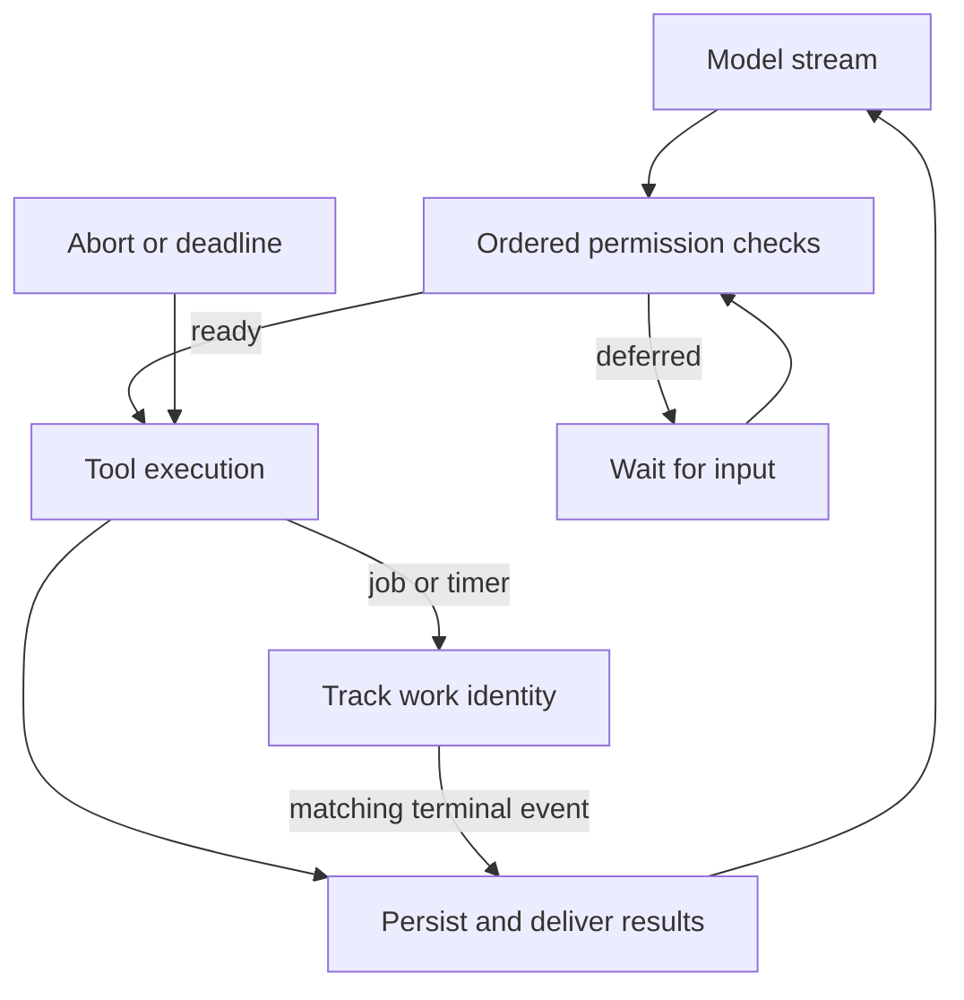

# Agent loop, process and database review

## Executive summary

Implemented focused fixes in the agent loop, database owner, subagent wait reducer and subprocess cleanup. Existing user changes were preserved. The findings below concern cancellation, permission ordering, recovery from contention and correct completion of asynchronous work; no concurrency limits, database durability settings or public RPC schemas were changed.

All ten original findings remain addressed. Closure review additionally fixed background-job deadlines, clock-sensitive retry timing, endpoint startup/partial cleanup, startup diagnostics and delayed host-API loading. Recorded complete agent and database suites pass, and the delivery build passed. Repository-wide verification is not green: although an earlier full check passed eleven gates, the latest delivery check fails typecheck, lint and architecture after further concurrent changes; the repeat webview suite has nine unresolved failures. This host still denies sockets and `ps`, and only Node 26.4.0 is available. Exact results and limitations are below.

## Key findings and ratings

Ratings express impact if triggered, not measured production frequency. Confidence is high for the findings below because each has a source-level causal path and regression coverage. No overall numerical quality score is assigned without representative production traces.

| Finding | Severity | Root cause and change | Evidence |
| --- | --- | --- | --- |
| Database remained unavailable after a peer released an unchanged file | High | Migration refusal was cached until the database/WAL stamp changed. A rollback can release a lock without changing that stamp. Retry now occurs after one monotonic second, or immediately on a stamp change. | Migration recovery regression failed before the fix; full DB suite passes. |
| Already-aborted tool calls could enter a permission hook that never settles | High | Cancellation was checked only after preparation/hook execution. Calls now return an aborted result before argument preparation or permission hooks. | New regression failed before the fix; agent suite passes. |
| Unrelated or duplicate completion notices consumed another wait | High | A shared counter decremented for any job or timer notice. Waits now retain kind, ID and available job-log identity; only matching completion settles work. | Six original wait regressions failed before the fix; real child-reducer tests pass. |
| Repeating timer wakes ended the wait prematurely | Medium | Every timer notice counted as completion. Active wakes now retain the wait; terminal statuses settle it. | Repeating wake and terminal status regression coverage. |
| Successful timer cancellation left phantom waits | Medium | Cancellation results did not update pending work. Single/all cancellation now removes only the intended timer waits. | Cancellation preserves other timers and reply waits in regression tests. |
| Automatic background handoffs were omitted from waits | Medium | Only explicit `background: true` starts were counted. A successful bash result with a job identity now establishes a wait, reusing any existing explicit-start placeholder. | Real reducer tests cover automatic/explicit jobs, foreground results and failed starts. |
| Force-kill escalation was cancelled when a root process exited | High | Root `exit` cleared the timer even if descendants ignored SIGTERM. POSIX group escalation and exit tracking now survive the root until force-kill. | Both event-order regressions failed before the fix; a real SIGTERM-ignoring descendant died after the grace period. |
| Shutdown could signal a recycled positive PID | High | Tracked-group cleanup fell back from negative process-group ID to the former root PID. POSIX tracked cleanup now targets only the registered group. Windows retains its existing tree cleanup. | New regression failed before the fix; graceful-child sparing remains covered. |
| Queued early tools overtook an asynchronous deferred check | Medium | Later preparations were queued before `closed` changed and ignored their predecessor's result. Deferral now propagates through the preparation chain. | Deterministic ordering regression failed before the fix. |
| Timed-out database drains retained observers | Low | `Promise.race` left the losing idle callback registered until the entire queue emptied. A Set and `finally` now remove every expired observer. | Before fix: 32 expired drains retained 32 callbacks. Cleanup regression and full writer suite pass. |

## Analysis and profiling

The investigated flow is model stream → ordered preparation/permissions → shared or exclusive tools → committed result delivery → continuation. Background work adds a separate completion obligation; cancellation must settle the caller while retaining ownership of remaining processes.

All measurements below use synthetic workloads on this host under concurrent audit load. They are observations, not production latency estimates or claimed speedups from these fixes. Temporary databases and child processes were used; no provider API calls or paid evaluations ran.

| Workload | Observed result | Interpretation |
| --- | --- | --- |
| Direct DB transaction with a competing 400 ms lock | A 10 ms timer fired at 402.89 ms | Synchronous lock waiting blocks the caller's event loop. |
| Existing DB worker under the same lock | Timer: 10.46 ms; command completion: 402.43 ms | Existing worker design isolates that wait from the main event loop. |
| 1,000 queued DB bookkeeping writes | 524.54 ms, approximately 1,906/s; pending queue ended at zero | No queue accumulation in this bounded run. |
| Cold DB worker | 207.46 ms | Startup is a separate cost from steady-state writes. |
| 1,000 synthetic loop runs, 16,000 tool calls | 245.14 ms total | No evidence here justifies rewriting the scheduler. |
| Sixteen short tools per run | Parallel median: 6.32 ms; sequential median: 49.22 ms, ten runs each | Existing bounded parallelism is useful for independent work; workload includes intentional waits. |
| Tool ignoring cancellation, twenty runs | Cancellation median: 54.76 ms; p95: 67.93 ms; maximum: 74.37 ms | Existing tool abort races remain bounded in this workload. |
| Thirty real short Node commands | Median: 97.69 ms; p95: 169.30 ms | Includes process startup and concurrent host load. |
| Real cancellation with a descendant ignoring SIGTERM | Caller returned in 5.61 ms, code 143; descendant absent after the 5 s force-kill grace | Caller settlement and descendant cleanup both observed. |

CPU profiles support the distinction between lock waiting and loop overhead. The DB profile attributes approximately 402.5 ms to `beginImmediate` during the intentional direct transaction. Profile artifacts and runnable probes are in `.octocode/tmp/`:

- `db-loop-profile.{mts,json,stderr,cpuprofile}`
- `loop-audit-agent-profile.{mjs,json,log,cpuprofile}`
- `loop-audit-process-profile.{mjs,json,err}` and `loop-audit-process.cpuprofile`

### Alternatives and trade-offs

Increasing SQLite busy timeouts would extend main-thread stalls rather than resolve them. WAL permits concurrent readers and a writer, but still allows only one writer; long readers can delay checkpoints. The current worker and separate transcript mirror already address the measured contention path. This audit therefore preserves timeout, checkpoint, durability and queue-limit settings.

A generic wall-clock kill of any database command was rejected without a demonstrated hung command: it could interrupt a valid migration or a stepped save after partial progress. The writer already bounds readiness, queue capacity, restarts and contention attempts. A missing general progress watchdog is a remaining design consideration, not a reproduced failure in this audit.

Permission/result hooks that are already running remain awaited where their contract commits state. The new cancellation guard prevents entering stale work; it does not abandon in-flight commit hooks or imply that arbitrary hook implementations are cancellable.

## Implementation and ownership

| Task | Owner | Dependencies | Final state and acceptance evidence |
| --- | --- | --- | --- |
| Agent loop and permission ordering | `agent_loop` | None | Completed; 21 files, 172 tests passed; focused lint passed. |
| Database recovery, drain lifecycle and profiling | `database` | None | Completed; 9 files, 61 tests passed in serialized full DB suite. |
| Wait identity, timers and automatic background handoffs | `orchestration_waits` | None | Completed; 3 files, 59 tests passed; focused lint passed. |
| Process escalation and shutdown cleanup | Coordinator | Loop/recovery review | Implemented; five new regressions passed; real descendant cleanup observed. |
| Integration, review and broad checks | Coordinator | All implementation lanes | Verification results and limitations below. |

The shared checkout was used with separate file ownership. The coordinator integrated results and ran broad checks. The loop agent independently reviewed process cleanup and identified the positive-PID fallback; the wait agent independently reviewed DB recovery/drain changes and checked that lean RPC preserves wait identities. Execution checkpoints are in `.octocode/tmp/loop-audit-plan.md`.

Changed owners and tests:

- `packages/agent/src/agent-loop/{early-start,tool-call}.ts`, `packages/agent/test/{early-start-deferred-order,tool-callback-abort}.test.ts`, and the agent README.
- `packages/db/src/{db,migrate}.ts`, `packages/db/src/writer/client.ts`, DB migration/writer tests, and the DB README. Migration and writer error comments now reflect bounded retry and possible stale partial mirror copies.
- `packages/coding-agent/src/octocode/subagents/{pending-waits,events}.ts`, `test/octocode/{pending-waits,waiting-guards}.test.ts`, and the relevant native-features paragraph.
- `packages/coding-agent/src/core/exec.ts`, `src/utils/shell.ts`, and `test/{exec-command-escalation,detached-child-cleanup}.test.ts`.

## Initial verification

| Check | Result | Evidence |
| --- | --- | --- |
| Agent workspace suite | Passed: 21 files, 172 tests | Agent lane execution and focused lint. |
| Complete DB workspace suite, serialized | Passed: 9 files, 61 tests | `.octocode/tmp/db-suite-serial.log` |
| Wait/subagent focused suite | Passed: 3 files, 59 tests | `.octocode/tmp/loop-audit/pending-waits-final.log` |
| New process regressions | Passed: 2 files, 5 tests | `.octocode/tmp/loop-audit-process-regressions.log` |
| Existing exec baseline | 6 passed, 1 failed | Process-group inspection requires `ps`; sandbox output lacks the group ID. `.octocode/tmp/loop-audit-exec-baseline.log` |
| Initial repository check | Passed: all 11 checks | `.octocode/tmp/loop-audit-check.log` |
| Final repository check | 10 passed; lint found two parameter assignments in concurrently changed `ui/footer/fit.ts`. After that source was corrected by the concurrent work, a fresh `yarn run lint` passed with exit 0. | `.octocode/tmp/loop-audit-check-final.log`, `.octocode/tmp/loop-audit-lint-final.log` |
| Offline build | Passed, exit 0 | `.octocode/tmp/loop-audit-build.log`; prompt generation emitted an API Unix-socket `EPERM` warning. |
| Existing shutdown/exit regressions | Passed: 2 files, 9 tests | `.octocode/tmp/loop-audit-exit-regressions.log`; import/transform dominated the 367 s elapsed run. |
| Full e2e | Blocked; interrupted with exit 130 after repeated endpoint setup timeouts | `.octocode/tmp/loop-audit-e2e.log`; independent `net.Server.listen(0, '127.0.0.1')` returns `EPERM`. No e2e pass is claimed. |
| Supported Node 24 validation | Unverified | Only Node 26.4.0 was available. |

The first concurrent DB suite had 60 passing tests and one lock-latency failure: 76 ms against the existing 30 ms threshold. The focused test then passed 7/7, and the complete suite passed serialized. No assertions or thresholds were weakened.

Final Git whitespace checks passed for both staged and unstaged changes. The checkout also contained concurrent changes outside this audit; validation results describe the tested tree and are not an assertion that those other features received this audit's review.

No whole-repository `./test.sh` pass is claimed. Browser, provider-network, remote-environment and paid model evaluations were not executed. This is a targeted resilience audit of the relevant loop, wait, process and persistence paths, not an exhaustive proof over all features.

## Recommendations and next steps

1. Run the complete e2e suite and process-table checks on supported Node 24 in a host that permits sockets and `ps`. Success means all suites pass with the existing assertions.
2. Use representative session traces before tuning database checkpointing or moving additional synchronous coordination calls. Measure lock duration, event-loop delay, queue depth and tail latency together; throughput alone can hide stalls.
3. If a real writer stall remains after readiness, capture command age and progress before designing a watchdog. Distinguish valid migration/save progress from a stopped worker and preserve acknowledgement/recovery semantics.

The confirmed findings in the table have been addressed. Remaining uncertainty is integration/platform validation and representative production behavior, rather than a claim that all possible stalls have been eliminated.

## Audit closure follow-up

The original fixes were re-read against their callers and regressions. No generic writer-kill watchdog was added: a missing watchdog alone is not a confirmed hang, and interrupting a valid partially committed save would add recovery risk. All confirmed code findings from this audit and its closure review are implemented.

| Additional finding | Severity | Resolution and evidence |
| --- | --- | --- |
| An automatically backgrounded command lost its declared watchdog deadline | High | Store each tool's original deadline by call identity, transfer only the successful job's matching deadline, and clear entries on results or turn recovery. Two regressions failed before the fix. Tests cover heartbeat, settling, concurrent deadlines, failures and cleanup. |
| Database contention retries could exceed their five-second budget after a backward clock adjustment | Medium | Use monotonic `performance.now()` for both budget readings. An isolated real-worker test simulates a 60-second backward wall-clock change; it exceeded eight seconds before the fix and now returns the expected busy error. The system clock was never changed. |
| Failed endpoint binding left test setup pending and cleanup accessed uninitialized resources | Medium | Shared, plugin and auxiliary page endpoints now await listening or reject the original error. Endpoint/page/temp cleanup is conditional on initialization. Bind denial still fails the suites; no assertions, timeouts or skip rules were relaxed. The before-fix startup regression remained pending; both endpoint unit tests now pass. |
| Startup cleanup diagnostics could replace the original failure if stderr failed | Medium | Cleanup uses guarded synchronous diagnostic output, attempts final listener cleanup even after partial stop failures, and rethrows the original initialization exception. Concurrent cleanup work was preserved; six startup failure/success tests pass, including closed-stderr cases. |
| Harness configuration stayed loading when its host API arrived later | Medium | The loading effect now tracks API availability while preserving stable callback references. The new unchanged-workspace/reload-key regression failed before the fix; all six harness tests pass with existing grouping and read-only assertions unchanged. |

Integration checking also caught an intentional tool-description wording change, a concurrent auth type mismatch, formatting changes and a duplicate hashing helper. The wording expectation now checks the current routing statement and more strictly rejects it in child contexts. The auth owner had already corrected the union type; 26 focused tests verify read-only behavior. Runner status now reuses the existing SHA-256 owner with identical JSON input and hex output. Only the exact files flagged by formatting were formatted.

| Closure verification | Result | Evidence |
| --- | --- | --- |
| Complete agent suite | 21 files, 172 passed | `.octocode/tmp/loop-followup-agent-full.log` |
| Complete DB suite, serialized retry | 9 files, 62 passed | `.octocode/tmp/loop-followup-db-full-retry.log` |
| Wait/subagent regressions | 3 files, 65 passed | `.octocode/tmp/loop-followup-waits-final.log` |
| Endpoint startup regressions | 2 passed | `.octocode/tmp/loop-followup-endpoint-final.log` |
| Agent context protocol | 44 passed | `.octocode/tmp/loop-followup-e2e-context-plugin.log` |
| Auth/fallback integration | 26 passed | `.octocode/tmp/loop-followup-auth-integration.log` |
| Architecture and external-runner/config suites | 25 passed | `.octocode/tmp/loop-followup-runner-helper.log` |
| Startup cleanup and failed diagnostics | 6 passed; focused lint passed | `.octocode/tmp/loop-followup-startup-cleanup.log`, `.octocode/tmp/loop-followup-startup-cleanup-lint.log` |
| Harness API arrival | 6 passed; new regression failed before fix | `.octocode/tmp/loop-followup-harness-api-{before,after,lint}.log` |
| Later source integration regressions | 79 passed across five files; targeted lint and native Node26 projection smoke passed | `.octocode/tmp/loop-followup-{source-gates,source-gates-lint,projection-native}.log` |
| Contracts after browser regeneration | 15 files, 113 passed | `.octocode/tmp/loop-followup-contracts-final.log` |
| Complete webview, first run | 82 files passed, 1 failed; 630 tests passed, 1 failed | `.octocode/tmp/loop-followup-webview.log`; harness-list lookup failure investigated without raising its timeout. |
| Complete webview, repeat | 76 files passed, 9 failed; 626 tests passed, 9 failed | `.octocode/tmp/loop-followup-webview-final.log`; the run completed with exit 1 before the stop request. These broader failures remain unresolved and are not classified as host-permission failures or load-only flakes. |
| Repository check | Earlier full run passed eleven gates. Delivery run exited 1: eight gates passed; typecheck, lint and architecture/boundaries failed after further concurrent edits. | `.octocode/tmp/loop-followup-check-final.log`, `.octocode/tmp/loop-followup-check-delivery.log` |
| Offline build | Delivery build passed, exit 0; all seven prompt captures generated, with the expected Unix-socket EPERM warning | `.octocode/tmp/loop-followup-build-delivery.log` |
| Complete e2e, first closure run | 243 passed, 9 failed, 145 skipped; 3 unhandled bind errors | `.octocode/tmp/loop-followup-e2e.log`; stale wording and fixture error handling were then corrected. |
| Complete e2e, final run | 244 passed, 8 failed, 144 skipped; 30 files passed and 29 failed | `.octocode/tmp/loop-followup-e2e-final.log`; 25 suites cannot bind their endpoint. The eight individual failures are Claude startup (3), API command (1), process inspection (1) and plugin endpoint binds (3). No unhandled bind or uninitialized-teardown error remains. |

The first complete DB closure run overlapped other suites and failed only the unchanged process-exit latency assertion: 4.58 seconds against four seconds. The serialized retry passed all 62 tests in 32.12 seconds. No threshold was raised. The same host restrictions were reprobed: loopback returns `EPERM`, `ps` is forbidden, and no Node 24 executable was found in standard installation/version-manager locations.

Claude startup failures were traced to `serveTools()` rejecting a socket bind before the adapter spawned; no adapter hang was established. Plugin fixture failures now expose `EPERM` in 1–6 ms rather than timing out for 60 seconds. Both complete closure e2e runs finished; a fully passing e2e result is not claimed. Nonfatal listener-count warnings were also observed during repeated fixture sessions. Concurrent startup cleanup work addresses listener rollback; its diagnostic integration passes six tests, including twenty repeated failed starts without accumulating stream handlers.

Closure ownership was split between loop/DB verification, wait/deadline verification, integration typing/helper review, and e2e diagnosis. The coordinator owned endpoint recovery, integration checks and this report. Existing user changes were preserved throughout the shared-checkout work.

The repeat webview failures are in Markdown inspection/event updates (`flows`), generated backlog receipt flow, profiler timeline pagination, editor save/refresh recovery, backlog filter preservation, close-item reason handling, unavailable message recipients, hostile-data rendering, and the inline Mermaid CSP hash test. HarnessPanel is imported only by ConfigView and does not directly change those other components, but shared-app/generated-bundle effects are possible. Their causes are unverified; this report does not assert they are harmless or unrelated regressions. No broader passing webview or security-suite result is claimed.

Final delivery build passed. The latest full check is explicitly failed, not superseded by the earlier eleven-gate pass: new type syntax in `ui/reason-row.ts`, floating promises in settings persistence/accessors, expression/type-assertion lint in tool rendering and ambient-auth tests, and 2,203 interactive shared-host references against the unchanged 2,200 architecture ceiling remain repository-wide integration issues. No threshold was raised or metric bypass introduced. The checkout continued changing throughout validation; these results do not establish a stable release candidate. Supported Node24, unrestricted socket/process e2e, and the nine broader webview failures remain verification gaps.

## Primary sources

- [Node.js 24.15 child processes](https://nodejs.org/download/release/v24.15.0/docs/api/child_process.html): process exit and stdio closure differ; sending a signal does not establish termination; signalling a reused PID can reach another process.
- [Node.js 24.15 SQLite](https://nodejs.org/download/release/v24.15.0/docs/api/sqlite.html): `DatabaseSync` operations execute synchronously and its timeout bounds lock waiting.
- [SQLite WAL](https://www.sqlite.org/wal.html): one writer, checkpoint/read interactions and checkpoint latency trade-offs.
- [SQLite busy timeout](https://www.sqlite.org/pragma.html#pragma_busy_timeout): busy handler configuration and connection-level timeout behavior.
- [Node.js 24.15 events](https://nodejs.org/download/release/v24.15.0/docs/api/events.html#eventsonceemitter-name-options): `events.once` rejects an emitter error while waiting for another event.
- [Node.js 24.15 performance measurement](https://nodejs.org/download/release/v24.15.0/docs/api/perf_hooks.html#performancenow): high-resolution process-relative timing for elapsed budgets.
