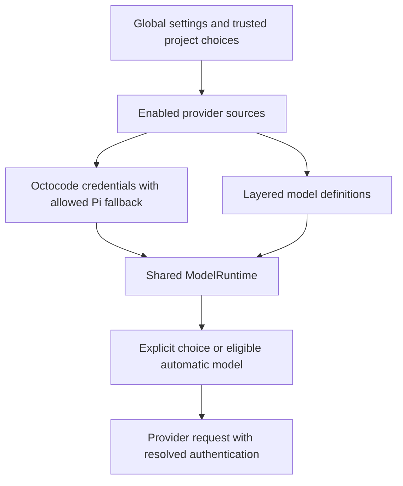
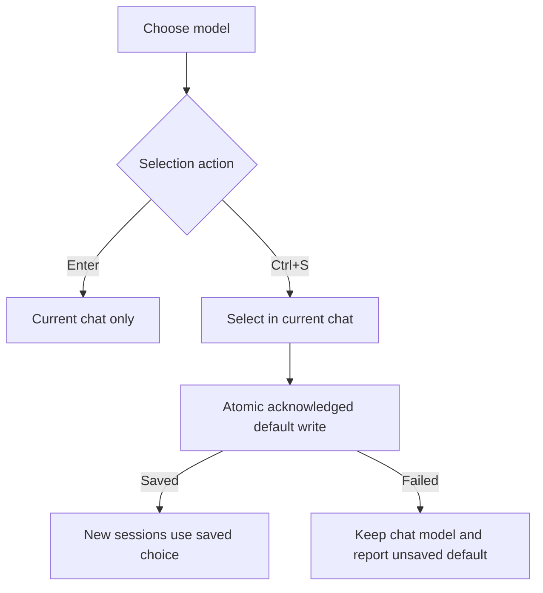

# Provider connection audit

## Executive summary

Reviewed API credentials, subscription authentication, OAuth renewal, installed vendor CLIs, Pi/Octocode defaults, model selection, local-server templates, llama.cpp, and configuration propagation into sessions and subagents. Confirmed defects were fixed in their existing owners, with isolated regression tests and independent review.

The latest follow-up passes **732 connection/default-focused core tests across 81 files**, **102 AI authentication/OAuth tests**, **651 webview tests** and **113 contracts tests**. Default-selection regressions verify real disk saves, fresh-runtime restoration for local and Claude Code models, production `/new` behavior, failure reporting, shortcut scope preservation and overrides. **All 11 repository static checks and the offline build pass.**

This does not prove every live account or server works. Socket operations and read-only local metadata requests return EPERM here; live account grants, real OS keychains and Node 24 remain unverified. Supported, unsupported and unverified capabilities are separated below.

## Key findings and implemented changes

| Priority | Root cause | Resulting behavior | Main owners |
| --- | --- | --- | --- |
| High | Credential-file initialization checked existence before a truncating write | Exclusive file creation preserves another process's newly saved credentials | `core/auth-storage/backends.ts` |
| High | Primary credentials trusted valid JSON without validating its shape | Shared validation rejects malformed roots and credential entries before enumeration or writes | `core/auth-storage/validation.ts`, `core/auth-storage.ts` |
| High | Codex renewal required a replacement refresh token; explicit validity used the proactive refresh threshold | Renewal retains the old token when no replacement is supplied; requested minimum validity is enforced separately | AI `auth/oauth/openai-codex/tokens.ts`, `auth/resolve.ts` |
| High | Auth checks constructed a different credential store from sessions; auth commands ignored source switches | Checks and credential exports share default discovery, Pi masking, explicit-home isolation and global source gates | `core/model-runtime/create.ts`, `main/auth-command.ts` |
| High | Auth checks had no operation deadline; read-only helpers returned unresolved secret references | A 15-second deadline reaches creation/check/read/resolution; no-refresh resolves own keychain references without OAuth refresh or credential writes | `cli/auth-check.ts`, `core/auth-storage/read-only.ts`, `core/auth-storage.ts` |
| High | Automatic selection only considered subscription providers with available default-model IDs | Available subscription fallback models are considered before metered defaults; explicit choices and unattended-use policy remain respected | `core/model-resolver.ts` |
| High | Unknown external CLI billing was treated as a plan, suppressing reported cost | Unknown billing stays unknown through display, launch, replies and subagent outcomes; costs are retained unless plan billing is established | `external/connected.ts`, runner ports/session/headless, `subagents/runner-child.ts` |
| Medium | Case-insensitive duration matching used case-sensitive conversion and permitted overflow | Uppercase duration units convert correctly; unsafe millisecond values are refused | `cli/auth-command.ts` |
| Medium | CLI fallback probes used the process environment instead of the supplied one | Discovery, status and ACP probes use the same cleaned configuration environment | `external/runner-status.ts` |
| Medium | CLI cache identity omitted credential paths and exported token identity; Gemini home override was ignored | Switching homes/configurations/tokens invalidates cached status; Gemini's configured root is honored; token values are not stored in the cache | `external/runner-status.ts`, `external/runners.ts` |
| Medium | CLI status children could ignore termination or keep pipes open; cancelled checks replaced completed cache entries | Status checks use bounded process/pipeline handling and forced cancellation; aborted refreshes preserve prior cache state | `external/runner-status.ts` |
| Medium | Global provider visibility switches were loaded without validating their schema | Invalid edits become recoverable settings-load errors and do not crash watcher callbacks | `core/settings-manager/load.ts` |
| Medium | Provider-page home overrides only applied when an environment map was also supplied | Home-only overrides consistently reach runner lookup, status and login environments | Interactive `provider-runners.ts` |
| Medium | Local templates offered unrelated vendor IDs and malformed URL errors echoed input | Server-specific model IDs are used; malformed endpoint errors do not disclose supplied credentials | `core/provider-templates/models.ts`, `apply.ts` |
| Medium | Derived model caches were blindly cast, including inherited object properties | Corrupt cache data is discarded safely while valid sibling catalogs survive; model shapes reuse shared AI schemas; actual I/O failures still propagate | `core/models-store.ts`, `models-store-validation.ts` |
| Medium | llama.cpp URLs accepted embedded credentials; UI and request limits used different context precedence | Credential-carrying URLs are rejected without exposing their values; UI and provider share context-limit resolution | `octocode/llama/client.ts`, `context.ts`, `provider.ts`, `ui.ts` |

The follow-up found and fixed these additional defects:

| Priority | Root cause | Resulting behavior | Evidence |
| --- | --- | --- | --- |
| High | Saving a default queued writes and reported success before storage acknowledged them | Model/provider/required shortcut changes commit together; failed writes reject, restore default settings and preserve diagnostics; overlapping default writes serialize safely | `settings-model-defaults.test.ts`, `model-default-save.test.ts` |
| High | Saving a global default copied effective workspace/run shortcuts into global settings | Global shortcut ordering is preserved; workspace/run lists remain scoped, and the picker explains their precedence | Project/run and present/absent global-list regressions in `model-default-save.test.ts` |
| High | Model-default saves failed after changing the chat, but no distinct partial-success outcome existed | The current chat remains usable; the picker shows a save-failure warning, waits for acknowledgment and ignores repeated save keystrokes | `core/agent-session/model-default.ts`, picker regressions |
| High | Saved defaults and resumed selections checked credentials but bypassed provider availability | Disabled/unavailable providers cannot be reactivated by default or resume selection; explicit CLI choice remains separate | `model-selection-availability.test.ts` |
| High | Compatibility summaries required an API key/header even for successful ambient authentication | Bedrock profile and Vertex ADC `auth: {}` results reach summary requests with their environment; missing auth still rejects | `summarization-ambient-auth.test.ts` |
| Medium | Scalar configuration setters acknowledged queued errors and said defaults applied on reload | One canonical atomic writer reports failures; model-default list/set/unset say next session, and the active settings manager reloads | `configuration/default-models.test.ts` |
| Medium | Browser and run-scoped model-default results described the wrong application time | Save/clear defaults say next session and keep the current chat's model; other settings retain their own timing | Browser config-edit and configuration run-scope regressions |
| Medium | Selecting a model could wait indefinitely for an uncooperative authentication check | Selection authentication has a 15-second deadline; a failed check leaves the model and startup settings untouched | Model-selection deadline regression |
| Medium | Free model-list verification classified every HTTP 403 as an invalid key | HTTP 403 saves with an explicit permission warning; 401 still refuses; redirects are refused and response bodies released | AI API-key verification suite |
| Medium | Local template IDs inherited generic 128k/16k limits or hosted metadata | Setup requires actual loaded context/output limits; validates positive counts/output bounds, cancels before writing and uses conservative local metadata | `local-model-template.test.ts` |
| Medium | A successful catalog refresh hid a failed llama action | Network/action failures remain visible without duplicating connection-retry errors | `octocode/llama-command-errors.test.ts` |
| Medium | Runner display trimmed a requested model but the subprocess received the original string | Trimmed model reaches ACP/vendor flags; blank requests use the vendor default | External runner regressions |
| Medium | Claude session launch accepted unknown billing and labelled it a plan | Session/default-model exposure requires explicit plan billing | Claude backend availability regressions |

## Analysis and configuration flow

External task runners have a separate established route: CLI discovery/status → connected runner → session/headless adapter → subagent outcome. Their vendor CLI owns its sign-in. Discovery must not infer a subscription from authentication alone; this distinction now survives every consumer.

The fixes favor reuse: one default credential factory for CLI/session parity, one credential validator, shared AI model schemas for cache validation, and one llama context-limit helper. Pi fallback remains read-only, skips unsupported OAuth entries and secret commands, and yields to the user's own credential/model-key configuration. No migration-reference implementation was changed.

### Default-model workflow

Open `/model`, highlight the model and press **Ctrl+S** (or the configured set-as-default key). Enter and `/model <provider>/<id>` change only the current chat. Ctrl+S selects it now and saves the global startup default after the write finishes. A trusted workspace/run override is reported rather than hidden. Existing sessions resume their previous available model; a new default does not silently replace it.

SDK callers use `await session.setModel(model, { persist: true })`. RPC `set_model` is session-only. Configuration can save `defaultProvider` and `defaultModel` globally or for a trusted workspace; these raw field edits affect new sessions. The picker/SDK paired save is the atomic model-choice path.

### Connection support and limits

Support below is implemented capability with fixture evidence, not a claim that a real account/server was authenticated.

| Connection | Main chat / saved default | External tasks | Explicit limits |
| --- | --- | --- | --- |
| Native API, account or subscription provider | Supported when configured and available | Native subagents use the same model/auth layer | Credentials/listed model do not prove entitlement, quota, billing or remote acceptance |
| Ollama, LM Studio, vLLM compatible server | Supported; disk/fresh-runtime restoration verified | Through native subagents | User starts server, supplies exact IDs and loaded limits; no automatic pull or capability inference |
| llama.cpp router | Cached selection/default/CLI/resume verified | Through native subagents | First-use headless selection with an empty cache needs prior discovery through `/model` or `/llama` |
| Claude Code CLI | `claude-code/opus`, `/sonnet`, `/haiku` | ACP; headless task fallback where supported | Session route needs explicit plan billing, adapter, cached connection and `externalAgents`; text only; vendor controls effort |
| Codex CLI | Unsupported through the CLI route | Through `codex-acp` | Native OpenAI/ChatGPT providers are separate connections that can be main/default models |
| OpenCode CLI | Unsupported through the CLI route | Through `opencode acp` | Signed-in does not establish subscription billing |
| Gemini CLI | Unsupported through the CLI route | Through `gemini --acp` | Native Google API/Vertex providers are separate main/default-model routes |
| Arbitrary ACP executable | No main/default-provider integration | Explicit connection and prompts | Explicit model requires stable ACP model configuration; legacy listing-only adapters are refused |
| Running Octocode instance | Uses that instance's current model | Explicit connection and prompts | Connection rejects model override; it does not replace the instance's saved default |
| RPC client | Can select current session model | Per exposed session operations | `set_model` has no persistence option; use configuration or SDK for saved defaults |

Octocode has no persisted per-runner model default. Omit task `model` to use the vendor's own default; pass the vendor's model ID for one task where the adapter supports it. Runner tasks do not accept native-child `skills`, `mcp`, `profile`, `resume` or `headless` fields. Turning `externalAgents` off also removes Claude session-model choices under the existing contract.

### What connection checks establish

| Check | Establishes | Does not establish |
| --- | --- | --- |
| `auth check` / configured availability | Credential resolution and optional OAuth renewal | Reachability, selected-model permission, quota or successful inference |
| Free API-key login verifier | Acceptance of its metadata endpoint; 403 is reported as permission-limited | Inference access; custom gateways do not inherit upstream verification |
| Provider-page **Test credential** | One small actual model request when explicitly chosen | Future reliability or access to every model; it may consume provider usage |
| Installed CLI/adapter discovery | Executables are found | A working sign-in, paid entitlement or successful task execution |
| This run's local metadata probes | Host denied requests to Ollama, LM Studio and vLLM default ports with EPERM | Whether those servers are running, configured correctly or able to generate |

## Verification evidence

Counts below describe individual runs and overlap; they must not be added into a unique-test total.

| Check | Result | Evidence |
| --- | --- | --- |
| Latest connection/default-focused core suite | 81 files, 732 passed | `.octocode/tmp/connections-followup/core-verified.log`, `core-verified-status.json` |
| Latest AI authentication/OAuth | 102 passed | `.octocode/tmp/connections-followup/ai-auth-final.log` |
| Integrated default-selection/picker/configuration | 6 files, 51 passed | `.octocode/tmp/connections-followup/defaults-integrated-final.log` |
| Final model scope/deadline/picker and `/new` selection | 2 files, 16 passed | `.octocode/tmp/connections-followup/model-scope.log` |
| Production `/new` lifecycle | 3 passed; saved default, explicit `--model` and run-default priority; zero fetch calls | `.octocode/tmp/connections-followup/new-session-default.log` |
| Acknowledged settings/persistence | 21 passed | `.octocode/tmp/connections-followup/settings-defaults-final.log` |
| Resolver/default/resume availability | 83 passed | `.octocode/tmp/connections-followup/selection-availability.log` |
| Configuration acknowledgment and timing | 38 passed, including run-scoped timing | `.octocode/tmp/connections-followup/config-run-defaults-final.log` |
| Browser default timing and full webview | 86 files, 651 passed | `.octocode/tmp/connections-followup/webview-verified.log` |
| Full contracts | 15 files, 113 passed | `.octocode/tmp/connections-followup/browser-defaults-contracts.log` |
| External runner follow-up | 41 passed; final affected suites 17 passed | `.octocode/tmp/connections-followup/external-tests.log`, `external-final-tests.log` |
| Local metadata/context/llama follow-up | 29 template/runtime, 30 context, 17 llama, 2 cached-selection tests passed | `.octocode/tmp/connections-followup/` local/context/llama logs |
| Selected integrated native regressions | 4 files, 17 passed | `.octocode/tmp/connections-audit/native-final.log` |
| Initial external CLI regression wave | 5 files, 35 passed | `.octocode/tmp/connection-external-tests.log` |
| Local template/runtime wave | 31 passed | `.octocode/tmp/connections-audit/local-models-tests.log` |
| Cache/catalog wave | 34 passed | `.octocode/tmp/connections-audit/models-store-tests.log` |
| Read-only credential/cancellation cases | 4 passed | `.octocode/tmp/connections-auth-read-only.log` |
| Pi fallback serialized retry | 16 passed | `.octocode/tmp/connections-pi-final.log` |
| Latest offline build and prompt generation | Passed | `.octocode/tmp/connections-followup/build-shipped.log`, `.octocode/tmp/agent-prompts/` |
| Latest full repository static gate | All 11 passed, including typecheck, lint, format, boundaries and bundle freshness | `.octocode/tmp/connections-followup/check-shipped.log` |
| Latest full e2e attempt, fail-fast | Failed in slash-command scenarios requiring API/web sockets; suite not completed | `.octocode/tmp/connections-followup/e2e-final.log`, `e2e-final-status.json` |
| Historical broader footer recheck | Previous run had 7 passed, 2 failed outside connection changes; not rerun in this follow-up | `.octocode/tmp/connections-audit/footer-recheck.log` |

Before/after regressions cover malformed primary credentials, exclusive initialization, subscription fallback selection, malformed settings, optional renewal refresh tokens, explicit validity, local template IDs, corrupt caches, URL handling and llama context display. The exclusive-create fixture was corrected to synchronize Node's named builtin exports and assert its filesystem spy ran; only that corrected fixture is used as race evidence.

The initial combined credential test run had one startup-import timeout under concurrent transforms. The full Pi suite subsequently passed serialized without assertion changes. A first expanded core run hit its four-minute supervisor deadline; the subsequent connection-focused run completed. No timeout or skipped integration is counted as a pass.

The latest full static gate passes all 11 checks. Earlier fixture/type, board-lint and bundle-drift failures are historical: concurrent source settled, and the browser bundle was regenerated through its owning generator. The full e2e suite remains incomplete; static success is not a claim that all integration or live-service checks passed.

The expanded core run exposed a race-fixture assertion counting the lock-owner metadata write alongside credential creation. Instrumented paths established that the extra write was `auth.json.lock.owner`; the fixture now targets only the credential file, retains exact exclusive-create/mode and byte-preservation assertions, and passes in the final 81-file run. No credential production defect was found in that failure.

An isolated Claude backend probe returned `Claude Code failed: listen EPERM: operation not permitted 127.0.0.1`. The local MCP server starts before the ACP child, so that denied bind explains the final e2e fixture's missing child-start event. The fixture explicitly registers its backend and bypasses runner cache/billing discovery. No e2e assertion was changed; the probe exited successfully. The first interrupted full run's separate command/MCP/protocol failures were not fully classified and are not claimed to be fixed.

## Installed commands and user setup

PATH discovery found `claude`, `codex`, `opencode`, `gemini` and `ollama`. `lms` and `llama-server` were not on PATH; this does not establish whether their applications are installed elsewhere. Read-only metadata confirmed Codex 0.166.0 and Gemini 0.64.0. OpenCode metadata was blocked when its launcher attempted a log write outside writable roots. No live sign-in or paid inference was performed.

For Ollama, LM Studio or vLLM: `/providers` → **Add from a template** → choose the server → enter its API URL and actual server model IDs → choose authentication → `/model`. `/llama` remains the GGUF/router setup route. The owning providers/models/configuration/native-feature guides were updated, along with external-runner tool descriptions.

## Sources and applicability

| Source | Verified applicability |
| --- | --- |
| [OAuth 2.0, RFC 6749 §6](https://www.rfc-editor.org/rfc/rfc6749.html#section-6) | A successful renewal need not issue another refresh token; a replacement, when supplied, replaces the previous token |
| [Gemini CLI configuration](https://geminicli.com/docs/reference/configuration/) | `GEMINI_CLI_HOME` is the root beneath which the CLI creates `.gemini` |
| [Gemini CLI authentication](https://geminicli.com/docs/get-started/authentication/) | Google-account, Gemini API-key and Vertex authentication are distinct; authenticated does not prove subscription billing |
| [Claude Code environment variables](https://code.claude.com/docs/en/env-vars) | Exported OAuth-token identity affects authentication and cache validity |
| [LM Studio OpenAI compatibility](https://lmstudio.ai/docs/developer/openai-compat) | Local base URL, server model IDs and compatibility endpoints |
| [Ollama authentication](https://github.com/ollama/ollama/blob/main/docs/api/authentication.mdx) | Local API versus cloud authentication requirements |
| [ACP session configuration](https://agentclientprotocol.com/protocol/v1/session-config-options) | Stable model-selector configuration and explicit selection behavior |
| [Claude model configuration](https://code.claude.com/docs/en/model-config) | CLI model aliases/defaults are owned by the vendor route |
| [OpenAI RBAC](https://developers.openai.com/api/docs/guides/rbac) | Model-list permission is distinct from model-request permission |
| [Claude API errors](https://platform.claude.com/docs/en/api/errors) | HTTP 403 describes resource permissions rather than proving an invalid key |
| [LM Studio model loading](https://lmstudio.ai/docs/developer/rest/load) | Loaded context length is a server configuration value that must be represented accurately |

## Remaining risks and next steps

1. Run the full checks and e2e suite on Node 24.15+ with socket/process support after concurrent edits settle. Socket-dependent llama cases and real OS keychains remain unverified here.
2. Historical footer failures have not been revalidated by this connection follow-up. Run broader repository tests separately when validating changes beyond connection/default behavior.
3. Exercise each desired real account/local server in its supported environment. Fixture tests establish routing and configuration behavior, not service entitlement, available GPU memory or successful live authentication.

Confidence is high for the reproduced defects and fixture-verified fixes; live-service and platform compatibility remain explicitly uncertain.
