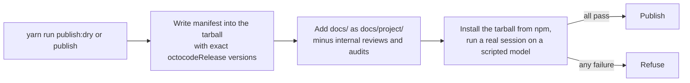

# Developing octocode-code

For contributors. To use Octocode, read the [README](README.md). Rules for changing code, owners and generated files: [AGENTS.md](AGENTS.md).

Octocode is a fork of [Pi](https://github.com/earendil-works/pi): Pi's agent loop, providers and terminal UI plus native Octocode features (code research, guarded edits, subagents, collaboration, browser work, memory, recovery). The native features live in `packages/coding-agent/src/octocode/` and load automatically.

## Run from source

Needs Node.js 24.15 or newer within Node 24 (`.node-version` pins the line) and the sibling `octocode` repository checked out at `../octocode` on the `octocode-20.0.0` branch (its default branch lacks the needed packages). `packages/coding-agent/package.json` links the sibling packages `octocode`, `octocode-mcp`, `octocode-native` and `octocode-chrome-devtools` with `link:`; build them first, native binaries included.

```sh
yarn install --immutable
yarn run hydrate:model-data   # downloads the provider model catalog
yarn start                    # run from source; `yarn start --help` lists options
```

Inside the app: `/login` connects an account, `/model` picks a model, `/help` lists commands.

| Command                      | Does                                                                                        |
| ---------------------------- | ------------------------------------------------------------------------------------------- |
| `yarn start research --help` | The `octocode` research CLI                                                                 |
| `yarn start native --help`   | The native helper CLI                                                                       |
| `yarn run build:offline`     | Builds every workspace after hydration; run `node packages/coding-agent/dist/bundle/cli.js` |
| `yarn run build`             | Refreshes model data, then builds                                                           |

## Verify


| Command                                                                                 | Does                                                                                                                                                 |
| --------------------------------------------------------------------------------------- | ---------------------------------------------------------------------------------------------------------------------------------------------------- |
| `yarn run check`                                                                        | Typecheck, Oxlint, format check, browser-smoke, workspace bundle and favicon freshness, package and database boundaries, Knip; rewrites nothing      |
| `yarn oxfmt <files>`                                                                    | Formats those files (`yarn run format` formats everything)                                                                                           |
| `yarn vitest run --config vitest.octocode.config.ts [paths]` in `packages/coding-agent` | Native suite (`test/octocode/`); `yarn run test:changed` runs only tests for changed files                                                           |
| `yarn vitest run [paths]` in `packages/coding-agent`                                    | Core suite                                                                                                                                           |
| `yarn workspace @octocodeai/octocodecode run test:e2e`                                  | Real sessions on a scripted model, no network; holds the prompt-size ceilings                                                                        |
| `yarn workspace @octocodeai/octocodecode run test:architecture`                         | Layering rules in the coding-agent                                                                                                                   |
| `yarn run test:scripts`                                                                 | Node tests for `scripts/`                                                                                                                            |
| `./test.sh`                                                                             | Every test with isolated home, config, credentials and temp dir (needs `fd`, `rg`); `yarn run test` is its workspace runner                          |
| `yarn run test:tmux`, `yarn run test:mcp-conformance`                                   | tmux and MCP conformance suites                                                                                                                      |
| `yarn run check:unused`                                                                 | Knip: unused files, exports and dependencies. `knip.jsonc` lists public APIs and dynamic entry points; verify a finding against them before deleting |

- Run builds and full suites in the background; write long output to `.octocode/tmp/`. Never run two builds or generators at once.
- After browser source changes run `yarn run generate:workspace`. After prompt, tool description or MCP preset changes run `yarn workspace @octocodeai/octocodecode run generate:prompts` and read `.octocode/tmp/agent-prompts/`.
- Harness-based session tests: [suite rules](packages/coding-agent/test/suite/README.md).
- Known flakes: `team-interpreter-parsed` "gates a 2000-stage pipeline quickly" (400 ms limit) under heavy load; the real-browser e2e can leave a Chrome process behind.
- `octocode-test.sh` runs the agent from source; it is a launcher, not a suite.

## Release

Only `@octocodeai/octocodecode` is published; every other workspace compiles into its one bundle.



`publish:dry` rehearses; `publish` also requires a clean tree and dependency versions on npm. Local packaging (`pack:packages`, `release:local`) turns `link:` and `file:` dependencies into absolute `file:` references in disposable artifacts: they depend on the sibling checkout and are not portable. What each script does: [scripts/README.md](scripts/README.md).

### Validate a registry release candidate

Staging runs after `yarn run build:offline`, rewrites no development manifest and publishes nothing. Supply a reviewed JSON map: `schemaVersion: 1` and a `packages` object keyed by dependency name, each with an exact `version`, its `sourceRevision` and the registry's `sha512-…` `integrity` (include reviewed native platform packages and other sibling transitive packages). Seed a disposable registry with the candidate and the reviewed sibling tarballs, then:

```sh
node scripts/stage-registry-release.mjs --prepare --map /path/to/map.json \
  --registry http://127.0.0.1:4873/ --out /tmp/octocode-registry-candidate

# once the registry serves the exact tarballs:
node scripts/stage-registry-release.mjs --verify --map /path/to/map.json \
  --registry http://127.0.0.1:4873/ --out /tmp/octocode-registry-candidate
```

| Phase       | Does                                                                                                                                                                                                                                                                                                                                                |
| ----------- | --------------------------------------------------------------------------------------------------------------------------------------------------------------------------------------------------------------------------------------------------------------------------------------------------------------------------------------------------- |
| `--prepare` | Saves tarballs, checksums and the map digest in `candidate.json`                                                                                                                                                                                                                                                                                    |
| `--verify`  | Checks registry metadata and integrities, creates an installer lock under the output directory, installs the single staged tarball in a clean consumer, and checks both CLI entries, public imports, roles, research skills, model data and `--help` paths with isolated configuration. Keeps its bytes on failure; discards any prior fixture lock |

A disposable-registry result is not a production lock: after the dependency tarballs are published, rerun `--verify --registry https://registry.npmjs.org/` on the same tarballs, then review and copy the verified lock through the release process. The command never publishes and refuses to write a fixture lock into the production installer-lock directory. Check supported OS/CPU/libc variants separately so native binaries load. `yarn run check:package-install` covers the local multi-tarball graph instead.

## Packages

| Package                                         | Responsibility                                              |
| ----------------------------------------------- | ----------------------------------------------------------- |
| [coding-agent](packages/coding-agent/README.md) | CLI, sessions, native features, RPC (the published package) |
| [acp](packages/acp/README.md)                   | Inbound and outbound ACP (private)                          |
| [mcp](packages/mcp/README.md)                   | MCP client and host integration (private)                   |
| [agent](packages/agent/README.md)               | Agent loop, tool execution                                  |
| [ai](packages/ai/README.md)                     | Providers, model catalog                                    |
| [tui](packages/tui/README.md)                   | Terminal UI                                                 |
| [webview](packages/webview/README.md)           | Browser workspace, rendering, UI state                      |
| [contracts](packages/contracts/README.md)       | Shared schemas and protocols                                |
| [telemetry](packages/telemetry/README.md)       | Telemetry contracts and adapters                            |
| [db](packages/db/README.md)                     | Agent database (private)                                    |
| [common](packages/common/README.md)             | Host-free utilities (private)                               |

## Interface checks

| Interface   | Run (from `packages/coding-agent` unless noted)                                                                                                                                                                                                                                                                                                                                                                                                                                                                                                                                                                                                                                                                                     |
| ----------- | ----------------------------------------------------------------------------------------------------------------------------------------------------------------------------------------------------------------------------------------------------------------------------------------------------------------------------------------------------------------------------------------------------------------------------------------------------------------------------------------------------------------------------------------------------------------------------------------------------------------------------------------------------------------------------------------------------------------------------------- |
| ACP         | `yarn workspace @octocodeai/octocode-acp test` (broker, history, input, permissions, startup, redaction); `yarn vitest run --config vitest.e2e.config.ts test/octocode/e2e-acp.test.ts test/octocode/e2e-acp-conformance.test.ts test/octocode/e2e-reach-process.test.ts`; `yarn vitest run --config vitest.config.ts test/acp-api.test.ts test/acp-command-lifecycle.test.ts`; `yarn node test/octocode/scripts/live-acp-reliability.mjs --fixture` (no provider calls). In disposable environments: `test/octocode/scripts/check-acp-compatibility.mjs` (official ACP TCK checkout, `uv`, Python 3.14+; experimental, not certification) and `check-acp-python.mjs` (Python SDK `agent-client-protocol==0.12.1`, both directions) |
| Session API | With an isolated `HOME`, exercise `list` → `status` → guarded `send --wait` → same-key retry → `watch`: a retry starts no second `agent.start`, cancellation shows as a settlement event. Tests: `yarn vitest run --config vitest.octocode.config.ts test/octocode/api-cli-subprocess.test.ts test/octocode/api-socket.test.ts test/octocode/api-events.test.ts`, `test/acp-api.test.ts`, `test/acp-command-lifecycle.test.ts` (`vitest.config.ts`), `test/octocode/e2e-reach-process.test.ts`, `test/octocode/e2e-api-events.test.ts` (`vitest.e2e.config.ts`)                                                                                                                                                                     |
| tmux        | `yarn run test:tmux` (repository root); real-tmux tests use a private server and skip without `tmux` 3.3 or `python3`. `scripts/tmux-cli-check.sh` runs the real CLI in a private server (startup, paste; with `--model` a prompt, `/fork` and image rows; `--cli=<command>` checks another launcher). Image rendering needs a real Kitty or Ghostty window                                                                                                                                                                                                                                                                                                                                                                         |

## Plugin and hook compatibility checks

Normal tests read saved fixtures and need neither Rust nor a vendor binary. Each fixture proves its own narrow contract against source revisions and executables pinned in its manifest, not host equivalence.

| Contract                                                          | Evidence (under `packages/coding-agent/test/`)                                                                                                                                                                                                                                                                                                                                             | Reproduce                                                                                                                                                  |
| ----------------------------------------------------------------- | ------------------------------------------------------------------------------------------------------------------------------------------------------------------------------------------------------------------------------------------------------------------------------------------------------------------------------------------------------------------------------------------ | ---------------------------------------------------------------------------------------------------------------------------------------------------------- |
| Codex hook output decisions                                       | `fixtures/hooks/codex-output-contract.json`, read by `hooks-codex-conformance.test.ts`; not exit semantics, timing, permissions or patch rewriting                                                                                                                                                                                                                                         | `node packages/coding-agent/scripts/generate-codex-hook-output-fixtures.mjs [--check]` (Cargo and network)                                                 |
| Codex patch parsing and bytes                                     | [Patch oracle](packages/coding-agent/test/octocode/fixtures/codex-patch/ADAPTATIONS.md)                                                                                                                                                                                                                                                                                                    | Its page                                                                                                                                                   |
| Codex skill metadata                                              | [Metadata oracle](packages/coding-agent/test/fixtures/codex-skill-metadata/ADAPTATIONS.md)                                                                                                                                                                                                                                                                                                 | Its page                                                                                                                                                   |
| Codex skill mentions                                              | [Corpus](packages/coding-agent/test/fixtures/codex-skill-mentions/corpus.json), [manifest](packages/coding-agent/test/fixtures/codex-skill-mentions/manifest.json)                                                                                                                                                                                                                         | `python3 packages/coding-agent/test/fixtures/codex-skill-mentions/replay.py`                                                                               |
| Claude permission decisions, rewrites, file rewrites, replace-all | [replay.py](packages/coding-agent/test/octocode/fixtures/claude-permissions/replay.py), [rewrites.py](packages/coding-agent/test/octocode/fixtures/claude-permissions/rewrites.py), [file-rewrites.py](packages/coding-agent/test/octocode/fixtures/claude-permissions/file-rewrites.py), [replace-all.py](packages/coding-agent/test/octocode/fixtures/claude-permissions/replace-all.py) | Each with `--claude /absolute/path/to/claude --node /absolute/path/to/node`; the recorded version and hash must match, or pass `--allow-identity-mismatch` |
| Claude permission updates                                         | [permission-updates.py](packages/coding-agent/test/octocode/fixtures/claude-permissions/permission-updates.py)                                                                                                                                                                                                                                                                             | The same arguments                                                                                                                                         |
| Claude Bash grammar and wrappers                                  | [grammar.py](packages/coding-agent/test/octocode/fixtures/claude-permissions/grammar.py), [wrappers.py](packages/coding-agent/test/octocode/fixtures/claude-permissions/wrappers.py); narrower than the Bash language, no PowerShell                                                                                                                                                       | The same arguments                                                                                                                                         |

The Claude replays use a local mock provider, temporary settings and a dummy credential, never a live account, and end their process group on a timeout. They use POSIX process handling; Windows is unverified.

## More

[Features and owners](docs/FEATURES.md) · [User docs index](packages/coding-agent/docs/index.md) · [How-to recipes](packages/coding-agent/docs/how-to.md) · [Native features](packages/coding-agent/docs/native-features.md) · [Configuration](packages/coding-agent/docs/configuration.md) · [Instructions](packages/coding-agent/docs/instructions.md) · [Security](SECURITY.md)

## License

[MIT](LICENSE). Independent fork; original Pi copyright notices are retained.
