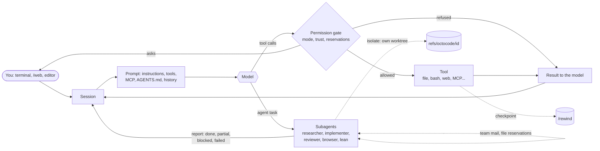

# Octocode Code

A terminal coding agent that researches code before it changes it, and splits big work across a team of subagents and git worktrees. A fork of [Pi](https://github.com/earendil-works/pi) with the Octocode features built in.

## Install

Needs Node 24.15 or later (Node 24 line).

```sh
npm install -g @octocodeai/octocodecode
cd your-project
octocode
```

Trust the folder when asked, then `/providers` to connect a provider and `/model` to pick one.

## How it works



## Read next

- [User guide](packages/coding-agent/README.md): features, commands, first run
- [Documentation index](packages/coding-agent/docs/index.md)
- [Develop Octocode itself](DEVELOPMENT.md): run from source, checks, releases
- [Security](SECURITY.md)

MIT; original Pi copyright notices are retained in [LICENSE](LICENSE). Fork of Pi by Mario Zechner and contributors.
