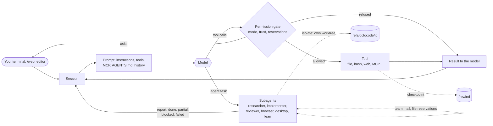

# Octocode Agent

A terminal coding agent that researches code before it changes it, and splits big work across a team of subagents and git worktrees.

- **Research first:** reads your code, dependencies and GitHub before editing.
- **Guarded changes:** every edit is checkpointed, and a permission gate decides each tool call.
- **Teams:** a coordinator delegates to subagents that message each other, reserve files and work in isolated worktrees.
- **Bring your setup:** any provider or local model, MCP servers, skills, hooks, and existing Pi, Claude Code and Codex configuration.

## Quick start

Needs Node.js 24.15 or later on the Node 24 line.

```sh
npm install -g @octocodeai/octocode-agent
cd your-project
octocode
```

1. Trust the folder when asked. Until you do, Octocode reads nothing from it.
2. Connect a provider with `/providers`, then pick a model with `/model`.
3. Ask for something: `explain how auth works here`, `fix the failing test`, `review my changes`.

Useful next: `/` lists commands, `/web` opens the browser workspace, `/rewind` undoes edits, `/resume` reopens a session. See [how-to](packages/coding-agent/docs/how-to.md) and [commands](packages/coding-agent/docs/commands.md).

## How it works



Each session runs one event loop. Messages from you, subagents and other sessions are queued and delivered at the agent's next step; a long foreground command moves to the background so the agent can answer, and a finished job wakes it. Transcripts survive a crash or a full disk, and compaction keeps long sessions inside the context window. Details: [context](docs/CONTEXT.md), [execution and permissions](docs/EXECUTION_AND_PERMISSIONS.md).

## Features

| Area | What you get | Read |
| --- | --- | --- |
| Research | Local code search with LSP, GitHub and package lookups, web pages | [Native features](packages/coding-agent/docs/native-features.md) |
| Editing | Guarded `file` edits, patches, checkpoints and `/rewind` | [File mutation](packages/coding-agent/docs/native-features.md#file-mutation-guarantees) |
| Safety | Permission modes and rules, folder trust, OS sandbox for the shell, security review of hooks, MCP servers and skills | [Permissions](packages/coding-agent/docs/permissions.md), [sandbox](packages/coding-agent/docs/sandbox.md) |
| Subagents and teams | Profiles (researcher, implementer, reviewer, browser, desktop, lean), team mail, path reservations, isolated worktrees, request budgets | [Agent communication](docs/AGENT_COMMUNICATION.md) |
| Work tracking | Backlog with epics, dependencies and steps; scheduled tasks and notifications | [Native features](packages/coding-agent/docs/native-features.md) |
| Memory | Notes later sessions reuse; searchable archive of past sessions | [Memory](packages/coding-agent/docs/memory.md) |
| Browser and desktop | Drive Chrome for pages; control native apps with per-start approval | [Browser](packages/coding-agent/docs/native-features.md#browser-and-web-access), [desktop](packages/coding-agent/docs/native-features.md#desktop-control) |
| Models | Any provider, local models, vendor CLIs, smart routing, rate limits, prompt caching | [Providers](packages/coding-agent/docs/providers.md), [models](packages/coding-agent/docs/models.md) |
| Extend | MCP servers, skills, hooks, Claude and Codex plugins, prompt templates, themes | [MCP](packages/coding-agent/docs/mcp.md), [skills](packages/coding-agent/docs/skills.md), [hooks](packages/coding-agent/docs/hooks.md) |
| Interfaces | Terminal UI, `/web` workspace with board and profiler, `/remote`, tmux, editors over ACP | [Web workspace](packages/coding-agent/docs/web-workspace.md), [ACP](packages/coding-agent/docs/acp.md) |
| Compatibility | Reads Pi, Claude Code and Codex configuration; switch sources with `/harness` | [Configuration](packages/coding-agent/docs/configuration.md#harnesses) |

Every feature with its page: [features](docs/FEATURES.md).

## Use from scripts and other agents

After configuring a provider and trusting the target project:

```sh
octocode -p --no-stdin --no-session --permission-mode workspace "Review this project without editing files"
```

Use `--mode json` for JSON Lines events or `--mode rpc` for a persistent, controllable session. See [external agents](packages/coding-agent/docs/external-agents.md), [RPC](packages/coding-agent/docs/rpc.md) and [CLI modes](packages/coding-agent/docs/cli.md).

## Configure

`/settings` reads and changes any setting; global settings live in `~/.octocode/octocodecode/`, project ones in `.octocode/` of a trusted folder. Put standing project instructions in `AGENTS.md`. See [configuration](packages/coding-agent/docs/configuration.md), [settings](packages/coding-agent/docs/settings.md) and [troubleshooting](packages/coding-agent/docs/troubleshooting.md).

## Contribute

Run from source, package map, checks and releases: [DEVELOPMENT.md](DEVELOPMENT.md). Package ownership and rules for agents: [AGENTS.md](AGENTS.md). Report vulnerabilities as [SECURITY.md](SECURITY.md) describes.

## License

MIT, see [LICENSE](LICENSE). Octocode is a fork of [Pi](https://github.com/earendil-works/pi); Pi's copyright notice is retained as its license requires.
