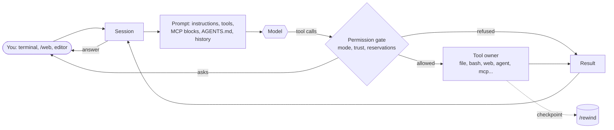
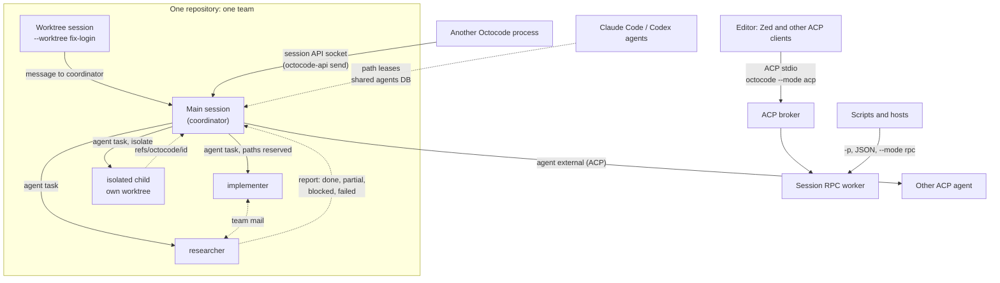
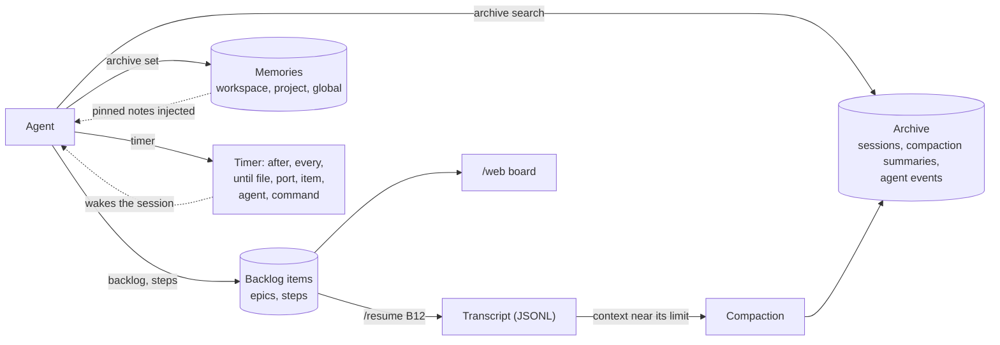
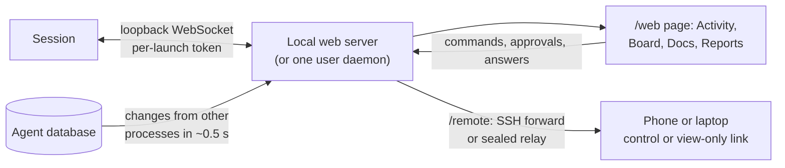
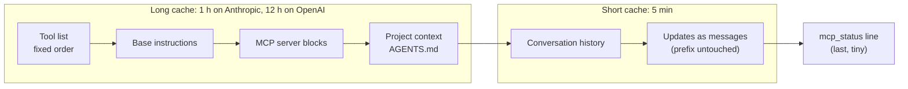
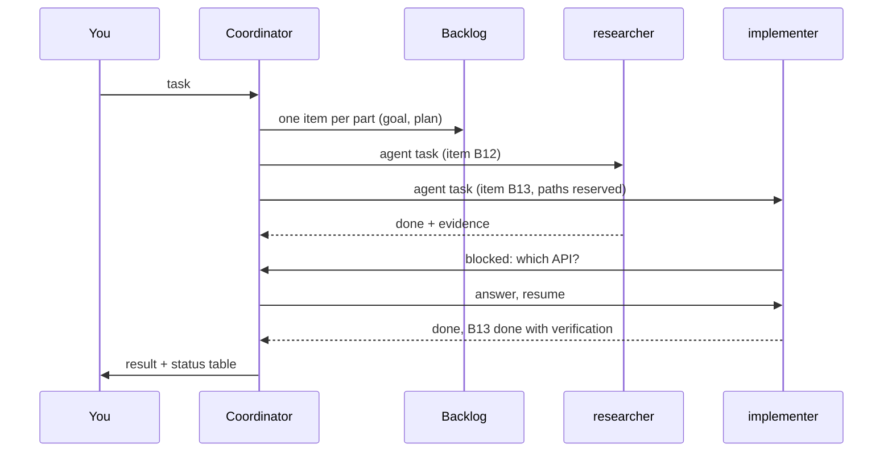

# Octocode Code

A terminal coding agent that researches code before it changes it, and splits big work across a team of subagents and git worktrees.

Fork of [Pi](https://github.com/earendil-works/pi) with the Octocode features built in · [Documentation](packages/coding-agent/docs/index.md) · [How-to recipes](packages/coding-agent/docs/how-to.md) · [All commands](packages/coding-agent/docs/commands.md)

## Install and start

Needs Node 24.15 or later (Node 24 line).

```sh
npm install -g @octocodeai/octocodecode
cd your-project
octocode
```

> [!NOTE]
> Octocode first asks whether you trust the folder. Until you do, it reads nothing from it: no `AGENTS.md`, settings, MCP servers, hooks or skills.

1. `/login` connects an AI provider (browser sign-in or API key).
2. `/model` picks the model, then type your task.
3. Optional: `/octocode auth login` connects GitHub for code search.

Run it without the terminal UI, for scripts and CI:

```sh
octocode -p "Summarize what changed on this branch"
git diff main | octocode -p "Review this diff for bugs"   # piped stdin is read first
octocode --trust -p "..."                                 # headless runs need a trusted folder
```

## Features at a glance

| Feature                                               | What you get                                                           | Start with                                   |
| ----------------------------------------------------- | ---------------------------------------------------------------------- | -------------------------------------------- |
| [Octocode research](#octocode-out-of-the-box)         | Local, structural, LSP, GitHub and package search, on by default       | just ask                                     |
| [Tools](#tools)                                       | `bash`, `file`, `web`, `agent`, `backlog`, `archive`, `timer` and more | `--tools`, `--exclude-tools`                 |
| [Subagents](#subagents)                               | Child agents with roles, models, budgets, isolation                    | ask for parallel work, `/agents`             |
| [Worktrees](#worktrees)                               | Parallel sessions on separate branches, one team                       | `/worktree`, `--worktree <name>`             |
| [Backlog and steps](#backlog-and-steps)               | Durable work items, epics, a live board                                | `/web backlogs`                              |
| [Memory, archive, timers](#memory-archive-and-timers) | Notes, searchable history, smart wake-ups                              | `/memory`                                    |
| [Locks and coordination](#locks-and-coordination)     | File reservations, team mail, backlog-driven orchestration             | `/agents`, `/worktree`                       |
| [MCP](#mcp-servers)                                   | Any MCP server's tools                                                 | `/mcp`, `octocode mcp add`                   |
| [Skills](#skills)                                     | On-demand instructions for a kind of work                              | `/harness list skills`                       |
| [Plugins and hooks](#plugins-and-hooks)               | Claude and Codex plugins, lifecycle hooks                              | `/harness`, `octocode marketplace add`       |
| [Harnesses](#harnesses)                               | Reuse Pi, Claude Code, Codex, Cursor and `.agents` setup               | `/harness`                                   |
| [Providers and models](#providers-and-models)         | Hosted providers, OAuth, local models, routing                         | `/login`, `/model`, `/modelsettings`         |
| [Prompt caching](#prompt-caching)                     | Layered cache, shared prefixes, warming                                | `cacheWarming`, `/status`                    |
| [Permissions and safety](#permissions-and-safety)     | Modes, folder trust, plan mode, checkpoints                            | `/permissions`, `/trust`, `/plan`, `/rewind` |
| [Sessions](#sessions-and-context)                     | Resume, fork, compaction, side questions                               | `/resume`, `/fork`, `/compact`, `/btw`       |
| [Interfaces](#web-remote-and-other-interfaces)        | Web workspace, remote links, tmux, ACP, RPC, session API               | `/web`, `/remote`, `--mode acp`              |

## How it works

### One turn

Every tool call passes the same permission gate before the tool's owner runs it; refusals come back to the model as results, not crashes.



### Agents and processes

Each agent is its own process with its own saved session. They talk through one `agent` tool: `task` starts a child, `message` reaches any agent by name, `coordinate` reserves files and merges work. Other processes, editors and other vendors' agents reach a session through their own doors.



- A message from another process arrives marked as external, and the permission gate decides whether the session takes it (`full` takes it; the other modes ask).
- A child that goes quiet gets a check-in; one near its request budget asks the parent for more.
- A reservation blocks other agents' edits and shell writes to those paths until released; a live Claude or Codex lease on a file does the same.

### Work and knowledge

State that outlives a session lives in one SQLite database (`~/.octocode/octocodecode/agent/workspaces.db`) and in workspace files under `.octocode/code/`.



### The web workspace



The page never executes anything: commands go back to the session, and its permission gate still decides.

### Prompt caching

Requests are built so the parts that rarely change come first and stay cached, while only the tail grows.



- **Stable prefix:** tool order and instructions stay byte-identical for the life of a session; MCP connection state lives in one last line, so a server reconnecting does not rewrite the cache.
- **Shared across agents:** sibling subagents of one profile build the same prefix and share a cache key; task details ride in the first message; forks reuse their parent's key.
- **Warming:** `cacheWarming` (`off`, `streaming`, `idle` default) refreshes a cache with one-token requests so a pause does not lose it.

```json
{ "cacheWarming": "idle", "cacheRetention": "long" }
```

`/status` shows cache state and warming usage; `showCacheMissNotices` reports misses with the provider's reason. Actual hits are up to the provider. See [prompt caching](packages/coding-agent/docs/prompt-caching.md) and [context management](docs/CONTEXT.md).

## Octocode out of the box

The `octocode` MCP server ships with the agent and is on in every session and subagent: nothing to install or configure. Its tools (`mcp__octocode__*`) cover:

- **This checkout:** text search, file reads by range or outline, file layout, code-shape (AST) search, LSP definitions, references and call hierarchies.
- **GitHub:** repository, code and history search, file reads at any ref, pull requests, commits and comparisons.
- **Packages:** registry lookups that map a version to its source, and known-vulnerability checks (OSV).
- **Judging many hits** by meaning with a small model, so the agent reads only what matters.

Sign in for GitHub with `/octocode auth login` (`status`, `logout`); a start notice tells you when you are not signed in. `/octocode <args>` runs the Octocode research CLI directly, and agent shells have it on `PATH` as `octocode`. A second built-in server, `browser`, is given only to the `browser` subagent. To keep the research tools' full text out of the prompt until needed: `{ "mcpServers": { "octocode": { "exposure": "deferred" } } }` in `mcp.json`. See [MCP](packages/coding-agent/docs/mcp.md) and [the research CLI](packages/coding-agent/docs/native-features.md#the-octocode-research-cli).

## Tools

Octocode has no separate read, edit, grep or ls tools: reads go through the research tools, changes through `file`.

| Tool                                | Does                                                                                                        |
| ----------------------------------- | ----------------------------------------------------------------------------------------------------------- |
| `bash`                              | Shell commands and PowerShell; long runs move to the background (`/jobs`), long output is saved and trimmed |
| `file`                              | Every write, edit, patch and delete, with stale-content checks and checkpoints for `/rewind`                |
| `web`                               | Web search and page fetch, with address and redirect checks                                                 |
| `agent`                             | Delegate a task, message any agent, reserve files, merge an isolated child's work                           |
| `backlog`, `steps`                  | Durable work items and the steps of one piece of work                                                       |
| `archive`                           | Memories, earlier sessions, compaction summaries, agent events                                              |
| `timer`                             | Wake later, every N seconds, or when a file, port, item, agent or command changes                           |
| `askUser`                           | Ask you a question with options, in the main session                                                        |
| `skill`, `mcp`, `models`, `compact` | Load a skill, manage MCP servers, choose models for children, compact context                               |

Limit a run with `--tools <list>` or `--exclude-tools <list>` (also binding subagents). See [tool selection](packages/coding-agent/docs/native-features.md#tool-selection-and-migration).

## Subagents

The agent starts child agents for bounded work, in the foreground or background. Shipped roles (profiles):

| Role          | Use                                                       |
| ------------- | --------------------------------------------------------- |
| `researcher`  | Answer a question with evidence, no source edits          |
| `implementer` | Build a scoped change and verify it                       |
| `reviewer`    | Find bugs and test gaps in a change, no source edits      |
| `browser`     | Drive a real browser: login, clicks, screenshots, network |
| `lean`        | Small self-contained tasks with a minimal toolset         |

Each child gets a model route (the cheapest that fits, or a named one), a request budget the parent can extend, check-ins when it goes quiet, and file reservations. `isolate: true` runs a child in its own git worktree; its result is saved on `refs/octocode/<id>` and lands only when merged. Add your own roles as Markdown in `~/.octocode/octocodecode/agents/*.md` or `.octocode/agents/*.md`. `/agents` lists, messages, interrupts, kills and merges agents; `/modelsettings` sets which model each purpose uses. See [profiles](packages/coding-agent/docs/native-features.md#profile-front-matter), [the subagent model](packages/coding-agent/docs/native-features.md#the-subagent-model) and the [glossary](packages/coding-agent/docs/GLOSSARY.md).

## Worktrees

Run parallel sessions on separate branches of one repository. They share one team (messages, reservations, project memories); each worktree has its own backlog and notes.

```sh
octocode --worktree fix-login     # .octocode/worktrees/fix-login on branch worktree-fix-login
```

In a session: `/worktree list`, `new <name>`, `open <name>` (a tmux window or pane), `switch <name|main>`, `merge <branch>`. A finished worktree messages the main checkout's session, which lands it; landing on the default branch always asks you. List untracked files to copy into new worktrees (such as `.env`) in `.worktreeinclude`, and add `.octocode/worktrees/` to `.gitignore`. See [worktrees](packages/coding-agent/docs/native-features.md#worktrees).

## Backlog and steps

A per-workspace board of durable items (`backlog`, `todo`, `ongoing`, `done`, `closed`) with goals, plans, evidence, epics and dependencies. The agent claims an item before working on it and records the result with its verification; a subagent updates only the item its task names. Steps track the parts of one item.

`/web backlogs` opens the live board (drag cards, edit, close, Implement); `/backlog` offers `tui`, `add`, `do`, `<id> <state>`, `export` and `html`; `/resume B12` finds the sessions that worked on an item. See [the backlog view](packages/coding-agent/docs/web-workspace.md#backlog-view).

## Memory, archive and timers

- **Memory:** notes (`preference`, `fact`, `decision`, `gotcha`, `procedure`, `reference`) saved per workspace, per repository (`project`) or `global`; pinned notes are injected into every main session (subagents get relevant notes, not pins). `/memory` lists, searches, adds, reviews stale notes and switches automatic recall.
- **Archive:** the agent's `archive` tool searches memories, earlier sessions, full compaction summaries and agent events, by keywords (ranked) or regular expression, and groups past tool errors.
- **Smart timers:** the agent never sleeps or polls. The `timer` tool wakes the session once after a delay, every N seconds, or when a condition holds: a path is `unlocked`, a `file` appears, changes or disappears, a backlog `item` reaches a state, an `agent` ends, a loopback `port` listens, or a `command` exits 0. A `check` adds a small model's judgment once the trigger fires ("did the build pass?"); it costs money, so it is off until `timer.check.enabled` is `true` in the global settings. Timers survive a resume.

See [memory and archive](packages/coding-agent/docs/memory.md).

## MCP servers

MCP is always on. Add any stdio or Streamable HTTP server:

```sh
octocode mcp add filesystem -- npx -y @modelcontextprotocol/server-filesystem .
octocode mcp add --local docs ...   # this workspace only (.octocode/mcp.json)
```

Definitions live in `~/.octocode/mcp.json` (user) and `.octocode/mcp.json` (trusted workspace); `.agents/mcp.json`, the root `.mcp.json` and Pi's `mcp.json` load too. `/mcp` shows servers, tools, errors and sign-in; `/mcp enable|disable <server>`, `/mcp login <server>`, `/mcp tools <server> <tool>`. Per server or tool, `exposure` is `direct`, `deferred` (loaded on demand) or `hidden`; `"defaultActive": false` gives a server only to agents that name it. Turn one server off with `{ "mcpServers": { "name": { "enabled": false } } }`; `--no-mcp` turns MCP off for one run. See [MCP](packages/coding-agent/docs/mcp.md) and its [reference](packages/coding-agent/docs/mcp-reference.md).

## Skills

A skill is a folder with `SKILL.md` (name, description, instructions) plus optional `scripts/`, `references/` and `assets/`. The model sees each skill's name and description and loads the full text only when a task matches. Put skills in `~/.octocode/octocodecode/skills/`, `~/.agents/skills/`, `.octocode/skills/` or `.agents/skills/`; Pi's skills load too. Bundled: `octocode-debugging` (lldb, pdb, profilers from the shell) and `octocode-context-optimization` (shorter skill and tool descriptions; also `octocode context`). `/harness list skills`, `/harness enable|disable <name>`. See [skills](packages/coding-agent/docs/skills.md).

## Plugins and hooks

- **Plugins** bundle skills, commands, agents, hooks and MCP servers. Octocode reads Claude (`.claude-plugin/plugin.json`), Codex and portable `plugin.json` plugins. Add a marketplace with `octocode marketplace add`, then `/harness install <plugin@marketplace>`; local plugins go in the `plugins` setting. Installing approves a plugin's hooks and MCP servers; an update that changes them asks again. Code extensions are not supported.
- **Hooks** run your commands on lifecycle events (before a tool, after a turn, at start). Native `hooks.json`, Claude and Codex hook files all load; project hooks need folder trust. `/harness hooks` inspects them; `"disableAllHooks": true` turns them off.

See [the plugin guide](PLUGINS.md), [plugins](packages/coding-agent/docs/plugins.md) and [hooks](packages/coding-agent/docs/hooks.md).

## Harnesses

Octocode can reuse the setup of other agents. `/harness list` shows one row per harness with what it supplies; `/harness enable|disable <name>` switches it (`--project` for this repository only).

| Harness    | Default   | Supplies                                                           |
| ---------- | --------- | ------------------------------------------------------------------ |
| Octocode   | always on | its own settings, skills, agents, hooks, MCP                       |
| `agents`   | on        | `~/.agents/skills`, `.agents/skills`, `.agents/mcp.json`           |
| `mcp-json` | on        | the workspace root `.mcp.json`                                     |
| `pi`       | on        | Pi models, settings, skills and MCP (Pi extension code never runs) |
| `claude`   | off       | Claude Code skills, hooks, plugins, MCP (`~/.claude.json`)         |
| `codex`    | off       | Codex skills, hooks, plugins, MCP (`config.toml`)                  |
| `cursor`   | off       | Cursor skills and MCP (`.cursor/mcp.json`)                         |

Enabling a harness connects its MCP servers at once; its skills and hooks apply after the offered reload. An Octocode server of the same name wins. Project instructions come from `AGENTS.md` and `AGENTS.override.md`. See [configuration and Pi compatibility](packages/coding-agent/docs/configuration.md#pi-configuration-fallback).

## Providers and models

`/login` lists every provider with its credential source: sign in through the browser (OAuth) or add an API key, stored in the OS keychain when available. Environment variables (`ANTHROPIC_API_KEY`, `OPENAI_API_KEY`, ...) and key commands work too; Bedrock and Vertex use cloud credentials; `/login pi` imports Pi sign-ins; GitHub Copilot is `/login github-copilot`.

- `/model` picks the model for this chat; `/effort` sets reasoning effort; `/context size` sets the session context budget.
- `/modelsettings` manages shortcuts, the catalog and which model each purpose (small, medium, subagent roles) uses.
- Custom endpoints and models go in `~/.octocode/octocodecode/models.json`; virtual models put several real models behind one name.
- Local models: `/llama` manages a llama.cpp router; Ollama and other OpenAI-compatible servers work as endpoints.

See [providers](packages/coding-agent/docs/providers.md), [models](packages/coding-agent/docs/models.md), [custom providers](packages/coding-agent/docs/custom-provider.md) and [local models](packages/coding-agent/docs/models.md#connect-local-models).

## Permissions and safety

- **Modes:** `full` (default, no routine asks), `workspace` (asks for changes outside the workspace and destructive commands), `manual` (asks for changes, commands and requests). Switch with `/permissions <mode>`, `--permission-mode` or `OCTOCODE_PERMISSION`. Landing on the default branch and browser cookies always ask.
- **Folder trust:** nothing loads from a folder until you trust it (`/trust`, `octocode trust add <path>`).
- **Plan mode:** `/plan` keeps the agent read-only until you approve a plan.
- **Checkpoints:** `/rewind [turns]` restores file changes; `/diff` shows them.
- **Not a sandbox:** tool policy is not an operating-system sandbox; see [SECURITY.md](SECURITY.md) and [permissions](packages/coding-agent/docs/permissions.md).

## Sessions and context

Sessions are saved per workspace in `.octocode/code/sessions/`. `/resume` (or `/resume all`), `/fork`, `/tree`, `/new`, `/rename`. Compaction runs automatically when context nears the model's limit; `/compact` runs it now, and the summaries stay searchable through the archive. `/btw <question>` asks a side question outside the conversation; `/context` shows what fills the window; `/optimize on` rewrites each prompt with a cheaper model for your approval; `/processes` lists Octocode processes and cleans up orphans.

## Locks and coordination

The main session is the **coordinator**: it plans the work as a dependency graph, asks you every decision up front, gives each independent part to one child, and reviews the combined result. Children report `done`, `partial`, `blocked` (waiting for an answer) or `failed`.



- **Backlog-driven:** the coordinator claims an item before starting or delegating it; each child may update only the item its task names, so a crashed session leaves an accurate board. Every reply while work is open ends with a status table of agents, items, state and blocker.
- **Locks (reservations):** `coordinate` `lock` (or a task's `paths`) reserves files or a `dir/` tree; other agents' `file` edits and `bash` writes to them are refused until unlocked or the run ends. A timer `until: unlocked` waits for a path instead of retrying. Claude Code and Codex agents that hold a live lease in the shared agents database block writes the same way.
- **Team mail:** `agent` `message` reaches a child, the coordinator (`to: "parent"`), a sibling, `all`, another Octocode process by name, or from a worktree the main checkout (`to: "coordinator"`). A stuck team gets one stand-up message to everyone.
- **Budgets and check-ins:** each child has a soft and hard request limit (`coordinate` `grant` adds more) and is checked on when quiet for `subagents.checkInSeconds`; `subagents.maxChildren` and `subagents.maxCost` cap a session.

See [communication and results](packages/coding-agent/docs/native-features.md#communication-and-results) and [team mail](packages/coding-agent/docs/native-features.md#team-mail).

## tmux

Octocode detects tmux and keeps Shift+Enter, multi-line paste, links, "answer ready" notifications and Kitty images working. `/fork pane`, `/fork pane down` and `/fork window` open a fork beside you; `/worktree open <name> pane` opens a worktree session in a split; `/worktree list` shows which pane each agent runs in. Octocode never changes your tmux options; for the full feature set add:

```tmux
set -g extended-keys on
set -g allow-passthrough on
set -g focus-events on
set -as terminal-features ',*:hyperlinks'
set -as terminal-features ',*:RGB'
```

See [running inside tmux](packages/coding-agent/docs/tmux.md).

## Everyday commands and keys

| Need                         | Use                                                                                                     |
| ---------------------------- | ------------------------------------------------------------------------------------------------------- |
| New line in the editor       | Shift+Enter; in Terminal.app or Windows Terminal use Ctrl+J                                             |
| Run a shell command yourself | `!<command>`                                                                                            |
| Queued messages              | `/queue` (or Up in an empty editor) to edit, remove or reorder                                          |
| Branches of a conversation   | `/tree`, `/fork`, `/clone`                                                                              |
| Share or save                | `/share` (secret GitHub gist, asks first), `/export [file.html\|file.jsonl]`, `/import <file>`, `/copy` |
| Shortcuts and diagnostics    | `/keys`, `/debug`, `/bug`, `/changelog`                                                                 |
| Leave                        | `/quit`; `/logout` removes saved credentials                                                            |

Start flags: `--continue`, `--resume`, `--session <id>`, `--fork <id>`, `--no-session`, `--model provider/id:thinking`, `--plan` (read-only until you approve a plan), `--worktree <name>`, `--trust`, `--offline`, `--tools`, `--no-mcp`. `--dangerously-skip-permissions` starts in `bypass` (nothing asks; use it only in a disposable container). See [CLI](packages/coding-agent/docs/cli.md) and [keybindings](packages/coding-agent/docs/keybindings.md).

## Web, remote and other interfaces

- **Web workspace:** `/web` opens Activity, the board, Docs and Reports in an app window with notifications; approvals and questions can be answered there.
- **Remote:** `/remote` publishes a control or view-only link to another device (SSH forward or end-to-end sealed relay); `/remote stop` kills every link. See [remote](packages/coding-agent/docs/remote.md).
- **Editors (ACP):** register `octocode --mode acp` as a custom agent in your editor (Zed: `"agent_servers": { "Octocode": { "type": "custom", "command": "octocode", "args": ["--mode", "acp"] } }`). With `"externalAgents": true` in the global settings, the `agent` tool can also drive ACP agents on your `PATH` and other Octocode instances. See [ACP](packages/coding-agent/docs/acp.md).
- **Scripts:** `-p` (print), JSON output and `--mode rpc`. See [CLI modes](packages/coding-agent/docs/cli.md) and [RPC](packages/coding-agent/docs/rpc.md).
- **Session API:** every session listens on an owner-only socket: `octocode-api list`, `status --to <id>`, `send --to <id> --wait -- "..."`; `/api on|off`. See [session API](packages/coding-agent/docs/session-api.md).

## Configure

| What                     | Global (`~/.octocode/octocodecode/`)         | Workspace (trusted)                       |
| ------------------------ | -------------------------------------------- | ----------------------------------------- |
| Settings                 | `settings.json` (`/settings`)                | `.octocode/settings.json`                 |
| MCP servers              | `~/.octocode/mcp.json`                       | `.octocode/mcp.json`                      |
| Providers and models     | `models.json`, `auth.json` (`/login`)        | none                                      |
| Skills                   | `skills/`                                    | `.octocode/skills/`                       |
| Subagent roles           | `agents/*.md`                                | `.octocode/agents/*.md`                   |
| Hooks                    | `hooks.json`                                 | `.octocode/hooks.json`                    |
| Prompt templates, themes | `prompts/`, `themes/`                        | `.octocode/prompts/`, `.octocode/themes/` |
| Instructions             | `AGENTS.md`, `SYSTEM.md`, `APPEND_SYSTEM.md` | `AGENTS.md`, `.octocode/SYSTEM.md`        |

Workspace settings override global ones (objects merge, arrays replace); `/reload` applies file edits. A key Octocode does not read is reported once at start, naming it: delete it.

<details>
<summary><b>Example files</b></summary>

`~/.octocode/octocodecode/settings.json`:

```json
{
	"defaultProvider": "anthropic",
	"defaultModel": "claude-sonnet-4-5",
	"defaultThinkingLevel": "medium",
	"theme": "octocode-dark",
	"cacheWarming": "idle",
	"cacheRetention": "long",
	"retention": { "days": 30, "sessionDays": 90 },
	"subagents": { "maxChildren": 6, "checkInSeconds": 300 },
	"web": { "window": "app", "sound": false }
}
```

`~/.octocode/mcp.json` (a workspace `.octocode/mcp.json` can switch a server off with `{ "mcpServers": { "docs": { "enabled": false } } }`):

```json
{
	"mcpServers": {
		"filesystem": {
			"command": "npx",
			"args": ["-y", "@modelcontextprotocol/server-filesystem", "."],
			"exposure": "deferred"
		},
		"docs": {
			"url": "https://example.com/mcp",
			"headers": { "Authorization": "Bearer ${DOCS_TOKEN}" },
			"defaultActive": false
		}
	}
}
```

`~/.octocode/octocodecode/models.json`, a local Ollama:

```json
{
	"providers": {
		"ollama": {
			"baseUrl": "http://localhost:11434/v1",
			"api": "openai-completions",
			"apiKey": "ollama",
			"models": [{ "id": "qwen2.5-coder:7b" }]
		}
	}
}
```

`.octocode/agents/docs-checker.md`, a custom subagent role:

```markdown
---
name: docs-checker
description: Use when a documentation claim needs checking against the source; returns cited evidence.
model: small:low
readOnly: true
maxRequests: 20
---

Check each claim against the code it names. Report path:line evidence and what stays unverified.
```

`.octocode/hooks.json`:

```json
{
	"hooks": {
		"SessionStart": [
			{ "matcher": "startup", "hooks": [{ "type": "command", "command": "echo hooks active", "timeout": 5 }] }
		]
	}
}
```

`.octocode/skills/pdf-tools/SKILL.md`:

```markdown
---
name: pdf-tools
description: Extract text and tables from PDF files. Use when reading, converting or inspecting PDFs.
---

Read `references/formats.md` before converting a document.
```

`.worktreeinclude` (gitignore syntax, copied into new worktrees): `.env` and `.env.local`, one per line.

Environment: `OCTOCODE_HOME` (move the home), `OCTOCODE_PERMISSION=workspace` (start mode), `OCTOCODE_WEB_DAEMON=1` (one web server for all sessions), provider keys such as `ANTHROPIC_API_KEY`.

</details>

Settings worth knowing: `contextBudget` (tokens per session), `httpProxy`, `research.allowedPaths` (extra folders the research tools may read), `externalAgents`, `timer.check.enabled`, `sessions.autoTitle`, `tuiMode` (`fullscreen` or `regular`), `bashBackgroundAfterSeconds`, `optimizePrompts`, `mcpExposure`. `OCTOCODE_HOME` moves the whole home. Every location: [CONFIGURATIONS.md](CONFIGURATIONS.md); every setting: [settings reference](packages/coding-agent/docs/settings.md); variables: [environment variables](packages/coding-agent/docs/environment-variables.md).

## Shell completions

```bash
source <(octocode completion bash)        # Bash
source <(octocode completion zsh)         # Zsh, after compinit
octocode completion fish | source         # Fish
```

The same works for `octocode-api`. In the terminal editor, type a command and a space to see its values; Tab accepts.

## More

- [How-to recipes](packages/coding-agent/docs/how-to.md) and the [documentation index](packages/coding-agent/docs/index.md)
- [Native features in depth](packages/coding-agent/docs/native-features.md) and [every feature with its owner](docs/FEATURES.md)
- [Develop Octocode itself](DEVELOPMENT.md): run from source, checks, packages and releases

Troubleshooting: if the separate `octocode` research package is installed globally, `npm install` reports `EEXIST` for the shared `octocode` command; remove that package first or install with `--force`. `octocode --version` shows which one runs.

For embedders: `getApplicationPort(session)` returns the shared application service, whose `getSnapshot()` and `subscribeState(listener)` expose copied runtime snapshots; see [interface architecture](docs/INTERFACE_ARCHITECTURE.md#runtime-state-and-database-ownership). A process supports one active `AgentSession`.

MIT; original Pi copyright notices are retained in [LICENSE](LICENSE). Licenses of the third-party code compiled into the bundle ship in the npm package as `dist/licenses/THIRD_PARTY_NOTICES.md`.
