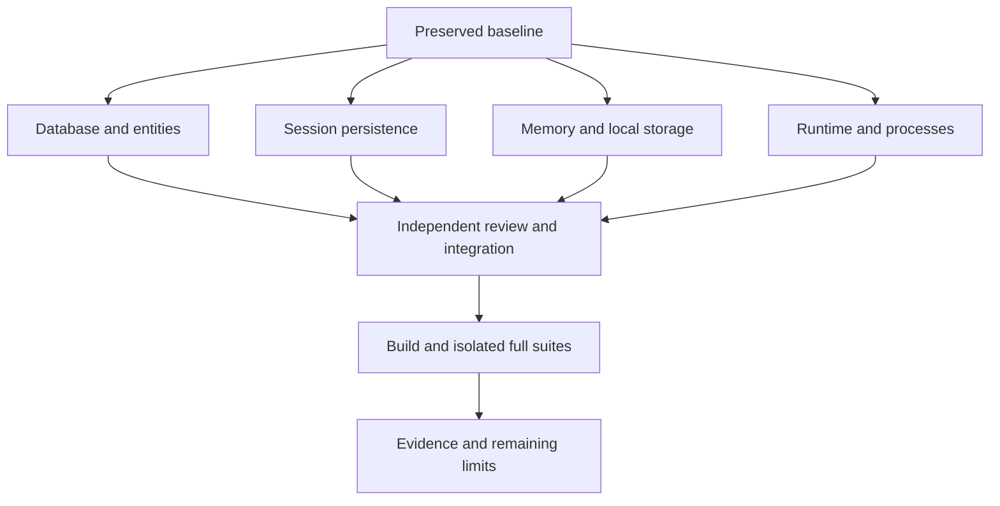

# Database, storage and resource lifecycle audit

## Executive summary

Reviewed the current database, session persistence, local memory and skill storage, process sampling, shell jobs, provider transport and local-model client. Confirmed failure paths were reproduced and repaired in their owning modules, with regression tests. Independent review changed the archive design to avoid database locking during filesystem I/O and found additional transport cancellation races.

The broad core run subsequently exposed another confirmed safety issue: stale timestamp reclamation ran before the live-owner check, so an event-loop stall could let another writer steal a recorded live lock. The shared-lock repair now passes deterministic regressions and independent review, including heartbeat-stable identity, successor-safe removal/release and process-verdict revalidation.

The initial checkout already contained 732 changed files. Those changes were preserved. Other concurrent work modified source and the Git index during verification; no audit agent staged, reset or reverted files. The source hashes, initial patches, task checkpoint, reproduction logs and verification receipts are in `.octocode/tmp/resource-audit/`. This report attributes the fixes below to this audit and treats repository-wide checks as integrated-checkout results.

**Latest gates:** the offline build and all 11 repository checks pass. The complete e2e run after the lock repair passed 244 tests, with 8 failures and 145 skipped cases attributable to prohibited local listeners or `ps`. The all-workspace run was stopped during repeated native fixture timeouts; remaining packages were checked separately with the gaps recorded below. The available Node version is 26.4.0, outside the project's supported Node 24 line. GPU hardware and actual inference performance were not measured.

## Key findings

| Severity | Confirmed cause | Implemented result | Regression evidence |
| --- | --- | --- | --- |
| High | Reading a closed database's lazy mirror could reopen/create a file | Reject mirror acquisition after the coordination connection closes | Closed, opened and never-opened mirror cases in `db-recovery.test.ts` |
| High | Age-only retention removed future timers and unended active runs | Preserve future-due active timers and runs with an exact live registration; expire old terminal/orphan records | `db-retention-boundaries.test.ts`, `db-active-run-fixed.log` |
| Medium | Global purge omitted shell history and optional process samples | Include both families and preserve session-scoped samples when requested | Global purge and `keepSessions` regressions |
| High | Receipt updates could race archive snapshots and deletion | Delete only unchanged snapshots; archive revision keys retain concurrent versions and deduplicate identical retries | Actual newer-archiver/stale-archiver interleaving regression |
| High | Deferred session open/close errors disappeared as if files were deleted | Track all non-ENOENT failures and retry at the next synchronous flush or exit | Open permission/descriptor/I/O, fsync, close and deletion cases |
| Medium | Listing-cache copies shared mutable Date objects | Clone timestamps on insertion and return | Caller mutation cannot alter later cached listings |
| High | Library stale reclamation preceded owner verification after a heartbeat stall | Protect matching recorded owners at acquisition and actual stale removal, keep legacy recovery, revalidate verdicts and preserve successor directories/metadata during cleanup | 24 common and 35 session/run-outcome tests pass; independent review resolved removal/release races |
| High | Shared skills.json read/modify/replace had no encompassing lock | Reread and update under one cross-process lock with bounded asynchronous contention; reject stale rewrite inputs | Overlapping record/rewrite and changed-source cases |
| High | A session resumed after sweep planning could lose DB-only data | Revalidate all planned session IDs and recheck before row-only deletion | Running, current and late-resumed sessions with no filesystem candidates |
| Medium | Long pinned memory titles vanished; escaped text bypassed the line bound | Render bounded quoted title/body projections, preserving valid JSON, retrieval pointers and full stored text | Long titles and escape-heavy bodies in `memory-injection-size.test.ts` |
| High | Oversized timer values became rapid timers; slow process reads accumulated work; recursive traversal overflowed | Clamp positive intervals, skip overlapping periods, start no queued work after stop, and traverse process trees iteratively with linear adjacency construction | Five failing-before cases; all process tests pass |
| Medium | Late process-verdict callbacks restored evicted cache entries | Accept a completion only for its still-current request token | 66 concurrent verdicts cannot refill evicted entries |
| High | A shell started before log creation failed, leaving no registered owner | Stop the tree, destroy pipes and unreference the child when storage setup fails, including adoption | Disk-full and invalid-directory regressions; 79 focused shell tests pass |
| High | Concurrent first WebSocket leases displaced cached sockets; cancellation lost session ownership | Track pending/active/uncached leases, reject pre-aborted acquisitions, retain real session ownership when caching is off, and suppress post-cleanup fallback | Mocked lifecycle tests and independent transport probes |
| Medium | Socket expiry timers and per-session diagnostic/fallback state survived cleanup | Unreference idle timers and clear session-owned state during cleanup | Timer-reference and diagnostic cleanup assertions |
| High | Local-model event streams leaked reader ownership, admitted oversized complete frames, or waited indefinitely for cancellation finalizers | Bound complete and incomplete frames, request cancellation, and release reader ownership without awaiting arbitrary underlying cancellation completion | Mocked watcher/client tests, including a nonsettling cancellation promise |
| Medium | Llama label-token cache grew without a bound | Bound reusable cache entries | `llama-label-cache.test.ts` |

No browser-source change was warranted by the inspected persistence and cleanup paths. Live preferences are host persisted; exported HTML stores a finite, clamped sidebar width and catches browser-storage errors. Retired connections, request deadlines, rendering schedules and unmount cleanup have focused coverage. The legacy unordered-tool compatibility path remains outside the ordered-tool window: this audit does not claim a hard bound on all browser memory or individual payloads.

## Analysis

### Storage ownership and database entities

| Store/family | Entities | Ownership and lifecycle |
| --- | --- | --- |
| Coordination and work | `workspaces`, `agents`, `agent_runs`, `agent_events`, `leases`, `edits` | Workspace references and registered run identity; explicit transactional cleanup |
| Messaging | `messages`, `deliveries` | Delivery records reference messages; reply links use SET NULL; delivery cleanup cascades |
| Backlog | `backlog`, `backlog_tasks`, `backlog_notes`, `backlog_comments`, `backlog_links`, `backlog_completions`, `backlog_audits` | Workspace/item relations, parent/source links and child cleanup; audit history is archived by age |
| Memory and trust | `memories`, FTS tables, `trusted_folders` | Durable memory/search and project trust; complete text retained independently of bounded prompt projections |
| Sessions | `sessions`, `session_forks` | Catalog and fork relations; resumed/current/running sessions are protected during sweep |
| Execution and history | `timers`, `workspace_commands`, `shell_history`, optional `process_samples`, `config_audits`, `meta` | Status-aware retention, receipt revision archive, bounded history/sample retention and explicit purge |
| Separate transcript mirror | `session_transcripts`, `session_entries`, `compaction_summaries` | Independent SQLite connection and schema; entry deletion cascades from transcripts; mirror lock precedes coordination lock |
| Files | Session JSONL, skill store/view, rotating shell logs, gzip archives | Canonical transcripts plus derived projections; atomic replacement and appropriate locks; explicit recovery and retention |

Disposable connections opened through the database API reported coordination schema 10 and mirror schema 1, `foreign_keys=1`, `integrity_check=ok` and no `foreign_key_check` violations. This is a schema smoke check on disposable databases, not an inspection of the user's real data. The full entity/foreign-key inventory is in `.octocode/tmp/db-resource-audit-integrity.log`.

The available runtime reports SQLite 3.53.2. SQLite documents its rare concurrent WAL-reset corruption bug as fixed in 3.51.3 and later; the official Node 24.15.0 release notes include that fixed SQLite update. No minimum-runtime bump was justified by this check. This source verification does not replace executing the suite on supported Node 24.

### Resource measurements

A no-network probe used disposable database files and synthetic process tables on Darwin arm64, Node 26.4.0. Each shape contained 12,000 owned processes and produced the expected initial and final samples. Files were removed afterward.

| Shape | Elapsed ms | User CPU ms | System CPU ms | Heap delta bytes | RSS delta bytes |
| --- | ---: | ---: | ---: | ---: | ---: |
| Wide | 69.22 | 26.280 | 8.058 | 4,884,296 | 19,267,584 |
| Deep | 45.71 | 24.403 | 8.766 | 10,889,768 | 13,385,728 |

These are single-run workload observations under concurrent host activity, not performance thresholds, before/after speedup evidence, leak measurements or a production memory ceiling. The former recursive deep-tree implementation failed the regression with a stack overflow. Evidence: `sampler-profile.json`, `sampler-current.cpuprofile` and `sampler-red.log` under the audit evidence directory.

Octocode's local-model module is an HTTP client of a separately running llama.cpp server. That server owns model CPU/GPU allocations; host free-RAM advice is not a VRAM-fit guarantee. No GPU allocations, release behavior, throughput or model-quality claims were verified on hardware.

### Decisions and trade-offs

| Alternative | Decision and reason |
| --- | --- |
| Hold the coordination write lock while compressing receipt history | Rejected in independent review: monthly gzip rewrite time is not bounded by the added row count. Archive I/O remains outside the DB transaction. |
| Delete a receipt by identity after archiving an earlier state | Rejected: snapshot-aware deletion preserves a concurrent update. Full-row revision keys retain both archived versions in a rare interleaving. This uses some extra archive space. |
| Raise SQLite busy timeouts globally | No change: synchronous waits can stall Node's calling thread, and WAL still allows only one writer. Existing worker queues, bounded retries and lock ordering remain. |
| Queue every missed monitoring sample | Rejected: old periodic observations have little value and create catch-up load. At most one process listing runs; elapsed periods are skipped. |
| Wait for arbitrary stream cancellation completion during cleanup | Avoided in the repaired watcher: request cancellation, handle its rejection and release the reader lock so shutdown can settle. |
| Alter rendering compatibility or tune GPU defaults without hardware evidence | Deferred: preserve public behavior and server ownership; verify actual workloads before changing resource policy. |

### Execution graph and ownership

| Owner | Assignment | State |
| --- | --- | --- |
| `database` | DB source/tests/README; schema inventory and native consumers | Implementation complete; regression/integration verification complete |
| `sessions` | Session-manager persistence/cache source, shared lock acquisition and tests | Complete; original session fixes and final live-lock regressions pass; independently reviewed by database owner |
| `memory_storage` | Memory, skill-store and sweep source/tests | Complete; 107 focused tests pass |
| `runtime_resources` | Provider transport, llama client, token cache and regressions | Complete; 81 AI and 13 llama tests pass |
| `browser_storage_review` | Read-only browser audit and independent runtime review | Complete; all four final transport probes pass |
| Coordinator | Process sampler, process-verdict cache, shell-storage failure handling, integration and report | Build and all 11 repository gates pass; package verification results and blocked coverage below |

Shared-checkout edits were assigned to non-overlapping owners. Builds/generators owned by this audit are serialized. The task checkpoint tracks dependencies and results; test failures and blocked checks remain visible rather than being relabeled as success.

## Verification

| Check | Observed result | Evidence |
| --- | --- | --- |
| DB workspace | 71 tests passed in ten files, including active-run retention | `db-resource-audit-tests-final.log`, `db-active-run-fixed.log` |
| Native DB consumers | 53 tests passed in four files | `db-resource-audit-native-integration.log` |
| Session durability/cache | 22 tests passed in three files | `db-storage-sessions-focused.log` |
| Final live-lock safety | 24 common tests plus 35 session/run-outcome tests passed; root typecheck passed; explicit filesystem typing corrected after initial closure check | `resource-audit/live-lock-common-final.log`, `live-lock-session.log`, `live-lock-typecheck.log` |
| Broader session-manager | Initial run 251 passed / 3 failed; one intended open-error assertion fixed and passed; two start-time cases require prohibited `ps` | `db-storage-sessions-tests.log` |
| Memory, skill storage and resumed sweep cases | 107 tests passed in nine files, then all 107 passed again against the final lock implementation | `resource-audit-memory/combined-tests.log`, `closure-tests.log` |
| Broader sweep | 32 passed / 1 failed; reused-PID fixture needs prohibited `ps` | `resource-audit-memory/sweep-tests.log` |
| Process feature | 66 tests passed in seven files | `resource-audit/sampler-green.log` |
| Common process-cache/locks | 8 tests passed in three files | `resource-audit/lock-owner-green.log` |
| Shell storage/spawn/handoff/concurrency | 79 tests passed in four files | `resource-audit/bash-storage-green.log` |
| AI runtime | 81 tests passed in six files | `runtime-ai-final.log` |
| Mocked local-model watcher/client | 13 tests passed in two files | `runtime-llama-final.log` |
| Existing loopback local-model bounds | Five tests fail at `listen EPERM`; their assertions remain | `runtime-llama-after.log` |
| Browser lifecycle/storage | 64 tests passed in seven files | `resource-audit/browser-storage-focused.log` |
| Independent final transport probes | Four pass: active cleanup has zero HTTP fallbacks or resurrected stats; cached pre-abort rejects; uncached socket closes; pending cancellation releases reader | `resource-audit/runtime-review-*`, `llama-review-cancel.ts` |
| Synthetic CPU/RSS probe | Passed, both shapes produced two complete samples | `resource-audit/sampler-profile.exit`, profile JSON and CPU profile |
| First integrated check | Failed on concurrent fixture type/format/bundle changes and two new test inline type imports; inline imports repaired | `resource-audit/integrated-check.log` |
| Intermediate integrated checks | Exposed concurrent fixture/UI changes and the new lock wrapper's inferred-type errors; all are cleared in the final gate run | `resource-audit/final-check.log`, `closure-check.log`, `closure2-check.log` |
| Final repository check | All 11 checks passed: types, lint, formatting, browser smoke, generated freshness, package/DB/MCP boundaries, architecture and unused-code analysis | `resource-audit/verified-check.exit`, `verified-check.log` |
| Closing check after final test-fixture correction | All 11 checks passed again | `resource-audit/closing-check.exit`, `closing-check.log` |
| Workspace regeneration and final offline build | Passed; prompt generation warned that the sandbox forbids its local API socket. One intermediate build raced a concurrently created TUI helper and was retried after its emitted file existed | `resource-audit/verified-build.exit`, `verified-build.log` |
| Complete standalone scripted e2e | 29 files passed / 30 failed; 243 tests passed / 9 failed / 145 skipped. Twenty-five suite failures could not start loopback fixtures. Eight failing tests also trace to listener/process restrictions; one stale backlog schema assertion was repaired | `resource-audit/integrated-e2e.log` |
| Affected e2e contract rerun | 21 tests passed; retained exact enum assertion now includes the registered `step` operation | `resource-audit/e2e-contract-rerun.log` |
| Complete e2e after lock repair, two workers | 30 files passed / 29 failed; 244 tests passed / 8 failed / 145 skipped. Remaining suite/test failures require prohibited listener or process inspection capabilities | `resource-audit/closure2-e2e.log`, `closure2-e2e.exit` |
| Isolated scripts, ACP and engine | Scripts: 219 passed / 3 listener failures. ACP: 185 passed. Agent engine: 172 passed | `resource-audit/full-tests-current.log` |
| Isolated full AI workspace | 3,690 passed / 44 failed / 863 skipped; failures include forbidden callback/mock listeners and related timeouts | `resource-audit/full-tests-current.log` |
| Isolated full coding-agent core | 5,245 passed / 97 failed / 17 skipped; failures include environmental restrictions, concurrently repaired contracts/syntax, and the additional live-lock defect now being repaired | `resource-audit/full-tests-current.log` |
| Full isolated test runner | Stopped during native repeated timeouts; no complete native-suite result is claimed. It contains pre-repair/concurrent snapshots, not a clean release result | `resource-audit/full-tests-current.log`, `full-tests-current.interrupted.txt` |
| Common suite excluding two listener fixture files | 130 passed / 1 failed / 1 skipped across 22 files. Sole failure requires native file events without polling; asynchronous EMFILE forces the working fallback. Full listener attempt was stopped during repeated timeouts | `resource-audit/pkg-common.log`, `remaining-workspaces.interrupted.txt` |
| Contracts | 113 tests passed in 15 files | `resource-audit/pkg-contracts.log` |
| Webview | 651 tests passed in 86 files; additional focused current board checks passed 58 tests | `resource-audit/pkg-webview.log`, `board-focus-integration.log`, `board-focus-callers.log` |
| Terminal | 47 tests passed in eight files | `resource-audit/pkg-terminal.log` |
| Telemetry | 27 tests passed in four files | `resource-audit/pkg-telemetry.log` |
| TUI | Completed with failures in real tmux fixtures: creation of their Unix sockets was denied. The dot reporter supplies no reliable total, so no total is invented | `resource-audit/pkg-tui.log` |
| MCP subset after six listener-file exclusions | 84 files and 576 tests passed; one further file, `test/server/tool-server.test.ts`, failed six tests because its indirect listener could not bind. Overall exit 1; no retry | `resource-audit/mcp-portable-summary.json`, `mcp-portable.log` |
| Configuration and local-model closure | 46 tests passed in three files, confirming current model limits/cancellation, settings-save behavior and provider management. Exact-path UI assertions use a wide fixture viewport so isolated temporary prefixes do not truncate the expected text | `resource-audit/configuration-closure-final.log` |

Logs in this table are under `.octocode/tmp/`. Focused test groups overlap; their counts must not be summed into a unique-test total. No tests requiring live paid models were run.

The MCP subset excluded the following entire files. Portable cases inside mixed files are also unverified; the command is not presented as a full MCP-suite pass.

| Excluded file | Listener dependency |
| --- | --- |
| `test/client/oauth.test.ts` | Shared loopback helper and OAuth callback server |
| `test/client/streamable-http.test.ts` | Shared loopback HTTP fixture |
| `test/mcp-browser-proxy.test.ts` | HTTP/TCP proxy fixtures |
| `test/mcp-command.test.ts` | Token gateway fixture; file also has portable CLI cases |
| `test/mcp-extension.test.ts` | Token gateway fixture; file also has portable in-memory cases |
| `test/mcp-oauth-refresh.test.ts` | Shared OAuth MCP server fixture |

The executed `test/server/tool-server.test.ts` invokes `serveTools`, which also binds loopback. Its six failures are an additional coverage gap, not an excluded or passing test. Exact discovery evidence and actual counts are in `mcp-portable-summary.json`.

The three Claude adapter e2e failures initially appeared as missing journal entries or a launch timeout. An independent direct session probe reproduced `Claude Code failed: listen EPERM: operation not permitted 127.0.0.1`: its tools-enabled connection starts an MCP listener before spawning the adapter, and the provider correctly turns that startup failure into an assistant error. The fixture therefore has no start/result/prompt entry to inspect. No routing defect or assertion weakening was warranted.

The e2e log also contains Socket listener-count warnings without stacks. A focused owner probe found zero retained stdin/stdout/stderr error listeners after 30 signal-handler register/unregister cycles. Twelve concurrent output drains reproduced the warning while pending, then all their listeners were removed. This proves a possible transient cause, not attribution of every integrated warning or a persistent leak. Evidence: `resource-audit/warning-listener-probe.log`; the direct Claude probe is preserved as `resource-audit/claude-code-listen-probe.log`.

A fresh native file-watch probe constructed its watcher, then received asynchronous `EMFILE` and no change events. A disposable footer-provider probe still refreshed a changed HEAD within 5.8 seconds through its existing retry/refresh path. The two failing reftable tests require native watcher installation or native event delivery; real reftable delivery remains unverified. Evidence: `resource-audit/footer-watch-probe.log`. No watcher assertions were weakened.

## Recommendations and next steps

1. Repeat release validation with `./test.sh` and the complete scripted e2e on supported Node 24 in an environment allowing process-start inspection, native file events and local TCP/Unix listeners. Success means the previously blocked integration tests execute successfully without weakened assertions.
2. Preserve the final source checkpoint (`resource-audit/closure-source-hashes.json`) and gate receipts when integrating this audit with other concurrent changes. All 25 audited production files remain below 400 lines; the largest has 393.
3. Run a representative local llama.cpp workload on target hardware before changing VRAM budgets, load/unload policy or GPU concurrency. Capture server-reported device memory, cancellation and release behavior.
4. Monthly archive compression is still synchronous and scales with the month's retained content, although the repair does not hold a DB write lock during it. Generic custom SSE transports with nonsettling cancellation remain an unverified hypothesis outside the reproduced watcher case. Capture a real workload/progress trace before adding a broader worker or timeout mechanism.

Confidence is high in the reproduced defects and focused regressions. Production resource ceilings, GPU behavior, supported-runtime compatibility and blocked integrations remain unverified. This report does not assert that every possible repository defect or production-data inconsistency has been excluded.

No repair remains pending for the confirmed findings listed in this report. Full release validation remains blocked by the documented environment and coverage gaps.

## Primary sources

- [Node 24 timers](https://nodejs.org/download/release/v24.22.1/docs/api/timers.html#setintervalcallback-delay-args): out-of-range delays are reduced to a rapid timer, and unreferenced timers do not keep Node alive. The clamp and idle-expiry fixes respect these documented semantics.
- [Node 24 filesystem](https://nodejs.org/docs/latest-v24.x/api/fs.html#filehandlesync): file synchronization requests persistence for an open descriptor; concurrent modifications require application synchronization. Failure-path regressions validate application handling separately.
- [SQLite WAL](https://www.sqlite.org/wal.html): one writer, reader/checkpoint interactions and the durability/performance trade-off. These constraints informed the rejected database-lock/archive-I/O design.
- [Node 24.15.0 release notes](https://nodejs.org/en/blog/release/v24.15.0): dependency updates include SQLite 3.51.3, whose WAL-reset fix is documented by SQLite. Actual supported-runtime execution is still required.
- [WHATWG Streams](https://streams.spec.whatwg.org/#default-reader-prototype): cancellation and release of reader ownership are distinct operations. The watcher tests include delayed cancellation settlement.
- [proper-lockfile](https://github.com/moxystudio/node-proper-lockfile): directory-based locking and modification-time heartbeat behavior underpin the existing cross-process lock utility reused for skill updates.
- [llama.cpp server](https://github.com/ggml-org/llama.cpp/blob/master/tools/server/README.md#memory-based-unloading): the separate server/router owns model/device memory and loading/unloading. Its current documentation is architectural context, not proof of compatibility with an uninspected installed server version.
