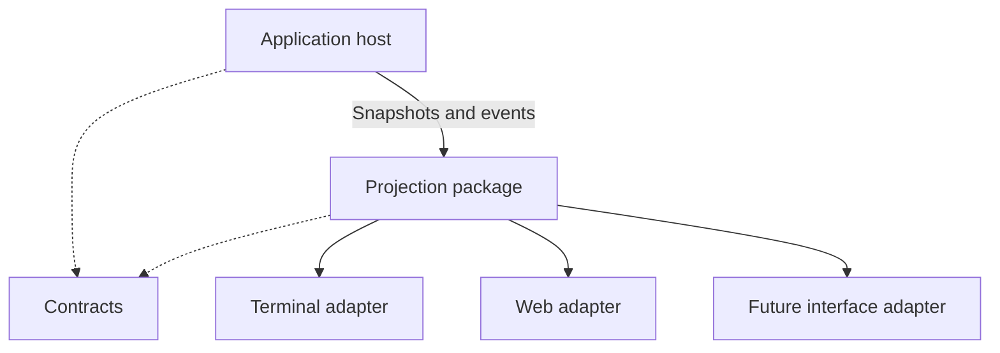
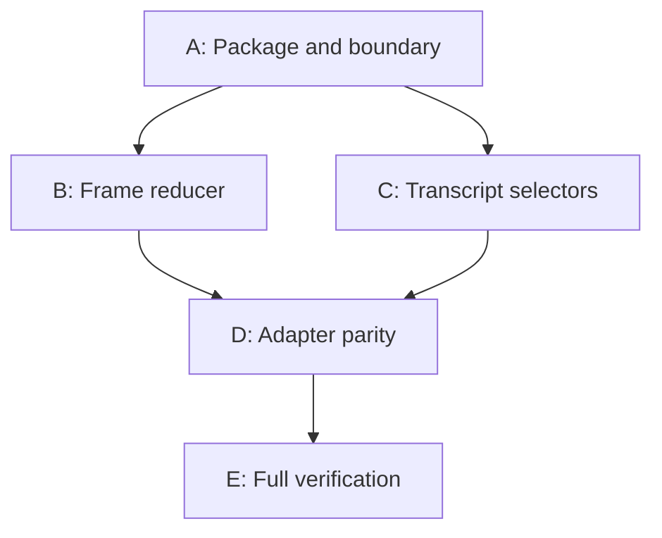

# RFC: A dedicated interface projection package

## Executive summary

Create the private workspace package **`@octocodeai/octocode-projections`** at `packages/projections`. It owns portable, deterministic interpretation of application data: frame reduction, transcript visibility, tool ownership, ordering and presentation-state selectors. Its only workspace dependency is `@octocodeai/octocode-contracts`.

Keep contracts as the wire vocabulary, the application host as execution authority, and each interface as its own renderer. A new interface should consume the same semantic data without importing the terminal, browser application or agent runtime.

Start by extracting the existing portable `ApplicationStream`, then migrate shared transcript semantics from the web adapter and adopt shared selectors in both web and terminal. Preserve protocol version 1 and current public commands. No separate service, database, event bus or public npm package is needed.

**Status:** this document proposes the extraction; the new package has not been created. Two independently useful audit fixes remain in their current owners; verification results are recorded below. If accepted, this proposal supersedes only the earlier [application-port RFC](.octocode/octocode-rfc-generator/2026-10-22-interface-port/RFC.md)'s decision to avoid a runtime package during that migration. Its single-host and protocol decisions remain intact.

## Key findings and evidence

The audit used the working checkout at `9e328c41`, including pre-existing changes. Locations below identify source evidence, not a claim that every path has been execution-tested.

| Finding | Source evidence | Consequence | Confidence |
| --- | --- | --- | --- |
| A shared application boundary already exists | `core/application/service.ts`; terminal `interactive-mode/agent-events.ts:66`; workspace `application-stream.ts` | Extend this boundary; do not introduce another execution owner | High |
| Portable frame interpretation is owned by the browser package | `packages/webview/src/application-stream.ts`, especially `accept()` and retention helpers | Future clients must copy logic or depend on a UI package | High |
| Transcript meaning is mixed with web feed metadata | `packages/webview/src/app/live/application-projection.ts:57–74,99–127,166–172` | Visibility, duplicate suppression, association and ordering can diverge across interfaces | High |
| Both interfaces already consume host-produced tool displays | `core/application/transcript-display.ts`; terminal `components/tool-execution/display.ts`; web `packages/webview/src/app/live/ContentBlocks.tsx` | Preserve canonical `ToolDisplay`; avoid a second implementation of tool-specific interpretation | High |
| Parent cycles can hide every tool in a component | Web projection marks rows embedded when their parent exists; `app/live/model.ts:163` filters embedded rows | A self-parent or two-node cycle needs a deterministic visible root | Medium: source-derived, regression required |
| Visibility enforcement is uneven | Contract `application.ts:120` says consumers must honor `display:false`; web projection checks it; terminal `application-events.ts:91` does not check it at that ingress | Share the predicate; test actual live and history paths before changing terminal behavior | Medium: producer/path coverage remains to verify |
| Incremental cost is an existing contract | Web projection's source-reference cache; `packages/webview/test/projection-incremental.test.ts` | Extraction must preserve unchanged-row reuse and avoid serializing the whole transcript per delta | High |
| Host projection and custom display can disagree | `core/application/transcript.ts` projects result text but previously passed the original result to tool display construction | A custom renderer can reinterpret content that the host projection replaced; fixed separately from extraction | High: regression coverage added |
| Replacement deltas retained obsolete display fields | `packages/webview/src/application-stream.ts` previously retained absent `full`/`content` fields | Old assets or rich content could outlive an authoritative replacement; fixed separately | High: regression coverage added |

`core/application/*` and terminal paths in this table are under `packages/coding-agent/src/`. Contracts paths are under `packages/contracts/src/`. These are distinct kinds of projection: **host enrichment** turns native results into safe application data; **portable projection** interprets that application data for views. Only the latter moves in this RFC.

## Proposed architecture



Solid arrows carry data. Dotted arrows identify schema/type dependencies. Each adapter submits commands through the existing application port or authenticated transport; these command paths are omitted from the diagram. Projection and rendering never start a run.

### Ownership and dependency rules

| Owner | Owns | Excludes |
| --- | --- | --- |
| `contracts` | Serializable schemas/types, protocol versions, parsers, command and frame vocabulary | View caches, transcript grouping policy, execution |
| `projections` | Frame folding; read-only transcript interpretation; semantic visibility, ownership, order and state; bounded local read model | Host imports, filesystem, DB, network, clocks, React, DOM, terminal libraries, credentials and permission decisions |
| `coding-agent/core/application` | Native event conversion, registered tool display callbacks, redaction, assets, authoritative transcript/history, sequencing/replay, receipts and commands | Interface layout |
| `coding-agent` terminal adapter | Components, theme, width, images, focus, local extension UI and scroll/window controls | A second interpretation of shared message visibility or tool lifecycle |
| `webview` | React, transport/reconnect scheduling, feed metadata, filters, history requests, Blob URLs and layout | Host execution or authorization |

Allowed new workspace edges: `projections → contracts`, `webview → projections`, and `coding-agent → projections`. Add them to the existing package-boundary policy. Contracts must never import projections; low-level `agent`, `ai` and `tui` do not gain projection dependencies. Keep `common` and the MCP/ACP owners unchanged.

The package is ESM, private and side-effect free, using the existing TypeScript/source-export/build conventions. It is bundled into the sole public package. Add its workspace manifest, build/test setup and dependency declarations through Yarn; update the one lockfile and regenerate release/install artifacts only through their owning scripts when required. No independent versioning or release process is introduced.

### Initial API

These signatures describe the proposed boundary, not implemented exports. Retain existing names where possible; confirm names against current exports before adding them.

| API | Responsibility | Initial consumers |
| --- | --- | --- |
| `ApplicationStream` | Existing `accept(unknown)`, `acceptReceipt()`, cursor, snapshot and last-frame time; validates/folds snapshot, replay and event frames | Web transport, portable integration tests, future remote clients |
| `applicationMessageDisplayed(message)` | Enforce explicit visibility and context-only custom-message policy | Web transcript adapter and terminal live/history ingress |
| `projectTranscript(input)` | Ordered semantic message/tool rows, tool ownership and descendants; duplicate tool-result suppression | Web feed adapter initially; selectors reused by terminal without replacing its components |
| `toolState(tool)` | Return the existing contracts `UiState`; map `notRun` to `stopped` and preserve failure/running/completed distinctions | Web and terminal state adapters |

`projectTranscript` accepts readonly contract messages/tools and a session scope. It returns discriminated rows such as `{ kind: "message", key, message, tools }` and `{ kind: "tool", key, tool, tools, embedded }`. Keys include the session, row kind and canonical ID with an unambiguous encoding. Preserve original contract objects and source order for equal or absent order values. Do not wrap the rows in browser `WorkspaceEvent` or invent numeric feed IDs.

Retain explicit terminal `renderCall`/`renderResult` extensions as local adapter capabilities; this RFC does not force them through the generic tool renderer.

Keep web `ApplicationProjection` as the adapter that adds local identity/interning, observed timestamps and thinking duration. Its incremental cache may remain there during the first extraction; the shared selector must not force reconstruction or serialization of every large row on each delta. Benchmark the integrated path before selecting a stateful projector API. Avoid an additional cache until its owner and invalidation rules are explicit.

Do not move `applicationMessageText(content)` from contracts merely to obtain a preferred API name: it already exists. Existing schema-adjacent helpers remain initially; later relocation requires a real second consumer and compatibility forwarding without a dependency cycle. Do not move the whole `ApplicationProjection` class or `core/application` directory.

### Data and failure invariants

| Concern | Required behavior |
| --- | --- |
| Authority | Consume host-projected data. A selector never reads native results, invokes tool callbacks, opens assets or grants capabilities |
| Rich content | Ordered blocks remain authoritative; text previews are fallbacks. Legacy placeholder parsing applies only to legacy text |
| Delta semantics | Preserve block-append preconditions. An authoritative replacement clears omitted obsolete rich/full fields. Preserve compatibility with legacy text-only appends |
| Replay | Duplicate/stale events, gaps, epoch changes, resumed markers and coalesced ranges retain current tested behavior. Invalid append state requests resync |
| Session isolation | No cache or row identity leaks across sessions or context resets. Preserve the current session-change resync behavior rather than silently treating all cross-session frames alike |
| Graph safety | Missing parents remain visible. Self-parent and multi-node cycles terminate and retain a deterministic visible root; no component disappears solely due to malformed topology |
| Ordering | Stable canonical order across live updates, snapshots and loaded history; no duplicate tool result beside its represented tool |
| Retention | Preserve current distinct host snapshot and client live-window limits. Evicted tools remain recoverable through history; no arbitrary unification of thresholds |
| Assets | Carry opaque references and revisions unchanged. Loading, session checks, URL policy and cache disposal stay in the host/interface adapters |
| Performance | No whole-transcript JSON comparison per streamed delta; preserve canonical references and existing changed-row cost assertions |
| Isolation | One projector per connection/view; no globals, callbacks with execution authority, timers, hidden I/O or mutable shared singleton |

Projection can maintain its own view state, but must not mutate caller-owned contract objects. Reusing canonical objects requires adapters to treat them as immutable. A future configurable retention limit is not required for the first move; add one only for a concrete consumer, with validated bounds and explicit history semantics.

### Host enrichment stays separate

Registered `display()` callbacks can depend on feature types, structured native results and tool-specific policy. `normalize.ts` also reads saved outputs and creates assets. `ApplicationService` owns session operations, subscriptions, receipt persistence and lifecycle. These responsibilities remain in the host, with pure pieces extracted only when their inputs are already portable. When an output projection applies, result renderers must not receive the discarded original result; preserve freshly computed argument-only metadata and use the projected body/outcome.

The audit also found a host lifecycle follow-up: `octocode/workspace/runtime.ts:147` installs an output projector and ignores its disposer; `core/agent-session/extension-runtime.ts:88` emits `session_shutdown` on reload, while `core/application/transcript.ts:85` retains the previous registration. Before changing that lifecycle, reproduce reload/rebind behavior and verify which owner should unregister it. Also verify whether late projector registration rebuilds the synchronous terminal transcript as well as invalidating serialized replay; that parity concern remains a hypothesis. Moving the registration into a pure projection package would conceal the lifecycle problem.

## Alternatives and trade-offs

| Alternative | Benefit | Cost / decision |
| --- | --- | --- |
| Keep everything in webview | No package overhead | New interfaces inherit a browser dependency or duplicate semantics; reject |
| Put reducers and selectors in contracts | Minimal dependency graph | Blurs schema ownership with view state and presentation policy; retain only existing small schema-adjacent helpers |
| Move the entire application service to a new package | Potentially reusable host runtime | Pulls sessions, assets, settings and feature callbacks across ownership boundaries; outside this RFC |
| New private projection workspace | Clear reusable boundary, enforceable dependencies, incremental extraction | Adds manifest/build/test maintenance; recommended because portable frame reduction already has real cross-package tests |
| Universal renderer or plugin framework | One rendering abstraction | Couples accessibility, terminal layout and browser interaction; unnecessary for shared data interpretation |

This is a local read-model separation, not an adoption of distributed CQRS or event sourcing. Microsoft's [CQRS guidance](https://learn.microsoft.com/en-us/azure/architecture/patterns/cqrs) supports separate read representations but also documents the complexity of separate stores. This design retains the existing host and storage. The [Language Server Protocol rationale](https://code.visualstudio.com/api/language-extensions/overview#language-server-protocol) provides a useful analogy for reusable semantics behind multiple clients; it does not imply that this application needs LSP or another wire protocol.

## Migration and verification plan

No migration stage requires changing the public protocol. Serialize conflicting edits; stages B and C have distinct file owners. Each stage must pass its gate before dependent work begins.



| Stage | Owner role | Concrete changes | Acceptance gate |
| --- | --- | --- | --- |
| A | Coordinator / package owner | Add private projections workspace, exports, Yarn references and import rules; add Node/DOM/host import guard | Package builds; boundary tests reject prohibited imports; existing package build order preserved |
| B | Frame owner | Move `webview/src/application-stream.ts` and pure reducer tests into projections; split mixed tests as needed; retain web projection/history integration tests in webview and update imports | Replay, replacements, append preconditions, receipts and retention tests pass unchanged; only one implementation remains |
| C | Semantic owner | Extract visibility, tool association/order and state; preserve browser metadata/cache in its adapter | Selector tests cover hidden/custom messages, interrupted empty messages, duplicates, orphans, out-of-order parents and cycles |
| D | Adapter owner | Web consumes rows; terminal adopts shared visibility/state in live and history paths; keep its extension UI and windowing | Same fixture yields equivalent semantic visibility/state in both adapters; current UI/performance tests pass |
| E | Independent reviewer | Inspect dependency graph, generated bundle and final behavior; document extension points | Root check, full web/contracts/projections suites, focused terminal/application tests, offline build and full scripted e2e pass |

Keep temporary forwarding exports only if a real importer requires them; they must point to the sole implementation. In particular, contracts cannot re-export projections because projections already depends on contracts. Remove browser compatibility forwarding after updating repository imports in the same change where possible.

Run these checks during implementation; **they are acceptance criteria, not claims of execution for an uncreated package**:

```sh
yarn workspace @octocodeai/octocode-projections run test
yarn workspace @octocodeai/octocode-projections run build
yarn workspace @octocodeai/octocode-contracts run test
yarn workspace @octocodeai/octocode-webview run test
yarn run generate:workspace
yarn run check
yarn run build:offline
yarn workspace @octocodeai/octocodecode run test:e2e
```

Also run focused core application and terminal integration tests with their owning Vitest configs. Builds and full suites run in the background with bounded log inspection. Validate on the supported Node 24.15+ line; this audit environment currently runs Node 26.4.0, so results here do not establish supported-runtime compatibility.

### Required regression matrix

| Area | Cases / existing evidence to retain |
| --- | --- |
| Frames | Fresh snapshot, resume, duplicate/out-of-order/gap, epoch/session change, coalesced block appends, invalid payloads |
| Message display | `display:false`, context-only custom messages, rich-only content, reasoning-only content, empty failed/aborted/interrupted responses |
| Tools | Started/progress/completed, result replacement, `notRun`, parent after child, missing parent, self-loop, two-node cycle, message-linked descendants |
| History and assets | Window eviction, duplicate page IDs, late results, context reset, old full asset removal, full-content chain/revision and isolation |
| Parity and cost | Web full rebuild vs incremental rows; terminal live vs rebuild; existing `projection-incremental`, `rich-stream`, `application-content`, stream-cost and stopped-tool tests |
| Boundaries | Browser bundling of the package, no Node/DOM/host imports, no effects from module import, no render-triggered execution |

## Risks, confidence and next steps

| Risk | Mitigation / evidence needed |
| --- | --- |
| A move quietly changes behavior | Extract before redesigning; keep current fixtures, add targeted regressions, compare adapters before replacing local selectors |
| Caches retain stale or cross-session data | Session-scoped ownership, context-reset tests, disposal and unchanged-object contracts |
| Correctness improvement increases streaming cost | Preserve existing performance assertions; index tool relationships once per projection update instead of repeated full scans; measure before optimizing |
| The package becomes a miscellaneous presentation utility bucket | Admit only portable application-data interpretation with actual consumers; keep layout and native-result enrichment outside |
| A new interface expects controls it cannot answer | Expose existing awaiting/capability facts; host authorization remains authoritative; do not infer permissions from rendered state |
| Source-derived cycle/visibility risks differ from production paths | Add reproductions before changing those policies; record failure evidence and verify history/live producer coverage |

**Recommendation:** accept the private package boundary and staged migration. The first implementation change should establish the package and extract the frame reducer without a protocol change. Shared transcript selectors follow with web/terminal parity tests. Defer generic asset hydration, arbitrary plugin APIs and broad domain projections until a real consumer needs them.

Success means a new adapter can interpret the session using contracts plus projections, cannot import host authority through the package, and passes the same semantic fixtures as terminal and web. It does not mean every interface must render identical layouts or use the same transport.

## Audit execution record

| Workstream | State | Result |
| --- | --- | --- |
| Contracts / frame audit | Completed | Portable reducer boundary mapped; extraction prototype withdrawn after the RFC request; replacement regression fixed in current owner |
| UI semantics audit | Completed, read-only | Visibility/topology/state candidates identified; cycle and terminal-ingress risks reserved for regression-first migration |
| Application host audit | Completed | Output-projection/display bypass regression and host-only boundary identified; no service/package move |
| RFC integration / independent review | Completed | Three audit workstreams integrated; independent review corrections applied; coordinator owns final verification report |

The package migration remains **proposed**. The results below validate the retained audit fixes and existing checkout; migration acceptance tests above remain future work.

### Observed verification

| Check | Actual result | Evidence |
| --- | --- | --- |
| Webview suite | Passed: 86 files, 653 tests | `.octocode/tmp/interface-projections/webview-tests.log` |
| Contracts suite | Passed: 15 files, 113 tests | `.octocode/tmp/interface-projections/contracts-tests.log` |
| Focused application suite | Passed: 3 files, 27 tests; output projection, content and stopped tools | Application audit worker's completed core Vitest run |
| Formatting of changed source/tests | Passed: all six files | Targeted Oxfmt check; no whole-repository formatting mutation |
| Generated workspace | Regenerated; root workspace freshness and browser smoke checks passed | Generated `state.generated.ts` and root check log |
| Offline build | Passed, including prompt capture; Unix-socket `EPERM` warning emitted | `.octocode/tmp/interface-projections/build.log` |
| Repository check | Final aggregate run passed all 11 checks. Initial unrelated compaction-test formatting failure was corrected by concurrent work and rechecked | `.octocode/tmp/interface-projections/check.log` and `check-final.log` |
| Full scripted e2e | Failed: 30 files passed, 29 failed; 244 tests passed, 8 failed, 145 skipped | `.octocode/tmp/interface-projections/e2e.log` |
| Patch whitespace / RFC links | Passed; independent review corrections checked | `git diff --check` and local link inspection |

E2e failures include explicit denied TCP/Unix socket binding, denied `ps`, slash-command expectations affected by unavailable services, and three Claude adapter assertions consistent with listener startup failure. The Claude path binds loopback before starting its fixture, explaining the missing journal data and cancellation timeout; the exact underlying assistant error was not captured and no clean-baseline run was performed. These results do not establish end-to-end parity or Node 24 compatibility. No assertions, timeouts or thresholds were relaxed; no paid model evaluation was run.
