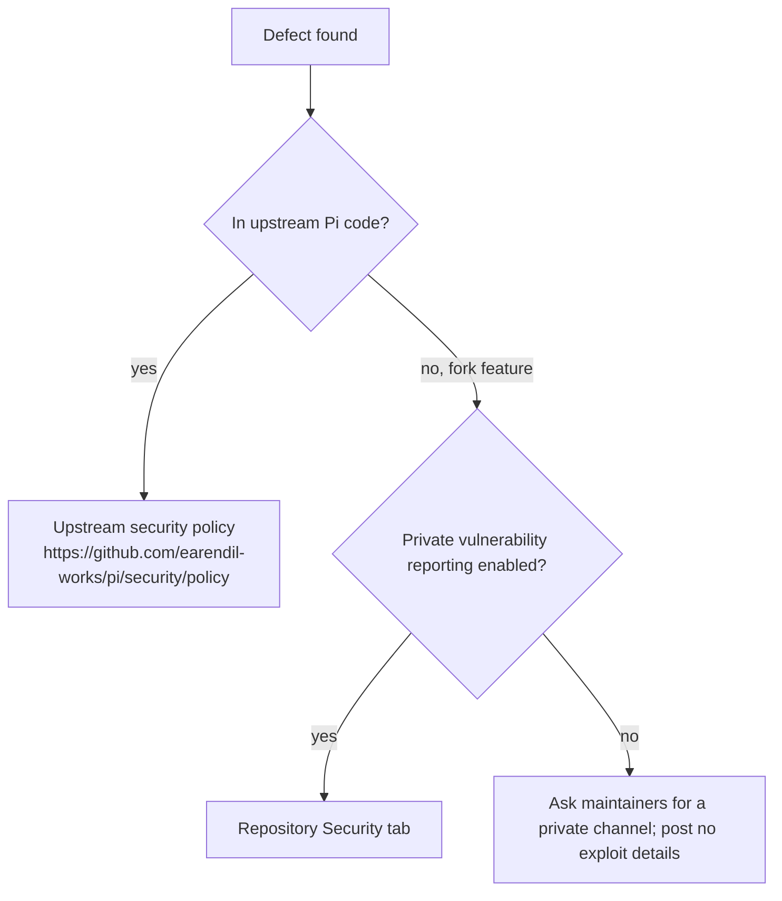

# Security in octocode-code

Octocode is an independent fork of [Pi](https://github.com/earendil-works/pi). It runs with the operating-system permissions of the user who launches it. Permission checks, file guards, project trust and hook policies control supported agent actions; they are **not** an operating-system sandbox. Use process or container isolation for a stronger boundary.

Extensions and hooks run local code: install trusted packages and review project instructions, skills and configuration before granting trust. Retrieved text and model output can be adversarial; prompts alone cannot enforce filesystem or network isolation.

## Boundaries

| Area                | Behavior                                                                                                                                                                                   |
| ------------------- | ------------------------------------------------------------------------------------------------------------------------------------------------------------------------------------------ |
| Permission modes    | Default `full`; set `OCTOCODE_PERMISSION=manual` or `workspace` for more checks. Grants and modes: [permissions](packages/coding-agent/docs/permissions.md)                                |
| File edits          | Guarded edits and path reservations coordinate agents working in one workspace                                                                                                             |
| Local session API   | Opt-in; keep its discovery files and tokens private                                                                                                                                        |
| Same-user processes | A process with the same user's filesystem or debugger access can influence the agent; child nonces and private file modes do not isolate it                                                |
| External agents     | Run with their own credentials, tools and permission policies                                                                                                                              |
| Credentials         | Manage AI credentials with `/providers` ([provider guide](packages/coding-agent/docs/providers.md#connect-what-you-have)); GitHub code-search login via `/octocode auth login` is separate |

Related: [configuration](packages/coding-agent/docs/configuration.md), [environment variables](packages/coding-agent/docs/environment-variables.md), [native features](packages/coding-agent/docs/native-features.md).

## Reporting

This repository names no security email or response-time commitment. Include the commit or package version, configuration, reproduction steps, expected boundary and observed impact; redact credentials and session contents. A bypass of an implemented permission, trust or API-authentication check is worth investigating even though the process is not sandboxed.
