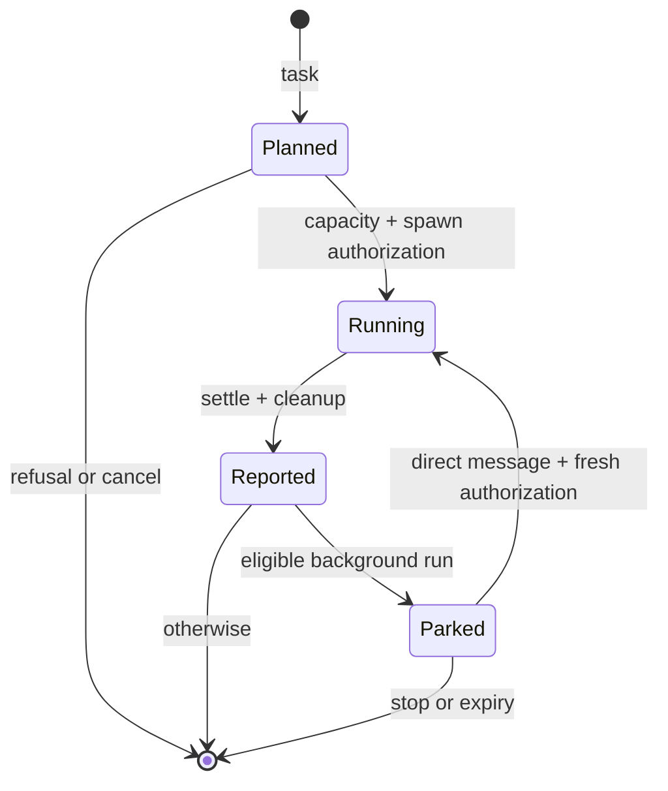
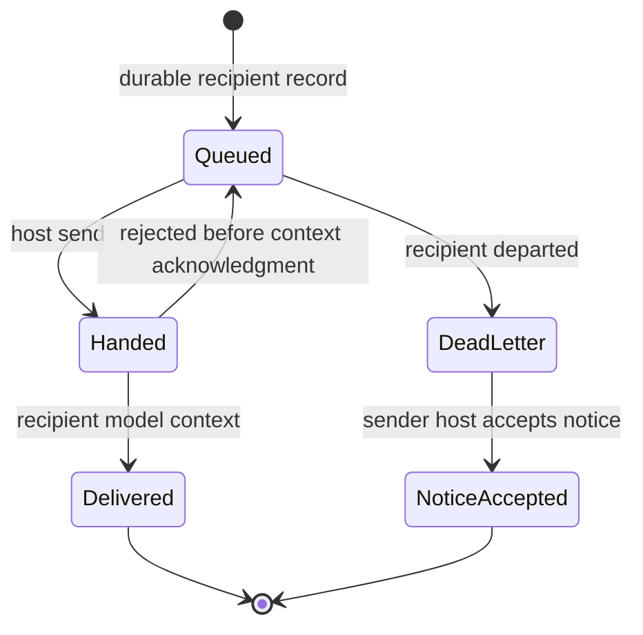

# Agent communication and worker lifecycle

Internal Team mail, worker RPC, the native process API and ACP have distinct delivery contracts. A2A is not implemented; it would be an optional remote adapter, since it needs an HTTP server, Agent Cards and auth. One verb for the model sits over these contracts: `agent` type `message`, `to` a name, for teammates and for another Octocode process, with a merge workflow from a linked worktree to its main checkout.

## External processes

| Goal                                               | Interface and owner                                                                                                         | Lifecycle                                                                                                                                                                                       |
| -------------------------------------------------- | --------------------------------------------------------------------------------------------------------------------------- | ----------------------------------------------------------------------------------------------------------------------------------------------------------------------------------------------- |
| An editor or script launches Octocode              | [Inbound ACP](../packages/coding-agent/docs/acp.md), `packages/acp/src/server/`                                             | The client owns the broker; the broker owns one RPC worker per session.                                                                                                                         |
| A local process talks to a running Octocode host   | [Local session API](../packages/coding-agent/docs/session-api.md), `src/octocode/api/`                                      | Discover an instance (every top-level session serves one by default), guard its conversation ID, send and observe results.                                                                      |
| A session's model reaches another running Octocode | `agent` type `message`, `to` its process name or `coordinator`; `src/octocode/external/peers.ts` over the local session API | Does not wait for the receiver's run; an answer is a message back; the receiver's [permission mode](../packages/coding-agent/docs/permissions.md#external-messages) decides whether it arrives. |
| Octocode launches an external coding agent         | Native `agent`, `type: "external"`, `transport: "acp"`; `src/octocode/external/`                                            | The connection owns its peer process tree and returns each prompt's reply.                                                                                                                      |
| Octocode attaches to an existing peer              | Native `agent`, `type: "external"`, `transport: "octocode"`                                                                 | Uses the peer's local API and an idle-only guarded message; disconnect does not terminate the peer host.                                                                                        |
| An embedding host controls a native worker         | [RPC](../packages/coding-agent/docs/rpc.md), `src/modes/rpc/`                                                               | The host owns process lifetime, request correlation and explicit cancellation.                                                                                                                  |

ACP updates and local API events are observations, not Team-mail acknowledgments. A peer can answer an outbound ACP prompt; to initiate an independent message to a running Octocode host, it uses that host's local API, which is on by default and marks the message as external. Both directions retain native tool permission checks. A remote HTTP ACP service and A2A are not implemented by the local API.

## Native workers and Team mail

Octocode's native `agent` tool starts a child in its own RPC process and saved session. A task can select a profile, model, background execution, collaboration and isolation. The parent checks profile and model, takes a capacity slot, and resolves `agent.spawn` before claiming an identity or launching. Refusal or cancellation releases the slot and launches nothing ([task owner](../packages/coding-agent/src/octocode/subagents/tool.ts), [capacity](../packages/coding-agent/src/octocode/subagents/claim.ts), [spawn decision](../packages/coding-agent/src/octocode/subagents/profiles.ts)).

Live IDs and unique role names resolve across coordinator trees in the same repository, including sessions in its other git worktrees: the team is keyed by the git common dir, while file reservations, the edit log and scratch folders stay per worktree (a worktree nested inside the main checkout shares its files, so reservations are compared across the two). The roster shows parent IDs; exact IDs avoid ambiguous roles. Broadcast stays within the sender's tree, and cross-tree messaging does not grant interruption or revival authority. `collaborate` adds teammate context. The [native communication reference](../packages/coding-agent/docs/native-features.md#communication-and-results) owns routing, versioned report artifacts and bounded reference handoffs; the [request budget reference](../packages/coding-agent/docs/native-features.md#subagent-request-budget) explains cumulative continuation accounting, per-run statistics and how a parent grants more requests, and [check-ins](../packages/coding-agent/docs/native-features.md#subagent-check-in) say how a quiet child is asked whether it needs something. [Orchestration](ORCHESTRATION.md) shows the flow the prompts teach on top of these contracts.

Child-specific environment fields carry its current mode, per-spawn grants and identity; a one-use nonce file supports permission relay to the parent ([environment](../packages/coding-agent/src/octocode/subagents/process/env.ts), [launch](../packages/coding-agent/src/octocode/subagents/process/run-child.ts), [relay](../packages/coding-agent/src/octocode/subagents/relay.ts)). Private [resource handoffs](../packages/coding-agent/src/octocode/subagents/process/handoff-files.ts) carry selected skills and session MCP definitions; cleanup removes only files this launch created. In `manual` and `workspace`, spawn approval can grant the profile's file and shell reach for the whole run. Destructive shell, outside-workspace mutation and undeclared browser control are never inherited this way. Tightening permissions stops children and clears session grants. Read-only, isolated-tree and shared-tree Git-state checks still apply ([permissions](../packages/coding-agent/docs/permissions.md)).

Team messages queue in repository-scoped SQLite until they appear in the recipient's model context; unread departures generate dead letters. `replyRequired` wakes an idle teammate, and so does `wake: true` on an FYI (no reply expected; paced on the recipient's side to one agent-started turn per 30 seconds); other FYI mail does not, and an idle teammate reads it with its next prompt. A busy teammate reads any mail in its next model request, not at the end of its turn ([timing](../packages/coding-agent/docs/native-features.md)). An interrupt reaches only the sender's child or the user's session tree ([send](../packages/coding-agent/src/octocode/team/session/send.ts), [inbox](../packages/coding-agent/src/octocode/team/inbox.ts), [delivery](../packages/coding-agent/src/octocode/team/delivery.ts), [routing](../packages/coding-agent/src/octocode/team/routing.ts)). A database sender field is not user provenance: the parent signs the message id, recipient and text. Unverified user claims and peer text are fenced in model context; steering does not grant permission ([proof](../packages/coding-agent/src/octocode/team/proof.ts), [mail](../packages/coding-agent/src/octocode/team/mail.ts)). Background reports have separate pending recovery copies until the originating session records them ([native feature guide](../packages/coding-agent/docs/native-features.md)).

Every agent's end is recorded with its reason in the `delete` event of `agent_events` (see [entities](ENTITIES.md)): the agent's own `leave` names `completed` or `failed` when a run settles and `parent-gone` when its parent died; a parent that stops a child writes `stopped-user` (the user, Esc or a stop from the user's side) or `stopped-parent` into `agents.end_hint` before it aborts, and `failed` after a bad exit, so a child killed without leaving is still retired with that cause; a row with no reason at all is `crashed` when another process finds its process gone and `left` otherwise. In process, `Team.lifecycle` (`team/lifecycle-bus.ts`) turns those rows into join, state and end events for listeners: the ticker reads `agent_events` after a stored sequence only when the database file changed, and a transaction of this connection reports its own sequences at once, so only the writing process acts on a transition. The [`AgentOn` and `AgentOff` hooks](../packages/coding-agent/docs/hooks.md#agent-presence-in-the-octocode-profile) are the first listener. Only persisted sessions write these events. A main session joins the team when it starts (one row and one heartbeat per session, even an idle one; a failed join is reported by its first team action), so its run exists from the start; a subagent's parent opens its run (`agent_runs`) when it spawns it, with the backlog item it was given.

When a peer ends, the agent that corresponded with it (sent it mail or received mail from it) reads one line, `<agent> ended: <reason>` (`team/peer-left.ts`). It starts a turn only when a question of this agent's to that peer was left unanswered; otherwise it is read at the next step. A subagent's parent gets no such line for its children: it has their reports. `coordinate list` shows each agent's folder, branch and process title.

These are delivery stages, not a shared task state machine. Broadcast creates recipient delivery records; a reply is another message. Late rejection after model-context acknowledgment does not replay mail. Session generations prevent old callbacks acknowledging a new inbox. Dead-letter notices retry failed host acceptance, but acceptance does not prove the sender's model saw them. Mail retry currently uses the regular tick without exponential backoff. This is internal agent mail, not an email-provider integration.

| Boundary              | What an acknowledgment establishes                                                                                                                                  | Recovery limit                                                                                                                    |
| --------------------- | ------------------------------------------------------------------------------------------------------------------------------------------------------------------- | --------------------------------------------------------------------------------------------------------------------------------- |
| Team mail             | Recipient model context contains the message                                                                                                                        | SQLite delivery records and retries; host-local membership/process checks                                                         |
| Child RPC and reports | Protocol response or matching report recorded in the parent transcript                                                                                              | Pending report copies require a successful disk write                                                                             |
| Native process API    | `accepted` means dispatched, or [waiting for the receiver's user](../packages/coding-agent/docs/session-api.md#what-the-sender-gets); `settled` means the run ended | An asynchronous failed handoff becomes `uncertain`; the same key cannot dispatch again. Keys and replay are session-memory scoped |
| Inbound/outbound ACP  | Protocol session, streamed updates and prompt stop reason                                                                                                           | Client/editor transport and native session persistence; not Team delivery acknowledgment                                          |
| Application stream    | A session/epoch cursor identifies ordered events                                                                                                                    | Bounded replay; coalesced full-text deltas identify their exact sequence range                                                    |

An uncertain native API send releases failed active ownership while retaining its key; actual session activity still prevents an idle-only send. A stale session callback cannot change the replacement session's receipt or audit stream. API acceptance, mail delivery, a completed model run and a completed backlog item are different facts. See the [entity model](ENTITIES.md).

A finished background worker in the shared tree may remain addressable for `OCTOCODE_SUBAGENT_LINGER_SECONDS`; `blocked` gets at least 600 seconds. Its parked record is an address for the saved conversation, not a replay queue. Reopen requires the same parent session, workspace, transcript and profile; an explicit browser headless override survives when other profile fields match. Reopen runs nothing. A direct parent or user message checks capacity and current `agent.spawn` permission, verifies the parked generation, then retires the address before launching. Stop and expiry retire it; isolated workers cannot linger ([record](../packages/coding-agent/src/octocode/subagents/parked.ts), [revival](../packages/coding-agent/src/octocode/subagents/linger.ts), [eligibility](../packages/coding-agent/src/octocode/subagents/tool.ts)). A crash after retirement cannot safely replay uncertain execution.

Both parent-run cancellation and tool-call cancellation reach the parked worker's approval and revival path. A clean but empty final answer to a new message is an incomplete follow-up, even if the previous task reported `done`; the earlier report remains evidence, and a later successful retry can resolve the failure.

With `isolate: true`, the child works in a detached Git worktree, starting at HEAD by default. `workingCopy: true` captures tracked and non-ignored untracked files with a temporary index, preserving the parent's branch and index; it refuses filter-bearing paths before snapshotting. Finish exports only the worker delta to a unique `refs/octocode/<id>` ref and removes the worktree; it refuses, and keeps the worktree, when a changed or new file has a Git filter attribute such as Git LFS, because Octocode never runs filters when saving ([finish](../packages/coding-agent/src/octocode/subagents/worktree-finish.ts)) (results an earlier version saved under `refs/octocode/pi/<id>` are still listed and merged). A failed export keeps it for review; landing is a separate step, by `coordinate` `merge` or `/agents merge`. Repository hooks do not run when the worktree is created, and submodules are not initialised: their folders stay empty and the child is warned. All worktrees of a repository share one orphan folder, so a later session in any of them prunes a crashed run, saving its changes to a ref first. When the child held a backlog item, the item gets an `output` link to the saved ref and a note that it is not merged yet; `/agents merge` notes the merge. Owner records and process-start checks guard orphan pruning ([snapshot](../packages/coding-agent/src/octocode/subagents/worktree-snapshot.ts), [worktree](../packages/coding-agent/src/octocode/subagents/worktree.ts)). Ordinary checkout may run configured smudge filters. Isolation is not an OS sandbox: external programs can write paths the tool-level check cannot parse.

For commands and enablement, see the [native feature guide](../packages/coding-agent/docs/native-features.md). Configuration discovery and precedence belong to [CONFIGURATIONS.md](../CONFIGURATIONS.md).
