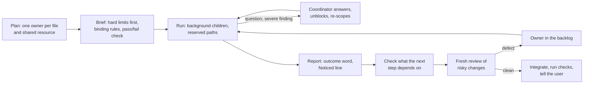
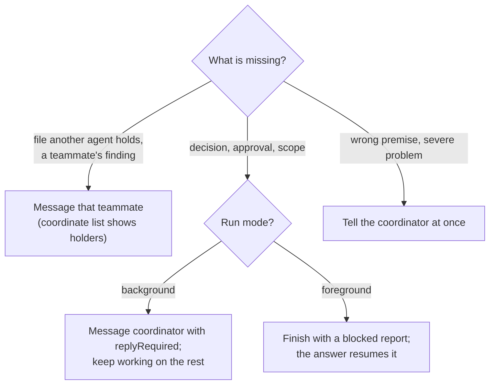
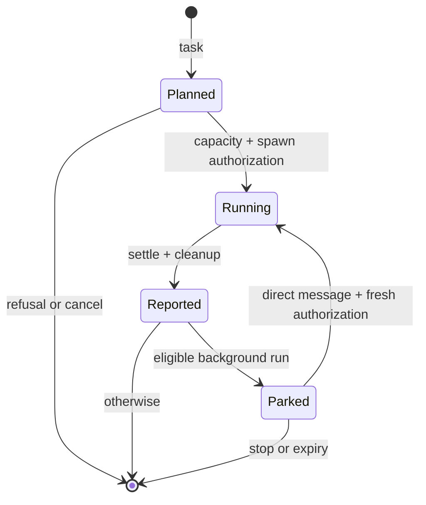
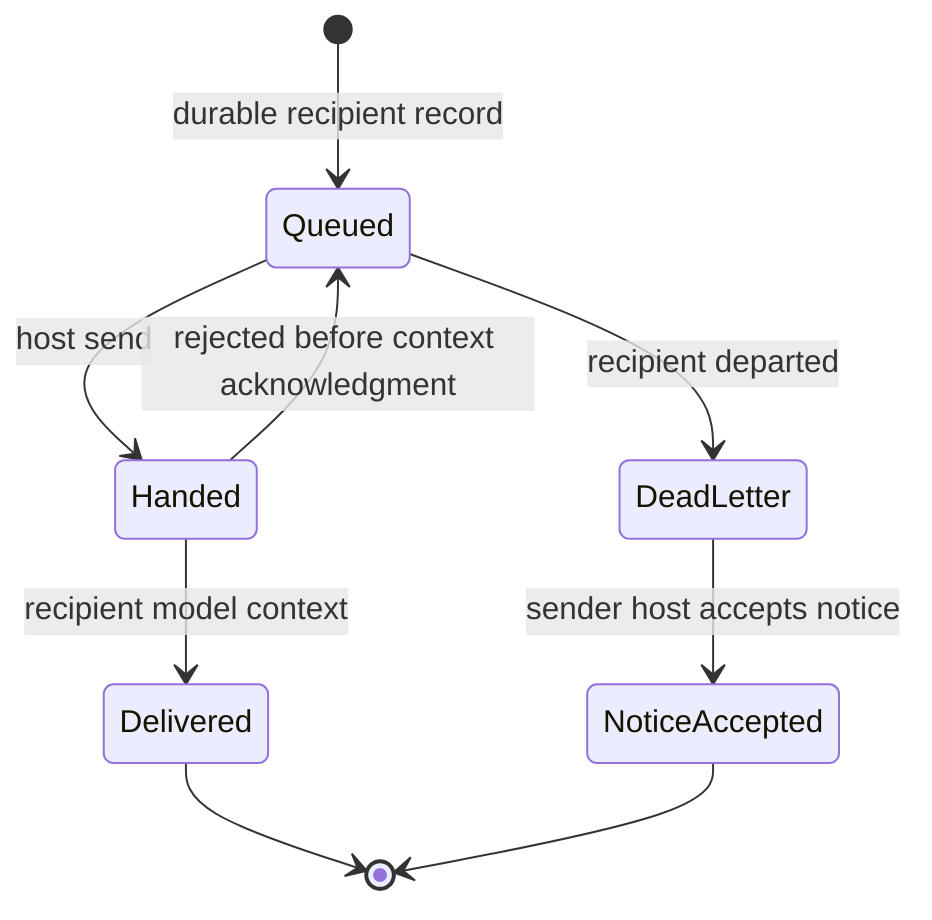
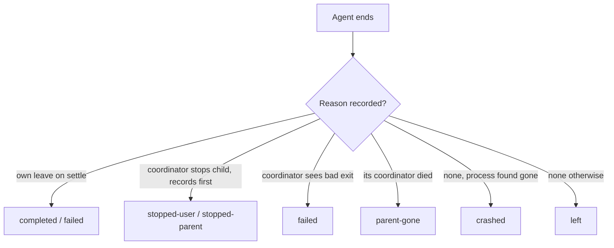
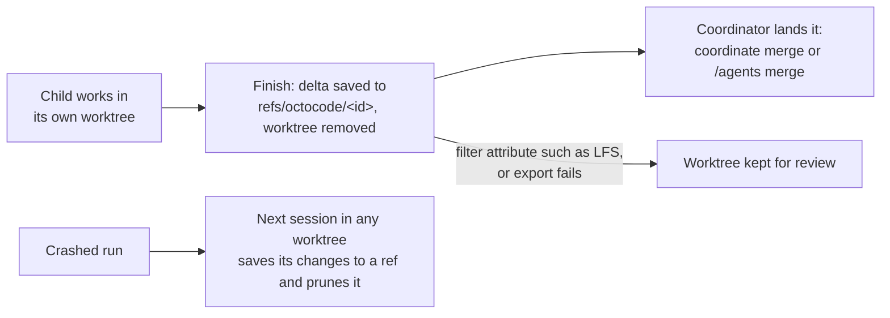

# Agents: teams, messages and workers

How a coordinator runs subagents, how agents talk, and what each channel guarantees. Commands and options: [native features](../packages/coding-agent/docs/native-features.md#communication-and-results). Terms: [glossary](../packages/coding-agent/docs/GLOSSARY.md).

## Who talks to whom

One verb reaches everyone: the `agent` tool with `type: "message"` and `to` set to a name.

| `to`                            | Reaches                                                                 |
| ------------------------------- | ----------------------------------------------------------------------- |
| a teammate's id or role name    | Subagent or sibling in your team, in any git worktree of the repository |
| `parent`                        | The coordinator that started you                                        |
| a process name                  | Another running Octocode session (arrives marked external)              |
| `coordinator` (from a worktree) | The session in the main checkout, which lands merges                    |
| `all`                           | Everyone in your own tree only                                          |

Example: a background child that needs a decision sends `{ type: "message", to: "parent", message: "Rename or keep the API?", replyRequired: true }` and keeps working on what does not depend on the answer.

## Orchestration

| Phase  | The coordinator                                                                                                                           |
| ------ | ----------------------------------------------------------------------------------------------------------------------------------------- |
| Plan   | Delegates only work needing separate context; runs independent parts in parallel; one owner per file, interface and shared resource       |
| Brief  | 5W2H task, hard limits first; copies in every user rule or memory the child must obey; pass/fail command as definition of done            |
| Run    | Answers questions at once; gives each confirmed defect a backlog owner                                                                    |
| Report | Reads `Noticed` first; treats the report as a claim; checks what the next step depends on                                                 |
| Review | A fresh reviewer checks a risky change; its author does not sign it off                                                                   |
| Tell   | Tells the user unasked about rule breaks, data sent outside and its own wrong claims; ends replies with a status table while work is open |

A subagent's final report starts with an outcome word:

| Outcome   | Meaning                                          |
| --------- | ------------------------------------------------ |
| `done`    | Acceptance checks met                            |
| `partial` | Ended early; usable as is; no answer pending     |
| `blocked` | Needs a decision or access; ends with a question |
| `failed`  | Could not proceed                                |

### A stuck child

A child cannot ask the user, so it asks whoever can settle the matter instead of guessing or looping.

A working child with no message to or from its coordinator for `monitor.checkInSeconds` (default 300) is asked the same question by its own harness. The check-in only joins a request the child was about to make, so it never wakes an idle child. See [check-in](../packages/coding-agent/docs/native-features.md#subagent-check-in).

### Memory and subagents

| Source            | Main session                                          | Subagent                              |
| ----------------- | ----------------------------------------------------- | ------------------------------------- |
| Pinned memories   | Injected before each prompt, within the pinned budget | Not injected                          |
| Relevant memories | Up to five, matched to the prompt                     | Up to three, matched to its goal      |
| Saving            | Allowed (global and pinned changes ask permission)    | Read-only: proposals go in its report |

`AGENTS.md` and project files are in both prompts. Put a rule that must bind a child in its task; write a memory's title as the rule itself (recall can cut the body); put rules for everyone in `AGENTS.md`; treat a recalled memory as a lead to check. Budgets: [automatic recall](../packages/coding-agent/docs/memory.md#user-commands-and-automatic-recall).

## Channels and what an acknowledgment proves

A2A is not implemented (local agents already reach each other; it would only be an optional remote adapter). A remote HTTP ACP service is not implemented either.

| Goal                                     | Use                                                                | Behavior                                                                                                                                                             |
| ---------------------------------------- | ------------------------------------------------------------------ | -------------------------------------------------------------------------------------------------------------------------------------------------------------------- |
| An editor launches Octocode              | [ACP](../packages/coding-agent/docs/acp.md), `octocode --mode acp` | Client owns the broker; broker owns one worker per session                                                                                                           |
| A local process drives a running session | [Session API](../packages/coding-agent/docs/session-api.md)        | On by default for top-level sessions; discover, send, observe                                                                                                        |
| One session's model messages another     | `agent` `message`, `to` a process name or `coordinator`            | Does not wait for the receiver's run; its [`message.external` permission](../packages/coding-agent/docs/permissions.md#external-messages) decides whether it arrives |
| Octocode drives an external coding agent | `agent` `type: "external"`, `transport: "acp"`                     | Connection owns the peer's process tree; returns each prompt's reply                                                                                                 |
| Octocode attaches to a running Octocode  | `agent` `type: "external"`, `transport: "octocode"`                | Idle-only guarded message; disconnect leaves the peer running                                                                                                        |
| A host embeds a worker                   | [RPC](../packages/coding-agent/docs/rpc.md), `--mode rpc`          | Host owns process lifetime, request correlation, cancellation                                                                                                        |

| Channel            | An acknowledgment means                                                                                                                               | Limit                                                                                                       |
| ------------------ | ----------------------------------------------------------------------------------------------------------------------------------------------------- | ----------------------------------------------------------------------------------------------------------- |
| Team mail          | Recipient's model context contains the message                                                                                                        | SQLite with retries; membership and process checks are local to the host                                    |
| Child reports      | Report recorded in the coordinator's transcript                                                                                                       | A pending copy needs a successful disk write                                                                |
| Session API        | `accepted`: dispatched, or [waiting for the receiver's user](../packages/coding-agent/docs/session-api.md#what-the-sender-gets); `settled`: run ended | A failed async handoff becomes `uncertain`; the same key cannot dispatch again; keys live in session memory |
| ACP                | Protocol session, streamed updates, prompt stop reason                                                                                                | Not Team delivery                                                                                           |
| Application stream | Session and epoch cursor orders events                                                                                                                | Bounded replay                                                                                              |

API acceptance, mail delivery, a finished model run and a done backlog item are different facts ([entities](ENTITIES.md)). ACP updates and API events are observations, not mail acknowledgments.

## Workers

The `agent` tool starts a child in its own process and saved session. The coordinator checks the profile and model, takes a capacity slot and resolves `agent.spawn` permission first; a refusal or cancel releases the slot and launches nothing.

| Topic           | Behavior                                                                                                                                                                                                                                                            |
| --------------- | ------------------------------------------------------------------------------------------------------------------------------------------------------------------------------------------------------------------------------------------------------------------- |
| Permissions     | In `manual` and `workspace`, approving a spawn can grant the profile's file and shell reach for the run. Never inherited: destructive shell, outside-workspace changes, undeclared browser control. Tightening permissions stops children and clears session grants |
| Skills and MCP  | Reach the child through private handoff files, removed afterwards                                                                                                                                                                                                   |
| Lingering       | See below                                                                                                                                                                                                                                                           |
| Empty follow-up | A clean but empty answer to a message counts as incomplete even if the task reported `done`; a later successful retry resolves it                                                                                                                                   |

**Lingering:** a finished background worker in the shared tree stays addressable for `OCTOCODE_SUBAGENT_LINGER_SECONDS` (a profile's `linger` overrides it; `blocked` gets at least 600 s). A direct message from the coordinator or user rechecks capacity and `agent.spawn`, then resumes the saved conversation. Isolated workers cannot linger. Stop or expiry retires the address; a crash after retirement does not replay.

## Team mail

The team is keyed by the repository's git common directory, so live ids and unique role names resolve across worktrees. Reservations, the edit log and scratch folders stay per worktree (a worktree nested in the main checkout shares files, so reservations compare across both). Broadcast stays in the sender's tree; cross-tree messages grant no interrupt or revival authority. `collaborate` adds teammate context.

| Message kind                                                        | When the recipient reads it                                                                                                      |
| ------------------------------------------------------------------- | -------------------------------------------------------------------------------------------------------------------------------- |
| `replyRequired`, or the answer to the recipient's open question     | Wakes an idle teammate                                                                                                           |
| FYI to a named teammate (`parent` included)                         | Wakes an idle teammate; agent-started turns are paced to one per 30 s and six per 10 minutes, and mail meanwhile joins that turn |
| Reply answering no open question, broadcast to `all`, `wake: false` | Idle teammate reads it with its next prompt                                                                                      |
| Any mail to a busy teammate                                         | Its next model request                                                                                                           |
| Interrupt                                                           | Reaches only the sender's own child or the user's session tree                                                                   |

- Delivery stages are not a task state machine. A broadcast makes one delivery per recipient; a reply is another message.
- A rejection after context acknowledgment does not replay mail; old session callbacks cannot acknowledge a fresh inbox. Retries use the regular tick without backoff. This is agent mail, not email.
- Provenance: the database sender field is not user provenance; the coordinator signs message id, recipient and text. Unverified user claims and peer text are fenced in model context, and steering grants no permission.
- Background reports keep pending recovery copies until the originating session records them.
- When a peer ends, an agent that corresponded with it reads one line, `<agent> ended: <reason>`, and starts a turn only if its own question to that peer is unanswered. A coordinator gets no such line for its children: it has their reports.
- `coordinate list` shows each agent's folder, branch, process title and, where recorded, its backlog item, transcript folder (`log:`) and shell-log folder.

### How an agent's end is recorded

`stopped-user` covers the user, Esc or a stop from the user's side; `stopped-parent` the coordinator.

The `AgentOn` and `AgentOff` [hooks](../packages/coding-agent/docs/hooks.md#agent-presence-in-the-octocode-profile) fire from these events. Only persisted sessions write them. A main session joins the team at start (one heartbeat per session, even idle); a coordinator opens a subagent's run record when it spawns it, with the backlog item it was given.

## Isolated workers

`isolate: true` gives the child a detached git worktree starting at HEAD; `workingCopy: true` starts from your tracked and untracked non-ignored files without touching your branch or index.

| Limit                | Detail                                                                                                                                                                               |
| -------------------- | ------------------------------------------------------------------------------------------------------------------------------------------------------------------------------------ |
| Filters              | Git filters never run when saving: changed or added files with a filter attribute (LFS) refuse the export and keep the worktree. Ordinary checkout may run configured smudge filters |
| Hooks and submodules | Repository hooks do not run at creation; submodules are not initialised and the child is warned                                                                                      |
| Backlog item         | A held item gets an `output` link to the ref and a note "not merged"; `/agents merge` notes the merge                                                                                |
| Not a sandbox        | External programs can write paths the tool-level check cannot parse                                                                                                                  |

See [native features](../packages/coding-agent/docs/native-features.md) for commands and enablement and [configuration](../packages/coding-agent/docs/configuration.md#precedence) for settings precedence.
