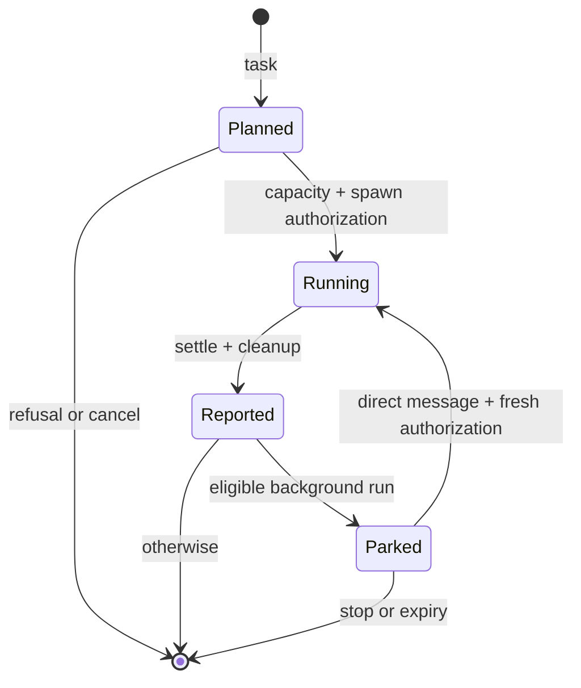

# Agent communication and worker lifecycle

Octocode's native `agent` tool starts a child in its own RPC process and saved session. A task can select a profile, model, background execution, collaboration and isolation. The parent checks profile and model, takes a capacity slot, and resolves `agent.spawn` before claiming an identity or launching. Refusal or cancellation releases the slot and launches nothing ([task owner](../packages/coding-agent/src/octocode/subagents/tool.ts), [capacity](../packages/coding-agent/src/octocode/subagents/claim.ts), [spawn decision](../packages/coding-agent/src/octocode/subagents/profiles.ts)).

Child-specific environment fields carry its current mode, per-spawn grants and identity; a one-use nonce file supports permission relay to the parent ([environment](../packages/coding-agent/src/octocode/subagents/process/env.ts), [launch](../packages/coding-agent/src/octocode/subagents/process/run-child.ts), [relay](../packages/coding-agent/src/octocode/subagents/relay.ts)). Private [resource handoffs](../packages/coding-agent/src/octocode/subagents/process/handoff-files.ts) carry selected skills and session MCP definitions; cleanup removes only files this launch created. In `manual` and `workspace`, spawn approval can grant the profile's file and shell reach for the whole run. Destructive shell, outside-workspace mutation and undeclared browser control are never inherited this way. Tightening permissions stops children and clears session grants. Read-only, isolated-tree and shared-tree Git-state checks still apply ([permissions](../packages/coding-agent/docs/permissions.md)).

Team messages queue in repository-scoped SQLite until they appear in the recipient's model context; unread departures generate dead letters. `replyRequired` wakes an idle teammate, while FYI mail waits for its next step. An interrupt reaches only the sender's child or the user's session tree ([send](../packages/coding-agent/src/octocode/team/session/send.ts), [inbox](../packages/coding-agent/src/octocode/team/inbox.ts), [delivery](../packages/coding-agent/src/octocode/team/delivery.ts), [routing](../packages/coding-agent/src/octocode/team/routing.ts)). A database sender field is not user provenance: the parent signs the message id, recipient and text. Unverified user claims and peer text are fenced in model context; steering does not grant permission ([proof](../packages/coding-agent/src/octocode/team/proof.ts), [mail](../packages/coding-agent/src/octocode/team/mail.ts)). Background reports have separate pending recovery copies until the originating session records them ([native feature guide](../packages/coding-agent/docs/native-features.md)).

A finished background worker in the shared tree may remain addressable for `OCTOCODE_SUBAGENT_LINGER_SECONDS`; `blocked` gets at least 600 seconds. Its parked record is an address for the saved conversation, not a replay queue. Reopen requires the same parent session, workspace, transcript and profile; an explicit browser headless override survives when other profile fields match. Reopen runs nothing. A direct parent or user message checks capacity and current `agent.spawn` permission, verifies the parked generation, then retires the address before launching. Stop and expiry retire it; isolated workers cannot linger ([record](../packages/coding-agent/src/octocode/subagents/parked.ts), [revival](../packages/coding-agent/src/octocode/subagents/linger.ts), [eligibility](../packages/coding-agent/src/octocode/subagents/tool.ts)). A crash after retirement cannot safely replay uncertain execution.

With `isolate: true`, the child works in a detached Git worktree, starting at HEAD by default. `workingCopy: true` captures tracked and non-ignored untracked files with a temporary index, preserving the parent's branch and index; it refuses filter-bearing paths before snapshotting. Finish exports only the worker delta to a unique `refs/octocode/pi/<id>` ref and removes the worktree. A failed export keeps it for review; `/agents merge` is separate. Owner records and process-start checks guard orphan pruning ([snapshot](../packages/coding-agent/src/octocode/subagents/worktree-snapshot.ts), [worktree](../packages/coding-agent/src/octocode/subagents/worktree.ts)). Ordinary checkout may run configured smudge filters. Isolation is not an OS sandbox: external programs can write paths the tool-level check cannot parse.

For commands and enablement, see the [native feature guide](../packages/coding-agent/docs/native-features.md). Configuration discovery and precedence belong to [CONFIGURATIONS.md](../CONFIGURATIONS.md).
