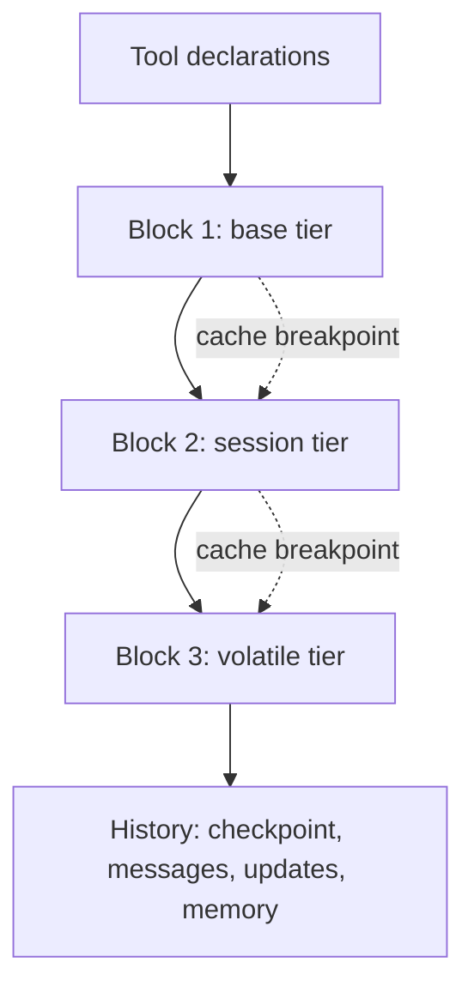
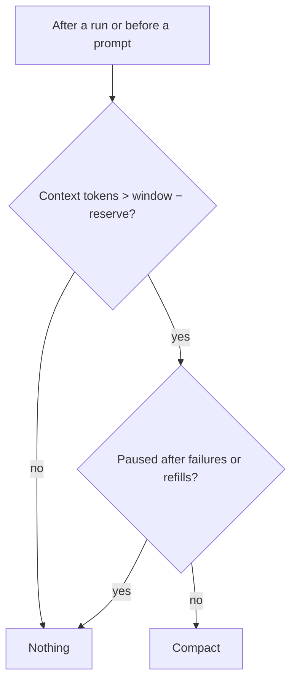
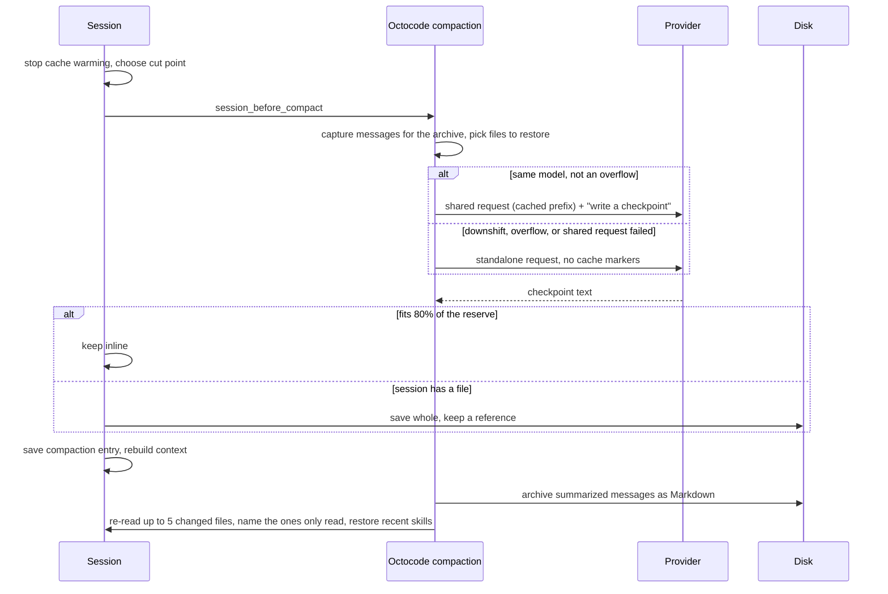

# Context management

What a native Octocode session sends the model on each request, how changes reach it, and how history stays inside the window. Related: [prompt caching](../packages/coding-agent/docs/prompt-caching.md) (providers, retention, warming, miss diagnostics), [agent context](../packages/coding-agent/docs/agent-context.md) (each source and its switch), [agent instructions](../packages/coding-agent/docs/prompts.md), [MCP](../packages/coding-agent/docs/mcp.md).

## What the model sees

Tool declarations, up to three instruction blocks, then history. Adapters that support it split the instructions at cache breakpoints; an opaque prompt, missing boundaries or `OCTOCODE_INSTRUCTION_CACHE_SPLIT=off` give one block.

| Part                                                                              | Reusable across                        |
| --------------------------------------------------------------------------------- | -------------------------------------- |
| Tool declarations, Block 1 (base: `preamble`, `tools`, `rules`, `docs`, `mcps`)   | Same tools and MCP servers             |
| Block 2 (session: `addendum` to `harnesses`)                                      | One project and role, any day          |
| Block 3 (volatile, no breakpoint: `cwd`, `environment`, `planning`, `mcp_status`) | One directory, day, surface, MCP state |
| History                                                                           | One session                            |

A cache hit also needs matching settings, adapter support and a live provider entry; see [Limits](#limits).

### Sections

In prompt order; an empty section is left out. `SYSTEM.md` replaces `preamble` and drops `docs` ([instructions](../packages/coding-agent/docs/prompts.md)).

| Section                                                     | Content                                                                                                                        |
| ----------------------------------------------------------- | ------------------------------------------------------------------------------------------------------------------------------ |
| `preamble`                                                  | Built-in text, `SYSTEM.md` or custom prompt                                                                                    |
| `tools`, `rules`                                            | A `- name: trigger` line and guidelines per non-MCP tool                                                                       |
| `docs`                                                      | Where Octocode's docs live; not under a custom prompt or in subagents                                                          |
| `mcps`                                                      | Per server: name, purpose, `mcp__<server>__*` prefix, instructions; contracts too under `mcpPresentation: "compact"` or `json` |
| `addendum`                                                  | `APPEND_SYSTEM.md`                                                                                                             |
| `work`, `research`, `delegation`, `safety`, `communication` | Policy for the tools and agent kind; `lean` replaces it for lean profiles                                                      |
| `children`                                                  | Main session: running children and their reports; added at the first child or agent message                                    |
| `subagent`                                                  | A writable child's policy, in place of `delegation`                                                                            |
| `project_context`                                           | [Project context](#project-context)                                                                                            |
| `memory`                                                    | Global and repository `MEMORY.md`, read at start ([memory](../packages/coding-agent/docs/memory.md))                           |
| `skills`                                                    | Name, description, path per skill; body loads on `skill`                                                                       |
| `hooks`                                                     | One line per event and matcher; never a command, URL or prompt                                                                 |
| `role`                                                      | Subagent profile                                                                                                               |
| `harnesses`                                                 | Other agent products Octocode reads; main session                                                                              |
| `cwd`, `environment`, `planning`, `mcp_status`              | Directory; platform, shell, date, surface, render capabilities; plan mode; servers not ready                                   |

Recalled notes (up to 2,400 characters per notice) and a child's task arrive in history, not as sections; notices accumulate until compaction. `mcps` never includes raw `mcp.json`, launch commands, environment values or credentials; server instructions, tool descriptions and results are model-visible.

### Project context

`project_context` holds, in order:

1. The global context file in the agent directory.
2. Per ancestor through `cwd`, outermost first, the first of `AGENTS.override.md`, `AGENTS.md`, `AGENTS.MD`, else `CLAUDE.md`. The walk stops at a trust grant, and at the repository root when a parent repository lies above; a linked worktree nested in its main checkout uses its own file.
3. Claude's project `MEMORY.md` when `claude:memory` is on in `/harness`: first 200 lines or 25 KB, read-only.

These load without project trust (the permission gate still decides each action). A file over 64 KiB is cut and named by path. `--no-context-files` skips all.

Files below `cwd` load on the first read under their folder (a research read, or `cat`, `head`, `tail`, `sed -n` in `bash`), appended to that result so the cached prompt stays the same. Trusted projects only; 64 KiB per file and in context at once; one already in context is not resent until a compaction drops it.

## How a change reaches the model

Before each prompt, `before_agent_start` handlers fill the sections; the session sends only what differs from the transcript.

| Change                    | Result                                                         |
| ------------------------- | -------------------------------------------------------------- |
| Section text (date, plan) | Section patch in history; blocks stay where the adapter allows |
| Tool added or removed     | Tool change in history where supported; else blocks rewritten  |
| Model switched            | Previous cache not reusable                                    |
| Idle past history TTL     | Possible cache rewrite; messages unchanged                     |

A failed request (timeout) does not renew the entry; while the session waits on children, jobs or timers, the warmer refreshes it within one rewrite's cost. Some adapters place an update in the leading message (Mistral after a tool result). On the Anthropic API, miss reasons are requested unless `OCTOCODE_CACHE_DIAGNOSTICS=off`; `showCacheMissNotices` shows them ([prompt caching](../packages/coding-agent/docs/prompt-caching.md#provider-reported-miss-reasons)).

## Keeping the history small

| Mechanism         | Behavior                                                                                |
| ----------------- | --------------------------------------------------------------------------------------- |
| Large results     | Over the turn's text budget: saved to a file; context keeps a bounded part and the path |
| Repeated reads    | An unchanged reread returns a note pointing at the earlier result                       |
| Clearing          | Old results of re-fetchable tools, see below                                            |
| Oversized request | A 413 strips images and retries                                                         |

**Clearing.**

- Runs when at least 20k estimated tokens free up.
- Keeps the newest 5 results, all called in the last 10 turns whatever their size, and older ones whose path was named in those turns (up to 20k tokens).
- Placeholders name the saved files; only saved results are cleared.
- Runs when a cache rewrite is already due, or while warm when avoided reads outweigh the rewrite.
- A model that binds thinking to its prefix also drops thinking of later turns.
- It is a session entry, so resume and fork apply the same placeholders.

## When compaction runs

After each run and before each prompt (counting the incoming message). `/compact [focus]` runs one now. The agent's `compact` tool queues one for the end of its reply; it is refused below 90% of the room before automatic compaction, within two turns of the last one, or when recent compactions kept refilling.

| Situation                                                     | Action                        |
| ------------------------------------------------------------- | ----------------------------- |
| Response predates the last compaction or was stopped          | None                          |
| Overflow or length stop, response failed, first time this run | Drop it, compact, retry       |
| Same, failed again                                            | Report that recovery failed   |
| Same, response completed                                      | Compact, keep it              |
| Switch to a model with too small a window                     | Compact on the previous model |

The window is `contextBudget` (default 300,000 tokens) capped at 90% of the model's capacity, or all of it with `"full"`. Counts use provider receipts, else estimates (characters per token: 2.5 Claude and unknown, 3.3 DeepSeek, 3.5 OpenAI).

| Value       | Rule                                                                                                                     | 200k window, thinking off |
| ----------- | ------------------------------------------------------------------------------------------------------------------------ | ------------------------- |
| Reserve     | At least 24,576, raised for thinking plus answer room, at most window/6 (`min(16,384, window/8)` when window/6 < 20,485) | 24,576                    |
| Trigger     | Context > window − reserve                                                                                               | > 175,424                 |
| Kept recent | `min(20,000, window/4)` newest tokens, verbatim, excluding the system prompt                                             | 20,000                    |

Automatic compaction pauses after three consecutive failures for a session and model, or after the context refilled within 3 turns of compacting 3 times in a row. `/compact` resets both; an hour after the last failure one more attempt runs.

## The compaction pipeline

1. **Cut.** Never on a tool result; a cut inside a turn adds a summary of that turn's start. If the kept part leaves no room for a summary, more is summarized; if even the newest turn does not fit, compaction fails: switch to a larger window or `/new`.
2. **Request.**
   - _Shared_ (same model, no overflow): the session's prompt, tools, thinking and messages plus "write a checkpoint", so a live cache entry can be read. When nothing reads what it writes (history expired, model switched, update folded into the leading prompt), it is sent with `cacheRetention: "none"`, keeping instruction markers while that entry is live.
   - _Standalone_ (downshift, overflow, shared failed): the serialized conversation under its own prompt, custom and external messages labeled by type, `cacheRetention: "none"`, no routing id (except OpenCode's `x-opencode-session`, which [OpenCode Go requires](https://opencode.ai/v2/docs/console/harnesses/)). Long tool results are saved whole and shown as references. Without Octocode's handler, the core sends this request.
3. **Validate.** The reply needs nonempty summary text within `maxTokens`; otherwise compaction fails and history stays. A paid summary is reused after a persistence failure only for identical input, files, model, instructions and budget.
4. **Checkpoint.** Goal, constraints, progress, decisions, errors and fixes, where we stopped, critical context, summary.
   - Constraints and decisions form a ledger with ids (`[C3]`, `[D2]`): an update writes only added bullets and marks a carried one lifted or superseded with its reason; code restores every other carried bullet word for word; the entry records each lift.
   - A focus from the agent's own `compact` reaches the summarizer labelled as the agent's.
   - Code appends, within a budget (older or long ones behind saved references): the user's messages, askUser answers and, for a child, its coordinator's messages, word for word; file lists; saved results; and a Recovery section of about 800 characters (archive and transcript locations, backlog and running work as tools report them now, loaded skills by name; one not loaded across two compactions leaves the list).
   - The shared request also asks what each image shows; the standalone one says images do not arrive.
5. **Store.** Within 80% of the reserve the summary stays inline; otherwise a session with a file saves it whole behind a reference, and an in-memory session keeps head and tail.
6. **Rebuild.** The entry is saved with the system message in force (blocks stay cached); the context becomes instructions, checkpoint, newest messages and restored files.
7. **Archive and restore.**
   - Summarized messages become searchable Markdown (`archive`); they also stay in the session file.
   - Up to 5 files the agent changed in the summarized part are re-read: whole within 8k characters, else an outline (at most 4k) or a window of lines; total 20k characters, at most 10% of the window after the reserve.
   - Files only read are named in one line, newest first; `node_modules` dependencies are dropped; `.octocode/` files never come back (a worktree there counts as work).
   - The 2 most recently loaded skills return as loaded, each within 5,000 tokens and 10,000 in all (at most 5% of the window); a longer one is cut at a line with a note naming its file.

**Summary requested early.** The session plans a compaction a tenth of the window before the threshold (8,000–32,000 tokens) and Octocode requests the shared summary then, beside the run. The compaction uses it if ready or waits only for the rest. Everything after the planned cut stays verbatim; file lists are rebuilt at use.

| Case                                                                       | Result                                |
| -------------------------------------------------------------------------- | ------------------------------------- |
| Model, thinking or branch changed; context edit or another compaction      | Plan dropped, request cancelled       |
| Early request failed or unusable                                           | Compaction asks its own               |
| Session cache expired                                                      | Not sent (bills the whole input)      |
| Your `/compact`, threshold compaction with instructions, overflow recovery | Not used                              |
| The agent's own `compact`                                                  | Usable; its focus follows the summary |

One plan per compaction. Each step is an `early-summary` note (requested, ready, unusable, discarded, with whether it finished and was billed); a used summary is noted in the compaction entry with its wait. Usage is charged to the session that started the request, even after cancellation.

**Branch summaries.** `/tree` to another point summarizes the branch being left with the same summarizer, from as much as fits the window less `branchSummary.reserveTokens`. If the summary cannot fit, navigation is refused before any model call.

## Across many context windows

Each request and the next compaction use only the newest checkpoint. Reminders tagged for an older checkpoint are left out of requests (they stay in the transcript); a visible excerpt is not appended again.

| Layer             | Keeps                                                            | Use for                                   |
| ----------------- | ---------------------------------------------------------------- | ----------------------------------------- |
| Recent messages   | Retained tail, verbatim                                          | Immediate reasoning, tool-call continuity |
| Checkpoint        | Goals, constraints, decisions, evidence, active work, next steps | Continuing after compaction               |
| Backlog and tasks | Work state, owners, dependencies                                 | What remains; no duplicate work           |
| Memory            | Preferences, facts, procedures; bounded recall                   | Knowledge across sessions                 |
| Archive           | Earlier transcripts and full checkpoints                         | Exact details no longer in context        |

A coordinator's checkpoint also needs child and job ids, owners, dependencies, open questions and pending effects. Recovery notices refresh running work from recorded state; check it before retrying a side effect or delegating again. For long tasks, record progress in the backlog item and save only durable facts as memory.

`/context` shows cost, compactions on the branch, the active checkpoint, threshold and tail target without calling the model. `/archive [n]` browses segments; the agent searches older conversations with `archive`.

### Limits

- **Summaries are lossy.** A saved checkpoint proves persistence, not that every distinction survived; repeated compactions can compound an omission. Code carries the user's messages and the transcript keeps everything, so a dropped correction is recoverable if the model looks. Check approvals, changed requirements and pending effects against evidence. A session without persistence cannot recover what was summarized away.
- **Caching is an opportunity.** Matching inputs make a hit possible, not certain: provider routing, entry lifetime and adapter placement ([breakpoints per adapter](../packages/coding-agent/docs/prompt-caching.md#second-instruction-block)) decide. Changed or cleared history can be cold while the instruction tier stays warm.
- **Counts are estimates.** Hooks or provider serialization can change a request's size. An early summary can be discarded after it was billed; its notes make that countable.
- **Recall is lexical.** Automatic recall uses a bounded keyword query and can miss paraphrases, short acronyms and terms beyond its selection; explicit memory and `archive` searches are the fallback. An explicit memory read names the session that wrote the note.
- **Search cost scales with history.** Ranked `archive` search reads one file at a time and rereads only files it shows, so memory grows with matches, not archive size, and it can be cancelled inside a long file. Time still grows with files in scope.

Judge long-session quality by retained constraints, correct next actions, recoverable evidence and provider usage together; cache hit rate and token counts do not measure correctness.

## Skills and MCP tools in the context

The skills listing goes through a store under `context-optimization/` in the agent directory. MCP descriptions, schemas and instructions are never rewritten.

- **Scope.** User skills share one folder; a repository's use `projects/<repo>-<hash>/`, shared by its worktrees.
- **Recorded.** A root session records skills when they change; each entry hashes its source, so an edited skill falls back to its own wording.
- **Rewritten on request.** `octocode context list` shows entries still at `source`; the bundled `octocode-context-optimization` skill shortens them ([skills](../packages/coding-agent/docs/skills.md#optimized-descriptions)).
- **Stable.** Read at start and `/reload`, so a rewrite never changes a cached prompt mid-run; subagents read the same store.

A server reaches an agent only when its tool selection names it. One with `defaultActive: false` (the built-in `browser`) starts only for agents selecting `mcp__<server>__*`; a selected server not yet connected shows in `mcps` as one line with its state. Locations and precedence: [MCP reference](../packages/coding-agent/docs/mcp-reference.md#configuration-and-precedence); `/mcp config` shows what the session resolved.
