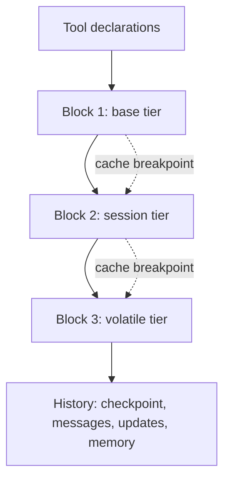
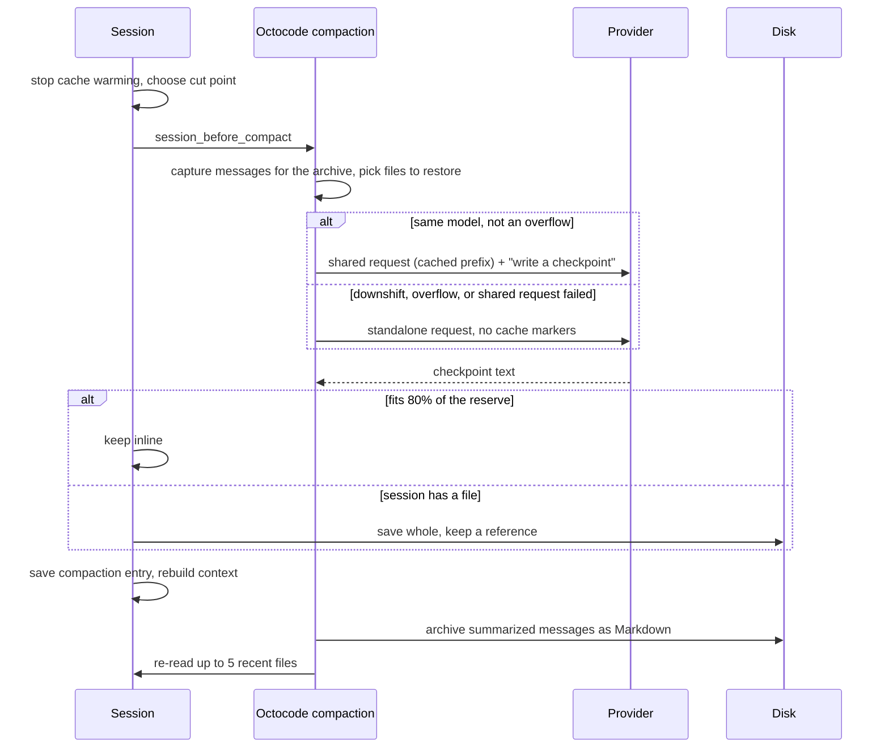

# Context management

What a native Octocode session sends the model on each request, how changes reach it, and how history stays inside the window. Related pages: [prompt caching](../packages/coding-agent/docs/prompt-caching.md) (providers, retention, warming, miss diagnostics), [agent context](../packages/coding-agent/docs/agent-context.md) (each source and its switch), [agent instructions](../packages/coding-agent/docs/instructions.md) (prose), [MCP](../packages/coding-agent/docs/mcp.md).

## What the model sees

Tool declarations, up to three instruction blocks, then history. Adapters that support it split the instructions at cache breakpoints; an opaque prompt, missing boundaries or `OCTOCODE_INSTRUCTION_CACHE_SPLIT=off` give one block.

| Part                                         | Holds                                                                                                             | Reusable across                              |
| -------------------------------------------- | ----------------------------------------------------------------------------------------------------------------- | -------------------------------------------- |
| Tool declarations                            | Role-invariant tools in fixed order, other built-in and extension tools, MCP tools by server and name, role tools | sessions with the same tools and MCP servers |
| Block 1 (base)                               | `preamble`, `tools`, `rules`, `docs`, `mcps`                                                                      | sessions with the same tools and MCP servers |
| Block 2 (session)                            | `addendum`, policy, `children`, `coordinator`, `project_context`, `skills`, `hooks`, `role`, `harnesses`          | one project and role, any day                |
| Block 3 (volatile, no breakpoint of its own) | `cwd`, `environment`, `planning`, `mcp_status`                                                                    | one directory, day and MCP state             |
| History                                      | Checkpoint, messages, tool calls and results, section updates, memory, restored files                             | one session                                  |

A cache hit also needs matching settings, adapter support and a live provider entry; see [Limits](#limits).

### Sections

In prompt order. An empty section is left out. `SYSTEM.md` replaces `preamble` and drops `docs` ([instructions](../packages/coding-agent/docs/instructions.md)).

| Section                                                     | Content                                                                                                                                     |
| ----------------------------------------------------------- | ------------------------------------------------------------------------------------------------------------------------------------------- |
| `preamble`                                                  | Built-in text, `SYSTEM.md` or a custom prompt                                                                                               |
| `tools`, `rules`                                            | One `- name: trigger` line and the guidelines of each declared non-MCP tool                                                                 |
| `docs`                                                      | Where Octocode's own documentation lives; not under a custom prompt or in subagents                                                         |
| `mcps`                                                      | Per enabled server: name, purpose, `mcp__<server>__*` prefix, instructions; tool contracts too under `mcpPresentation: "compact"` or `json` |
| `addendum`                                                  | `APPEND_SYSTEM.md`                                                                                                                          |
| `work`, `research`, `delegation`, `safety`, `communication` | Policy, adapted to the tools and to main or child agent; `lean` replaces it for lean profiles                                               |
| `children`                                                  | Main session only: running children and using their reports; added at the first child or agent message                                      |
| `coordinator`                                               | A writable child's execution and reporting policy, in place of `delegation`; its identity and task arrive in history                        |
| `project_context`                                           | [Project context](#project-context)                                                                                                         |
| `skills`                                                    | Name, description and path of each skill; the body loads on `skill`                                                                         |
| `hooks`                                                     | One line per event and matcher that may act on a call; never a command, URL or prompt                                                       |
| `role`                                                      | The subagent's profile                                                                                                                      |
| `harnesses`                                                 | Which other agent products Octocode reads; main session only                                                                                |
| `cwd`, `environment`, `planning`, `mcp_status`              | Working directory; platform, shell, date; plan mode; servers not ready or partly undeclared                                                 |

Memory (pinned and matching notes, up to 2,400 characters per notice) and a child's task arrive in history, not as sections. Notices accumulate until compaction. The `mcps` section never includes raw `mcp.json`, launch commands, environment values or credentials; server instructions, tool descriptions and results are still model-visible.

### Project context

`project_context` holds, in order:

1. The global context file in the agent directory.
2. For each ancestor through `cwd`, outermost first, the first of `AGENTS.override.md`, `AGENTS.md`, `AGENTS.MD`. The walk stops at a folder with a trust grant, and at the repository root when a parent repository lies above. A linked worktree nested in its main checkout uses its own file.
3. Claude's project `MEMORY.md` when the `claude:memory` `/harness` switch is on: first 200 lines or 25 KB, labeled read-only.

These load without project trust (the permission gate still decides each action). A file over 64 KiB is cut and named by path. `--no-context-files` skips them all.

Context files below `cwd` load on first read under their folder (a research read, or `cat`, `head`, `tail`, `sed -n` in `bash`), appended to that result so the cached prompt stays the same. Trusted projects only; 64 KiB per file and 64 KiB in context at once. One already in context is not sent again until a compaction drops it.

## How a change reaches the model

Before each prompt, the `before_agent_start` handlers fill the sections; the session sends only what differs from what the transcript holds.

| Change                    | Result                                                                                        |
| ------------------------- | --------------------------------------------------------------------------------------------- |
| Section text (date, plan) | A section patch in history; the instruction blocks stay as they were where the adapter allows |
| Tool added or removed     | A tool change in history where the provider supports it; otherwise tools and blocks rewritten |
| Model switched            | The previous model's cache is not reusable                                                    |
| Idle past the history TTL | The history may need a new cache write; messages are unchanged                                |

Some adapters must place an update in the leading message (Mistral after a tool result). To see why a request missed the cache, set `OCTOCODE_CACHE_DIAGNOSTICS=on` or `showCacheMissNotices` ([prompt caching](../packages/coding-agent/docs/prompt-caching.md#provider-reported-miss-reasons)).

## Keeping the history small

| Mechanism         | Behavior                                                                                                                                                                                                                                                                                                                                                                     |
| ----------------- | ---------------------------------------------------------------------------------------------------------------------------------------------------------------------------------------------------------------------------------------------------------------------------------------------------------------------------------------------------------------------------- |
| Large results     | A result over the turn's text budget is saved to a file; the context keeps a bounded part and the path                                                                                                                                                                                                                                                                       |
| Repeated reads    | Rereading an unchanged file returns a note pointing at the earlier result                                                                                                                                                                                                                                                                                                    |
| Clearing          | Old results of re-fetchable tools are cleared when at least 20k estimated tokens free up; the newest 5 stay, placeholders name the saved files. It runs when a cache rewrite is already due, or while warm when avoided future reads outweigh the rewrite. Only saved results are cleared. A model that binds thinking to its prefix also drops the thinking of later turns. |
| Oversized request | A 413 strips images and retries                                                                                                                                                                                                                                                                                                                                              |

Clearing is a session entry, so resume and fork apply the same placeholders.

## When compaction runs

After each run and before each prompt (counting the incoming message). `/compact [focus]` runs one now. The agent's `compact` tool queues one for the end of its reply; it is refused under half the room before automatic compaction, within two turns of the last one, or when recent compactions kept refilling.

| Situation                                                                 | Action                                           |
| ------------------------------------------------------------------------- | ------------------------------------------------ |
| Disabled; or the response predates the latest compaction or was aborted   | None                                             |
| Overflow or recoverable length stop, response failed, first time this run | Drop the failed attempt, compact, retry the turn |
| Same, failed again                                                        | Report that recovery failed                      |
| Same, response completed                                                  | Compact, keep the response                       |
| Context tokens > window − reserve                                         | Compact                                          |
| Switch to a model whose window is too small                               | Compact on the previous model                    |

The window is `contextBudget` (default 300,000 tokens) capped at 90% of the model's capacity, or all of it with `"full"`. Counts use provider receipts where they apply and character estimates for new content, tools and images.

| Value       | Rule                                                                                       | 200k window, thinking off |
| ----------- | ------------------------------------------------------------------------------------------ | ------------------------- |
| Reserve     | `min(16,384, window/8)`, raised for the thinking budget plus answer room, at most window/6 | 16,384                    |
| Trigger     | context tokens > window − reserve                                                          | > 183,616                 |
| Kept recent | `min(20,000, window/4)` tokens of the newest history, verbatim                             | 20,000                    |

Automatic compaction pauses after three consecutive failures for a session and model, or after the context refilled within 3 turns of compacting 3 times in a row. `/compact` resets both; an hour after the last failure one more attempt runs.

## The compaction pipeline

1. **Cut.** Never on a tool result; a cut inside a turn adds a summary of that turn's start. If the kept part leaves no room for a summary (often after switching to a smaller model), more is summarized; if even the newest turn does not fit, compaction fails with that reason: switch to a larger window or `/new`.
2. **Request.**
   - _Shared_ (same model, no overflow): the session's own prompt, tools, thinking and messages plus "write a checkpoint", so a live cache entry can be read. When nothing would read what it writes (history entry expired, model switched, an update folded into the leading prompt), it is sent with `cacheRetention: "none"`, keeping the instruction markers while that entry is live.
   - _Standalone_ (downshift, overflow, or the shared request failed): the serialized conversation under its own prompt, custom and external messages labeled by type, `cacheRetention: "none"`, no routing id (except OpenCode's `x-opencode-session`, which [OpenCode Go requires](https://opencode.ai/v2/docs/console/harnesses/)). Long tool results are saved whole and shown as references. Without Octocode's handler, the core sends this request.
3. **Validate.** The reply needs nonempty summary text within `maxTokens`; otherwise compaction fails and the active history stays. A paid summary is reused after a persistence failure only for the same input, files, model, instructions and budget.
4. **Checkpoint.** Goal, constraints, progress, decisions, errors and fixes, where we stopped, critical context, TL;DR. Code then appends the user's messages, askUser answers and, for a child, its coordinator's messages word for word within a budget (older or long ones move behind saved references), file lists, saved results, loaded skills by name and path, and the backlog and running work as the tools report them now. The shared request also asks what each image shows; the standalone one says images do not arrive.
5. **Store.** Within 80% of the reserve the summary stays inline; otherwise a session with a file saves it whole behind a reference, and an in-memory session keeps head and tail.
6. **Rebuild.** The entry is saved with the system message in force (blocks stay cached); the context becomes instructions, checkpoint, newest messages and restored files.
7. **Archive and restore.** Summarized messages become searchable Markdown (`archive`; they also stay in the session file). Up to 5 recent files are re-read: whole within 8k characters, else an outline (at most 4k) or a window of lines; 20k characters in total, at most 10% of the window after the reserve.

**Summary requested early.** So a compaction does not hold the turn while the summary is written, the session plans it a tenth of the window before the threshold (8,000–32,000 tokens) and Octocode requests the shared summary then, beside the run. The compaction uses it if ready, or waits only for the rest. Everything after the planned cut stays verbatim; file lists are rebuilt at use.

| Case                                                                             | Result                                                       |
| -------------------------------------------------------------------------------- | ------------------------------------------------------------ |
| Model, thinking or branch changed; a context edit or another compaction happened | Plan dropped, request cancelled; the compaction asks its own |
| Early request failed or unusable                                                 | The compaction asks its own                                  |
| Session cache expired                                                            | Not sent: it would bill the whole input                      |
| `/compact`, compaction with instructions, overflow recovery                      | Early summary not used                                       |

One plan per compaction. Each step is recorded as an `early-summary` note: requested, ready, unusable, or discarded (with whether its request had finished and was billed). A used one is noted in the compaction entry with its wait. Usage is charged to the session that started the request, even if the reply arrives after cancellation.

**Branch summaries.** `/tree` to another point summarizes the branch being left with the same summarizer, from as much of it as fits the window less `branchSummary.reserveTokens`. If the summary cannot fit, navigation is refused before any model call.

## Across many context windows

Each request and the next compaction use only the newest checkpoint. After a compaction, reminders tagged for an older checkpoint are left out of requests (they stay in the transcript), and an excerpt already visible is not appended again.

| Layer             | Keeps                                                            | Use it for                                   |
| ----------------- | ---------------------------------------------------------------- | -------------------------------------------- |
| Recent messages   | The retained tail, verbatim                                      | Immediate reasoning and tool-call continuity |
| Checkpoint        | Goals, constraints, decisions, evidence, active work, next steps | Continuing after compaction                  |
| Backlog and tasks | Work state, owners, dependencies                                 | What remains; avoiding duplicate work        |
| Memory            | Saved preferences, facts and procedures; bounded recall          | Knowledge across sessions                    |
| Archive           | Earlier transcripts and full checkpoints                         | Exact details no longer in context           |

A coordinator's checkpoint also needs child and job ids, owners, dependencies, open questions and pending effects. Recovery notices refresh running work from recorded state, not from the summary; check that state before retrying a side effect or delegating again. For long tasks, record progress in the backlog item, save only durable facts as memory, and keep the latest request and next action clear.

`/context` shows the current cost, compactions on the branch, the active checkpoint, the threshold and the tail target; it sends nothing to the model. `/archive [n]` browses compacted segments; ask the agent to search older conversations with `archive`.

### Limits

- **Summaries are lossy.** A saved checkpoint proves persistence, not that every distinction survived; repeated compactions can compound an omission. The user's messages are carried by code (inline or behind a saved reference, across any number of compactions) and the transcript keeps everything, so a dropped correction stays recoverable, but the model has to look. Check approvals, changed requirements and pending effects against their evidence before acting on them. A session without persistence cannot recover what was summarized away.
- **Caching is an opportunity.** Matching inputs make a hit possible, not certain: provider routing, entry lifetime and adapter placement ([breakpoints per adapter](../packages/coding-agent/docs/prompt-caching.md#second-instruction-block)) decide. Changed or cleared history can be cold while the instruction tier stays warm.
- **Counts are estimates.** Token counts for new content and clearing savings are estimated, and hooks or provider serialization can change a request's final size. An early summary can be discarded after it was billed; its notes make that countable.
- **Recall is lexical.** Automatic memory recall uses a bounded keyword query and can miss paraphrases, short acronyms and terms beyond its selection; explicit memory and `archive` searches are the fallback. An explicit memory read names the session that wrote the note.
- **Search cost scales with history.** Ranked `archive` search reads one file at a time, keeps only counts for matching passages and rereads just the files it shows, so memory grows with matches, not archive size, and it can be cancelled inside a long file. Time still grows with the number of files in scope.

Judge long-session quality by retained constraints, correct next actions, recoverable evidence and actual provider usage together: cache hit rate, fewer tokens and memory use counts do not measure correctness.

## Skills and MCP tools in the context

The skills listing, and MCP tools under `mcpPresentation: "compact"` or `json`, go through one optimization store under `context-optimization/` in the agent directory. Under the default `declared`, each MCP tool keeps its own description and schema.

- **Scope.** User skills and servers share one folder; a repository's skills and workspace servers use `projects/<repo>-<hash>/`, shared by its worktrees.
- **Recorded automatically.** A root session records skills it finds, and the MCP host each server's file, when they change. Each entry hashes its source, so an edited skill or changed tool falls back to its own wording.
- **Rewritten on request.** `octocode context list` shows entries still at `source`; the bundled `octocode-context-optimization` skill rewrites them with fidelity checks (`octocode context` for [skills](../packages/coding-agent/docs/skills.md#optimized-descriptions), `octocode mcp compact` for [servers](../packages/coding-agent/docs/mcp-reference.md#compact-presentation)).
- **Stable in a session.** Read at start and `/reload`, so a rewrite never changes a cached prompt mid-run. Subagents read the same store.

A server reaches an agent only when its tool selection names it. A server with `defaultActive: false` (the built-in `browser`) starts only for agents that select `mcp__<server>__*`; a selected server that has not connected shows in `mcps` as one line with its state. Locations and precedence: [MCP reference](../packages/coding-agent/docs/mcp-reference.md#configuration-and-precedence); `/mcp config` shows what the session resolved.
