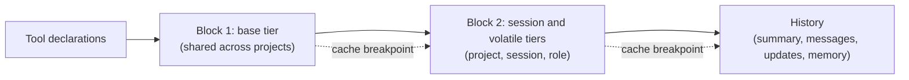
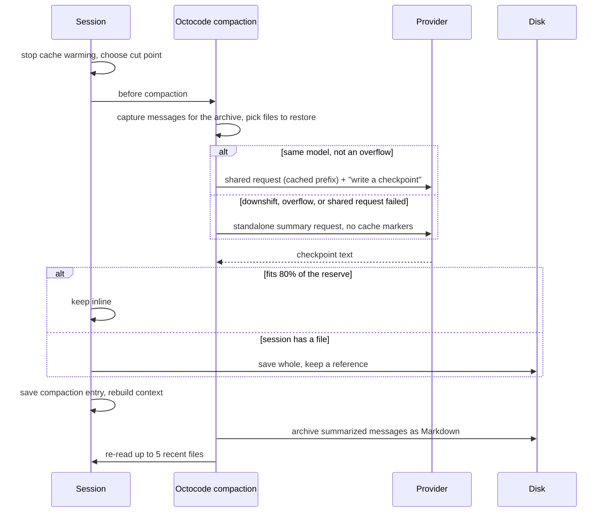

# Context management

What a native Octocode session sends the model on each request, how updates reach it, and how the history stays inside the context window. Owners of the rest: [prompt caching](../packages/coding-agent/docs/prompt-caching.md) (providers, retention, warming, miss diagnostics), [agent context](../packages/coding-agent/docs/agent-context.md) (where each source comes from and its switch), [agent instructions](../packages/coding-agent/docs/instructions.md) (prose), [MCP](../packages/coding-agent/docs/mcp.md).

## What the model sees

Each request is the tool declarations, two instruction blocks, then the history.

| Part                | Holds                                                                                                                              | Shared by                                    |
| ------------------- | ---------------------------------------------------------------------------------------------------------------------------------- | -------------------------------------------- |
| Tool declarations   | Role-invariant tools in a fixed order, other built-in and extension tools, MCP tools sorted by server and name, role-variant tools | sessions with the same tools and MCP servers |
| Instruction block 1 | Sections of the base tier (below)                                                                                                  | sessions with the same tools and MCP servers |
| Instruction block 2 | Sections of the session and volatile tiers (below)                                                                                 | one project, session and role                |
| History             | Compaction summary, messages, tool calls and results, section updates, memory, restored files                                      | one session                                  |

Sections in prompt order. `SYSTEM.md` replaces `preamble` and drops `docs`; every other section stays ([instructions](../packages/coding-agent/docs/instructions.md)). A section with nothing to say is left out.

| Tier     | Section                                                     | Content                                                                                                                                                                                                                                             |
| -------- | ----------------------------------------------------------- | --------------------------------------------------------------------------------------------------------------------------------------------------------------------------------------------------------------------------------------------------- |
| base     | `preamble`                                                  | Built-in text, or `SYSTEM.md` / a custom prompt                                                                                                                                                                                                     |
| base     | `tools`, `rules`                                            | One `- name: trigger` line (`promptSnippet`) and the guidelines of each declared non-MCP tool                                                                                                                                                       |
| base     | `docs`                                                      | The root of Octocode's own documentation; dropped under a custom prompt and for subagents                                                                                                                                                           |
| base     | `mcps`                                                      | One block per enabled MCP server: name, purpose, `mcp__<server>__*` prefix, instructions; under `mcpPresentation: "compact"` or `json` also its tool contracts (default `declared` keeps each tool's own description and schema in its declaration) |
| session  | `addendum`                                                  | `APPEND_SYSTEM.md`                                                                                                                                                                                                                                  |
| session  | `cwd`                                                       | Working directory                                                                                                                                                                                                                                   |
| session  | `work`, `research`, `delegation`, `safety`, `communication` | Policy prose, adapted to the tools and to main or child agent; `lean` replaces it for lean profiles                                                                                                                                                 |
| session  | `project_context`                                           | See [Project context](#project-context)                                                                                                                                                                                                             |
| session  | `skills`                                                    | Name, optimized description and path of each skill; a body loads when the agent calls `skill`                                                                                                                                                       |
| session  | `hooks`                                                     | One line per event and tool matcher that may act on a call, never a command, URL or prompt                                                                                                                                                          |
| session  | `role`                                                      | The subagent's profile                                                                                                                                                                                                                              |
| session  | `harnesses`                                                 | Which other agent products Octocode reads, on or off; main session only                                                                                                                                                                             |
| volatile | `environment`                                               | Platform, shell, local date                                                                                                                                                                                                                         |
| volatile | `planning`                                                  | The plan-mode constraint                                                                                                                                                                                                                            |
| volatile | `mcp_status`                                                | One line per MCP server that is not ready or whose tools are partly undeclared                                                                                                                                                                      |

Not sections: memory (pinned and query-matched notes, at most 2,400 characters, hidden from the transcript view) and a child's task (identity, goal, scratch folder, teammates) arrive in the history.

Block 2 starts at the first non-base section present; `OCTOCODE_INSTRUCTION_CACHE_SPLIT=off` sends one block. An isolated subagent names the main checkout in its prompt, so sibling children share both blocks. Breakpoints per adapter: [prompt caching](../packages/coding-agent/docs/prompt-caching.md#second-instruction-block). Raw `mcp.json`, commands, environment values and tokens never reach the model; server instructions and tool descriptions do.

### Project context

`project_context` holds, in order:

1. The global context file (agent directory).
2. In each directory from the repository root to `cwd`, the first of `AGENTS.override.md`, `AGENTS.md`, `AGENTS.MD`.
3. Claude's `MEMORY.md` for the project, only when the `claude:memory` `/harness` switch is on: the first 200 lines or 25 KB, labeled as Claude's read-only notes, below `AGENTS.md` and Octocode memories.

Directories run outermost first, stopping at the folder a trust grant is on and at the working directory's repository root when a parent repository lies above. In a linked worktree nested inside its main checkout, the worktree's own file replaces the main checkout's. These files load without project trust: they are text the model reads, and the permission gate still decides each action. A file over 64 KiB is cut and the rest is named by path. `--no-context-files` skips all of it.

## How a change reaches the model

Before each prompt, `before_agent_start` handlers (MCP, Octocode policy, planning, memory) fill the section inputs and `buildSystemPromptSections` renders them. The session compares the result with the sections the transcript already holds and sends only the difference.

| Change                             | Result                                                                                                                |
| ---------------------------------- | --------------------------------------------------------------------------------------------------------------------- |
| Section text (date, plan, role)    | A section patch in the history; the instruction blocks stay cached                                                    |
| Tool added or removed              | Provider loads tools mid-conversation: a tool change in the history. Otherwise the tool list and blocks are rewritten |
| Model switched                     | Full cache miss                                                                                                       |
| Idle longer than the history's TTL | History rewritten                                                                                                     |

Providers without mid-conversation system messages receive a patch as a marked user message, so their leading prompt stays byte-identical. To find a miss's cause, set `OCTOCODE_CACHE_DIAGNOSTICS=on` or enable `showCacheMissNotices` ([prompt caching](../packages/coding-agent/docs/prompt-caching.md#provider-reported-miss-reasons)).

## Keeping the history small

1. A tool result over the turn's shared text budget is saved to a file; the context keeps a bounded part and the path.
2. A repeated read of an unchanged file becomes a short note pointing at the earlier result.
3. Old results of re-fetchable tools are cleared (the newest 5 stay; placeholders name saved files) only when the next request rewrites the history's cache entry anyway (the cache has expired, or the request folds a system update into the leading prompt or switches model) and the context is past half its working window, with at least 20k tokens to free. Clearing a warm entry alone would only force a rewrite.
4. Clearing changes the prefix every later thinking block was bound to, so for a model that binds thinking to its prefix the request also drops the thinking of later turns produced before the clear; the provider would drop them anyway.
5. A 413 "too large" strips images and retries.

Clearing is a session entry: every later request applies the same placeholders, across resume and fork.

## When compaction runs

The session checks after each run and before sending a prompt (the pre-prompt check counts the incoming prompt). `/compact [focus]` runs one directly. The agent's `compact` tool queues one for the end of its reply; it is refused when the context is under half the room before automatic compaction, within two turns of the previous compaction, or when recent compactions kept refilling.

| Situation                                                                                     | Action                                           |
| --------------------------------------------------------------------------------------------- | ------------------------------------------------ |
| Compaction disabled, or the response predates the latest compaction (after a run: or aborted) | None                                             |
| Overflow or recoverable length stop, response failed, first time this run                     | Drop the failed attempt, compact, retry the turn |
| Same, failed again                                                                            | Report recovery failed                           |
| Same, response completed                                                                      | Compact, keep the response                       |
| Context tokens > window − reserve                                                             | Compact                                          |
| Switch to a model whose window is too small                                                   | Compact on the previous model                    |

The window is the working window: `contextBudget` (default 300,000 tokens) capped at 90% of the model's capacity, or the whole capacity for `"full"`.

| Value       | Rule                                                                                       | 200k window, thinking off |
| ----------- | ------------------------------------------------------------------------------------------ | ------------------------- |
| Reserve     | `min(16,384, window/8)`, raised for the thinking budget plus answer room, at most window/6 | 16,384                    |
| Trigger     | context tokens > window − reserve                                                          | > 183,616                 |
| Kept recent | `min(20,000, window/4)` tokens of the newest history, verbatim                             | 20,000                    |

Automatic compaction stops after three consecutive failures for the same session and model, or when the context refilled within 3 turns of the previous compaction 3 times in a row. A successful `/compact` resets both; an hour after the last failure one more attempt is let through.

## The compaction pipeline

1. The session stops cache warming, chooses the cut point (never on a tool result; a cut inside a turn adds a second summary of that turn's start) and emits `session_before_compact`.
2. Octocode's handler captures the messages for the archive and picks files to restore.
3. It asks the model for a checkpoint:
   - **Shared request** (same model, not an overflow): the session's own system prompt, tools, thinking settings and messages plus "write a checkpoint", so the provider reads the cached prefix instead of billing the history as new input. When the history entry has expired, the model was switched since the last reply, or an instruction or tool update was folded into the leading prompt, it goes with `cacheRetention: "none"`, since nothing would read what it wrote; if the long instruction entry is still live, `keepInstructionCache` keeps its markers. A warm request is unchanged.
   - **Standalone request** (downshift, overflow, or the shared request failed): serializes the conversation under its own system prompt (custom and external messages labeled by type, never as the user's) with `cacheRetention: "none"`, so no cache markers or routing id are sent (OpenCode keeps `x-opencode-session`, which [OpenCode Go requires](https://opencode.ai/v2/docs/console/harnesses/)). Only this request saves long tool results whole and shows them as references.
   - Without Octocode's handler, the core default sends a standalone request.
4. The reply is accepted when the provider's reported output tokens are within `maxTokens` (a character estimate decides only without a count).
5. The checkpoint format is one statement (goal, constraints, progress, decisions, errors and fixes, where we stopped, critical context, TL;DR) plus one focus text. A split turn sends the focus with the history request, or with the turn-prefix request when there is no history. The summary is asked only for judgment; code appends the user's messages word for word, the file lists (files Octocode's local tools read, files `file` changed), saved results and recovery pointers, including skills loaded so far by name and path (`details.loadedSkills`, never bodies). The shared request also asks what each image shows that the work depends on; the standalone one serializes text and says images do not arrive.
6. A summary within 80% of the reserve stays inline; otherwise a session with a file saves it whole and keeps a reference; an in-memory session keeps head and tail with an omission marker.
7. The compaction entry is saved (with the system message in force, so the instruction blocks stay cached) and the context is rebuilt: instructions, updated summary and file lists, newest messages, restored files.
8. On `session_compact` the summarized messages are archived as searchable Markdown (`archive` tool; they also remain in the session file) and up to 5 recent files are re-read. A file within 8k characters returns whole; a larger one as an outline of its declaration lines (at most 4k characters) or a window of whole lines. Restored files total at most 20k characters, capped at 10% of the window left after the reserve. Memories injected before the kept range may be injected again.

`/tree` to another point summarizes the branch being left as a `branchSummary` message with the same summarizer, using as much of the branch as fits the window less `branchSummary.reserveTokens`.

## Skills and MCP tools in the context

The skills listing, and MCP tools under `mcpPresentation: "compact"` or `json`, pass through one optimization stage stored in the agent directory under `context-optimization/`. Under the default `declared`, each MCP tool's own description and schema reach the model.

- **Scope.** User-level skills and servers share one folder; a repository's own skills and workspace servers go to `projects/<repo>-<hash>/`, keyed by repository so worktrees share it.
- **Recorded automatically.** A root session records the skills it discovers, and the MCP host renders each server's file, whenever they change. Each entry keeps a hash of its source; a rewrite applies only to the source it was written for, so an edited skill or changed tool falls back to its own wording.
- **Rewritten by the internal skill.** `octocode context list` shows which entries are still `source`. The bundled `octocode-context-optimization` skill rewrites them with fidelity checks: `octocode context` for skills ([optimized descriptions](../packages/coding-agent/docs/skills.md#optimized-descriptions)), `octocode mcp compact` for servers ([compact presentation](../packages/coding-agent/docs/mcp-reference.md#compact-presentation)).
- **Stable within a session.** Text is read at start and `/reload`; a rewrite never changes a cached prompt mid-run. Subagents read the same store.

A server reaches an agent only when the agent's tool selection names it. A server with `defaultActive: false` (the built-in `browser`) starts only for agents whose selection names `mcp__<server>__*`; a selected server that has not connected appears in `mcps` as one line with its state. Locations and precedence: [MCP reference](../packages/coding-agent/docs/mcp-reference.md#configuration-and-precedence); `/mcp config` shows what the session resolved.
