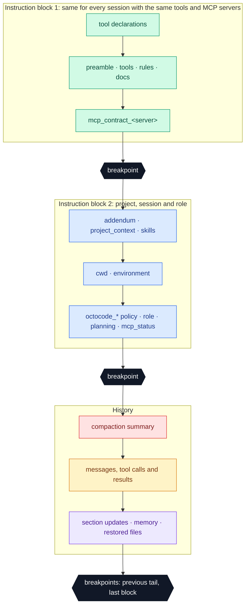
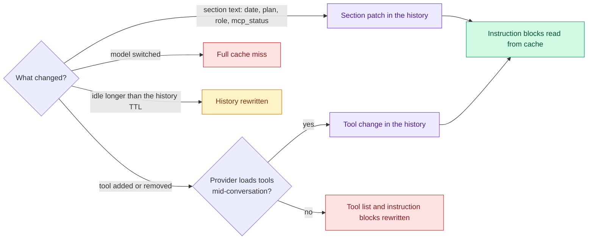
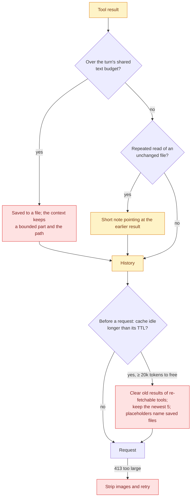
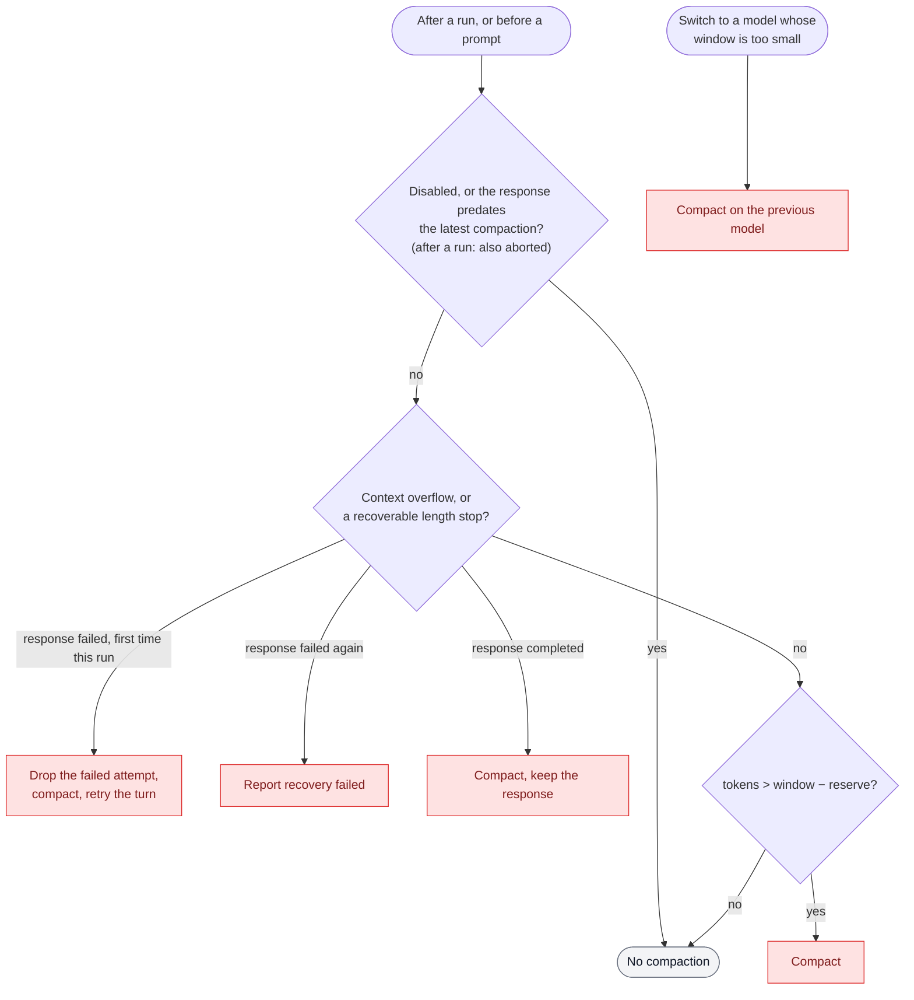
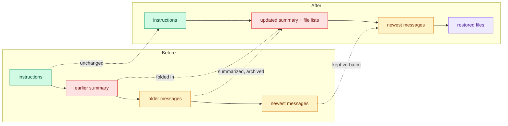
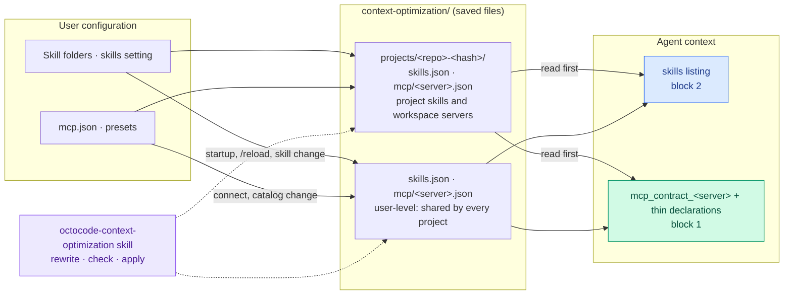

# Context management

What a native Octocode session sends the model on each request, which parts the provider caches, and how the session keeps the history inside the context window. Details stay with their owners: [prompt caching](../packages/coding-agent/docs/prompt-caching.md), [agent instructions](../packages/coding-agent/docs/instructions.md), [MCP](../packages/coding-agent/docs/mcp.md), [`core/compaction/`](../packages/coding-agent/src/core/compaction/) and [`octocode/compaction/`](../packages/coding-agent/src/octocode/compaction/).

Diagram colors: green is cached content shared across projects, blue is cached project and session content, amber is history, purple is a mid-conversation update, red is compaction, and black is a cache breakpoint.

## What the model sees

Each request has two instruction blocks followed by the history. By default both the instruction blocks and the history are cached for one hour (`cacheRetention` and `instructionCacheRetention` in settings), so a new message never invalidates the instructions and a pause shorter than an hour keeps the history.



| Content                 | Source                                                                                      | Changes when                                    |
| ----------------------- | ------------------------------------------------------------------------------------------- | ----------------------------------------------- |
| Tool declarations       | Built-in and extension tools in their given order, then MCP tools sorted by server and name | A tool or MCP server is added or removed        |
| `preamble`              | Built-in text, or `SYSTEM.md` / a custom prompt                                             | The custom prompt changes                       |
| `tools`, `rules`        | Snippets and guidelines of the declared tools                                               | The tool selection changes                      |
| `docs`                  | Paths of Octocode's own documentation; empty for subagents                                  | Rarely                                          |
| `mcp_contract_<server>` | Each selected server's optimized TypeScript file: its instructions and typed tools          | The server's catalog changes                    |
| `addendum`              | `APPEND_SYSTEM.md`                                                                          | The file changes, then `/reload`                |
| `project_context`       | One `AGENTS.override.md`, `AGENTS.md` or `CLAUDE.md` per directory from the root to `cwd`   | A file changes, then `/reload`                  |
| `skills`                | Names, optimized descriptions and paths; bodies load on demand                              | A skill is added or removed                     |
| `cwd`, `environment`    | Working directory; platform, shell and local date                                           | A new day                                       |
| `octocode_*` policy     | `octocode/instructions/policy.ts`, adapted to the tools and to main or child agent          | The tool set or profile list changes            |
| `role`, `planning`      | The subagent's profile; the plan-mode constraint                                            | `/plan` enters or leaves                        |
| `mcp_status`            | Selected MCP servers that are not connected                                                 | A server connects                               |
| Memory                  | Pinned and query-matched notes, at most 2,400 characters, hidden from the transcript view   | Each prompt; already injected notes are skipped |
| Child task              | Identity, goal, scratch folder and teammates of a subagent                                  | Once, as the child's first message              |

Block 2 starts at the first of `addendum`, `project_context`, `skills`, `cwd` or `environment` present; `OCTOCODE_INSTRUCTION_CACHE_SPLIT=off` sends one block. An isolated subagent names the main checkout in its prompt, so sibling children share both blocks. The breakpoints shown are Anthropic's; [adapter behavior](../packages/coding-agent/docs/prompt-caching.md#behavior-and-accounting) covers other providers and [retention per layer](../packages/coding-agent/docs/prompt-caching.md#retention-per-layer) the settings. Raw `mcp.json`, commands, environment values and tokens never reach the model; server instructions and tool descriptions do.

## How a change reaches the model

Before each prompt, `before_agent_start` handlers (MCP, Octocode policy, planning, memory) fill the section inputs, and `buildSystemPromptSections` renders them. The session compares the result with the sections the transcript already holds and sends only what differs.



Providers without mid-conversation system messages receive a section patch as a marked user message, so their leading prompt stays byte-identical. To find the cause of a miss, set `OCTOCODE_CACHE_DIAGNOSTICS=on` (Anthropic reports the first divergence) or enable `showCacheMissNotices`.

## Keeping the history small between compactions

Tool results are bounded when they are written, and old results are cleared only when the next request rewrites the history's cache entry anyway: the cache has expired, or the request carries a system update or a model switch and the context is past half its working window (`CLEAR_ABOVE_CONTEXT_SHARE`). Clearing a warm entry on its own would make the next request rewrite it. Clearing a result changes the prefix every later thinking block was bound to, so for a model that binds thinking to its prefix the request also drops the thinking of turns that follow a cleared result and were produced before it was cleared (`octocode/compaction/thinking.ts`); the provider would drop those blocks anyway, and the request no longer carries them.



Clearing is recorded as a session entry, so every later request applies the same placeholders and survives resume and fork. Owners: `octocode/shared/turn-budget.ts`, `octocode/files/dedupe.ts`, `octocode/compaction/clearing.ts`.

## When compaction runs

The session checks after each run and before sending a prompt; the pre-prompt check also counts the incoming prompt. `/compact [focus]` runs a manual compaction directly.



| Value       | Rule (`core/compaction/settings.ts`)                                                       | 200k window, thinking off |
| ----------- | ------------------------------------------------------------------------------------------ | ------------------------- |
| Reserve     | `min(16,384, window/8)`, raised for the thinking budget plus answer room, at most window/6 | 16,384                    |
| Trigger     | context tokens > window − reserve                                                          | > 183,616                 |
| Kept recent | `min(20,000, window/4)` tokens of the newest history, verbatim                             | 20,000                    |

Automatic compaction stops after three consecutive failures for the same session and model, or when the context refilled within 3 turns of the previous compaction 3 times in a row (`octocode/compaction/pacing.ts`); a successful `/compact` resets both.

## The compaction pipeline

```mermaid
sequenceDiagram
    autonumber
    participant S as Session
    participant X as Octocode compaction
    participant P as Provider
    participant D as Disk

    S->>S: stop cache warming; choose the cut point
    S->>X: session_before_compact
    X->>X: capture messages for the archive; pick files to restore
    alt same model, not an overflow
        X->>P: the session's own request + "write a checkpoint"
    else a downshift, an overflow, or the shared request failed
        X->>P: standalone summary request, routed and cached as the session's
    end
    P-->>X: checkpoint text
    X-->>S: summary + read and modified file lists
    alt summary fits 80% of the reserve
        S->>S: keep it inline
    else session has a file
        S->>D: save it whole; keep a reference
    else in-memory session
        S->>S: keep head and tail with an omission marker
    end
    S->>S: save the compaction entry; rebuild the context
    S->>X: session_compact
    X->>D: archive the summarized messages as searchable Markdown
    X->>S: re-read up to 5 recent files
```

The cache-shared request keeps the session's system prompt, tools and thinking settings, so the provider reads the cached prefix instead of billing the whole history as new input; a cold cache does not change the choice, since the session's next request would rewrite the prefix anyway, and the summary request pays that write once. The reply is accepted when the provider's reported output tokens are within the cap (`maxTokens`); the character estimate decides only when no count was reported. The standalone request (a downshift, an overflow, a failed shared request) serializes the conversation under its own system prompt and sends the session's routing id and cache preferences; only that request saves long tool results whole and shows them as references. Both requests carry one statement of the checkpoint format (`core/compaction/summary-format.ts`: goal, constraints, progress, decisions, errors and fixes, where we stopped, critical context, TL;DR), composed into the standalone, update and branch prompts, and one focus text; a split turn sends the focus with the history request, or with the turn-prefix request when there is no history to summarize. The summary is asked only for judgment: code appends the user's messages word for word, the file lists, the saved results and the recovery pointers. Restored files get at most 20k characters each and 50k in total, capped at 10% of the window left after the reserve. Without Octocode's handler, the core's default (`core/compaction/compaction.ts`) sends a standalone request. A cut never lands on a tool result; a cut inside a turn adds a second summary of that turn's start.



The compaction entry stores the system message in force, so the instruction blocks stay cached; only the history after them is written again. Summarized messages remain in the session file and in the compaction archive (`archive` tool), and memories injected before the kept range may be injected again.

Moving to another point in the session tree (`/tree`) summarizes the branch being left as a `branchSummary` message, using the same summarizer and as much of that branch as fits the window less `branchSummary.reserveTokens`.

## How skills and tools reach the context

Agents never read a skill's or MCP tool's own description directly. Every configuration change passes through one optimization stage, saved in the agent directory under `context-optimization/`, before it reaches an agent.



- **Stored by scope, outside the repository.** User-level skills and servers share one folder across projects; a repository's own skills and workspace-defined servers get `projects/<repo>-<hash>/`, keyed by the repository so worktrees share it and two projects never overwrite each other's same-named entries.
- **Recorded automatically.** A root session records the skills it discovers, and the MCP host renders each server's file, whenever they change. Each entry keeps a hash of its source, and a rewrite applies only to the source it was written for, so an edited skill or a changed tool falls back to its own wording.
- **Rewritten by the internal skill.** New or changed entries without a rewrite are reported to the user once. The bundled `octocode-context-optimization` skill rewrites them with fidelity checks: `octocode context` for skills ([optimized descriptions](../packages/coding-agent/docs/skills.md#optimized-descriptions)) and `octocode mcp compact` for servers ([compact presentation](../packages/coding-agent/docs/mcp-reference.md#compact-presentation)).
- **Stable within a session.** Sessions read the stored text at start and `/reload`, so a rewrite never changes a cached prompt mid-run. Subagents read the same store.

An MCP server reaches an agent only when the agent's tool selection names it. A server with `defaultActive: false`, such as the built-in `browser`, starts only for agents whose selection names `mcp__<server>__*`; a selected server that has not connected yet is named in `mcp_status`. File locations and precedence are in the [MCP reference](../packages/coding-agent/docs/mcp-reference.md#configuration-and-precedence); `/mcp config` shows what the current session resolved.
