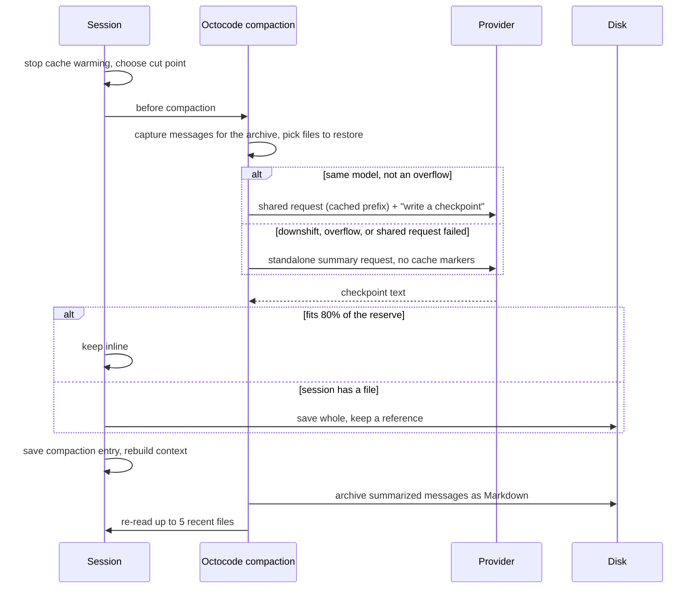

# Context management

What a native Octocode session sends the model on each request, how updates reach it, and how the history stays inside the context window. Owners of the rest: [prompt caching](../packages/coding-agent/docs/prompt-caching.md) (providers, retention, warming, miss diagnostics), [agent context](../packages/coding-agent/docs/agent-context.md) (where each source comes from and its switch), [agent instructions](../packages/coding-agent/docs/instructions.md) (prose), [MCP](../packages/coding-agent/docs/mcp.md).

## What the model sees

The logical layout is tool declarations, up to three instruction blocks, then history. Supported adapters split structured instructions at the configured boundaries; an opaque prompt, absent boundaries or a disabled split can produce one block.

| Part                | Holds                                                                                                                              | Typical reuse scope                          |
| ------------------- | ---------------------------------------------------------------------------------------------------------------------------------- | -------------------------------------------- |
| Tool declarations   | Role-invariant tools in a fixed order, other built-in and extension tools, MCP tools sorted by server and name, role-variant tools | sessions with the same tools and MCP servers |
| Instruction block 1 | Sections of the base tier (below)                                                                                                  | sessions with the same tools and MCP servers |
| Instruction block 2 | Sections of the session tier (below)                                                                                               | one project and role, on any day             |
| Instruction block 3 | Sections of the volatile tier (below); no cache breakpoint of its own                                                              | one directory, day and MCP state             |
| History             | Compaction summary, messages, tool calls and results, section updates, memory, restored files                                      | one session                                  |

These are reuse opportunities, not guaranteed cache hits. The rendered prefix, tools and relevant settings must match, the adapter must support the layout, and a matching provider cache entry must still be available.

Sections in prompt order. `SYSTEM.md` replaces `preamble` and drops `docs`; every other section stays ([instructions](../packages/coding-agent/docs/instructions.md)). A section with nothing to say is left out.

| Tier     | Section                                                     | Content                                                                                                                                                                                                                                             |
| -------- | ----------------------------------------------------------- | --------------------------------------------------------------------------------------------------------------------------------------------------------------------------------------------------------------------------------------------------- |
| base     | `preamble`                                                  | Built-in text, or `SYSTEM.md` / a custom prompt                                                                                                                                                                                                     |
| base     | `tools`, `rules`                                            | One `- name: trigger` line (`promptSnippet`) and the guidelines of each declared non-MCP tool                                                                                                                                                       |
| base     | `docs`                                                      | The root of Octocode's own documentation; dropped under a custom prompt and for subagents                                                                                                                                                           |
| base     | `mcps`                                                      | One block per enabled MCP server: name, purpose, `mcp__<server>__*` prefix, instructions; under `mcpPresentation: "compact"` or `json` also its tool contracts (default `declared` keeps each tool's own description and schema in its declaration) |
| session  | `addendum`                                                  | `APPEND_SYSTEM.md`                                                                                                                                                                                                                                  |
| session  | `work`, `research`, `delegation`, `safety`, `communication` | Policy prose, adapted to the tools and to main or child agent; `lean` replaces it for lean profiles                                                                                                                                                 |
| session  | `children`                                                  | Main session only: how to run children and use their reports, sent as a section patch from its first child or message to an agent                                                                                                                   |
| session  | `coordinator`                                               | Generic execution, reporting and coordinator-channel policy for a writable child, replacing `delegation`; the child's own identity and task arrive in history                                                                                        |
| session  | `project_context`                                           | See [Project context](#project-context)                                                                                                                                                                                                             |
| session  | `skills`                                                    | Name, optimized description and path of each skill; a body loads when the agent calls `skill`                                                                                                                                                       |
| session  | `hooks`                                                     | One line per event and tool matcher that may act on a call, never a command, URL or prompt                                                                                                                                                          |
| session  | `role`                                                      | The subagent's profile                                                                                                                                                                                                                              |
| session  | `harnesses`                                                 | Which other agent products Octocode reads, on or off; main session only                                                                                                                                                                             |
| volatile | `cwd`                                                       | Working directory                                                                                                                                                                                                                                   |
| volatile | `environment`                                               | Platform, shell, local date                                                                                                                                                                                                                         |
| volatile | `planning`                                                  | The plan-mode constraint                                                                                                                                                                                                                            |
| volatile | `mcp_status`                                                | One line per MCP server that is not ready or whose tools are partly undeclared                                                                                                                                                                      |

Not sections: memory (pinned and query-matched notes, at most 2,400 characters per injected notice, hidden from the transcript view) and a child's task (identity, goal, scratch folder, teammates) arrive in history. Different memory notices can accumulate until compaction; 2,400 characters is not a total memory budget for the active conversation.

Block 2 starts at the first non-base section present; `OCTOCODE_INSTRUCTION_CACHE_SPLIT=off` sends one block. An isolated subagent names the main checkout in its prompt, improving reuse between siblings whose actual instruction content matches. Breakpoints per adapter: [prompt caching](../packages/coding-agent/docs/prompt-caching.md#second-instruction-block). The MCP section does not automatically include raw `mcp.json`, launch commands, configured environment values or credentials. Server instructions, tool descriptions and tool results are separate model-visible content; this is not a general secrecy guarantee.

### Project context

`project_context` holds, in order:

1. The global context file (agent directory).
2. In each eligible ancestor directory through `cwd`, outermost first, the first of `AGENTS.override.md`, `AGENTS.md`, `AGENTS.MD`; the stop rules below decide the ancestor range.
3. Claude's `MEMORY.md` for the project, only when the `claude:memory` `/harness` switch is on: the first 200 lines or 25 KB, labeled as Claude's read-only notes, below `AGENTS.md` and Octocode memories.

Directories run outermost first, stopping at the folder a trust grant is on and at the working directory's repository root when a parent repository lies above. In a linked worktree nested inside its main checkout, the worktree's own file replaces the main checkout's. These files load without project trust: they are text the model reads, and the permission gate still decides each action. A file over 64 KiB is cut and the rest is named by path. `--no-context-files` skips all of it.

Folders below `cwd` load on read, not at start:

| Part   | Rule                                                                                                                                              |
| ------ | ------------------------------------------------------------------------------------------------------------------------------------------------- |
| When   | The first read of a file under a folder with its own context file (a research-server read or a plain `cat`, `head`, `tail` or `sed -n` in `bash`) |
| Where  | Appended to that read's result in the same `project_instructions` frame, so the cached prompt does not change                                     |
| Once   | A file already in the context is not sent again; after a compaction drops it, the next read under its folder sends it again                       |
| Limits | Trusted projects only; each file cut at 64 KiB; at most 64 KiB of these files in the context at once                                              |

## How a change reaches the model

Before each prompt, `before_agent_start` handlers (MCP, Octocode policy, planning, memory) fill the section inputs and `buildSystemPromptSections` renders them. The session compares the result with the sections the transcript already holds and sends only the difference.

| Change                             | Result                                                                                                                |
| ---------------------------------- | --------------------------------------------------------------------------------------------------------------------- |
| Section text (date, plan, role)    | A section patch in history; reusable instruction prefixes stay unchanged when the adapter can preserve the update there |
| Tool added or removed              | Provider loads tools mid-conversation: a tool change in the history. Otherwise the tool list and blocks are rewritten |
| Model switched                     | The previous model's cache is not reusable; a target-model hit depends on an eligible matching entry                  |
| Idle longer than the history's TTL | History may need a new cache write; expiry alone does not rewrite transcript messages                                |

Adapters can encode section patches as marked user messages to preserve the leading prompt. Strict placement rules can instead force an update into the leading message; Mistral updates held after a tool result are one such case. To find a miss's cause, set `OCTOCODE_CACHE_DIAGNOSTICS=on` or enable `showCacheMissNotices` ([prompt caching](../packages/coding-agent/docs/prompt-caching.md#provider-reported-miss-reasons)).

## Keeping the history small

1. A tool result over the turn's shared text budget is saved to a file; the context keeps a bounded part and the path.
2. A repeated read of an unchanged file becomes a short note pointing at the earlier result.
3. Old results of re-fetchable tools can be cleared when at least 20k estimated tokens can be freed; the newest 5 stay and placeholders name saved files. Clearing can use a cache rewrite that is already needed, or run while history is warm when an estimated break-even calculation favors it. That estimate compares avoided future reads with the suffix rewrite, using catalog prices when available and fallback ratios otherwise. There is no half-window prerequisite, and predicted savings are not a billing guarantee. Only results successfully saved can be cleared; the decision is checked again after saving.
4. Clearing changes the prefix every later thinking block was bound to, so for a model that binds thinking to its prefix the request also drops the thinking of later turns produced before the clear; the provider would drop them anyway.
5. A 413 "too large" strips images and retries.

Clearing is a session entry: every later request applies the same placeholders, across resume and fork.

## When compaction runs

The session checks after each run and before sending a prompt (the pre-prompt check counts the incoming prompt). `/compact [focus]` runs one directly. The agent's `compact` tool queues one for the end of its reply; it is refused when the context is under half the room before automatic compaction, within two turns of the previous compaction, or when recent compactions kept refilling.

| Situation                                                                                      | Action                                           |
| ---------------------------------------------------------------------------------------------- | ------------------------------------------------ |
| Compaction disabled, or after a run the response predates the latest compaction or was aborted | None                                             |
| Overflow or recoverable length stop, response failed, first time this run                      | Drop the failed attempt, compact, retry the turn |
| Same, failed again                                                                             | Report recovery failed                           |
| Same, response completed                                                                       | Compact, keep the response                       |
| Context tokens > window − reserve                                                              | Compact                                          |
| Switch to a model whose window is too small                                                    | Compact on the previous model                    |

The window is the working window: `contextBudget` (default 300,000 tokens) capped at 90% of the model's capacity, or the whole capacity for `"full"`.

Before a new prompt, a response from before the latest compaction supplies no usable token count: the check estimates the current projected context and includes the incoming message instead. Old overflow errors do not trigger recovery again.

Preflight counts use provider receipts when applicable and estimates for new or changed content, tool declarations and images. They are not an exact tokenizer or a guarantee that every provider will accept the final request; later hooks and provider serialization can change its size.

| Value       | Rule                                                                                       | 200k window, thinking off |
| ----------- | ------------------------------------------------------------------------------------------ | ------------------------- |
| Reserve     | `min(16,384, window/8)`, raised for the thinking budget plus answer room, at most window/6 | 16,384                    |
| Trigger     | context tokens > window − reserve                                                          | > 183,616                 |
| Kept recent | `min(20,000, window/4)` tokens of the newest history, verbatim                             | 20,000                    |

Automatic compaction stops after three consecutive failures for the same session and model, or when the context refilled within 3 turns of the previous compaction 3 times in a row. A successful `/compact` resets both; an hour after the last failure one more attempt is let through.

## The compaction pipeline

**Summary requested ahead.** A compaction holds the turn while the model writes the summary. To keep that wait short, the session plans the compaction shortly before the threshold (a tenth of the window earlier, between 8,000 and 32,000 tokens) and Octocode requests the summary then, beside the run, inside the session's cached request. The threshold compaction that follows runs the same plan: a summary that is ready is used at once, and one still being written is waited for only for what is left of it. Everything after the planned cut stays in the context word for word, including what the run added meanwhile, and the file lists are rebuilt when the compaction runs.

| Case                                                                                 | What happens                                                                           |
| ------------------------------------------------------------------------------------ | -------------------------------------------------------------------------------------- |
| The model, thinking level or branch changed, a context edit was appended, or another compaction ran first | The plan is dropped and its request cancelled; the compaction requests its own summary |
| The early request failed or its reply was unusable                                   | Nothing is kept; the compaction requests its own summary                               |
| The session's cache entry has expired                                                | No early request is sent: it would bill the whole input beside the run                 |
| Manual `/compact`, a compaction with instructions, overflow recovery                 | Never use the early summary                                                            |

One plan is made per compaction: a dropped or unused one is not requested again until a compaction succeeds. The session records each step as a compaction note (`early-summary`: requested, ready, or why it cannot be used), and the compaction entry's `details.summaryMethod.early` holds when the summary was requested and how long the compaction waited for it.

Reported usage belongs to the session that started the early request, including a reply received after cancellation or a session switch. An unused summary can still incur that reported cost.

Cache sharing uses the instruction prefix of the last successful request, including a temporary system-prompt override only while its session and branch still match. Changed historical messages or cleared results can make history cold even after a recent reply; an eligible long-lived instruction tier can remain reusable. A background summary is skipped when its prefix is known cold, so it does not send a fresh copy merely to warm a cache that the next checkpoint will replace.

1. The session stops cache warming, chooses the cut point (never on a tool result; a cut inside a turn adds a second summary of that turn's start) and emits `session_before_compact`. Before any request it checks that the kept part, with the system prompt and tools, leaves room for a summary in the target window. When it does not (typically after a switch to a smaller model), it keeps a shorter tail and summarizes more. When even the newest turn leaves no room, the compaction fails at once with that reason, nothing is billed, and a request still larger than the whole window is not sent: switch to a model with a larger window, or `/new`.
2. Octocode's handler captures the messages for the archive and picks files to restore.
3. It asks the model for a checkpoint:
   - **Shared request** (same model, not an overflow): the session's own system prompt, tools, thinking settings and messages plus "write a checkpoint", allowing an eligible provider cache entry to be read. Matching inputs do not guarantee a hit. When the history entry has expired, the model was switched since the last reply, or an instruction or tool update was folded into the leading prompt, it goes with `cacheRetention: "none"`, since nothing would read what it wrote; if the long instruction entry is still live, `keepInstructionCache` keeps its markers. A warm request is unchanged.
   - **Standalone request** (downshift, overflow, or the shared request failed): serializes the conversation under its own system prompt (custom and external messages labeled by type, never as the user's) with `cacheRetention: "none"`, so no cache markers or routing id are sent (OpenCode keeps `x-opencode-session`, which [OpenCode Go requires](https://opencode.ai/v2/docs/console/harnesses/)). Only this request saves long tool results whole and shows them as references.
   - Without Octocode's handler, the core default sends a standalone request.
4. The reply must contain nonempty summary text and fit `maxTokens` (the provider's output count decides when present, otherwise a character estimate). An empty, whitespace-only or thinking-only response fails without replacing the active history. A paid summary is reused after a later persistence failure only when its source content, file sets, model, instructions and output budget match.
5. The checkpoint format is one statement (goal, constraints, progress, decisions, errors and fixes, where we stopped, critical context, TL;DR) plus one focus text. A split turn sends the focus with the history request, or with the turn-prefix request when there is no history. The summary preserves current goals, corrections, scoped approvals, active work owners, identifiers, dependencies and the next check. Code appends user messages, askUser answers and, for a child, coordinator messages word for word within a budget; long or older messages may become references or be omitted, so these copies do not replace the summary's account of the current request. File lists, saved results and recovery pointers include loaded skills by name and path (`details.loadedSkills`, never bodies). The shared request also asks what each image shows that the work depends on; the standalone one serializes text and says images do not arrive.
6. A summary within 80% of the reserve stays inline; otherwise a session with a file saves it whole and keeps a reference; an in-memory session keeps head and tail with an omission marker.
7. The compaction entry is saved (with the system message in force, so the instruction blocks stay cached) and the context is rebuilt: instructions, updated summary and file lists, newest messages, restored files.
8. On `session_compact` the summarized messages are archived as searchable Markdown (`archive` tool; they also remain in the session file) and up to 5 recent files are re-read. A file within 8k characters returns whole; a larger one as an outline of its declaration lines (at most 4k characters) or a window of whole lines. Restored files total at most 20k characters, capped at 10% of the window left after the reserve. Memories injected before the kept range may be injected again.

`/tree` to another point summarizes the branch being left as a `branchSummary` message with the same summarizer, using as much serialized conversation as fits the window less `branchSummary.reserveTokens`. System updates and hidden thinking that are not sent do not consume that selection budget. A required checkpoint that cannot fit is refused before a model call, without clipping it: choose a larger window or navigate without a summary. A reserve that leaves no input room must be reduced first.

## Working across many context windows

Compaction bounds what the model reads; it does not make a summary lossless. A persistent session keeps its original transcript and complete saved checkpoints for targeted recovery through `archive`. A session without persistence cannot recover omitted details that way. Prefer references to large evidence over repeatedly copying it into the active context.

| Layer             | Keeps                                                                     | Use it for                                        |
| ----------------- | ------------------------------------------------------------------------- | ------------------------------------------------- |
| Recent messages   | The retained tail, verbatim                                               | Immediate reasoning and tool-call continuity      |
| Checkpoint        | Goals, constraints, decisions, evidence, active work and next steps       | Continuing the current task after compaction      |
| Backlog and tasks | Durable work state, ownership and dependencies                            | Checking what remains and avoiding duplicate work |
| Memory            | Explicit saved preferences, facts and procedures; bounded relevant recall | Reusing durable knowledge across sessions         |
| Archive           | Earlier transcripts and full checkpoints, read on demand                  | Recovering exact details no longer in context     |

Regular agents and coordinators share the checkpoint format. A coordinator additionally needs its delegation state: child and job identifiers, owners, dependencies, unanswered questions and pending effects. Recovery notices refresh running work and held items from recorded state rather than trusting an older summary. Check that state before retrying a side effect or delegating the same work again.

For a long task, record progress and verification in its backlog item or task, save only durable knowledge as memory, and keep the latest request and next action clear. Repeated compaction reduces token pressure; relevance and summary fidelity still determine session quality. `/context` shows the current cost, and `archive` retrieves the missing evidence.

Ordinary requests and the next compaction use the newest checkpoint, rather than replaying every historical summary. Its update merges current facts and needed outcomes once; exact older evidence remains available through history. Branch navigation deliberately reads its abandoned branch history and can include multiple historical checkpoints, so it has a separate input budget.

After a new compaction, usage and running-work reminders tagged for an older checkpoint are omitted from model requests. They remain in the transcript; restored source evidence is retained, and an identical excerpt already visible is not appended again. Within one checkpoint, new messages append without deleting earlier reminders, preserving the reusable prefix. The cache-sharing summary request uses the same filtering.

`/context` also shows recorded compactions on the selected branch versus checkpoints still active in committed context, the latest checkpoint, the automatic threshold and recent-tail target. Its lifecycle table separates writing a summary, replacing older active history, and continuing work. A second table distinguishes working context, saved memory, searchable history and prompt caching. The report is for you: opening it adds no model messages and makes no model request. `/archive [n]` browses compacted segments; ask the agent to search earlier conversations with the `archive` tool. A session without persistence cannot keep its history after it exits.

## Skills and MCP tools in the context

The skills listing, and MCP tools under `mcpPresentation: "compact"` or `json`, pass through one optimization stage stored in the agent directory under `context-optimization/`. Under the default `declared`, each MCP tool's own description and schema reach the model.

- **Scope.** User-level skills and servers share one folder; a repository's own skills and workspace servers go to `projects/<repo>-<hash>/`, keyed by repository so worktrees share it.
- **Recorded automatically.** A root session records the skills it discovers, and the MCP host renders each server's file, whenever they change. Each entry keeps a hash of its source; a rewrite applies only to the source it was written for, so an edited skill or changed tool falls back to its own wording.
- **Rewritten by the internal skill.** `octocode context list` shows which entries are still `source`. The bundled `octocode-context-optimization` skill rewrites them with fidelity checks: `octocode context` for skills ([optimized descriptions](../packages/coding-agent/docs/skills.md#optimized-descriptions)), `octocode mcp compact` for servers ([compact presentation](../packages/coding-agent/docs/mcp-reference.md#compact-presentation)).
- **Stable within a session.** Text is read at start and `/reload`; a rewrite never changes a cached prompt mid-run. Subagents read the same store.

A server reaches an agent only when the agent's tool selection names it. A server with `defaultActive: false` (the built-in `browser`) starts only for agents whose selection names `mcp__<server>__*`; a selected server that has not connected appears in `mcps` as one line with its state. Locations and precedence: [MCP reference](../packages/coding-agent/docs/mcp-reference.md#configuration-and-precedence); `/mcp config` shows what the session resolved.
