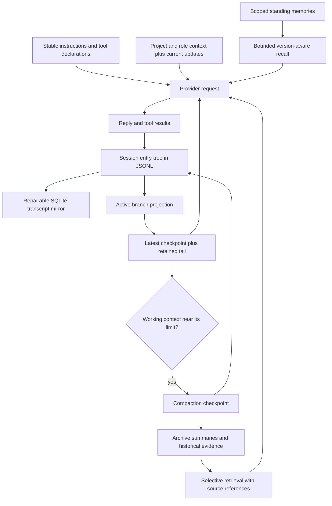

# Context, compaction and agent history review

**Status: findings and proposed improvements; recommendations are not implemented by this document.**

Keep the existing persistence, cache layering and recovery architecture. Repair historical lookup and request/reply correlation first; then make the saved evidence easier to retrieve, strengthen compaction handoffs, and measure smaller working contexts. Simplify budget instructions while retaining renewable runtime limits. A combined agent/files/backlog view should reuse existing records and preserve the difference between assignment, reservation, observed activity and verified completion.

This review covers the main agent and native subagents: context construction, caching, compaction, Archive, memory, communication, model/effort selection, session labels, historical runs and work attribution. “RKF” in the originating discussion refers to the core Archive tool, including past history and memories. External-agent internals are outside this scope.

The design owners remain [context management](CONTEXT.md), [agent communication](AGENT_COMMUNICATION.md), [orchestration](ORCHESTRATION.md), [entities](ENTITIES.md), and [Memory and Archive](../packages/coding-agent/docs/memory.md). This page consolidates the gaps, their consequences and proposed repairs. It does not replace their API or configuration references.

## Assessment and priorities

The implementation has substantial mechanisms for bounded context, recovery and coordination. Confidence is stronger in those mechanisms than in the claim that the current defaults optimize long-running task quality and cost. Deterministic tests can establish persistence and protocol behavior; they cannot establish that a model retains the right decision through repeated compactions or that a cheaper route completes a task more economically.

| Priority     | Improvement                                                                                  | Reason to do it in this order                                                                                   |
| ------------ | -------------------------------------------------------------------------------------------- | --------------------------------------------------------------------------------------------------------------- |
| First        | Preserve exact historical run identity; correlate budget grants with their requests          | Both problems have isolated reproductions and can produce misleading state despite successful underlying writes |
| Next         | Complete Archive transcript/session/run discovery; preserve retrieval provenance             | The evidence is often stored already, but the ordinary retrieval surface does not cover it completely           |
| Next         | Strengthen checkpoint content, standalone fallback evidence and memory selection             | These determine whether the agent can continue correctly after information leaves active context                |
| Then         | Join agents, files, items and steps; retain attribution beyond short-lived coordination logs | Existing relationships can support a useful view, but its historical accuracy depends on the preceding fixes    |
| Experimental | Smaller working contexts, alternative budget policy and task-specific routing                | Their value depends on matched task outcomes, total cost and recovery behavior                                  |

“Confirmed” below means source behavior was established, with an executable reproduction where stated. “Inferred risk” identifies a consequence not measured end to end. “Proposed” identifies a design or policy choice requiring implementation and validation.

## Existing flow and storage boundaries

Durability, discoverability, retrieval, active context and correct application are separate stages. Saving a message does not make it discoverable through every search route. Retrieving it does not guarantee that the model will use it correctly. Provider caching reduces repeated processing cost; cached tokens still occupy the model's context.

This is a dependency view, not an exact event-order diagram. Provider-specific behavior belongs to [prompt caching](../packages/coding-agent/docs/prompt-caching.md); request sequencing belongs to [the context pipeline](CONTEXT.md).

| Layer                                      | Current responsibility                                                                            | Boundary to preserve                                                             |
| ------------------------------------------ | ------------------------------------------------------------------------------------------------- | -------------------------------------------------------------------------------- |
| Base, session and volatile prompt sections | Keep stable content before frequently changing content; apply supported provider cache boundaries | Cache eligibility is not a guarantee of a cache hit                              |
| Active context projection                  | Select the current branch, latest compaction, retained messages and later entries                 | It must not rewrite the original history into a summary-only record              |
| Session JSONL                              | Versioned entries with IDs, parent IDs, timestamps, messages and state changes                    | It is the primary saved conversation, subject to retention and explicit deletion |
| SQLite transcript mirror                   | Indexed copy, repaired after a missed mirror write                                                | It is not an independent competing transcript                                    |
| Compaction archive                         | Full retained summary plus derived searchable message segments and pointers                       | A readable index is not a byte-identical transcript                              |
| Memory                                     | Standing preferences and reusable knowledge                                                       | Task progress belongs in checkpoints, sessions, backlog items and reports        |
| Team database                              | Presence, messages/deliveries, lifecycle events, runs, leases and observed edits                  | Live state and historical execution are different records                        |

### Persistence and compaction commit flow

JSONL appends hold a writer lock, merge concurrent entries and flush records before updating the SQLite mirror. Setup-only entries can remain in memory until a conversation starts; clients can explicitly materialize a reloadable empty session. A mirror failure reports pending indexing and can be repaired from the saved file. A lock timeout can temporarily retain an assistant or tool-result entry in memory; a final failed flush can still leave it unsaved. This is not a single transaction spanning filesystem, database and model execution. [Persistence owner](../packages/coding-agent/src/core/session-manager/persistence.ts), [mirror](../packages/coding-agent/src/core/session-manager/mirror.ts).

Compaction captures the messages being summarized, commits the checkpoint, then publishes the matching archive segment. A failed or cancelled compaction does not publish that capture. The checkpoint retains the summary, boundary entry, prior token usage, details and prompt/tool state. Replay uses the latest checkpoint plus the kept and subsequent entries; the original earlier entries remain saved. [Compaction capture](../packages/coding-agent/src/octocode/compaction/archive.ts), [entry types](../packages/coding-agent/src/core/session-manager/types.ts), [context projection](../packages/coding-agent/src/core/session-manager/context.ts).

The Markdown segment includes message text, calls/results, source entry IDs, time range, topics, read/modified files and branch information. Reasoning is excluded and images become placeholders. SQLite retains complete compaction summaries and detail-file status; `LIBRARY.md` is a derived index. Detail expiry and whole-session expiry have different effects. [Archive format](../packages/coding-agent/src/octocode/shared/archive.ts), [summary persistence](../packages/coding-agent/src/octocode/archive/summaries.ts), [retention](../packages/coding-agent/src/octocode/archive/retention.ts).

## What the external guidance supports

The paper [You don't need long context](https://arxiv.org/pdf/2611.05306) motivates execution-oriented compaction and selective retrieval instead of carrying the full trace at every step. Its outcomes vary by model and task. Table 3 distinguishes nominal API spending from estimated optimized cost; smaller contexts do not consistently lower the nominal bill. Appendix D gives additional model-dependent limits. The paper supports a controlled comparison of policies here. It does not establish a universal context size, an optimal child request allowance, a routing policy or a memory schema for Octocode.

[Anthropic's context-engineering guidance](https://www.anthropic.com/research/effective-context-engineering-for-ai-agents) supports compaction, persistent notes and focused subagents, and recommends tuning compaction for recall before removing unnecessary detail. This supports improving what a checkpoint preserves and how evidence is recovered.

[Claude's context-editing documentation](https://platform.claude.com/docs/en/build-with-claude/context-editing) explains that clearing tool results invalidates affected cached prefixes and incurs new cache-write cost. Enough material must be removed to justify that cost. This supports preserving cache-aware clearing rather than deleting old results on every turn.

The local design conclusion is to measure **correct completion and total task cost**, with latency reported separately. Cache-hit percentage, context size and summary length are diagnostic metrics, not success criteria by themselves.

## Context and compaction findings

### C1 — Keep prompt layering and cache-aware clearing

**Confirmed.** Stable sections precede session and volatile sections. Provider adapters receive an instruction boundary. Child identity is carried in task text while stable child prompt variants support cache reuse. Tool outputs are bounded and saved before replacement; broad clearing is delayed until the cache is cold or another prefix rewrite is already required and enough recoverable material can be removed. [Instruction boundary](../packages/coding-agent/src/core/model-runtime/instruction-boundary.ts), [clearing](../packages/coding-agent/src/octocode/compaction/clearing.ts).

**Suggestion and rationale.** Retain these mechanisms and instrument their actual effect. Aggressive rewriting can exchange lower context size for repeated cache writes and recovery calls. Conversely, a large warm context can still cost attention, latency and money. Choose cadence from completed-task outcomes rather than a blanket rule to compact rarely or frequently.

**Acceptance.** Compare total input, cache-read/write, output, summary and retrieval cost. Check provider request correctness, tool-pair integrity and recovery after model switches. Treat cache diagnostics as evidence about the request, not a live billing guarantee.

### C2 — Main and child agents already compact; improve the checkpoint contract

**Confirmed.** Main and child sessions use automatic pre-request compaction; lean profiles change tools rather than removing this lifecycle. The main agent additionally exposes explicit compaction. The working context defaults to the smaller of 300,000 tokens and 90% of model capacity, with reserves and retained-tail logic. Existing `contextBudget` and `/context` controls can reduce it. The preferred summary reuses the active model and cacheable prefix; overflow/downshift can use a standalone fallback. [Working window](../packages/coding-agent/src/core/agent-session/model-control.ts), [compaction settings](../packages/coding-agent/src/core/compaction/settings.ts), [hooks](../packages/coding-agent/src/core/agent-session/agent-hooks.ts), [shared summary](../packages/coding-agent/src/octocode/compaction/shared-summary.ts).

**Suggestion and rationale.** Tighten the meaning of the existing checkpoint sections. Preserve the current goal and acceptance criteria, applicable constraints and authorization scope, verified progress, unresolved failures, corrections and superseded decisions, pending asks, current intent, and the next justified action. Reference exact source entries and artifacts when details are omitted. Reusing the current checkpoint avoids another mutable task-state store that can disagree with the transcript. [Checkpoint format](../packages/coding-agent/src/octocode/instructions/workflows/compaction/checkpoint-format.md), [selection guidance](../packages/coding-agent/src/octocode/instructions/workflows/compaction/focus.md).

**Tradeoff and acceptance.** Carrying every historical detail defeats compaction. Select facts needed to continue and retain recovery pointers for the rest. Force repeated compactions after corrections and branch changes; verify the resumed action, not just the presence of expected headings. Preserve tool-call/result grouping, exact-input safeguards, loaded-skill references and bounded recent-file restoration.

### C3 — Standalone fallback can hide evidence from its own summarizer

**Confirmed mechanism; behavioral impact remains unmeasured.** In standalone preparation, a tool result over 2,000 characters can become a saved-file pointer. The summary request has no tools to open that pointer. The evidence remains durable, but it is unavailable to the summarizer at that point. The ordinary shared-summary path sees the live context, so this is a specific fallback risk. [Checkpoint text](../packages/coding-agent/src/octocode/compaction/checkpoint-text.ts), [standalone summarization](../packages/coding-agent/src/core/compaction/summarization.ts).

**Suggestion and rationale.** Preserve a useful bounded extract or explicitly selected critical evidence alongside the pointer. Prefer a deterministic extraction rule or host-assisted retrieval over assuming a pointer is equivalent to available evidence. Allowing the summarizer tools is a broader alternative with extra execution, cost and permission implications.

**Acceptance.** Put a necessary fact deep in a long result, trigger standalone overflow/downshift, then require the continuation to use the fact correctly or retrieve the original before drawing its conclusion. Also test irrelevant large output so the repair does not simply restore every oversized result.

## Archive and memory findings

### H1 — Saved conversation coverage exceeds normal Archive discovery

**Confirmed.** Ordinary history search uses archive segments and session records. A session record keeps a small beginning/ending view, so a decision in the middle of a never-compacted session can be absent. Structured Archive `sessions` listing uses the compaction-derived session index, which omits sessions without compactions. Raw JSONL/SQLite recovery remains possible. [History selection](../packages/coding-agent/src/octocode/shared/history.ts), [session record](../packages/coding-agent/src/octocode/compaction/archive/session-record.ts), [Archive reads](../packages/coding-agent/src/octocode/archive/reads.ts).

**Suggestion and rationale.** Add bounded transcript search/read through Archive and enumerate sessions from the session/transcript catalog. Retain fast summary-first discovery, followed by exact evidence retrieval. Return entry IDs, role, timestamp, branch/source range, continuation cursor and coverage status. Preserve tool pairs when returning executable conversation context. Use existing database-owned queries and branch/workspace permissions.

**Tradeoff and acceptance.** Searching raw history increases indexing and payload work; bounded results and stable pagination control it. Retrieve a unique middle-turn decision without requiring compaction, then distinguish two branches with contradictory decisions. Report unavailable or expired data rather than silently treating an empty search as proof of absence.

### H2 — Recovery paths differ across agents and retention states

**Confirmed.** Past compactions can be read explicitly. Children can access parent archives; forks have ancestor pointers. Ordinary children have read-only Archive/memory access but do not receive pinned memories. Lean omits Archive by default and relies on file recovery or parent help. Detailed archives default to 30-day retention and idle transcripts to 90 days; retained summaries can outlive details, while whole-session removal can remove more. [Archive lineage](../packages/coding-agent/src/octocode/shared/archive.ts), [child tools](../packages/coding-agent/src/octocode/subagents/core-tools.ts), [retention policy](../packages/coding-agent/src/config/retention.ts).

**Suggestion and rationale.** Make recovery availability explicit: present, expired, missing, not indexed, or outside the permitted scope. Include parent/fork identity in pointers. Consider read-only Archive for lean when recovery-heavy tasks justify the tool-schema cost; do not add it to every lightweight task by default.

**Acceptance.** Cover main, ordinary child and lean recovery after compaction and restart. Test expired details with a retained summary separately from whole-session expiry. Never turn an old session's user-role text into current authorization.

### M1 — Memory recall has early-term bias and incomplete update provenance

**Confirmed.** Recall is scoped, bounded, quoted and version-aware; a removed injection can be recalled after compaction. Query construction keeps the first 32 useful distinct words, which can omit a later task topic. Source attribution does not provide a complete entry-level trail for each correction. [Query selection](../packages/coding-agent/src/octocode/memory/query.ts), [recall](../packages/coding-agent/src/octocode/memory/register.ts), [injection](../packages/coding-agent/src/octocode/memory/inject.ts), [memory store](../packages/coding-agent/src/octocode/memory/store.ts).

**Suggestion and rationale.** Select terms from the actual current request and its named entities, rather than only its beginning. Record evidence entry/artifact references and correction provenance. Keep reusable knowledge in memory and current execution state in session/backlog/checkpoint records. Enlarging injected memory before fixing selection can add unrelated content without improving recall.

**Acceptance.** Place the relevant topic late in a verbose request with competing memories present. Verify retrieval and correct application. Update a preference, compact and restart; the current version should govern while its earlier evidence remains auditable. An injection/use counter measures exposure, not usefulness.

### M2 — Historical retrieval should preserve trust provenance

**Confirmed code gap; exploit impact untested.** Archive output has no explicit origin branch in the inspected provenance classifier. Existing fenced history and quoted-memory safeguards help, but source classification should survive a round trip through history. [Provenance owner](../packages/coding-agent/src/octocode/permission/provenance.ts), [message conversion](../packages/coding-agent/src/core/messages.ts).

**Suggestion and rationale.** Carry the original source class and authority scope with retrieved evidence, including external text and historical approvals. Host-verified metadata should distinguish an actual current instruction from a stored quotation. Semantic labels must not elevate authority.

**Acceptance.** Retrieve a historical web instruction and an approval from another session; neither should authorize a new consequential action. Test normal legitimate recovery as a positive control so the repair does not make Archive unusable.

## Delegation, models and budgets

### D1 — Brief children for a fresh context; select effort by difficulty

**Confirmed.** Children start fresh without the parent's full conversation. Task references can resolve selected messages and reports before launch. Required user rules must be copied explicitly. Built-in roles provide economical routes, but tier selection uses availability, capability metadata and price heuristics rather than measured success on the assigned task. Native children are leaves. [Task schema](../packages/coding-agent/src/octocode/subagents/agent-tool.ts), [task references](../packages/coding-agent/src/octocode/subagents/task-text.ts), [model routing](../packages/coding-agent/src/octocode/subagents/model.ts), [delegation policy](../packages/coding-agent/src/octocode/instructions/policy/delegation.md).

| Role                                          | Inspected default                | Reasoned routing policy                                                        |
| --------------------------------------------- | -------------------------------- | ------------------------------------------------------------------------------ |
| General task without a profile                | `medium`, medium thinking        | Use as a starting point; verify that it meets the task's completion conditions |
| Researcher                                    | `small:medium`                   | Bounded retrieval fits; ambiguous causal analysis may need escalation          |
| Implementer or reviewer                       | `medium:medium`                  | Escalate complex cross-module changes and consequential review                 |
| Browser or lean                               | `small:low`                      | Keep for bounded operations; account for recovery failures and retries         |
| Design, root-cause analysis or final judgment | Policy favors the parent's model | Choose effort from uncertainty, complexity and failure consequence             |

**Suggestion and rationale.** Replace the high-effort example about a child coordinating other children: native children cannot spawn descendants. Avoid using price as a capability claim. Brief objective, evidence, scope, ownership, authorization and completion criteria; name required skills explicitly. Record requested/effective model and effort, retry/escalation behavior and cost per successful task before changing route defaults. A profile without an explicit route can inherit the parent model; effective routing must be observed rather than inferred from its name.

Automatic tier selection also filters known context capacities below 100,000 tokens while accepting unknown capability metadata. That heuristic is not proof that every selected route fits a task or that smaller-window models are unsuitable. If the candidate pool changes, first verify prompt headroom, supported tools and recovery on the actual model. Keep requested and effective effort separate when a provider clamps the requested level.

**Acceptance.** Inspect generated final prompts after wording changes, then test realistic tasks and held-out cases. A stronger route should preserve prior useful context when resuming a non-isolated child. Isolated children require a new task with recovery context rather than ordinary resume.

### D2 — Simplify budget narration; retain renewable runtime limits

**Confirmed.** The child allowance counts model replies, not tokens, tool calls or dollars. Defaults are a soft threshold of 160 and a hard threshold of 240 requests; profile/environment overrides apply and zero disables the guard. Compaction side requests are outside this counter. Parents can grant more requests to a running child, and approved continuation renews an exhausted allowance. [Budget owner](../packages/coding-agent/src/octocode/subagents/budget.ts), [saved accounting](../packages/coding-agent/src/octocode/subagents/budget-history.ts).

**Recommendation.** Remove the requirement to invent a budget number in every natural-language brief. Preserve explicit user cost/time limits and let the runtime provide the request standing. The task schema has no per-call request-budget field, so mandatory briefing language creates work without corresponding enforcement.

Retain grants, continuation, cancellation, concurrency controls and watchdogs. A watchdog handles silence; it does not stop a continuously active unproductive loop. `subagents.maxCost` checks recorded spend before a new spawn/resume and is not a guaranteed ceiling on already-running work. [Spawn gates](../packages/coding-agent/src/octocode/subagents/spawn-limits.ts), [watchdog](../packages/coding-agent/src/octocode/subagents/process/watchdog.ts).

**Parent extension flow.** Use background mode when the child may need a parent decision. At the soft threshold it can ask for more with a reason and continue within its remaining allowance. The parent grants or requests a partial report. A foreground child's parent is blocked awaiting the tool result and cannot answer during that call; it must return useful remaining work for continuation. [Budget steering](../packages/coding-agent/src/octocode/instructions/notices/subagents/budget-steer.md).

**Counterargument and test.** Good children can be stopped just before success, and parent intervention adds overhead. Compare the existing renewable guard with the existing off switch under an independently enforced agreed spend/time cap. Include productive long tasks and active loops. Measure near-completion interruptions, interventions, eventual success and total cost. Do not combine this experiment with a context-window change.

### D3 — Budget grants do not resolve the question they answer

**Confirmed with an isolated reproduction.** A child sends `replyRequired:true`. Granting raises its allowance but sends an FYI without `replyTo`, leaving the original ask open. The unanswered dependency can keep a finished child reachable beyond normal lingering. A correlated reply closes it. [Grant implementation](../packages/coding-agent/src/octocode/team/tools/grant.ts), [reply correlation](../packages/coding-agent/src/octocode/team/store/mail.ts), [lifetime consumer](../packages/coding-agent/src/octocode/subagents/claim.ts).

**Smallest repair.** Accept an optional request reference on grant. Validate the asker, parent recipient, current run and open-question status before changing limits; then send the notification as the corresponding reply. Preserve proactive grants and unrelated asks. Update unified field ownership, schemas, instruction text and consumers together. Do not infer correlation by matching prose or close every question from a child.

**Acceptance.** Two asks are open; a grant closes exactly the intended one. Wrong-child and invalid request references refuse before mutation. If notification fails, the allowance remains raised, but the system must not fabricate delivery or an answered question. A grant without a prior ask remains valid.

## Communication and message-saving protocol

### P1 — Preserve existing transport semantics

**Confirmed.** Stored message bodies and per-recipient deliveries are separate. Existing fields include message identity, sender/recipient, time, reply requirement, reply correlation, wake/interrupt behavior, forwarded provenance and signatures. An acknowledgment occurs when the message reaches model context, not just when handoff is accepted. Retry/backpressure and urgent-control behavior protect delivery. Large messages can use hash-checked spills, and reports arriving after a session switch have a pending-delivery path. [Message model](../packages/coding-agent/src/octocode/team/model.ts), [inbox](../packages/coding-agent/src/octocode/team/inbox.ts), [delivery records](../packages/db/src/queries/deliveries.ts), [spills](../packages/coding-agent/src/octocode/team/spill.ts), [report delivery](../packages/coding-agent/src/octocode/subagents/run-execution.ts).

FYI messages do not normally wake an idle recipient. A reply-required question, a reply to an outstanding ask, and an explicit wake have different meanings. Only the starter can interrupt a native child. These are protocol fields with consumers; free-form labels cannot replace them. [Messaging tool](../packages/coding-agent/src/octocode/team/tools/messages.ts).

**Suggestion and rationale.** Keep raw message identity and delivery state through compaction and restart. Add task/run/source references only where a consumer needs them. Validate send, handoff, acknowledgment and answer independently: successful transport does not mean the requested decision was made or the underlying task completed.

**Acceptance.** Compaction between handoff and acknowledgment must neither lose nor duplicate a message. Restart must retain unresolved asks, reject stale reply correlation and preserve exact report references. Historical text must remain evidence at its original authority level.

## Session labels, historical agents and work attribution

### L1 — Labels are bookmarks; several other label-like fields are distinct

**Confirmed.** Session names use `session_info`. Entry bookmarks use append-only `label` events targeting an entry, with one resolved string per target; latest wins and empty clears. Automatic `✎ N files` labels use that same field while preserving other user labels. Compaction topics and backlog tags are separate mechanisms. [Types](../packages/coding-agent/src/core/session-manager/types.ts), [label writes](../packages/coding-agent/src/core/session-manager/appends.ts), [file labels](../packages/coding-agent/src/octocode/files/checkpoint-command.ts).

Labels survive reload and forks for retained targets. Branch creation rebuilds resolved labels and adjusts affected entry/compaction boundaries. A bookmark does not pin its target into model context. Archive message rendering preserves source entry IDs but does not export label events as semantic tags. [Branch handling](../packages/coding-agent/src/core/session-manager/tree.ts), [renderer](../packages/coding-agent/src/octocode/compaction/archive/render.ts).

**Suggestion and rationale.** Keep bookmark behavior. If retrieval cases justify annotations, use a small optional vocabulary such as decision, constraint, evidence, result and handoff, with source references, author, scope and explicit supersession. Store classification as metadata; avoid rewriting message bodies or requiring a model to tag every message. An annotation index should be rebuildable and separately searchable.

The backlog already supports typed links to sessions, messages, reports, memories and artifacts, using related/evidence/output/derivation relations. Reuse that contract before adding a generic relationship system. Extend missing kinds only with their readers and validation. [Backlog contract](../packages/contracts/src/backlogs.ts), [tool schema](../packages/coding-agent/src/octocode/backlog/tool-schema.ts).

**Acceptance.** A corrected decision supersedes the earlier one without deleting its evidence. Fork-specific decisions stay separate. Manual labels survive automatic file-label refresh. Labels never establish ownership, completion or user permission by themselves.

### A1 — Historical run lookup can silently select another execution

**Confirmed with an isolated reproduction.** `resolveAgent` resolves a reference to an agent name, then fetches that name's latest run. After one name works on B7 and then B8, the original run UUID and B7 can both resolve to the B8 run. The original B7 record still exists. The current newest-name policy is unsuitable for exact historical references. [Resolver](../packages/db/src/queries/agent-resolve.ts).

**Suggestion and rationale.** Preserve the matched run ID through lookup. A plain agent name can mean latest; an exact run or registration reference should retain the matching execution. Session/item queries can return several runs and require explicit selection. Keep current presence separate from historical fields so a live registration cannot overwrite the selected run's session or work item.

**Acceptance.** Reuse a name across runs, sessions and items; old references retrieve the original execution. Item queries return only runs for the matched item and respect workspace qualification. Test current live presence alongside a selected past run.

### A2 — Agent history exists but is fragmented and has finite retention

**Confirmed.** Live `agents` rows, lifecycle `agent_events` and historical `agent_runs` serve different purposes. Runs retain parent/session/role/model/goal, optional backlog item, process/worktree, usage, result/report and a bounded changed-file summary. Parent start, child registration, retirement and final result contribute different facts; audit writes are advisory and do not stop execution on failure. [Run owner](../packages/db/src/queries/agent-runs.ts), [events](../packages/db/src/queries/agent-events.ts), [audit adapter](../packages/coding-agent/src/octocode/team/run-audit.ts).

`agents.txt` is a derived view of the newest 50 lifecycle events. Archive's `agents` source reads live rows, not historical runs. `/agents history` reads children recorded in the current session; it is not the repository's complete execution history. `/agents`, targeted lookup and backlog item queries expose other portions. [Projection](../packages/coding-agent/src/octocode/archive/projection.ts), [Archive reads](../packages/coding-agent/src/octocode/archive/reads.ts), [agent command](../packages/coding-agent/src/octocode/subagents/command.ts).

Runs default to deletion after 30 days without the gzip archiving used for backlog/config audit history. Purging uses end time or start time, so an old open run can qualify. Backlog items, notes and comments are not age-deleted by that policy. [History retention](../packages/db/src/retention.ts).

**Suggestion and rationale.** Add historical-run discovery with stable pagination and explicit source coverage. Protect active runs from age-only purge, and choose an archive policy for ended run metadata if long-term attribution is required. Keep large transcript/artifact retention separate. More retention increases storage and privacy obligations; it should be deliberate rather than silently equated with “saved forever.”

**Acceptance.** Discover a completed run after its live row disappears. Pagination remains stable as new agents join. An active long-running execution survives retention cleanup. Expired results report what is missing, and a generated file can be rebuilt from canonical records.

### A3 — File attribution is useful but incomplete

**Confirmed.** Leases represent current write reservations. The edit log observes successful file-tool changes and named writes recognized by shell parsing. It does not comprehensively observe external editors, arbitrary scripts, reads or all filesystem mutations. The log retains one day. Retirement derives a run's changed-file count and at most 50 paths from remaining observations. [Reservations](../packages/coding-agent/src/octocode/subagents/reservation.ts), [edit log](../packages/coding-agent/src/octocode/team/edits.ts), [write observations](../packages/coding-agent/src/octocode/team/tools/events.ts), [run snapshot](../packages/db/src/queries/agent-runs.ts).

**Inferred risk.** A run lasting beyond edit retention can lose early observations before its end-of-run snapshot. This follows from the pruning and snapshot mechanism; it has not been demonstrated by a multi-day process run.

**Suggestion and rationale.** Attach run and workspace/worktree identity when writes are observed, then retain per-run path attribution incrementally beyond the short coordination log. Paginate display rather than discarding all paths after the cap. Preserve unknown attribution for pre-registration activity until a justified adoption can identify it. Include path-observation type and time; a declared review scope should remain visible even when no write or reservation occurs.

**Tradeoff and acceptance.** Additional attribution records need retention and migration rules. They still cannot prove unobserved external changes. Test more than the displayed path cap, log expiry during a run, reused names, identical relative paths in different worktrees, partial file-operation success and read-only review.

### A4 — Backlog ownership, delegated execution and steps need explicit joins

**Confirmed.** A backlog item is normally held by the parent session. An optional child `item` link records delegated work and attaches its report; it does not transfer all parent ownership. Main-agent lookup derives the most recently updated ongoing item held by the session, which loses multiplicity and past assignments. Steps have their own state and assignee, but no direct stable run-to-step link. [Delegation](../packages/coding-agent/src/octocode/backlog/delegation.ts), [item link](../packages/coding-agent/src/octocode/subagents/item-link.ts), [actor context](../packages/coding-agent/src/octocode/backlog/context.ts), [task rows](../packages/db/src/queries/tasks.ts).

Open session-owned child steps can be adopted by the parent without rewriting the old assignee; isolated unlinked child steps are reported before cleanup rather than transferred. A stale assignee is therefore not evidence of a currently working agent. [Task writes](../packages/coding-agent/src/octocode/backlog/tasks/writes.ts), [child task recovery](../packages/coding-agent/src/octocode/subagents/child-tasks.ts).

**Suggestion and rationale.** Preserve the optional B-item link and add a typed T-step link for step-specific delegation. Record assignment changes over time if historical main-agent work must be complete. Return the item holder, delegated run and current step assignee separately, with current liveness. Use collections where several items or steps can be active; avoid a single ambiguous “owner.”

**Acceptance.** One parent holds several items, two children handle distinct steps, and one exits with unfinished work. The view retains item responsibility, identifies the actual run/step relationships, and shows the handoff without implying the departed child is still active.

## Proposed combined agent, file and backlog view

Build one host-owned read model over existing database records. All SQL stays in named query functions under `packages/db/src/queries/`, exported through `api.ts`. CLI, agent tools and web UI should consume the same result. Reuse existing schemas and resource references; do not create a separately maintained roster or backlog.

| Field group        | Meaning and source                                                                                                                                    |
| ------------------ | ----------------------------------------------------------------------------------------------------------------------------------------------------- |
| Execution identity | Exact run ID, agent name, registration, parent agent/session and selected historical session; parent run only when recorded or unambiguously resolved |
| Current presence   | Live/ended status, heartbeat and current activity, explicitly separate from the selected run                                                          |
| Work scope         | Workspace, worktree, branch, declared files, item holder, delegated B-item and linked T-steps                                                         |
| Reservations       | Paths currently leased, with owner, scope and expiry                                                                                                  |
| Observed activity  | Named writes and their evidence/time; optional read/review observations only where supported                                                          |
| Results            | Report, outcome, completion verification and produced artifacts                                                                                       |
| Recovery           | Transcript/checkpoint/source entry links, detail availability, retention status and pagination                                                        |

Support queries by exact run, agent name, session, qualified item, step and path. A file lookup should distinguish “assigned to inspect,” “reserved to edit,” “observed writer,” and “reported output.” A backlog lookup should show all matching runs, including failures and resumes. Show uncertainty or missing linkage rather than inferring it from a title or tag.

Start with agent/CLI access because agents need these answers during coordination; the web UI can reuse the same projection afterward. The inspected web view shows live goals, activity and reservations but does not join historical files, runs, items and steps. The rollout order is a recommendation, not a recorded user decision. [Live team contract](../packages/contracts/src/team.ts), [web Agents view](../packages/webview/src/app/live/AgentsView.tsx).

## Implementation sequence and ownership

| Change                           | Owning modules                                                  | Compatibility and rollout                                                                                     |
| -------------------------------- | --------------------------------------------------------------- | ------------------------------------------------------------------------------------------------------------- |
| Exact historical lookup          | DB agent resolution/runs; team audit; command consumers         | Keep name-to-latest convenience; make exact references exact; distinguish list results from single-run lookup |
| Correlated grant                 | Team grant/mail, unified tool schema and instruction Markdown   | Keep grants without requests; validate before mutation; retain notification-failure behavior                  |
| Transcript and run discovery     | DB transcript/session/run queries; Archive reads/tools          | Add bounded sources and stable cursors; preserve permissions and existing IDs                                 |
| Checkpoint/fallback improvements | Compaction instruction Markdown and fallback preparation        | Keep existing entry format/readers; change selected content before inventing new mutable state                |
| Memory selection/provenance      | Memory query/store/injection and shared resource references     | Preserve versions, scope, deletion behavior and bounded injection                                             |
| Durable file/work attribution    | DB observation/run/task owners; team events; child start/finish | Prefer additive migration; mark unavailable historical fields rather than inventing a backfill                |
| Combined read model              | DB API, coding-agent host, contracts, tool/CLI, then web        | One projection and stable identities; derive displays rather than duplicate state                             |

Use narrow changes with owner-specific regressions. Regenerate and inspect exact prompts when modifying tool descriptions or instruction sources. For browser source changes, regenerate workspace assets and run the affected contracts/webview tests before bundle checks. Preserve cancellation, cleanup, permissions, tool pairing, save-before-replace behavior and existing recovery breakers.

## Evaluation before changing defaults

Compare the current working-window policy with 64k first, then 48k only where fixed prompts, useful recent context and recovery payloads fit. These are candidate working windows using the existing setting, not validated defaults or the paper's exact trigger thresholds. Keep model, effort, tools, memory policy and request guard fixed. Test budget-off and model-routing policies in separate experiments.

| Case                                    | Required observation                                                                                         |
| --------------------------------------- | ------------------------------------------------------------------------------------------------------------ |
| Repeated correction and compaction      | Current constraints and acceptance criteria govern the resumed action; superseded instructions do not return |
| Uncompacted middle history              | Exact decision is found with source identity and appropriate branch scope                                    |
| Standalone long-result fallback         | Necessary evidence is preserved or retrieved before use                                                      |
| Parent/child recovery                   | Required rules and pending asks survive; foreground and background behavior remain distinct                  |
| Grant correlation                       | Exactly the intended ask is answered; invalid references do not mutate allowance                             |
| Reused agent identity                   | Old run, session and item references do not silently select new work                                         |
| Memory late topic and correction        | Relevant current memory is retrieved and applied after compaction/restart                                    |
| Retention and long activity             | Missing history is explicit; active runs and retained attribution follow the chosen policy                   |
| File/worktree attribution               | Identical relative paths in separate worktrees and partial writes remain distinguishable                     |
| Historical trust                        | Retrieved quotations or old approvals do not gain current authority                                          |
| Active loop versus productive long task | Request-limit policy is judged on completion, interruption and waste, not duration alone                     |

Run deterministic cases for persistence, IDs and protocol state first. Then use matched live tasks, repeated runs and held-out cases for semantic continuation and routing. Include failed tasks in the denominator, record the effective model/effort/window/reserve, and counterbalance run order where warm caches can affect comparisons.

Measure correct completion, constraint adherence, successful retrieval/application, unresolved asks, duplicated work, total cost including children/summaries/retries/recovery, latency, compaction failures, repeated reads and parent interventions. The existing [agent-eval harness](../scripts/agent-eval/README.md) supplies the comparison path, but its short isolated cases do not by themselves establish cross-session recall or repeated-compaction quality. Use explicit isolated history fixtures. Live evaluation requires an agreed spend cap under the repository's [verification rules](../AGENTS.md#verify).

## Choices to defer

- **Universal small contexts:** fixed prompt costs, model behavior and API economics differ; select defaults only after the matched evaluation.
- **Unbounded children by default:** test the existing off switch with an independent cap before removing a guard that catches active loops.
- **A second task-state store:** first improve the existing checkpoint, backlog and typed links; another mutable copy creates reconciliation work.
- **Mandatory tags on every message:** add only annotations with a demonstrated retrieval/compaction consumer and a round-trip test.
- **Automatic conversion of sessions into memory:** preserve reusable facts with evidence; avoid turning transient decisions or stale progress into standing knowledge.
- **Treating reservations as complete file ownership:** retain the distinction between declared scope, enforceable leases, observed activity and verified output.

## External references

- [You don't need long context — paper PDF](https://arxiv.org/pdf/2611.05306)
- [You don't need long context — abstract and version history](https://arxiv.org/abs/2611.05306)
- [Anthropic — Effective context engineering for AI agents](https://www.anthropic.com/research/effective-context-engineering-for-ai-agents)
- [Claude Platform — Context editing and cache/clearing tradeoffs](https://platform.claude.com/docs/en/build-with-claude/context-editing)

The external sources inform the experiments and tradeoffs. The defect descriptions and implementation recommendations above are grounded in their linked repository owners; they are not claims that the paper evaluated this codebase.
