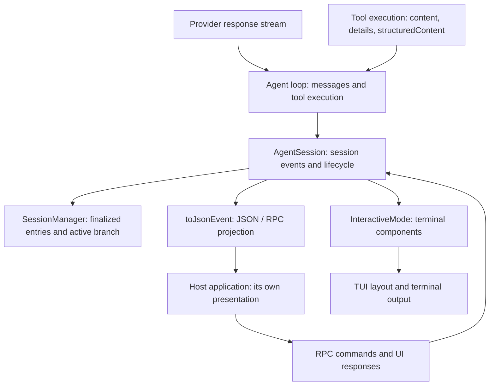

# Data and presentation architecture

The agent exposes reusable message, tool-result, session, and RPC types. The terminal UI is one consumer of those values. A web application can reuse the session backend through RPC or the Node.js SDK, but terminal components and custom renderers do not run in a browser. The current architecture supports multiple interfaces without replacing the agent loop; it does not provide a universal visual component model.

This review covers the working checkout on 2026-10-22, based on commit `5eb566c` plus its imported/untracked source. It verifies the data/presentation boundary, not every provider or deployment. Repository-wide checks still have failures described below; this is not an all-green certification.

## Ownership and flow

- [`packages/ai`](../packages/ai/src/types.ts) owns provider message/content/usage types and assistant stream events.
- [`packages/agent`](../packages/agent/src/types.ts) owns `AgentMessage`, `AgentEvent`, `AgentTool`, and `AgentToolResult<T>`. The loop owns execution, tool updates, and lifecycle events.
- [`AgentSession`](../packages/coding-agent/src/core/agent-session.ts) adds queues, retries, compaction, nested calls, persistence coordination, and `AgentSessionEvent`. SDK consumers subscribe here.
- [`SessionManager`](../packages/coding-agent/src/core/session-manager.ts) owns the persisted entry tree and active branch. The transcript is not a record of every streaming event.
- [`InteractiveMode`](../packages/coding-agent/src/modes/interactive/interactive-mode.ts) translates session events into terminal components, tracks streaming messages and pending tool calls, and requests redraws.
- [`packages/tui`](../packages/tui/src/tui.ts) owns terminal layout and output. A `Component` renders lines for a terminal width.
- [`toJsonEvent`](../packages/coding-agent/src/modes/json-event.ts), [print mode](../packages/coding-agent/src/modes/print-mode.ts), and [RPC mode](../packages/coding-agent/src/modes/rpc/rpc-mode.ts) own the wire projection and transport. They do not scrape terminal output.

The SDK and filesystem-capable coding-agent runtime belong in a Node.js/Bun host. The browser smoke checks cover selected AI/agent imports; they do not establish that the entire coding-agent SDK can run inside a browser.

## Data contracts

| Contract | What it represents | Presentation implications |
| --- | --- | --- |
| `AgentMessage` / `ToolResultMessage` | Transcript messages, content, errors, details, and usage | Reconstruct history from messages and session entries, not ANSI output. |
| `AgentToolResult<T>` | Model-facing `content`, typed `details`, optional `structuredContent`, usage, error and termination metadata | Tool execution stays independent of its renderer. |
| `AgentEvent` | Message and tool execution lifecycle | Discriminated event union, but tool arguments and results still contain `any`. |
| `AgentSessionEvent` | Agent events plus session lifecycle and nested-call metadata | Reuse for in-process observers; preserve `parentToolCallId` when displaying nested tools. |
| `JsonAgentSessionEvent` | The JSON/RPC event projection | Streaming updates differ from in-process updates. |
| `RpcCommand` / `RpcResponse` / `RpcSessionState` | Commands, correlated responses, and state queries | Commands and asynchronous events are distinct streams within the same JSONL transport. |
| `RpcExtensionUIRequest` / `RpcExtensionUIResponse` | Select, confirm, input, editor, notifications, status, and widget requests | Render dialogs in the host and answer using the request ID. |
| `ToolRenderers` / `ToolRenderContext` | Terminal rendering callbacks and display state | These are TUI contracts, not portable web components. |

RPC contracts are declared in [`rpc-types.ts`](../packages/coding-agent/src/modes/rpc/rpc-types.ts). TypeScript types are not runtime validation: the transport parses JSON and uses type assertions, with selected checks. A public network gateway needs its own validated boundary, authentication, and session ownership; the local stdio protocol is not an HTTP server.

`details` is the place for data that a tool needs to retain in transcript results. `structuredContent` is machine-readable execution output and can travel in execution events, but [`ToolResultMessage`](../packages/ai/src/types.ts) does not currently declare it. Do not assume it survives session restoration. The terminal renderer now receives structured data when it is present in the live result, while restored results retain the fields actually saved in the transcript.

## Streaming and lifecycle

In-process `message_update` includes the current message snapshot and the assistant delta event. JSON/RPC deliberately removes cumulative snapshots from updates; otherwise a long response repeatedly transmits its growing prefix. The wire stream retains cumulative usage and includes tool identity on `toolcall_start`.

A host should:

1. Start a message from `message_start`.
2. Apply text, thinking, and tool-call deltas by their content index.
3. Treat `message_end` as the authoritative completed message.
4. Track tool calls by `toolCallId`, including partial updates, errors, and optional duration. Execution completion order can differ from call order.
5. Wait for `agent_settled` when it needs the session to be idle. `agent_end` can precede retry or queued work.
6. Reconstruct resumed history from session state/entries, then consume subsequent events. Do not assume reconnect replay or exactly-once delivery: the current wire types do not provide a resumable event cursor.

Session subscriptions are synchronous and do not await listener promises. Renderers should schedule their own redraws and avoid blocking or mutating shared event objects. Dispatch now snapshots the listener list: unmounting a view does not cause the next subscribed view to miss the current event, and mounting a view does not deliver the in-progress event to it. This does not clone the event payload.

JSON/RPC output has explicit stdout backpressure handling. A future network bridge must handle its own buffering and disconnect lifecycle. Dispose sessions and unsubscribe observers when the host releases them; see the [SDK lifecycle guide](../packages/coding-agent/docs/sdk.md).

## RPC UI integration

[`RpcClient`](../packages/coding-agent/src/modes/rpc/rpc-client.ts) now separates typed UI requests from session events:

- `onEvent(listener)` receives `JsonAgentSessionEvent` values.
- `onExtensionUIRequest(listener)` receives `RpcExtensionUIRequest` values. Both subscription methods return an unsubscribe function.
- `respondToExtensionUIRequest(response)` sends a typed reply with the original dialog ID. Its promise reports completion of the pipe write; the protocol does not acknowledge UI replies as ordinary RPC commands.
- `collectEvents()` and `promptAndWait()` collect session events until `agent_settled`; UI requests are not mixed into those results.

Before this change, UI requests were passed to listeners as though they were `JsonAgentSessionEvent` values, and there was no public client method to reply. Consumers that worked around the incorrect event type should move their UI handling to `onExtensionUIRequest`.

Register the UI listener before sending a command that may ask a question. Render `select`, `confirm`, `input`, and `editor` requests in the host. Return the chosen value, confirmation, or cancellation with the same ID. Handle write failures and unsubscribe on teardown. Notifications and status/widget updates are not dialogs requiring a reply. Permission decisions remain owned by the backend; adding a web view must preserve its prompts and cancellation behavior.

## What is portable today

| Capability | Existing support | Remaining work for another interface |
| --- | --- | --- |
| Chat, thinking, tool progress, errors, usage | Typed session events and JSON/RPC projection | Host state reconstruction and native visual components. |
| Tool-specific data | Generic result details and structured output | Validate/narrow details for the selected tool; there is no exhaustive tool-name-to-result type map. |
| Basic dialogs and notifications | RPC UI request/response protocol and typed client methods | Host dialog rendering, cancellation, and timeout behavior. |
| String widgets and status | RPC transports strings/lines | These remain presentation text; they are not semantic card/table descriptions. |
| Custom components, headers, footers, editors | TUI callback APIs | Separate host implementations; RPC ignores or does not support several component-based APIs. |
| Session history | SessionManager and transcript messages | Render stored fields; transient execution metadata may not be available after reload. |
| HTML export | Existing export implementation | Static export is not a live web interface. |

The [extension API](../packages/coding-agent/src/core/extensions/types.ts) mixes execution registration with optional terminal renderers. Tool execution does not require calling those renderers, but their `Theme`, `Component`, and `TUI` types bind presentation to the terminal.

There are also remaining dependencies from core into presentation: `AgentSession` imports the interactive theme for HTML export, and `ResourceLoader` loads themes and detects terminal color capabilities. Some native result types, including subagent `RunDetails` and `ResultDetails`, are declared in renderer modules. These are real modularity limits, not evidence that headless execution is broken.

## Improvements made in this review

1. **Stable session fan-out.** Snapshot listeners during dispatch. Regression tests demonstrate the old missed-event behavior and the corrected behavior using real session queue events.
2. **Typed RPC UI routing and replies.** Separate UI subscribers, preserve dialog IDs, and share process/pipe validation between command and UI writes. Ignore unmatched command responses instead of presenting them as session events. Child-process tests cover confirmation, text containing a newline, cancellation, unsubscribe, and writing before startup.
3. **Preserve live tool-result metadata.** The TUI previously passed only `content` and `details` to custom result renderers, discarding structured output, error status, usage, and termination metadata. It now forwards the supplied result fields. The component derives optional metadata types from `AgentToolResult` rather than redefining them. A regression test exercises both partial and final rendering.

These changes retain the existing execution and wire formats. They do not introduce a second agent implementation or replace terminal rendering.

## Recommended direction

Keep `AgentSession` and the existing RPC protocol as the integration boundary. Build the first web view against this data before introducing a universal presentation abstraction.

When extending the boundary, move tool result types into their owning data modules, replace unbounded tool-event payloads with validated result contracts in compatible slices, and separate renderer registration from execution registration. Only extract a shared presentation reducer when both hosts need identical state transitions. Keep terminal widths, ANSI styling, keyboard handling, and `Component` instances inside the TUI adapter. Add explicit host capabilities before promising custom UI parity.

For acceptance, exercise streamed messages, partial/final/error tool results, nested calls, cancellation, retries, compaction, restored history, dialogs, and subscriber teardown. Compare semantic data across interfaces; their layout does not need to match.

## Verification on 2026-10-22

Checks used Node 24.21.0. `fd` was initially missing; it was installed before the final repository test run. Existing `ripgrep` and Bun were available.

- **Passed:** focused presentation/streaming suite, 68 tests across 9 files; separate RPC client/framing checks, 14 tests across 6 files (these sets overlap).
- **Passed:** native feature suite, 2,546 tests; 16 skipped. This configuration excludes live e2e and Chrome tests.
- **Passed:** complete TUI package test command; final tool-renderer/RPC regression rerun, 46 tests across 2 files.
- **Passed:** browser import/agent tree-shaking smoke check.
- **Passed:** offline build, including production TypeScript compilation and coding-agent bundle.
- **Passed:** source CLI `--help` smoke check.
- **Passed:** a real built CLI with an isolated temporary extension emitted a confirmation request, accepted the typed client reply, and emitted the confirmed notification. No provider call was needed.
- **Passed on the latest check:** repository-wide `npm run check`, including TypeScript and browser smoke. Earlier checks had 11 pre-existing provider-test type errors. Other changes to those test files appeared in the shared checkout during this review; they were preserved and are not attributed to the presentation fixes.
- **Not green:** the repository-wide isolated test run has model-catalog/default-model and Bun worker-lifetime failures. See the final counts below. Assertions and coverage requirements were not weakened.
- **Not verified:** live provider calls, manual visual inspection in a terminal, a deployed browser frontend, network reconnect behavior, and portable registry installation/release. The sibling local dependencies remain intentional.

The data/presentation regressions have passing checks. Remaining global failures prevent claiming that the entire repository works without qualification.

Latest full isolated test results, before the concurrent provider-test updates:

| Suite | Passed | Failed | Skipped | Result |
| --- | ---: | ---: | ---: | --- |
| Repository scripts | 29 | 0 | 0 | Passed |
| Agent core | 91 | 0 | 0 | Passed |
| AI/provider tests | 1,614 | 4 | 861 | Missing catalog entries in four provider tests |
| Codemode | 223 | 3 | 0 | Bun worker-lifetime assertions |
| Coding-agent standard suite | 2,773 | 1 | 50 | Configured GitHub Copilot default `gpt-5.4` absent from generated catalog |
| MCP | 45 | 0 | 0 | Passed |
| Telemetry | 47 | 0 | 0 | Passed |
| Native features (run separately) | 2,546 | 0 | 16 | Passed |

The standard coding-agent suite's failure prevents its chained native command from running in `./test.sh`, so the native suite was run explicitly. All 11 filesystem failures from the first run disappeared after installing `fd`. The eight failures in this full run also existed in the baseline run and were not hidden or skipped to produce a passing result. Follow-up results after concurrent changes are recorded separately below.

After the concurrent provider-test updates, all four previously failing AI test files passed (50 tests). The default-model suite still had one failure and 61 passing tests: GitHub Copilot's configured default is absent from the catalog. Together with the three Bun worker-lifetime failures from the full run, these remain unresolved. The entire suite was not rerun after the concurrent edits; the latest typecheck and these targeted rechecks were run against them.
