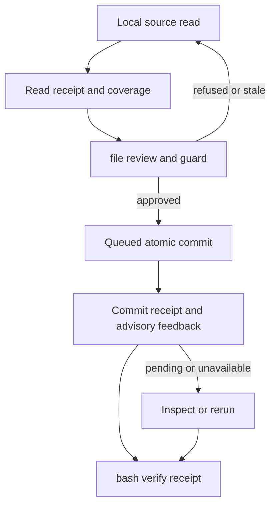

# Editing, feedback, verification, and debugging

Native sessions read source with Octocode research tools, mutate it with `file`, run checks with `bash`, and debug or profile a running program through `bash` with the bundled `octocode-debugging` skill. The [native feature guide](../packages/coding-agent/docs/native-features.md#tool-selection-and-migration) owns tool selection and read-command rules; [configuration](../CONFIGURATIONS.md) owns settings.

## Edit and verify

Read a known file with `localFetch` (or unminified `localGetFileContent` on an older server). The [read receipt](../packages/coding-agent/src/octocode/files/read-receipts.ts) credits unchanged source windows. Only a complete, untransformed read visible to the model supplies a copyable whole-source SHA-256. Partial, cut, failed, filtered and nested reads cannot supply an anchor. With local readers unavailable, the [native guide](../packages/coding-agent/docs/native-features.md#tool-selection-and-migration) lists the literal `bash` printers that count as reads. Repeat a read if its result has left the current context.

An ordinary `file` edit replaces exact `oldText` with `newText`. An optional complete-line anchor uses `edits: [{ line, sourceSha256, oldText, newText }]`: `line` is one-based, and `oldText` is the whole line without its terminator. The [anchor adapter](../packages/coding-agent/src/octocode/files/tool/anchored.ts) checks the visible source digest and current bytes, then finds unique context within 128 lines. It refuses stale, ambiguous or partial identity instead of guessing. The [file tool](../packages/coding-agent/src/octocode/files/tool.ts) also reviews permission, workspace and later-session paths, reservations, read coverage and target identity before [execution](../packages/coding-agent/src/octocode/files/tool/run.ts) checks the bytes again under a per-file queue and cross-process lock. External writers that ignore the lock can still race it.

A committed write or deletion gets a receipt even when later cleanup fails. A query batch reports each outcome and may continue after a failure; a patch validates first and stops on execution failure. Earlier commits remain: there is **no multi-file transaction**.

Use `bash({ command: "yarn test", verify: true })` for the check that matters. Its [receipt](../packages/coding-agent/src/octocode/files/bash/verification.ts) records command, exit or signal, output availability, process epoch and native `file` mutation revisions. A background start is pending; observed completion sends a terminal follow-up, while shutdown's pre-stop report remains pending and incomplete. A zero exit describes only that command. Later native `file` commits mark the receipt stale; `stale: false` cannot detect shell writes, debugger effects, editors or other processes. Inspect or rerun after those changes.

## Debugging and profiling

Octocode has no debugger tool. The bundled [`octocode-debugging` skill](../packages/coding-agent/src/octocode/native-skills/octocode-debugging/SKILL.md) teaches the agent to run the system debuggers and profilers non-interactively through `bash` (lldb, pdb, a Node inspector script, cProfile, `--cpu-prof`), so every run goes through the shell permission gate like any other command. Rerun the original check after fixing a debugged failure.
