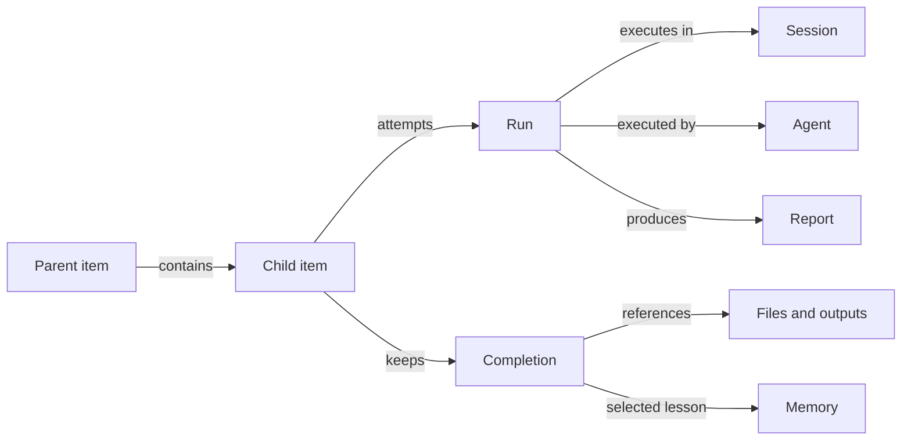
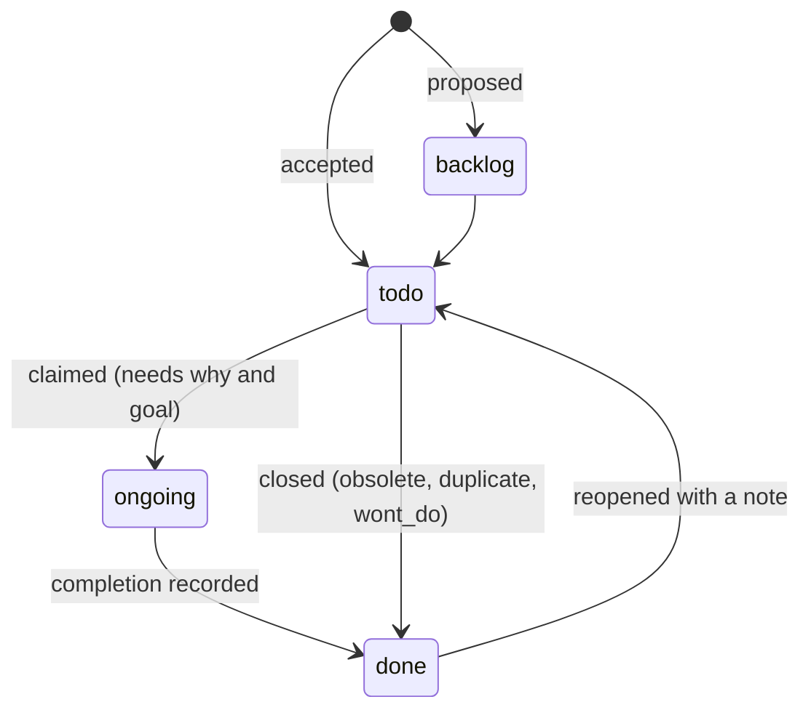
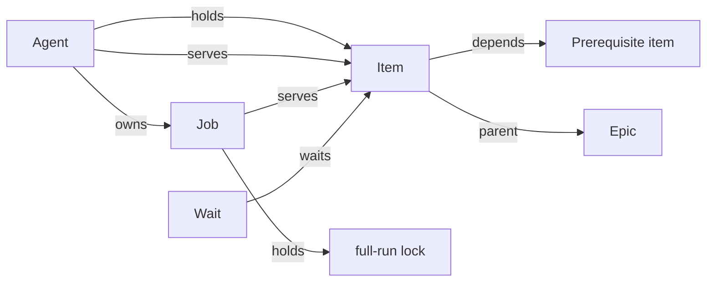

# Entities: what Octocode stores and how the pieces relate

One SQLite database per Octocode home keeps backlog items, sessions, agents, team messages, memories and more. The transcript mirror (session entries, compaction summaries, an index of the JSONL transcripts) lives in a second file beside it. Each kind has its own record and lifecycle; do not merge them (transcript messages are not team messages, backlog states are not run states, file references are not artifacts). Storage and retention: [configuration](../packages/coding-agent/docs/configuration.md#runtime-storage).

An item can involve several sessions, agents and attempts, and a session can work on several items: use links, not exclusive ownership.

## Database

Schema version 11. A version 10 file upgrades once, after a backup to `<file>.v10.bak`; a newer or older file is refused ([database versions](../packages/coding-agent/docs/configuration.md#runtime-storage)). Checkout-local data resolves to a workspace id (`workspaces`). Historical workspaces can share a name or last-known path, so file-serving routes check the current directory binding first.

| Tables                                                                      | Holds                                                                                                                                                |
| --------------------------------------------------------------------------- | ---------------------------------------------------------------------------------------------------------------------------------------------------- |
| `workspaces`                                                                | UUID, display name, canonical root, filesystem identity, git common dir, linked-worktree flag; the repository index groups checkouts                 |
| `sessions`, `session_forks`                                                 | Sessions bound to a workspace; host-created fork links; imports can stay unbound                                                                     |
| `session_transcripts`, `session_entries` (mirror)                           | Conversation tree (header, ordered entries with tree parent and payload); rebuildable from transcript files                                          |
| `compaction_summaries` (mirror)                                             | One summary per compacted entry; detail copies on disk have their own retention                                                                      |
| `backlog`, `backlog_tasks`                                                  | Items and steps, numbered per workspace; parents, origins and steps share the workspace                                                              |
| `backlog_links`, `backlog_notes`, `backlog_comments`, `backlog_completions` | Item children; a completion's operation key is unique within its item                                                                                |
| `backlog_audits`, `workspace_commands`                                      | Item history (survives item removal); web command receipts keyed by workspace, session, client request id                                            |
| `agents`, `agent_events`, `messages`, `deliveries`, `agent_runs`            | See [agents, runs and mail](#agents-runs-and-mail)                                                                                                   |
| `leases`, `edits`                                                           | Checkout-level reservations and observed edits                                                                                                       |
| `timers`                                                                    | `notify` wakes                                                                                                                                       |
| `jobs`                                                                      | Background `bash` jobs of every session (command, folder, pid, log, state), so an identical start can join a running one; rebuildable, never carried |
| `memories`                                                                  | Scoped to one of: a workspace, a project key, the global collection; full-text search when SQLite supports it                                        |
| `meta`, `config_audits`, `trusted_folders`                                  | Schema metadata, configuration audit history, project trust grants                                                                                   |

A session's rows in both files go together on delete; each file's part is one transaction.

## Agents, runs and mail

| Record  | Meaning                                                                                                                                    |
| ------- | ------------------------------------------------------------------------------------------------------------------------------------------ |
| Profile | Definition: role instructions, tools, model preference                                                                                     |
| Agent   | Live executor; presence is a temporary view. A team spans a repository; an isolated child can reserve files in its coordinator's workspace |
| Run     | One audit row per run (details below)                                                                                                      |
| Report  | Result a coordinator receives (`done`, `partial`, `blocked`, `failed`)                                                                     |
| Message | One team message, many recipient deliveries, optional reply link; delivered and answered are separate facts                                |
| Event   | `agent_events` lifecycle events (details below)                                                                                            |

- **Run** holds profile, model, goal, where it worked (folder, branch, process title, pid), the backlog item it was started for, start and end with reason, final numbers, changed files (count and first 50 paths), and the reported outcome with its report path. One run is open per agent name; a successor closes an older open one as `crashed`. Deleted with other history after `retention.days`.
- **Event**: a `delete` event records why a row ended (`completed`, `failed`, `stopped-user`, `stopped-parent`, `parent-gone`, `crashed`, `left`) and its last numbers (tool calls, input, cache read, output, cost, pid, times). A `stalled` update marks an agent silent for ten minutes, once per silence.
- `agents.end_hint` is the cause a coordinator leaves before stopping a child. Whoever retires the row uses it unless the leaver names its own reason; the first hint stays.
- `/agents <ref>` shows one agent, `/agents` recent runs, `backlog get` an item's runs. Reasons: [agents](AGENT_COMMUNICATION.md#how-an-agents-end-is-recorded).

A backlog item is `B36` in its own workspace and `<workspace name>:B36` elsewhere (the workspace id when the name is unknown); both parse.

## Backlog items

Small at capture, useful at completion: only a title is needed to create one.

| Field                                           | Notes                                                                                                                                                       |
| ----------------------------------------------- | ----------------------------------------------------------------------------------------------------------------------------------------------------------- |
| `title`                                         | Required                                                                                                                                                    |
| `type`                                          | `feature` (default), `epic`, `bug`, `research`. An epic is an ordinary grouping item; there is no epics table                                               |
| `why`, `goal`                                   | Reason and checkable definition of done; required before an agent starts or completes work, optional for human capture                                      |
| `state`                                         | `backlog` (proposed), `todo` (accepted), `ongoing` (claimed), `done`. Closed = `done` with a closure (`obsolete`, `duplicate`, `wont_do`) and no completion |
| `parentId`                                      | One optional parent, same workspace, no cycles                                                                                                              |
| `dependsOn`                                     | Finish-to-start prerequisites, stored once as `depends_on` links; inverse `blocks` is derived                                                               |
| `priority`, `tags`, `paths`, `evidence`, `plan` | Optional. `paths` is intended scope; completion `files` records what changed. A path or http(s) URL in evidence becomes an `evidence` link                  |
| `links`                                         | `related`, `derived_from`, `evidence`, `output`; local references resolve in the repository and grant no access                                             |
| `comments`, `audits`, `completions`             | Child collections in detail views, not on cards                                                                                                             |
| ids, claim, authors, times, `version`, `rank`   | Runtime-managed                                                                                                                                             |

`why` is the one name for an item's reason. In the agent tool `reason` is each call's purpose and is never stored. The board API still accepts `reason` from old clients and maps it to `why` (refusing a request whose two differ).

| Relation       | Answers               | Rule                                                                                                                                                                                 |
| -------------- | --------------------- | ------------------------------------------------------------------------------------------------------------------------------------------------------------------------------------ |
| `parentId`     | Part of what?         | Parent finishes only when no descendants are open and its goal is confirmed; reopening a child flags a done ancestor; items are closed, never deleted                                |
| `dependsOn`    | Waiting for what?     | Unresolved prerequisites block start and completion; done or closed satisfies. Omitted keeps, `[]` clears, an array replaces atomically; self-links and missing targets are rejected |
| `derived_from` | Discovered from what? | Provenance only; never inferred                                                                                                                                                      |

- Parent and dependency checks share one waiting graph: a child waiting on its own epic, or two children on each other's epics, is refused.
- Adding an unresolved prerequisite to ongoing or done work is refused (`Blocked by …`): return it to `todo` first.
- When a prerequisite reopens, downstream history stays and affected work is flagged.
- Dependencies stay within one repository.

Example: B22 (a Kanban view) is a child of epic B20 and depends on B21 (the backlog API): it belongs to B20 but waits for B21. The board shows **Blocked by** and **Blocks**, a dependency count and a Ready filter.

### Completion

Finishing asks for a short summary and related files; the runtime adds identity, time, item version and a goal snapshot.

| Part           | Values and rules                                                                                                           |
| -------------- | -------------------------------------------------------------------------------------------------------------------------- |
| `summary`      | What was done                                                                                                              |
| `files`        | Each with `role` `changed`, `reviewed` or `produced`; `[]` is valid; unknown history means unknown, never every dirty file |
| `verification` | `passed`, `failed`, `not_run`, `not_applicable`, `not_stated` (no result named; never recorded as passed). See rules below |
| `lesson`       | Optional observation; copy to memory explicitly                                                                            |
| `operationKey` | Retry key; `backlog` derives one from item and content when omitted, so a resent completion is recognized                  |

- A person may finish unverified work (shown as unverified); agents must not complete work whose required checks failed or did not run.
- On a done item, a completion corrects the previous one (`replaces` defaults to its id and may name only it).
- Completions are immutable history: reopening keeps earlier results, a correction appends a replacement. Failed attempts live in runs, reports and notes.

Example: `{ "summary": "Added searchable columns", "files": [{ "path": "src/board.ts", "role": "changed" }], "verification": { "status": "passed", "summary": "Board tests passed" } }`.

A subagent never finishes its coordinator's item: it notes progress and steps and reports; the coordinator marks it done (after QA review and merge of any isolated change) or closes it. The store's own checks (version, open steps, prerequisites) run before a QA review is paid for.

`backlogPlan` applies each `add` or `edit` entry separately. Cancelling keeps earlier commits and reports applied, refused, uncertain and unattempted entries. Inspect applied and uncertain entries before retrying: replaying the whole batch can duplicate items. `backlog` (`note`, `claim`, `done`, `close`, `step`), `memory` (`set`, `delete`) and `notify` (`set`, `on`, `off`) batch the same way: `items` holds entries of one call's fields, each runs as its own call, one reply line per entry. `backlogPlan` `stat` takes the `list` filters and returns counts by state, priority and type, no rows.

### Checklist steps

A step (`T12`) belongs to an item or a session and stores goal, state and result. People add, reorder, move or drop steps on the board. An agent reports a completed step with `backlog` `op: "step"`, its task `id` and a `note` with result and checks. Session and item ownership still apply; retrying the same result changes no history. Finishing a step updates progress, not its item; dropped steps show apart from done ones. An agent has at most one ongoing step per item (or session list): a second is refused until the first is done or dropped.

### Comments, audits and receipts

| Record  | Behavior                                                                                                                                                                                                                                                                                              |
| ------- | ----------------------------------------------------------------------------------------------------------------------------------------------------------------------------------------------------------------------------------------------------------------------------------------------------- |
| Comment | Append-only (id, author, time, text); `note` creates one. Comments never contact agents; **Send to agent** is a separate action through team routing                                                                                                                                                  |
| Audit   | Written by SQL triggers in the change's transaction (item fields, links, completions, comments, receipts); rollback removes both. Not updatable or deletable through ordinary SQL, survives item deletion, redacts credential-looking values. History integrity, not protection from an administrator |
| Receipt | `pending`, `accepted`, `failed` per request id. Same id and input returns the existing receipt; changed input is refused; pending after a crash is uncertain, not re-dispatched. Acceptance is not execution success                                                                                  |

### Board behavior

Four columns; cards show title, type, priority, assignee and child progress; details show why, goal, files, links, notes and completion history. More: [web workspace](../packages/coding-agent/docs/web-workspace.md).

- `/backlog` opens a live loopback page (forms, keyboard and drag controls, conflict handling, WebSocket updates that keep open drafts); `/backlog html` writes an offline snapshot.
- Edits need the expected version and return a conflict with current data when stale. Reordering within a column changes no version and announces nothing.
- A claim from a session's page is held by that session, as from `/backlog` in its terminal.
- The server checks the database revision every 500 ms to see other processes' writes.
- **Implement** claims an item and queues its context for the current agent. Delegation still passes the `agent` tool's checks; stop applies to the session's own background agents.
- Permission and question dialogs work in the terminal and the connected session's web page.
- The feed shows up to 200 recent events (about 256 KiB); item details show the 50 most recent audit events, older ones load by cursor.

### Work graph

The work graph is derived, never stored: each read joins items, steps, running agents, background jobs, reservations, the full-run lock and waits into nodes and edges, so it cannot drift from its records.

| Edge      | Means                                                      |
| --------- | ---------------------------------------------------------- |
| `depends` | Item needs the other done first                            |
| `parent`  | Item under an epic, step under its item                    |
| `holds`   | Agent claimed the item, or a job or agent holds a resource |
| `serves`  | Agent, job or resource taken for the item                  |
| `owns`    | Agent started the job                                      |
| `waits`   | Wait set on the item or resource                           |
| `blocks`  | Resource the item needs is held by someone else            |

`octocode backlog graph` prints a tree (`--json` for nodes and edges, `--item <id>` for one item). The ready list orders items with all prerequisites done by priority, then by how much each unblocks, then by age; it is code, not a model's choice.

## Guarantees

| When                                              | Then                                                                                         |
| ------------------------------------------------- | -------------------------------------------------------------------------------------------- |
| Writers reparent or add dependencies concurrently | No hierarchy cycles, combined waiting deadlocks, cross-repository parents or partial history |
| A target expires or an agent name is reused       | No link resolves to an unrelated record                                                      |
| An older Octocode writes upgraded data            | Backlog writes are refused (reads work); no silent loss of meaning                           |
| Tool, terminal and web show an item               | Same state, hierarchy, result and permissions                                                |

Also guaranteed, as described in [Backlog items](#backlog-items) and [Completion](#completion): a retried completion or failed write leaves one result or no partial transition; reopening or correcting keeps earlier goals and results readable; closing a parent with unfinished descendants is refused and names the open work; a human capture saves a title with defaults, no questionnaire.

The writer guard uses connection-local capabilities that triggers check on backlog and audit writes. It is a compatibility guard, not authorization. Not implemented: archive or blocking metadata, automatic memory promotion, cross-repository dependency writes, broad reference resolvers.
