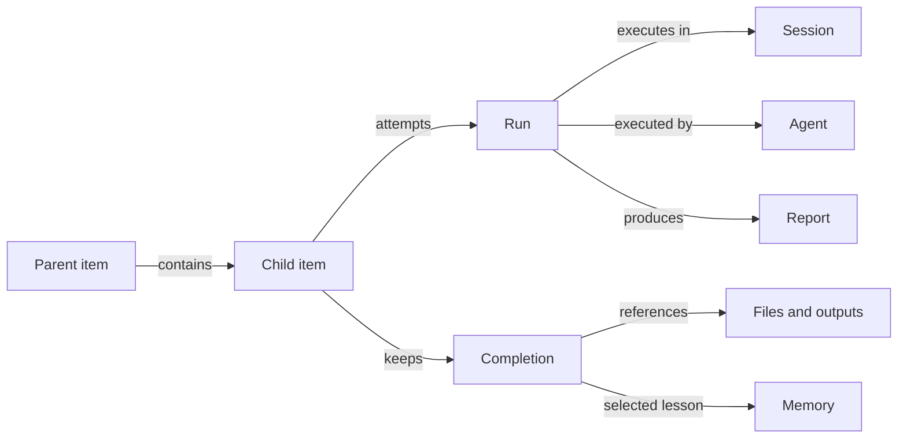
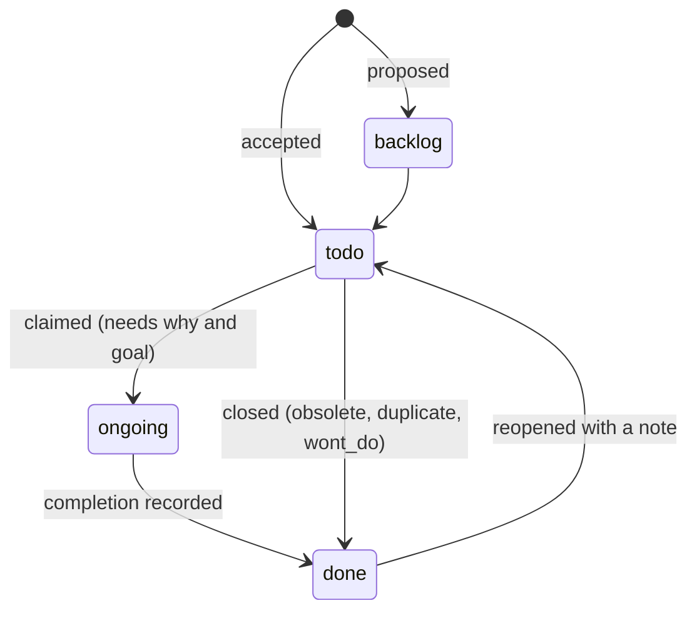
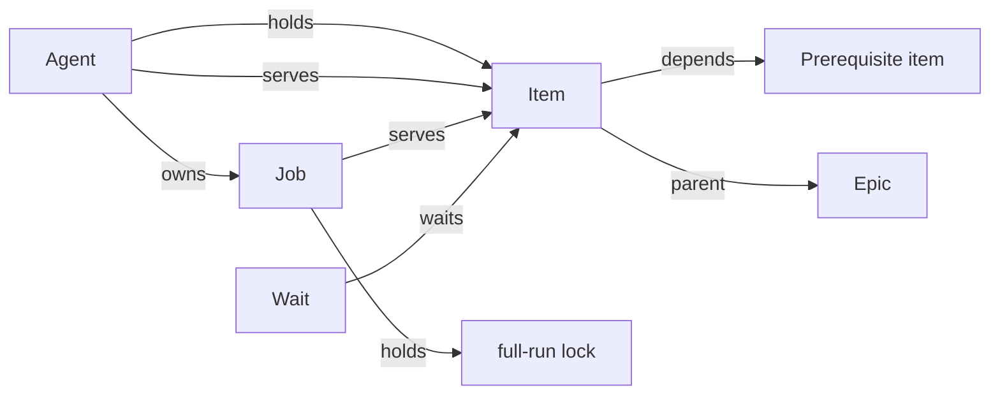

# Entities: what Octocode stores and how the pieces relate

One SQLite database per Octocode home keeps backlog items, sessions, agents, team messages, memories and more; the transcript mirror (session entries and compaction summaries, an index of the JSONL transcripts) lives in a second file beside it. Each kind has its own record and lifecycle; do not merge them (transcript messages are not team messages, backlog states are not run states, file references are not artifacts). Storage locations and retention: [configuration](../packages/coding-agent/docs/configuration.md#runtime-storage).

An item can involve several sessions, agents and attempts, and a session can work on several items: use links, not exclusive ownership.

## Database

Schema version 10. There are no upgrade steps: a file at another version is refused ([database versions](../packages/coding-agent/docs/configuration.md#runtime-storage)). Everything checkout-local resolves to a workspace id (`workspaces`); several historical workspaces can share a name or last-known path, so file-serving routes check the current directory binding first.

| Tables                                                                      | Holds                                                                                                                                                |
| --------------------------------------------------------------------------- | ---------------------------------------------------------------------------------------------------------------------------------------------------- |
| `workspaces`                                                                | Workspace UUID, display name, canonical root, filesystem identity, git common dir and linked-worktree flag; the repository index groups checkouts    |
| `sessions`, `session_forks`                                                 | Sessions bound to their workspace and host-created fork links; imports can stay unbound                                                              |
| `session_transcripts`, `session_entries` (transcript mirror)                | Conversation tree (JSONL header plus ordered entries, each with its tree parent and payload), rebuildable from the transcript files                  |
| `compaction_summaries` (transcript mirror)                                  | One summary per compacted entry of a session; detail copies on disk have their own retention                                                         |
| `backlog`, `backlog_tasks`                                                  | Items and steps, numbered per workspace; parents, origins and steps must share the workspace                                                         |
| `backlog_links`, `backlog_notes`, `backlog_comments`, `backlog_completions` | Children of an item; a completion's operation key is unique within its item                                                                          |
| `backlog_audits`, `workspace_commands`                                      | Item history (survives item removal) and web command receipts keyed by workspace, session and client request id                                      |
| `agents`, `agent_events`, `messages`, `deliveries`, `agent_runs`            | See [agents, runs and mail](#agents-runs-and-mail)                                                                                                   |
| `leases`, `edits`                                                           | Checkout-level reservations and observed edits                                                                                                       |
| `timers`                                                                    | The `notify` tool's wakes                                                                                                                            |
| `jobs`                                                                      | Background `bash` jobs of every session (command, folder, pid, log, state), so an identical start can join a running one; rebuildable, never carried |
| `memories`                                                                  | Scoped to exactly one of: a workspace, a project key or the global collection; full-text search when SQLite supports it                              |
| `meta`, `config_audits`, `trusted_folders`                                  | Housekeeping, configuration audit history, project trust grants                                                                                      |

A session's rows in both files go together when it is deleted; each file's part is one transaction.

## Agents, runs and mail

| Record  | Meaning                                                                                                                                                                                                                                                                                                                                                                                                                  |
| ------- | ------------------------------------------------------------------------------------------------------------------------------------------------------------------------------------------------------------------------------------------------------------------------------------------------------------------------------------------------------------------------------------------------------------------------ |
| Profile | A definition (role instructions, tools, model preference)                                                                                                                                                                                                                                                                                                                                                                |
| Agent   | A live executor; presence is a temporary view. A team spans a repository. An isolated child can reserve files in its coordinator's workspace                                                                                                                                                                                                                                                                             |
| Run     | One audit row per run of an agent: profile, model, goal, where it worked (folder, branch, process title, pid), the backlog item it was started for, start and end with reason, final numbers, changed files (count and first 50 paths) and the reported outcome with its report path. One run is open per agent name; a new one closes an older open one as `crashed`. Deleted with other history after `retention.days` |
| Report  | The result a coordinator receives (`done`, `partial`, `blocked`, `failed`)                                                                                                                                                                                                                                                                                                                                               |
| Message | One team message with many recipient deliveries and an optional reply link. Delivered and answered are separate facts                                                                                                                                                                                                                                                                                                    |
| Event   | `agent_events` keeps lifecycle events. A `delete` event records why a row ended (`completed`, `failed`, `stopped-user`, `stopped-parent`, `parent-gone`, `crashed`, `left`) and its last numbers (tool calls, input, cache read, output, cost, pid, times). A `stalled` update marks an agent silent for ten minutes, once per silence                                                                                   |

`agents.end_hint` is the cause a coordinator leaves before stopping a child; whoever retires the row uses it unless the leaver names its own reason, and the first hint stays. `/agents <ref>` shows one agent, `/agents` recent runs, and `backlog get` lists the runs of an item. Details: [agents](AGENT_COMMUNICATION.md#how-an-agents-end-is-recorded).

A backlog item is written `B36` in its own workspace and `<workspace name>:B36` (the workspace id when the name is unknown) elsewhere; both forms parse.

## Backlog items

Small at capture, useful at completion: only a title is needed to create an item.

| Field                                           | Notes                                                                                                                                                                               |
| ----------------------------------------------- | ----------------------------------------------------------------------------------------------------------------------------------------------------------------------------------- |
| `title`                                         | Required                                                                                                                                                                            |
| `type`                                          | `feature` (default), `epic`, `bug`, `research`. An epic is an ordinary item that groups work; there is no epics table                                                               |
| `why`, `goal`                                   | Why it matters and a checkable definition of done; required before an agent starts or completes new work, optional for human capture                                                |
| `state`                                         | `backlog` (proposed), `todo` (accepted), `ongoing` (claimed), `done`. A closed item is `done` with a closure (`obsolete`, `duplicate` of another item, `wont_do`) and no completion |
| `parentId`                                      | One optional parent in the same workspace; no cycles                                                                                                                                |
| `dependsOn`                                     | Prerequisites (finish-to-start); stored once as `depends_on` links, and the inverse `blocks` is derived                                                                             |
| `priority`, `tags`, `paths`, `evidence`, `plan` | Optional. `paths` is intended scope; completion `files` records what changed. Evidence that is a repository path or http(s) URL becomes an `evidence` link                          |
| `links`                                         | Typed relations: `related`, `derived_from`, `evidence`, `output`; local backlog references resolve inside the repository and grant no access                                        |
| `comments`, `audits`, `completions`             | Child collections shown in detail views, not on cards                                                                                                                               |
| ids, claim, authors, times, `version`, `rank`   | Managed by the runtime                                                                                                                                                              |

`why` is the one name for the reason behind an item. In the agent tool `reason` is every call's purpose and is never stored; the board API still accepts `reason` from old clients and maps it to `why` (refusing a request whose two differ).

| Relation       | Answers               | Rule                                                                                                                                                                                                                                |
| -------------- | --------------------- | ----------------------------------------------------------------------------------------------------------------------------------------------------------------------------------------------------------------------------------- |
| `parentId`     | Part of what?         | A parent finishes only when no descendants are open and its own goal is confirmed; reopening a child flags a done ancestor for review; items are never deleted, only closed                                                         |
| `dependsOn`    | Waiting for what?     | Unresolved prerequisites block starting or completing; a finished one (done or closed) satisfies one. Omitted leaves dependencies unchanged, `[]` clears, an array replaces atomically; self-links and missing targets are rejected |
| `derived_from` | Discovered from what? | Provenance only; never inferred from the other two                                                                                                                                                                                  |

Parent and dependency checks share one waiting graph (a child waiting on its own epic, or two children on each other's epics, is refused). Adding an unresolved prerequisite to ongoing or done work is refused (`Blocked by …`): return the work to `todo` first. When a prerequisite reopens, downstream history stays and affected work is flagged. Dependencies are within one repository.

Example: B22 (a Kanban view) is a child of epic B20 and depends on B21 (the backlog API): it belongs to B20 but waits for B21. The board shows **Blocked by** and **Blocks**, a dependency count and a Ready filter.

### Completion

Finishing asks for a short summary and the related files; the runtime adds identity, time, item version and a snapshot of the goal.

| Part           | Values and rules                                                                                                                                                                                                                                                                 |
| -------------- | -------------------------------------------------------------------------------------------------------------------------------------------------------------------------------------------------------------------------------------------------------------------------------- |
| `summary`      | What was done                                                                                                                                                                                                                                                                    |
| `files`        | Each with `role` `changed`, `reviewed` or `produced`; `[]` is valid; an unknown history means unknown, never every dirty file                                                                                                                                                    |
| `verification` | `passed`, `failed`, `not_run`, `not_applicable`, or `not_stated` when an agent's sentence names no result (it is never recorded as passed); a person may finish unverified work (shown as unverified); agents must not complete work whose required checks failed or did not run |
| `lesson`       | Optional single observation; copy it to memory explicitly                                                                                                                                                                                                                        |
| `operationKey` | Retry key; the `backlog` tool derives one from the item and content when omitted, so resending the same completion is recognized. On a done item a new completion corrects the latest (`replaces` defaults to its id and may name only it)                                       |

Example: `{ "summary": "Added searchable columns", "files": [{ "path": "src/board.ts", "role": "changed" }], "verification": { "status": "passed", "summary": "Board tests passed" } }`.

Completions are immutable history: reopening keeps earlier results and a correction appends a replacement. Failed attempts live in runs, reports and notes.

A subagent never finishes its coordinator's item: it notes progress and steps on it and reports, and the coordinator marks it done (after its QA review and the merge of any isolated change) or closes it. Before a QA review is paid for, the store's own checks run (version, open steps, prerequisites).

`backlogPlan` applies each entry of an `add` or `edit` batch separately. Cancelling the batch keeps earlier commits and reports applied, refused, uncertain and unattempted entries. Inspect applied and uncertain entries before retrying; replaying the whole batch can create duplicate items. `backlog` (`note`, `claim`, `done`, `close`, `step`), `memory` (`set`, `delete`) and `notify` (`set`, `on`, `off`) take the same kind of batch: `items` holds entries of the single call's fields, each runs as its own call, and the reply has one line per entry. `backlogPlan` `stat` takes the `list` filters and returns counts by state, priority and type, with no rows.

### Checklist steps

A step (`T12`) belongs to an item or a session and stores its goal, state and result. People add, reorder, move or drop steps on the backlog board. An agent reports a completed step with `backlog` using `op: "step"`, its task `id` and a `note` describing the result and checks. Session and item ownership still apply; retrying the same result changes no history. Finishing a step updates progress without completing its item. Dropped steps remain separate from done steps in progress displays. An agent has at most one ongoing step per item (or per session list): starting a second is refused until the first is done or dropped.

### Comments, audits and receipts

| Record  | Behavior                                                                                                                                                                                                                                                                                                            |
| ------- | ------------------------------------------------------------------------------------------------------------------------------------------------------------------------------------------------------------------------------------------------------------------------------------------------------------------- |
| Comment | Append-only (id, author, time, text); the `note` input creates one. Comments never contact agents; **Send to agent** is a separate action through team routing                                                                                                                                                      |
| Audit   | Written by SQL triggers in the same transaction as the change (item fields, links, completions, comments, receipts); a rollback removes both; cannot be updated or deleted through ordinary SQL, survives item deletion, redacts credential-looking values. History integrity, not protection from an administrator |
| Receipt | `pending`, `accepted`, `failed` per request id; the same id with the same input returns the existing receipt, changed input is refused; a pending receipt after a crash is uncertain and not re-dispatched. Acceptance is not execution success                                                                     |

### Board behavior

Four columns; cards show title, type, priority, assignee and child progress, with details for why, goal, files, links, notes and completion history. `/backlog` opens a live loopback page with forms, keyboard and drag controls, conflict handling and WebSocket updates that preserve open drafts; `/backlog html` writes an offline snapshot. Edits need the expected version and return a conflict with current data when stale; reordering a card within its column changes no version and announces no change. A claim made on a session's page is held by that session, as from `/backlog` in its terminal. The server checks the database revision every 500 ms to see other processes' writes. **Implement** claims an item and queues its context for the current agent; delegation requests still pass the `agent` tool's checks, and stop applies to the session's own background agents. Permission and question dialogs are available in the terminal and the connected session's web page. The feed shows up to 200 recent events (about 256 KiB); item details show the latest 50 audit events and older ones load by cursor. More: [web workspace](../packages/coding-agent/docs/web-workspace.md).

### Work graph

The work graph is derived, never stored: each read joins items, steps, running agents, background jobs, reservations, the full-run lock and waits into nodes and edges. Nothing writes it, so it cannot drift from the records it reads.

| Edge      | Means                                                         |
| --------- | ------------------------------------------------------------- |
| `depends` | the item needs the other done first                           |
| `parent`  | an item sits under an epic, a step under its item             |
| `holds`   | an agent claimed the item, or a job or agent holds a resource |
| `serves`  | an agent, job or resource was taken for the item              |
| `owns`    | an agent started the job                                      |
| `waits`   | a wait is set on the item or resource                         |
| `blocks`  | a resource the item needs is held by someone else             |

`octocode backlog graph` prints it as a tree (`--json` for nodes and edges, `--item <id>` for one item's part). The ready list orders items whose prerequisites are all done by priority, then by how much each unblocks, then by age; it is code, not a model's choice.

## Guarantees

| When                                              | Then                                                                                         |
| ------------------------------------------------- | -------------------------------------------------------------------------------------------- |
| A human captures a title                          | Saved with defaults; no questionnaire                                                        |
| Writers reparent or add dependencies concurrently | No hierarchy cycles, combined waiting deadlocks, cross-repository parents or partial history |
| A completion is retried or a write fails          | One result, or no partial transition                                                         |
| Work is reopened or corrected                     | Earlier goals and results stay readable                                                      |
| A parent has unfinished descendants               | Closing is refused and names the open work                                                   |
| A target expires or an agent name is reused       | No link resolves to an unrelated record                                                      |
| An older Octocode writes upgraded data            | Backlog writes are refused (reads keep working); never silent loss of meaning                |
| Tool, terminal and web show an item               | Same state, hierarchy, result and permissions                                                |

The writer guard uses connection-local capabilities that triggers check on backlog and audit writes. It is a compatibility guard, not authorization. Not implemented: archive or blocking metadata, automatic memory promotion, cross-repository dependency writes, broad reference resolvers.
