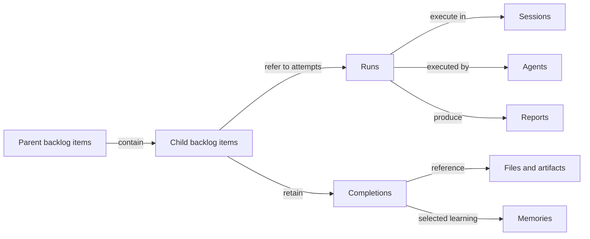
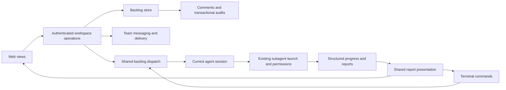

# Entities and composition

## Summary

Keep separate domain models for **backlogs, sessions, agents, runs, messages, and memories**. Connect them with scoped references; each owner keeps its own validation, storage, and lifecycle. A shared reference format is useful. A universal entity record, state machine, or CRUD service is not.

The first implementation includes epic/task/bug/research types, parent hierarchy, dependency arrays, typed links, completion history, and a live local workspace with agent controls, comments, audit history and shared report presentation. Optional future capabilities below remain deferred. Sessions, messages, agents, and memories keep their existing domain contracts. See [interface architecture](INTERFACE_ARCHITECTURE.md) for the shared application port and [presentation boundaries](DATA_PRESENTATION.md) for domain rendering contracts.

## Proposed design

### Naming and cardinality

- Use plural collection names: `backlogs`, `sessions`, `agents`, `runs`, `messages`, `files`, `links`, `comments`, `audits`, `completions`, `memories`.
- A collection holds individual records: `BacklogItem`, `Session`, `Run`, `FileRef`. Keep singular fields for one value: `parentId`, `goal`, `reason`, `state`.
- `files` always accepts multiple files, including an empty list. A file reference has one `path`; do not rename that to `paths`.
- Preserve existing public commands and storage names, including `/backlog`, the `backlog` table, and existing module paths. Apply plural naming to new collections without a disruptive rename campaign.
- Do not unify transcript messages with team messages, backlog states with run states, or file references with artifacts. Similar presentation does not imply shared ownership.

### Owners and records

These are responsibilities inside the existing application, not a request for a new module or table per row. Paths below are relative to `packages/coding-agent/src/` unless stated otherwise.

| Collections / concepts                          | Owner                                                          | What deserves identity or storage                                                                                                                                        |
| ----------------------------------------------- | -------------------------------------------------------------- | ------------------------------------------------------------------------------------------------------------------------------------------------------------------------ |
| `backlogs`                                      | `octocode/backlog/`                                            | Durable work items; child `comments`, `completions`, and `links`; append-only `audits`. Owns hierarchy, claims, state changes, and history.                              |
| Application events and dispatch                 | `core/application/`                                            | Shared session projection and dispatch; local terminal capability and serializable browser capability.                                                                   |
| `commands`, `receipts`, transport               | `octocode/workspace/`                                          | Authenticated host adapter and durable delivery; delegates execution to the application port and existing team/backlog owners.                                           |
| Browser views and state                         | `packages/webview/`                                            | Rendering and interaction, with no database or agent execution imports.                                                                                                  |
| Shared contracts                                | `packages/contacts/`                                           | Entity schemas, records, and workspace protocols shared by host and UI.                                                                                                  |
| `sessions`, `entries`                           | `core/session-manager.ts`, `core/agent-session.ts`             | Durable conversation tree and session lifecycle. The SQL session index enriches the transcript; it does not replace it.                                                  |
| `agents`, `profiles`, `runs`, `reports`         | `octocode/subagents/`; presence in `octocode/team/`            | Profiles are definitions; agents are executors; runs are attempts; reports are results. Presence is a temporary view. Preserve each distinction without four new stores. |
| `messages`, `deliveries`                        | `octocode/team/`                                               | One team message has many recipient deliveries. Delivered and answered are separate facts. Transcript messages remain session entries.                                   |
| `memories`                                      | `octocode/memory/`                                             | Reusable knowledge with scope, provenance, and existing trust/deduplication rules.                                                                                       |
| `files`, `artifacts`, `checkpoints`, `jobs`     | `octocode/files/` and producing modules                        | Files are references, artifacts are produced outputs, checkpoints support recovery, jobs track shell execution. No generic file catalog is needed.                       |
| `repositories`, `workspaces`, `leases`, `edits` | `octocode/shared/home.ts`, `octocode/team/`, worktree owner    | Scope values, concrete checkouts, temporary reservations, and observed edits. A reservation is not task ownership.                                                       |
| `questions`, `approvals`, `audits`, `hooks`     | `octocode/ask/`, `permission/`, `hooks/`                       | Preserve distinct interaction and authorization rules. A message or link never grants permission.                                                                        |
| `tools`, `toolCalls`                            | Agent loop, core, native/MCP adapters                          | Capability definitions versus executions. Nested calls retain their parent call identity.                                                                                |
| `connections`, `receipts`, `tabs`, `downloads`  | `octocode/api/`, `external/`, `browser/`, RPC and MCP adapters | Scoped execution resources; preserve their existing expiry and recovery behavior. Credentials are never reference metadata.                                              |
| `models`, `providers`, `settings`, `skills`     | AI package and core resource/configuration owners              | Configuration and capability definitions; record resolved versions on executions when needed.                                                                            |
| `traces`, `metrics`, boards, feeds, counters    | Telemetry and presentation owners                              | Diagnostics or computed projections. They do not become authoritative work records.                                                                                      |

Keep shared code limited to reference values and genuinely reused utilities. The application composition root connects owners. UI adapters consume data and invoke owner operations; they do not update SQL themselves. Run/result data types live in `subagents/run-types.ts`, with compatibility exports from `subagents/render.ts`.

### Backlogs: small at capture, useful at completion

| Fields                                                  | Requirement                                                                                                                                                                                              |
| ------------------------------------------------------- | -------------------------------------------------------------------------------------------------------------------------------------------------------------------------------------------------------- |
| `title`                                                 | Required to capture an item.                                                                                                                                                                             |
| `type`                                                  | `task` by default; `epic`, `bug`, or `research` when useful. An epic groups work toward a larger goal. Use `epic` instead of the previously proposed `plan` type; keep `plan` as optional approach text. |
| `reason`, `goal`                                        | Why this matters and what success looks like. Required before starting or completing new work; optional for human capture. Existing agent creation still requires a goal.                                |
| `state`                                                 | Existing `backlog`, `todo`, `ongoing`, `done`.                                                                                                                                                           |
| `parentId`                                              | Optional single parent in the same repository. No cycles. Any item may contain smaller work; `epic` identifies a larger outcome, not a separate storage model.                                           |
| `priority`, `tags`, `body`, `paths`, `evidence`, `plan` | Existing optional planning details. `paths` describes intended scope, including directories; completion `files` records actual related files.                                                            |
| `dependsOn`                                             | Optional array of scoped backlog references; empty by default. Names prerequisites, not children.                                                                                                        |
| `links`                                                 | Optional typed relationships. Existing `from` remains provenance, separate from hierarchy.                                                                                                               |
| `comments`, `audits`, `completions`                     | Child collections, loaded in detail/history views rather than embedded in every board card.                                                                                                              |
| IDs, claim, authors, times, `version`                   | Supplied or managed by the runtime. Do not ask users to fill these in.                                                                                                                                   |

`reason` is the user-facing name for existing `why`. Keep one stored meaning; adapt the name at the boundary and reject conflicting aliases. Do not add a second competing column.

Optional later capabilities: blocked metadata with a reason; archive metadata for completed, cancelled, duplicate, or obsolete work. Keep these out of the initial required record and form. They need consistent support from all active writers before activation.

### Composition rules



An item can involve several sessions, agents, and attempts. A session can work on several items. Use links for this many-to-many context; `sourceSession` records origin, not exclusive ownership. Keep the current single active claim and parent/subagent authority rules.

`parentId` answers **“part of what?”**; `dependsOn` answers **“waiting for what?”**; `derived_from` answers **“discovered from what?”**. Never infer one from another. Compute children and inverse links from stored relationships; do not maintain duplicate arrays on both ends.

Parents and dependencies need separate transactional cycle checks. No cross-repository parentage initially. Cross-repository reference resolution still checks access. Parent completion requires no open descendants and confirmation of its own goal; completed children do not automatically complete the parent. Reopening a child flags a completed ancestor for review without erasing its result. Refuse deletion of parents with children; require explicit reparenting or a separately designed archival operation.

### Epics and dependencies

Use `type: "epic"` for a larger outcome, with ordinary backlog items beneath it through `parentId`. Tasks, bugs, and research may be children. An epic is itself a backlog item with reason, goal, state, and completion history; no separate epics table or mandatory story layer. Standalone tasks remain valid. Child counts show progress, not a claim about percentage of effort completed.

Expose `dependsOn` as a convenient array in commands and read models. Persist each dependency once as a `depends_on` relationship in `backlog_links`; derive `dependsOn` and the inverse `blocks` view from those rows. Do not also store a JSON dependency array. Keep generic link editing for other relations so callers cannot send conflicting dependency representations.

```json
{
	"id": "B22",
	"type": "task",
	"title": "Build the Kanban view",
	"parentId": "B20",
	"dependsOn": [{ "resource": "backlogs", "repositoryKey": "repo-a", "id": "B21" }]
}
```

Here B20 is the epic, and B21 is a prerequisite such as the backlog API. B22 belongs to B20 but waits for B21. Command shortcuts may accept `"B21"` within the current repository; read models retain qualified references.

- On update, omitted `dependsOn` leaves dependencies unchanged; `[]` clears them; a supplied array replaces them atomically with an expected version. Deduplicate targets and reject self-links or missing targets. Initially allow dependency mutations only within the repository; cross-repository links can remain informational until cross-store consistency is designed.
- Dependencies are finish-to-start prerequisites: unresolved prerequisites prevent starting or completing the dependent item. They are satisfied by `done`, not merely by an ended run, missing target, or cancellation. Removing a dependency is an explicit audited edit.
- Validate the combined waiting graph: prerequisite edges plus each parent's implicit wait for its children to finish. Separate hierarchy/dependency checks alone miss deadlocks, such as a child depending on its own epic, or two children depending on each other's epics. Reparenting and dependency edits must both preserve this invariant.
- Adding an unresolved prerequisite to ongoing/done work requires first returning that work to todo. If a prerequisite is later reopened, retain downstream history and flag impacted work for review; do not cancel running work or silently reopen completed items. Completion still checks current prerequisites.
- Show **Blocked by** and **Blocks** in details, a dependency count on cards, and a Ready filter. Derive dependency blocking; do not copy it into manually maintained blocked metadata. When a prerequisite completes, readiness updates without automatically launching work.

This is a design choice informed by [Linear's separate blocking/related relations](https://linear.app/docs/issue-relations) and [Atlassian's epic grouping of tasks and bugs](https://support.atlassian.com/jira-cloud-administration/docs/what-are-issue-types/). It adds a useful API convenience and a familiar work type without adding another system.

### References, without a universal entity

Use a discriminated union of owner-specific references, with plural resource names. Examples:

```json
[
	{ "relation": "depends_on", "target": { "resource": "backlogs", "repositoryKey": "repo-a", "id": "B12" } },
	{ "relation": "related", "target": { "resource": "sessions", "namespace": "local", "id": "session-123" } },
	{ "relation": "evidence", "target": { "resource": "files", "repositoryKey": "repo-a", "path": "src/router.ts" } }
]
```

Each resource has its own required scope and identifier fields; do not use an unrestricted `{type, id, metadata}` bag. A bare `B12`, PID, tool-call ID, or recycled agent name is insufficient outside its scope. Add durable agent/run identity before supporting historical links to them; do not silently resolve an old name to a new executor.

Start relations with `related`, `derived_from`, `depends_on`, `evidence`, and `output`. Add `duplicate_of` when duplicate handling ships. Dependency and duplicate targets must be backlog items. Add resolvers for other catalog entries as consumers need them, rather than building an unused resolver for every concept now. Preserve unsupported references visibly instead of inventing a target or discarding them.

Local backlog references resolve within the current repository. Other typed links are retained and displayed as references; owner-specific resolution is deferred. Future resolvers must apply existing permissions and report unavailable, expired, or unsupported targets. References grant no access. Keep useful summaries after transient messages disappear. Reuse existing URLs for external sources, with safe protocols and no embedded credentials.

### Completion and learning

Finishing asks for **a quick summary and related files**. The runtime supplies identity, actor, time, item version, and the completed goal snapshot. Checks can be suggested from observed results; never inferred as passed from a confident summary.

```json
{
	"operationKey": "board-completion-1",
	"summary": "Added searchable backlog columns and task details.",
	"files": [
		{ "path": "src/board.ts", "role": "changed" },
		{ "path": "test/board.test.ts", "role": "reviewed" }
	],
	"verification": { "status": "passed", "summary": "Board tests passed." }
}
```

Completion inputs also require `operationKey`, a unique retry key; corrections may supply `replaces`, the previous completion ID. Files inherit the item's repository unless explicitly qualified. Roles are `changed`, `reviewed`, or `produced`; revision is optional; content hashes remain deferred. `files: []` is valid for work without files. Missing historical files means unknown. Never assign every dirty checkout file to the task.

Verification statuses are `passed`, `failed`, `not_run`, and `not_applicable`. A person may explicitly finish unverified work, shown as unverified. Agents must not complete work whose required checks failed or were not performed. The authenticated caller context determines the policy; a caller-provided author string is not authority.

An optional `lesson` captures one reusable observation. No mandatory retrospective, scores, or additional knowledge database. A user or agent can explicitly copy selected lessons through the existing memory tool with source references. Automatic promotion and a dedicated promotion operation remain deferred.

Keep `completions` as immutable history. Reopen preserves earlier results; correction appends a replacement. Derive the current completion for display rather than storing another copy. Keep failed attempts in runs/reports/notes. Search summaries and files before considering embeddings.

### States and management

- **Backlog:** proposed. **Todo:** accepted. **Ongoing:** claimed and started. **Done:** goal closed with a recorded result.
- Store lifecycle validation centrally so tool, terminal, and web writes agree. State, completion, history, and version changes commit together; completion retries use an operation key. A correction names `replaces`; reopening requires a note and retains prior results.
- The web API requires expected versions for edits/deletion; tool and internal store callers support expected versions for compatibility with existing integrations. Return a conflict and current data when stale; do not silently overwrite another writer.
- Keep work state, run lifecycle, report outcome, delivery state, and process liveness separate. Preserve existing report outcomes `done | partial | blocked | failed`. No global status enum or mass run-state migration is needed for this design.
- Blocking, if enabled, is metadata on unfinished work. Dependencies are separate indicators. A stale process is not evidence that a goal failed or succeeded.
- Archive, if enabled, hides work from the active board without representing cancellation as success. Restore must not revive a stale claim.

### Board UX

Keep the four Kanban columns. Cards show title, type, priority, assignee, and optional parent/child progress. Show reason, goal, files, links, notes, and completion history in details; avoid turning every card into a full report.

Creation needs one title. Starting asks only for missing reason/goal. Finishing asks for the short result, offers related files, and exposes verification honestly. Search and filters work across states; collapsed or paginated results show their counts. Children remain discoverable both within a parent and across status columns.

The default `/backlog` view is a live loopback web app with create/edit forms, explicit status selection, authenticated WebSocket updates, and conflict handling. State changes use accessible form controls; drag-and-drop is not implemented. `/backlog html` remains an offline snapshot with its generation time. Both use the same store-backed data model. Saves use the validated HTTP API; the WebSocket pushes snapshots and reconnects automatically without replacing open drafts. A server-side database revision check every 500 ms detects writes from other processes. Socket authentication uses the first message, never a query-string token, and requires the board’s exact origin.

### Comments, audits and command receipts

- `comments`: stable `id`, `backlogId`, `author`, `at`, `text`. Stored in `backlog_comments` with a foreign key to the item. Comments are append-only; add a correction instead of rewriting another person's words. The existing `note` input remains compatible: a database trigger creates its comment entity. Old notes are migrated once, preserving their author and time.
- `audits`: stable `id`, repository scope, `backlogId`, `actor`, `at`, `entity`, `action`, `before`, `after`. SQL triggers capture item fields, links, completions, comments and linked command receipts in the same transaction. Rollback removes the attempted mutation and its audit together. Audit records cannot be updated/deleted through ordinary SQL, survive item deletion, and redact credential-looking values when read. This is history integrity, not protection against an administrator replacing the database. Field-level history begins at upgrade; earlier edits are not reconstructed.
- Workspace `commands` / `receipts`: request `id`, repository, session, optional `backlogId`, action/input, time, status and message. States are `pending`, `accepted`, `failed`; acceptance is not execution success. Retries with the same ID and same input return the existing receipt; changing input under that ID is refused. A pending receipt after a crash is uncertain and is not automatically dispatched again. Receipt history does not replace runs or reports. Application-port receipts use `accepted`, `completed`, and `failed`; completion describes processing the request, not completion of queued follow-up work. They share durable storage but use a separate command family and are excluded from workspace receipt snapshots.

Comments never contact agents automatically. **Add comment** submits only the comment and expected version, so another session's claim does not prevent discussion. **Send to agent** explicitly sends through the team's existing routing, hooks and delivery records. The browser cannot select its own author or force changes.

### Workspace application and interface boundaries

The browser application lives in `packages/webview`: page composition, board views, workspace views, styles, Markdown/code rendering, and Zustand state. `packages/contacts` is the shared contracts package: entity/reference/completion schemas, backlog snapshots, agent presence and message-delivery records, workspace commands/receipts/events, HTTP route constants, and request validation schemas. It depends only on TypeBox.

The shared application port is defined in `contacts` and implemented in `coding-agent/src/core/application`. Terminal consumes its lossless native event capability; web consumes its versioned semantic stream. The interfaces share execution authority while keeping their rendering and local UI capabilities separate. See [interface architecture](INTERFACE_ARCHITECTURE.md) for supported operations, lifecycle rules, and verification.

The host adapter stays in `packages/coding-agent/src/octocode/workspace`: `server.ts` enforces authenticated local HTTP/WebSocket access, `runtime.ts` adapts session/team operations, and `commands.ts` owns durable receipts. The application package depends on webview and contacts; webview depends on contacts; neither new package imports coding-agent. Existing backlog model/HTML entry points re-export their new owners for compatibility. Database rows, permissions, session lifecycle, and agent launching remain host responsibilities.

Build contacts before webview, and both before coding-agent. Root build scripts follow this order. The source resolver, TypeScript paths, and test aliases resolve the packages to current source; packaged consumers resolve their built exports.



**Work with current agent** claims the item and queues its saved context in the current session. **Request new agent** queues a delegation request for that agent; the existing agent tool still performs profile selection, slot handling, permission checks and launch. It does not report a child as started merely because delegation was accepted. Stop requests apply to background agents owned by the current session. Permission/question dialogs remain in the owning terminal session; the web cannot approve them.

The **Agents** view shows live presence and delivery status. **Activity** shows session/tool events and structured results. The shared `subagents/presentation.ts` adapter supplies report summary, body and file references to both the terminal renderer and the web runtime. Browser prose uses sanitized Markdown and code highlighting; raw source remains available, and agent content cannot supply executable widgets. Transport and UI contain no second agent execution engine.

The event feed is a bounded recent projection (up to 200 events and roughly 256 KiB), reset when the session changes. The session transcript remains authoritative. Long output is explicitly shortened in the feed. WebSockets deliver full current projections after reconnection; open drafts are preserved. Audit pages load older records by cursor; item detail includes its latest 50 audit events. Receipts are durable, while live presence and activity are transient. Switching or closing the session closes its web connection and cancels pending message operations.

## Necessity review and rollout

| Decision                                                                                         | Reason                                                                                                                 |
| ------------------------------------------------------------------------------------------------ | ---------------------------------------------------------------------------------------------------------------------- |
| Add type, parentage, completions, and scoped links                                               | Directly supports plans, traceable results, and the requested composition.                                             |
| Reuse existing reason/goal, stages, stores, session history, claims, and memory                  | Avoids competing sources of truth and migration work without product value.                                            |
| Keep rich planning, lessons, file revisions, and execution links optional                        | Useful when available; unnecessary friction for routine tasks.                                                         |
| Defer archive/blocking, broad resolvers, and durable execution expansion                         | Each needs its own lifecycle and compatibility proof; none is a prerequisite for basic hierarchy and result recording. |
| Reject a universal entity table, universal states, mandatory templates, and a new files database | These combine unlike responsibilities or duplicate existing data.                                                      |

Contracts live in [contacts `backlogs.ts`](../packages/contacts/src/backlogs.ts); the existing store owns transactions and lifecycle checks. The [local server](../packages/coding-agent/src/octocode/workspace/server.ts), agent tool, and terminal commands call that store. Additive `backlog_completions` and `backlog_links` tables retain results and relationships. Do not convert `from` into parentage or fabricate completions for existing done items; label those results as unrecorded.

Additive SQL is not enough for old-writer compatibility: old binaries can bypass new invariants. The implemented minimum-writer boundary uses connection-local capability checks in backlog insert/update/delete triggers, tested against an older-style connection. Do not activate features that older active writers can corrupt. Rollback must preserve new records and their protections.

This direction is consistent with small [issue creation forms](https://linear.app/docs/creating-issues), explicit [parent/sub-issue relationships](https://linear.app/docs/parent-and-sub-issues), and [domain ownership](https://learn.microsoft.com/en-us/azure/architecture/microservices/model/domain-analysis). The exact fields and rollout above are design judgments for this repository.

## Validation and success

Acceptance checks for the implementation:

| Given / when                                                  | Observable result                                                                              |
| ------------------------------------------------------------- | ---------------------------------------------------------------------------------------------- |
| Human captures a title                                        | Saved with defaults and no planning questionnaire.                                             |
| Writers create/reparent children or dependencies concurrently | No hierarchy cycles, combined waiting deadlocks, cross-repository parents, or partial history. |
| Dependencies are omitted, cleared, or replaced                | Existing edges stay unchanged, clear, or replace atomically; no duplicate source of truth.     |
| A prerequisite finishes or reopens                            | Readiness updates; downstream history remains intact and affected work is flagged.             |
| Item needs several agents, sessions, and files                | Multiple links/files work without duplicating the item or overwriting earlier context.         |
| Completion retries or a write fails                           | One result, or no partial state transition.                                                    |
| Work is reopened or corrected                                 | Prior goals/results remain readable; current state is clear.                                   |
| Parent has unfinished descendants                             | Closing is refused with the outstanding work identified.                                       |
| Target expires or an agent name is reused                     | No link resolves to an unrelated record.                                                       |
| Older writer modifies upgraded data                           | Proven compatible behavior or explicit refusal, never silent loss of meaning.                  |
| Tool, terminal, and web show an item                          | Same state, hierarchy, result, and permissions; safe rendering.                                |

Source review: [backlog store](../packages/coding-agent/src/octocode/backlog/store.ts), [snapshot](../packages/coding-agent/src/octocode/backlog/snapshot.ts), [database schema](../packages/coding-agent/src/octocode/agentdb/schema.ts), [team contracts](../packages/coding-agent/src/octocode/team/model.ts), [run/report contracts](../packages/coding-agent/src/octocode/subagents/render.ts), and [session manager](../packages/coding-agent/src/core/session-manager.ts). Run relevant backlog/storage/consumer tests and the repository check when implementing these contracts.

## Open questions

- Writer compatibility is settled for this release: all backlog writers must upgrade. SQLite triggers require the connection-local `octocode_backlog_writer` and `octocode_audit_actor` capabilities registered by the updated runtime. Older readers remain available; older backlog writes fail. This is a compatibility guard, not authorization.
- Non-blocking: repository portability and long-term execution retention. Keep references local and scoped until an actual import/sync or retention workflow requires more.

## Implementation verification

Under Node 24.15.0, the full native suite passes: 2,655 tests passed and 16 skipped across 185 files. The focused backlog, storage, HTTP/WebSocket, command-receipt, architecture and terminal-report checks pass (131 tests). The repository TypeScript check and browser import smoke check also pass. Browser checks use an isolated sample database and a simulated agent directory to verify comments, message receipts, delegation requests, presence, activity and audit navigation. Live model/provider execution is not exercised by that preview.

Archive/blocking metadata, automatic memory promotion, cross-repository dependency writes, and broad reference resolvers remain deferred above. This web implementation does not replace the existing terminal permission dialogs or add an independent agent launcher.
