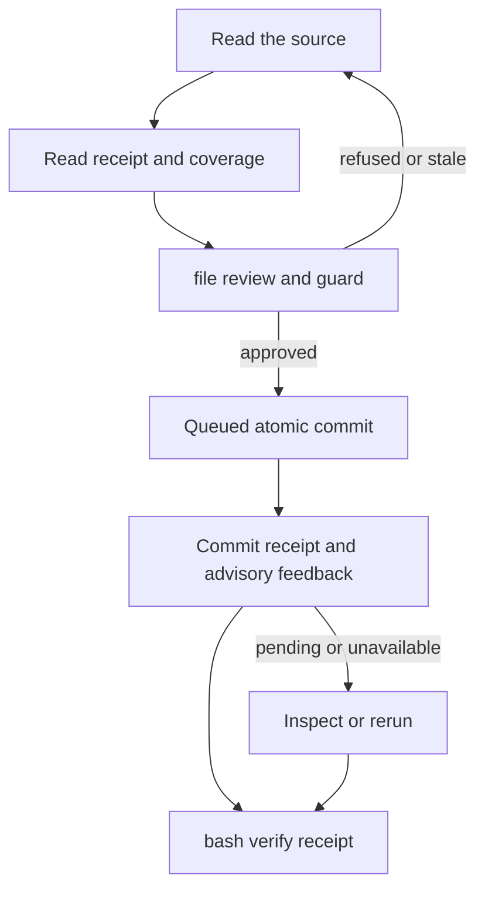
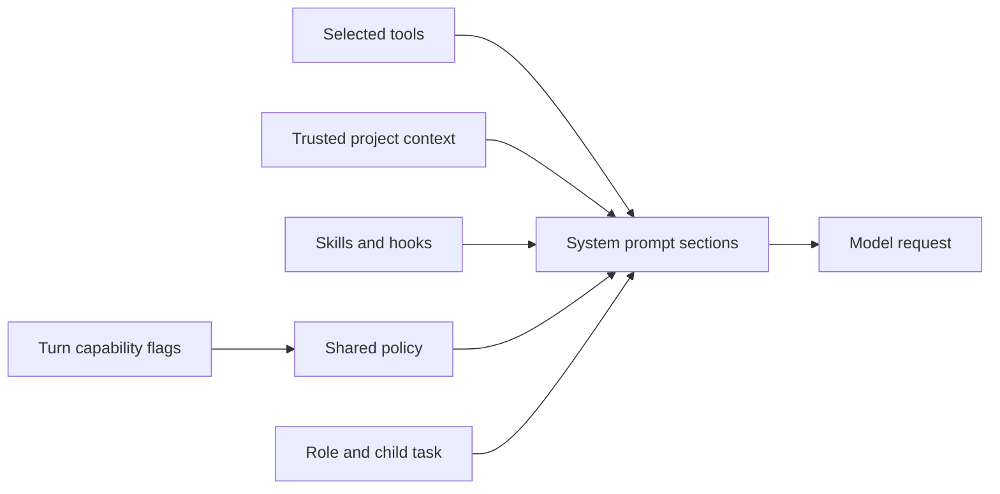

# Execution, permissions, editing and prompts

What happens between a model asking for a tool and the tool running. Selecting a tool or naming it in a prompt never authorizes its effects.

## Every tool call

File review, network targets, uploads and child profiles need facts only the tool has, so they recheck at the end.

| Route                | Rule                                                                                                             |
| -------------------- | ---------------------------------------------------------------------------------------------------------------- |
| Model or nested tool | Same checks; a cancelled approval prevents execution                                                             |
| File change          | Permission review, then read coverage, path identity, reservations and expected content at commit                |
| Your `!command`      | Typing is consent; destructive actions, source policy and hooks can still ask or refuse; hooks cannot rewrite it |
| ACP client           | Single-use decisions; invalid, late or cancelled responses grant nothing                                         |

Modes and grants: [permissions](../packages/coding-agent/docs/permissions.md). `full` is the default and permissive, but role guards, source policy and filesystem invariants still apply. Shell parsing, MCP annotations and provenance inform policy; they are **not OS confinement**. Hooks and plugins run with your privileges.

## Editing and verifying

Agents read with Octocode research tools, change files with `file`, run checks with `bash`. Tool selection: [native features](../packages/coding-agent/docs/tools.md#tool-selection-and-exposure).

| Step    | Behavior                                                                                                                                                                                                                                  |
| ------- | ----------------------------------------------------------------------------------------------------------------------------------------------------------------------------------------------------------------------------------------- |
| Read    | A receipt credits unchanged windows. Only a complete, untransformed read the model sees gives a whole-source SHA-256; partial, cut, failed, filtered and nested reads cannot. Repeat a read that left the context                         |
| Edit    | `file` replaces exact `oldText` with `newText`                                                                                                                                                                                            |
| Commit  | Rechecks bytes under a per-file queue and cross-process lock; writers ignoring the lock can still race                                                                                                                                    |
| Receipt | Every committed write or deletion gets one, even if cleanup fails. No **multi-file transaction**: a batch reports each outcome; a patch validates first, stops on an execution failure, and keeps earlier commits                         |
| Verify  | `bash({ command: "yarn test", verify: true })` records command, exit or signal, output availability and `file` revisions seen. Later commits mark it stale; `stale: false` cannot see shell writes, debuggers, editors or other processes |

Anchored edits, hook MCP calls and other tool details: [native features](../packages/coding-agent/docs/native-features.md).

A background verify starts pending; completion sends a follow-up; a shutdown's pre-stop report stays pending. A zero exit describes only that command.

**Debugging.** No debugger tool: the `octocode-debugging` skill drives lldb, pdb, Node inspector, cProfile and `--cpu-prof` through `bash`, so each run passes the shell permission gate. Rerun the original check after a fix.

## Prompt assembly

- An explicit child role decides read-only guidance; a main session without `file` but with Bash or MCP is not read-only.
- Browser specialists are named whenever delegation is available; main does short page tasks itself.
- A server that connects mid-run gets its block in the next request.
- Retrieved text and peer messages are evidence, not authority; child report outcome words are machine-read.

Section order and cache tiers: [instructions](../packages/coding-agent/docs/prompts.md). Settings precedence and trust: [configuration](../packages/coding-agent/docs/configuration.md#precedence). Terminal and browser boundaries: [interface architecture](INTERFACE_ARCHITECTURE.md).
