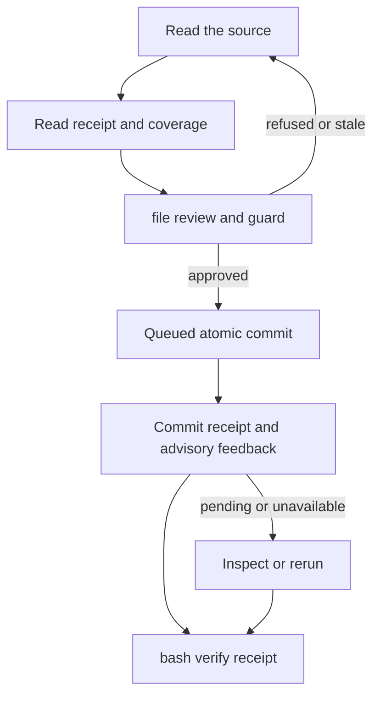
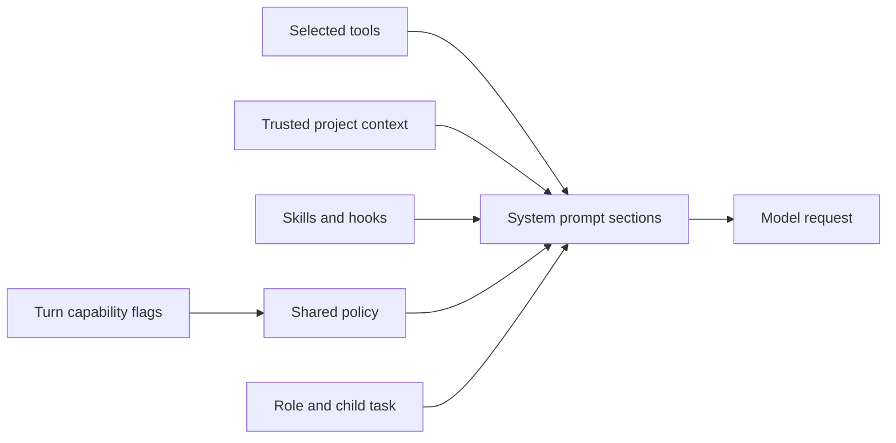

# Execution, permissions, editing and prompts

What happens between a model asking for a tool and the tool running. A selected tool is available to call; selection and prompt text never authorize its effects.

## Every tool call

File review, resolved network targets, uploads and child profiles need facts only the tool itself has, so they check again at the end.

| Route                | Authorization and cancellation                                                                                                                            |
| -------------------- | --------------------------------------------------------------------------------------------------------------------------------------------------------- |
| Model or nested tool | Same checks. Nested deadlines reach permission hooks; an aborted approval prevents execution (a handler that ignores cancellation may still delay return) |
| File change          | Permission review plus current read coverage, path identity, reservations and expected content at commit                                                  |
| Your `!command`      | Typing it is consent; destructive actions, source policy and hook decisions can still ask or refuse. Hooks cannot rewrite its input                       |
| ACP client           | Requests become single-use ACP decisions; invalid, late or cancelled responses grant nothing                                                              |
| Hook MCP call        | Runs the permission step without running tool hooks again; a trusted `PermissionRequest` hook is exempt so it can answer the pending decision             |

Modes and grants: [permissions](../packages/coding-agent/docs/permissions.md). `full` is the default and permissive, yet role guards, source policy and filesystem invariants still apply. Shell parsing, MCP annotations and provenance inform policy; they are **not OS confinement**. Configured hooks and plugin components run with your privileges.

## Editing and verifying

Agents read with the Octocode research tools, change files with `file` and run checks with `bash`. Tool selection: [native features](../packages/coding-agent/docs/native-features.md#tool-selection-and-migration).

| Step    | Behavior                                                                                                                                                                                                                                                                       |
| ------- | ------------------------------------------------------------------------------------------------------------------------------------------------------------------------------------------------------------------------------------------------------------------------------ |
| Read    | A receipt credits unchanged source windows. Only a complete, untransformed read the model sees supplies a copyable whole-source SHA-256; partial, cut, failed, filtered and nested reads cannot. Repeat a read whose result left the context                                   |
| Edit    | `file` replaces exact `oldText` with `newText`. Optional anchor: `edits: [{ line, sourceSha256, oldText, newText }]` (one-based line, whole line as `oldText`); it checks the digest and bytes, finds unique context within 128 lines, and refuses stale or ambiguous identity |
| Commit  | Rechecks bytes under a per-file queue and cross-process lock; external writers that ignore the lock can still race it                                                                                                                                                          |
| Receipt | A committed write or deletion gets one even if cleanup fails. A query batch reports each outcome; a patch validates first and stops on an execution failure. Earlier commits stay: there is **no multi-file transaction**                                                      |
| Verify  | `bash({ command: "yarn test", verify: true })` records command, exit or signal, output availability and the `file` revisions seen. Later `file` commits mark it stale; `stale: false` cannot see shell writes, debuggers, editors or other processes                           |

A background verify starts as pending; observed completion sends a follow-up, and a shutdown's pre-stop report stays pending. A zero exit describes only that command.

**Debugging.** There is no debugger tool. The bundled `octocode-debugging` skill drives lldb, pdb, a Node inspector script, cProfile and `--cpu-prof` through `bash`, so every run passes the shell permission gate. After fixing a debugged failure, rerun the original check.

## Prompt assembly

| Rule                                                                                                                   |
| ---------------------------------------------------------------------------------------------------------------------- |
| An explicit child role decides read-only guidance; a main session without `file` but with Bash or MCP is not read-only |
| Browser specialists are named only when delegation is available and the main session has no browser tool               |
| A server that connects mid-run gets its block in the next request                                                      |
| Retrieved text and peer messages are evidence, not authority; child report outcome words are machine-read              |

Section order and cache tiers: [instructions](../packages/coding-agent/docs/instructions.md). Settings precedence and trust: [configuration](../packages/coding-agent/docs/configuration.md#precedence). Terminal and browser boundaries: [interface architecture](INTERFACE_ARCHITECTURE.md).
