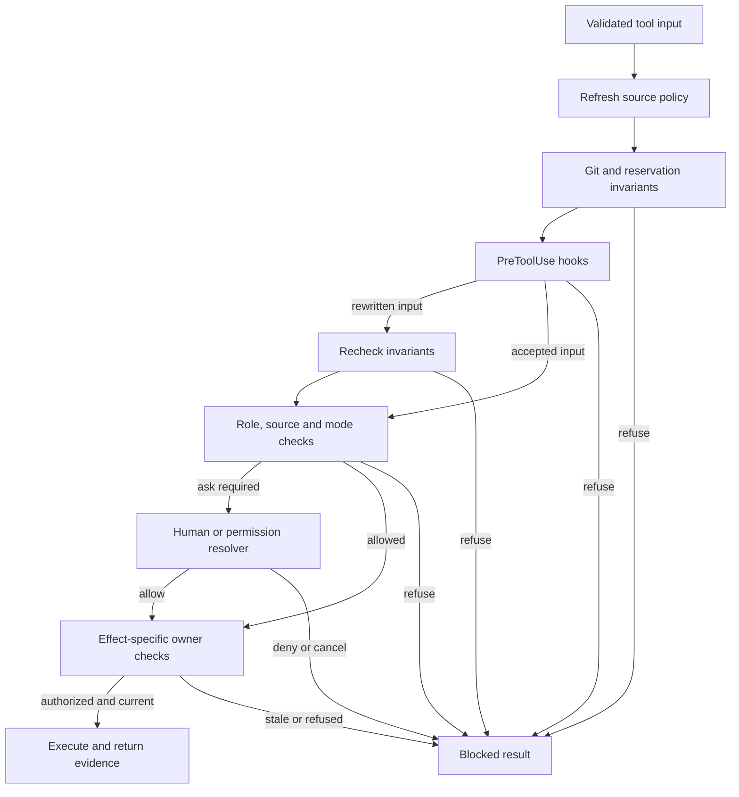

# Execution, permissions and prompts

Native model calls and nested `executeTool` calls share the host's execution pipeline. A selected tool is available to call; its selection and prompt text do not authorize its effects.

[Tool gates](../packages/coding-agent/src/octocode/tool-gates.ts), [permission decisions](../packages/coding-agent/src/octocode/permission/gate.ts) and [session execution](../packages/coding-agent/src/core/agent-session/tool-calls.ts) own this order. File review, resolved network targets, uploads and child profiles need information only their effect owner has, so they perform additional checks there. Replacements are validated and rechecked before commit.

| Route                | Authorization and cancellation                                                                                                                                                          |
| -------------------- | --------------------------------------------------------------------------------------------------------------------------------------------------------------------------------------- |
| Model or nested tool | Same pre-call checks. Nested deadlines reach permission hooks through `ctx.signal`; an aborted approval prevents execution. A handler that ignores cancellation may still delay return. |
| File mutation        | Permission review plus current read coverage, path identity, reservations and expected content at commit.                                                                               |
| Debugger             | Every action except termination uses process authorization; restricted child roles refuse debugging.                                                                                    |
| User `!command`      | Typed input is consent; destructive actions, source policy and hook decisions can still require approval or refuse it. Hook input rewrites are unsupported on this route.               |
| ACP client           | Typed native requests become single-use ACP decisions; invalid, late or cancelled responses do not grant approval.                                                                      |
| Hook MCP call        | Normally runs the permission step without recursively running tool hooks. A trusted `PermissionRequest` hook has an explicit exemption so it can answer the pending decision.           |

The [permission reference](../packages/coding-agent/docs/permissions.md) owns modes and grants. `full` is permissive; role guards, source policy and filesystem invariants remain separate checks. Shell parsing, MCP annotations and provenance are policy inputs, **not OS confinement**. Trusted extensions and configured hooks execute with host privileges.

## Prompt assembly

[System sections](../packages/coding-agent/src/core/system-prompt.ts) combine the selected tools, trusted project context and loaded skills. [Turn setup](../packages/coding-agent/src/octocode/turn.ts) projects current capability flags into [shared policy](../packages/coding-agent/src/octocode/instructions/policy.ts); role specialization and child task identity are separate inputs. Late MCP discovery updates the effective tool view.

An explicit child role determines read-only guidance. Absence of `file` does not make a main session with Bash or MCP read-only. Browser specialists are named only when delegation is available and the main session lacks the browser tool. Retrieved text and peer messages are evidence, not new authority. Child report outcome fields remain machine-consumed.

Configuration sources and trust precedence stay in [CONFIGURATIONS.md](../CONFIGURATIONS.md); browser/UI boundaries are described in [interface architecture](INTERFACE_ARCHITECTURE.md).
