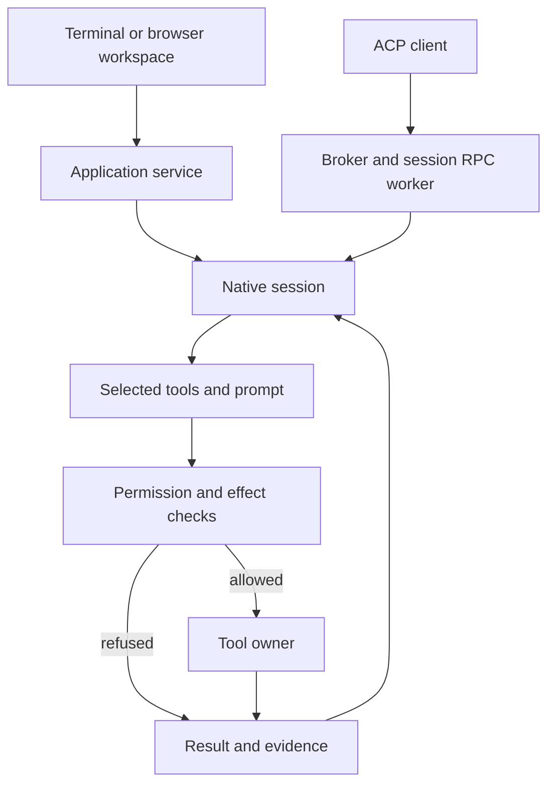

# Octocode feature architecture

The coding-agent host owns execution, permissions and session state. Terminal, browser and ACP clients adapt that host. Reusable agent, AI and TUI packages retain their own boundaries; MCP client and host integration live in the private `packages/mcp` workspace, compiled into coding-agent.

| Feature                     | Owner and reference                                                                                                                                                                                                                                                                 |
| --------------------------- | ----------------------------------------------------------------------------------------------------------------------------------------------------------------------------------------------------------------------------------------------------------------------------------- |
| Research                    | Native Octocode MCP supplies local, semantic, structural, GitHub and package research. Selection, deferred discovery and trusted roots: [native features](../packages/coding-agent/docs/native-features.md).                                                                        |
| Editing and verification    | One guarded `file` writer, read/commit receipts, advisory diagnostics, shell verification and optional DAP: [editing and debugging](EDITING_AND_DEBUGGING.md).                                                                                                                      |
| Agent communication         | Child processes, durable Team mail, explicit revival and optional worktrees: [communication](AGENT_COMMUNICATION.md). [Protocol RFC](RFC_COMMUNICATION_PROTOCOL.md) covers shared contracts and proposed A2A interoperability.                                                      |
| Permissions and prompts     | Shared checks, effect-specific authorization, trusted resources and capability-aware instructions: [execution flow](EXECUTION_AND_PERMISSIONS.md).                                                                                                                                  |
| Process integration         | Inbound ACP manages native sessions; outbound ACP delegates to another agent: [ACP design](RFC_ACP_EXPOSURE.md) and [protocol reference](../packages/coding-agent/docs/acp.md). The [local API](../packages/coding-agent/docs/session-api.md) lets scripts attach to running hosts. |
| Browser automation          | Optional native browser tool and specialist routing; navigation, private-network and upload checks remain in the host: [native guide](../packages/coding-agent/docs/native-features.md#browser-and-web-access).                                                                     |
| Skills, plugins and hooks   | Resource discovery and project trust select instruction and executable sources: [extensions](PLUGINS_MODS_HOOKS.md), [skills](../packages/coding-agent/docs/skills.md).                                                                                                             |
| Memory and backlog          | Scoped memory and durable project entities supplement session context: [native guide](../packages/coding-agent/docs/native-features.md), [entity model](ENTITIES.md).                                                                                                               |
| Terminal and web workspace  | Shared command receipts, events and replay; UI adapters do not execute tools: [interfaces](INTERFACE_ARCHITECTURE.md).                                                                                                                                                              |
| Models and reusable runtime | [AI](../packages/ai/README.md), [agent loop](../packages/agent/README.md), [MCP](../packages/mcp/README.md).                                                                                                                           |

The common instruction policy follows four responsibilities: **understand** the objective and evidence; **design** the simplest justified change; **execute** through the owning tools and bounded workers; **verify** effects and report uncertainty. Tool descriptions own mechanics, roles own specialization, and runtime checks own authorization.

The [feature coverage matrix](FEATURE_COVERAGE.md) expands every registered native domain, command surface and supporting package, including mail delivery and recovery. User settings and precedence belong in [CONFIGURATIONS.md](../CONFIGURATIONS.md). Defaults, enablement and public contracts belong in the linked package guides. [Validation and ratings](FEATURE_VALIDATION.md) distinguish tested behavior from live integration gaps.
