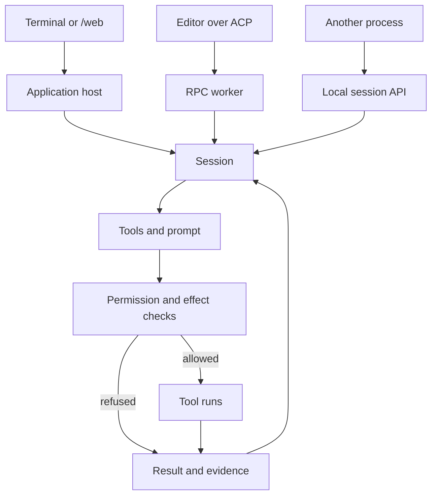

# Octocode features

Find a feature, then follow its link. User reference lives in the [documentation index](../packages/coding-agent/docs/index.md); this folder holds designs that cross packages; [configuration](../packages/coding-agent/docs/configuration.md) owns settings and precedence. Turn any feature on or off with [`/configuration`](../packages/coding-agent/docs/configuration.md#changing-configuration).

The host owns execution, permissions and session state; terminal, browser and ACP clients adapt it ([details](INTERFACE_ARCHITECTURE.md)).

## Agents and communication

| Feature                    | What it does                                                                                                                    | Read                                                                                                                                                        |
| -------------------------- | ------------------------------------------------------------------------------------------------------------------------------- | ----------------------------------------------------------------------------------------------------------------------------------------------------------- |
| Subagents and roles        | `agent` `type: "task"` starts a child with a profile, model, background mode and optional isolation                             | [Workers](AGENT_COMMUNICATION.md#workers), [profiles](../packages/coding-agent/docs/native-features.md#profile-front-matter)                                |
| Orchestration              | How the coordinator plans, briefs, runs, checks and reviews children; whom a stuck child asks                                   | [Orchestration](AGENT_COMMUNICATION.md#orchestration)                                                                                                       |
| Messaging                  | `agent` `type: "message"`, `to` a child, `parent`, a sibling, a process name or `coordinator`                                   | [Communication](../packages/coding-agent/docs/native-features.md#communication-and-results), [delivery](AGENT_COMMUNICATION.md#team-mail)                   |
| External messages          | Another session's text arrives marked external; its permission dialog decides whether it arrives                                | [Session API](../packages/coding-agent/docs/session-api.md#what-the-session-sees), [dialog](../packages/coding-agent/docs/permissions.md#external-messages) |
| Check-ins                  | A child quiet for `subagents.checkInSeconds` is asked whether it needs something                                                | [Check-in](../packages/coding-agent/docs/native-features.md#subagent-check-in)                                                                              |
| Request budgets and grants | Soft and hard request limits per child; `coordinate` `grant` adds requests                                                      | [Budget](../packages/coding-agent/docs/native-features.md#subagent-request-budget)                                                                          |
| Reservations               | `coordinate` lists the team and reserves paths; a task's `paths` reserves for a child                                           | [Reservations](../packages/coding-agent/docs/permissions.md#reservations-and-the-shell)                                                                     |
| Local session API          | On by default: each top-level session serves an owner-only socket (`octocode-api`, `/api`)                                      | [Session API](../packages/coding-agent/docs/session-api.md)                                                                                                 |
| ACP, inbound and outbound  | `octocode --mode acp` serves an editor; `agent` `type: "external"` drives another agent                                         | [ACP](../packages/coding-agent/docs/acp.md)                                                                                                                 |
| RPC and headless runs      | `--mode rpc`, `-p`, JSON output; a host controls a session                                                                      | [RPC](../packages/coding-agent/docs/rpc.md), [CLI](../packages/coding-agent/docs/cli.md)                                                                    |
| Worktrees and landing      | `--worktree`, `/worktree`; one team across worktrees; a finished worktree messages `coordinator`, who runs `coordinate` `merge` | [Worktrees](../packages/coding-agent/docs/native-features.md#worktrees), [finishing](../packages/coding-agent/docs/native-features.md#finishing-a-worktree) |
| Isolated children          | `isolate: true` works in a private worktree and saves to a ref                                                                  | [Isolated workers](AGENT_COMMUNICATION.md#isolated-workers)                                                                                                 |
| tmux                       | Panes, windows, notifications; `/fork pane`, `/worktree open`                                                                   | [tmux](../packages/coding-agent/docs/tmux.md)                                                                                                               |
| Processes                  | `/processes`: named processes, memory samples, orphan cleanup                                                                   | [Process names](../packages/coding-agent/docs/native-features.md#process-names-list-and-orphans)                                                            |

## Permissions and safety

| Feature            | What it does                                                                                                    | Read                                                                                              |
| ------------------ | --------------------------------------------------------------------------------------------------------------- | ------------------------------------------------------------------------------------------------- |
| Modes              | `manual`, `workspace`, `full` (default), `bypass`; shared checks, then the effect owner's checks                | [Permissions](../packages/coding-agent/docs/permissions.md), [flow](EXECUTION_AND_PERMISSIONS.md) |
| `message.external` | Receiving a message from another process: `full` takes it, the others ask                                       | [External messages](../packages/coding-agent/docs/permissions.md#external-messages)               |
| `worktree.merge`   | Landing on the default branch asks in every mode, via `coordinate` `merge` or `git merge` and friends in `bash` | [Worktree merges](../packages/coding-agent/docs/permissions.md#worktree-merges)                   |
| Plan mode          | `/plan`: read-only tools until a revision is approved                                                           | [Planning](../packages/coding-agent/docs/native-features.md#native-planning-constraint)           |
| Project trust      | `/trust` decides whether a folder's configuration loads                                                         | [Project trust](../packages/coding-agent/docs/permissions.md#project-trust)                       |
| Boundaries         | What is and is not a sandbox                                                                                    | [SECURITY.md](../SECURITY.md)                                                                     |

## Tools

| Feature              | What it does                                                                                                                        | Read                                                                                                                                                   |
| -------------------- | ----------------------------------------------------------------------------------------------------------------------------------- | ------------------------------------------------------------------------------------------------------------------------------------------------------ |
| Tool selection       | Native tools, their defaults, `--tools`, `--exclude-tools`, `--enable tool:<name>`                                                  | [Tool selection](../packages/coding-agent/docs/native-features.md#tool-selection-and-migration)                                                        |
| Guarded file changes | One `file` writer with read and commit receipts and patches                                                                         | [Editing](EXECUTION_AND_PERMISSIONS.md#editing-and-verifying), [guarantees](../packages/coding-agent/docs/native-features.md#file-mutation-guarantees) |
| Checkpoints          | `/rewind` restores file changes                                                                                                     | [Commands](../packages/coding-agent/docs/commands.md)                                                                                                  |
| Shell and jobs       | `bash`, background runs, trimmed output, verification receipts, `/jobs`                                                             | [Tool selection](../packages/coding-agent/docs/native-features.md#tool-selection-and-migration)                                                        |
| Debugging            | A skill drives lldb, pdb and profilers through `bash`; there is no debugger tool                                                    | [Debugging](EXECUTION_AND_PERMISSIONS.md#editing-and-verifying)                                                                                        |
| Resuming other tools | A skill finds Claude Code, Codex and Cursor sessions of the repository, reads them back and reports dangling worktrees              | [Native features](../packages/coding-agent/docs/native-features.md#resuming-other-tools-sessions)                                                      |
| MCP                  | Octocode is the default server; others are added in MCP configuration or `/configuration`; presets, per-agent assignment, overrides | [MCP](../packages/coding-agent/docs/mcp.md), [reference](../packages/coding-agent/docs/mcp-reference.md)                                               |
| Browser              | The `browser` MCP preset and specialist; navigation and network policy stay in the host                                             | [Browser and web access](../packages/coding-agent/docs/native-features.md#browser-and-web-access)                                                      |
| Web retrieval        | `web` search and fetch with address and redirect checks                                                                             | [Browser and web access](../packages/coding-agent/docs/native-features.md#browser-and-web-access)                                                      |
| Questions to you     | `askUser`, in the main session                                                                                                      | [Questions](../packages/coding-agent/docs/native-features.md#questions-to-a-person)                                                                    |

## Prompts, context and customization

| Feature                  | What it does                                                                             | Read                                                                                                                                                                                                                           |
| ------------------------ | ---------------------------------------------------------------------------------------- | ------------------------------------------------------------------------------------------------------------------------------------------------------------------------------------------------------------------------------ |
| Prompt sections          | Every section, its cache tier and what writes it                                         | [Instructions](../packages/coding-agent/docs/instructions.md)                                                                                                                                                                  |
| Context and caching      | What each request sends and what the provider reuses                                     | [Context](CONTEXT.md), [prompt caching](../packages/coding-agent/docs/prompt-caching.md)                                                                                                                                       |
| Compaction               | When history is summarized, the checkpoint, recovery references                          | [Compaction](../packages/coding-agent/docs/native-features.md#compaction-and-recovery), [pipeline](CONTEXT.md#the-compaction-pipeline)                                                                                         |
| Skills                   | Every model-visible skill, loaded on demand                                              | [Skills](../packages/coding-agent/docs/skills.md)                                                                                                                                                                              |
| Hooks                    | Native, Claude and Codex formats, always on                                              | [Hooks](../packages/coding-agent/docs/hooks.md), [events](../packages/coding-agent/docs/hook-events.md), [limits](../packages/coding-agent/docs/plugins.md#design-and-limits)                                                  |
| Plugins and marketplaces | Local Claude and Codex plugins, marketplace install, plugin agents                       | [Plugins](../packages/coding-agent/docs/plugins.md), [limits](../packages/coding-agent/docs/plugins.md#design-and-limits)                                                                                                      |
| Packages and templates   | Octocode packages, prompt templates, themes, keybindings                                 | [Packages](../packages/coding-agent/docs/packages.md), [templates](../packages/coding-agent/docs/prompt-templates.md), [themes](../packages/coding-agent/docs/themes.md), [keys](../packages/coding-agent/docs/keybindings.md) |
| Prompt optimization      | `/optimize` rewrites a typed prompt with a cheaper model for you to approve              | [Session commands](../packages/coding-agent/docs/native-features.md#session-workflow-commands)                                                                                                                                 |
| Configuration            | One command to list, get, enable, disable, set, add and remove; locations and precedence | [Configuration](../packages/coding-agent/docs/configuration.md), [settings](../packages/coding-agent/docs/settings.md), [environment](../packages/coding-agent/docs/environment-variables.md)                                  |

## Sessions, memory and work

| Feature                  | What it does                                                                                    | Read                                                                                                                                                                           |
| ------------------------ | ----------------------------------------------------------------------------------------------- | ------------------------------------------------------------------------------------------------------------------------------------------------------------------------------ |
| Sessions and recovery    | `/resume`, `/fork`, `/purge`; transcripts survive a full disk or crash; restart recovery        | [Session commands](../packages/coding-agent/docs/native-features.md#session-workflow-commands), [how-to](../packages/coding-agent/docs/how-to.md#recover-a-saved-conversation) |
| Memory and archive       | Saved notes, retrieval of compacted history, the agent event log                                | [Memory](../packages/coding-agent/docs/memory.md)                                                                                                                              |
| Backlog and steps        | Durable items, epics, dependencies and tracked steps                                            | [Entities](ENTITIES.md), [web workspace](../packages/coding-agent/docs/web-workspace.md)                                                                                       |
| Agent database           | One SQLite schema, migrations and retention                                                     | [Database](ENTITIES.md#database), [runtime storage](../packages/coding-agent/docs/configuration.md#runtime-storage)                                                            |
| Side questions and diffs | `/btw`, `/context`, `/diff`                                                                     | [Session commands](../packages/coding-agent/docs/native-features.md#session-workflow-commands)                                                                                 |
| Profiler                 | `/web` Profiler (Timeline, Requests, Messages, Agents, Insights, Events) and `octocode profile` | [Native features](../packages/coding-agent/docs/native-features.md#web-workspace-and-memory), [commands](../packages/coding-agent/docs/commands.md)                            |

## Interfaces and models

| Feature                   | What it does                                                        | Read                                                                                                                                                                            |
| ------------------------- | ------------------------------------------------------------------- | ------------------------------------------------------------------------------------------------------------------------------------------------------------------------------- |
| Terminal                  | Editor, live status, footer, agents panel                           | [Terminal UI](../packages/coding-agent/docs/tui.md), [commands](../packages/coding-agent/docs/commands.md)                                                                      |
| Web workspace             | `/web`: activity, board, docs, reports, profiler                    | [Web workspace](../packages/coding-agent/docs/web-workspace.md), [boundary](INTERFACE_ARCHITECTURE.md)                                                                          |
| User-level daemon         | One page across every session of a user (`OCTOCODE_WEB_DAEMON=1`)   | [Daemon](INTERFACE_ARCHITECTURE.md#the-user-level-web-daemon)                                                                                                                   |
| Remote access             | `/remote` publishes the daemon to another device                    | [Remote](../packages/coding-agent/docs/remote.md)                                                                                                                               |
| Providers and accounts    | `/providers`, provider adapters, OAuth                              | [Providers](../packages/coding-agent/docs/providers.md)                                                                                                                         |
| Model choice and routing  | `/model`, `/modelsettings`, `models`, purposes for subagents        | [Models](../packages/coding-agent/docs/models.md), [subagent model](../packages/coding-agent/docs/native-features.md#the-subagent-model)                                        |
| Local models              | `/llama` manages a llama.cpp router; Ollama and others as endpoints | [Local models](../packages/coding-agent/docs/models.md#connect-local-models), [small machines](../packages/coding-agent/docs/how-to.md#use-octocode-on-a-slow-or-small-machine) |
| Discovery, virtual models | Vendor model lists; several real models behind one name             | [Discovery](../packages/coding-agent/docs/models.md#discover-vendor-models), [compatible endpoint](../packages/coding-agent/docs/models.md#configure-a-compatible-endpoint)     |
| GitHub sign-in            | `/octocode auth login`; a start notice when not signed in           | [GitHub authentication](../packages/coding-agent/docs/native-features.md#github-authentication-in-the-terminal)                                                                 |

## What tests do and do not show

The offline suites cover each domain; the scripted end-to-end suite runs real sessions against a scripted model without network or credentials (every declared tool is driven in real processes, as are messaging between processes, landing, check-ins and budgets). A passing offline run does not establish:

- live provider inference, accounts, entitlements and cache hit rates;
- private subscription and vendor contracts (Copilot, Meta, fixed subscription clients);
- every editor's ACP behavior, physical browser and screen-reader use, Windows execution.

By design: tool policy is not an OS sandbox; native file revisions do not see shell or external edits; team mail is agent messaging, not email; A2A is not implemented ([why](AGENT_COMMUNICATION.md#channels-and-what-an-acknowledgment-proves)).

## Library boundaries

A library owns a protocol's mechanics; the host keeps authorization, persistence, accounting and UI.

| Boundary                    | Choice                                                                       | The host keeps                                                                        |
| --------------------------- | ---------------------------------------------------------------------------- | ------------------------------------------------------------------------------------- |
| MCP lifecycle and transport | The official MCP client; legacy SSE is rejected                              | Credential isolation, redirect and body limits, total deadlines, process-tree cleanup |
| JWT verification            | `jose`                                                                       | Issuer, audience, algorithm, nonce and authorized-party checks                        |
| Provider HTTP and streams   | `@ai-sdk/provider-utils` plus official vendor SDKs where they own a protocol | Grammar tools, reasoning replay, cache boundaries, usage accounting                   |
| ACP                         | `@agentclientprotocol/sdk`                                                   | Sessions, permissions, MCP registration                                               |
| Skill parsing               | `yaml` and a small adapter; no installer at activation                       | Permissive metadata, source precedence, trust, snapshot identity, child inheritance   |
| Web rendering               | React with Zustand; sanitized Markdown; no second cache beside the socket    | Permissions and execution                                                             |

RPC, compaction, cache policy and monitoring stay application modules: a transport SDK cannot decide what to compact or how siblings share a cache group.
