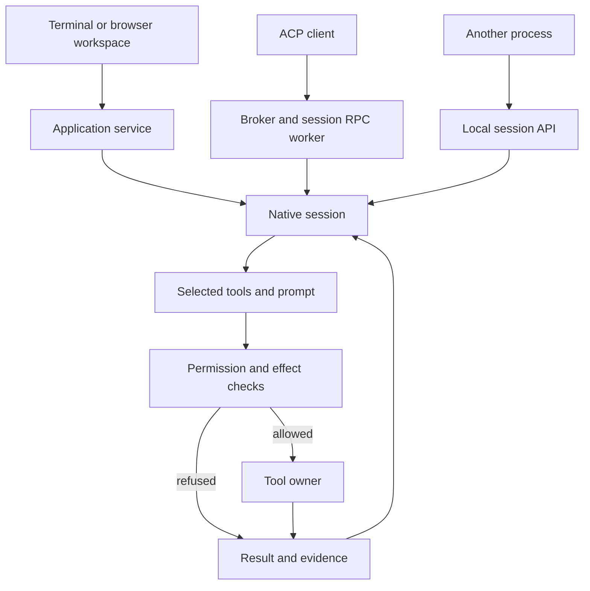

# Octocode features

The index of what Octocode does: find a feature here, then follow its link. `packages/coding-agent/docs/` owns user-facing reference ([its index](../packages/coding-agent/docs/index.md)), this folder owns designs that cross packages, and [CONFIGURATIONS.md](../CONFIGURATIONS.md) owns settings and precedence.

The coding-agent host owns execution, permissions and session state. Terminal, browser and ACP clients adapt that host. Reusable agent, AI and TUI packages keep their own boundaries, and the private `mcp`, `acp`, `db` and `common` workspaces compile into coding-agent.

Code paths below are under `packages/coding-agent/src/octocode/` unless they name a package.

## Agents and communication

| Feature                                   | What it does                                                                                                                       | Code                                          | Read                                                                                                                                                                      |
| ----------------------------------------- | ---------------------------------------------------------------------------------------------------------------------------------- | --------------------------------------------- | ------------------------------------------------------------------------------------------------------------------------------------------------------------------------- |
| Subagents and roles                       | `agent` type `task` starts a child process with a profile, model, background mode and optional isolation; slots follow the machine | `subagents/`, `instructions/roles/`           | [Worker lifecycle](AGENT_COMMUNICATION.md#native-workers-and-team-mail), [profiles and routes](../packages/coding-agent/docs/native-features.md#profile-front-matter)     |
| Orchestration flow                        | How the main agent plans, briefs, runs, checks and reviews children, and whom a stuck child asks                                   | `instructions/policy/`, `shared/`             | [Orchestration](ORCHESTRATION.md)                                                                                                                                         |
| One way to message any agent              | `agent` type `message`, `to` a name: child, parent, sibling, another process by name, or `coordinator`                             | `team/`, `external/peers.ts`                  | [Communication](../packages/coding-agent/docs/native-features.md#communication-and-results), [delivery contracts](AGENT_COMMUNICATION.md)                                 |
| Process to process, and external messages | Another session's text arrives marked as external, and its permission dialog decides whether it arrives                            | `external/`, `permission/external-message.ts` | [What the session sees](../packages/coding-agent/docs/session-api.md#what-the-session-sees), [the dialog](../packages/coding-agent/docs/permissions.md#external-messages) |
| Check-ins                                 | A child quiet for `subagents.checkInSeconds` is asked by its own harness whether it needs something                                | `team/check-in.ts`                            | [Subagent check-in](../packages/coding-agent/docs/native-features.md#subagent-check-in)                                                                                   |
| Request budgets and grants                | A soft and hard limit per child; the steer says where the run stops, and `coordinate` `grant` adds requests                        | `subagents/budget.ts`, `team/tools/grant.ts`  | [Request budget](../packages/coding-agent/docs/native-features.md#subagent-request-budget)                                                                                |
| Reservations and coordination             | `coordinate` lists the team and reserves paths; `task` `paths` reserves for a child                                                | `team/`, `subagents/reservation.ts`           | [Reservations and the shell](../packages/coding-agent/docs/permissions.md#reservations-and-the-shell)                                                                     |
| Local session API                         | On by default: every top-level session serves an owner-only socket; `octocode-api` and `/api`                                      | `api/`                                        | [Session API](../packages/coding-agent/docs/session-api.md)                                                                                                               |
| ACP, inbound and outbound                 | `octocode --mode acp` serves an editor; `agent` type `external` drives another agent                                               | `packages/acp`, `external/`                   | [ACP](../packages/coding-agent/docs/acp.md)                                                                                                                               |
| RPC and headless runs                     | `--mode rpc`, `-p`, JSON output; an embedding host controls a session                                                              | `src/modes/`                                  | [RPC](../packages/coding-agent/docs/rpc.md), [CLI modes](../packages/coding-agent/docs/cli.md)                                                                            |
| Worktrees and landing                     | `--worktree`, `/worktree`, one team across worktrees; a finished worktree messages `coordinator`, who runs `coordinate` `merge`    | `worktrees/`, `permission/landing.ts`         | [Worktrees](../packages/coding-agent/docs/native-features.md#worktrees), [finishing one](../packages/coding-agent/docs/native-features.md#finishing-a-worktree)           |
| Isolated children                         | `isolate: true` works in a private worktree and saves to a ref                                                                     | `subagents/worktree*.ts`                      | [Isolation](AGENT_COMMUNICATION.md#native-workers-and-team-mail)                                                                                                          |
| tmux                                      | Panes, windows and notifications; `/fork pane`, `/worktree open`                                                                   | `terminal-launch/`                            | [Running inside tmux](../packages/coding-agent/docs/tmux.md)                                                                                                              |
| Process list and orphans                  | `/processes`, named processes, memory samples and orphan cleanup                                                                   | `processes/`                                  | [Process names and orphans](../packages/coding-agent/docs/native-features.md#process-names-list-and-orphans)                                                              |

## Permissions and safety

| Feature             | What it does                                                                                                        | Code                                                       | Read                                                                                                        |
| ------------------- | ------------------------------------------------------------------------------------------------------------------- | ---------------------------------------------------------- | ----------------------------------------------------------------------------------------------------------- |
| Modes and checks    | `manual`, `workspace`, `full`; shared checks, then what only an effect's owner can decide                           | `permission/`, `tool-gates.ts`                             | [Permissions](../packages/coding-agent/docs/permissions.md), [execution flow](EXECUTION_AND_PERMISSIONS.md) |
| `message.external`  | Receiving a message from another process: `full` takes it, the others ask                                           | `permission/external-message.ts`                           | [External messages](../packages/coding-agent/docs/permissions.md#external-messages)                         |
| `worktree.merge`    | Landing on the default branch asks in every mode, by `coordinate` `merge` or `git merge` and friends through `bash` | `permission/landing.ts`, `permission/shell/git-landing.ts` | [Worktree merges](../packages/coding-agent/docs/permissions.md#worktree-merges)                             |
| Plan mode           | `/plan`: read-only tools until a revision is approved                                                               | `plan/`                                                    | [Native planning](../packages/coding-agent/docs/native-features.md#native-planning-constraint)              |
| Project trust       | `/trust` decides whether a folder's configuration loads                                                             | `trust/`, `src/core/folder-trust.ts`                       | [Project trust](../packages/coding-agent/docs/permissions.md#project-trust)                                 |
| Security boundaries | What is and is not a sandbox                                                                                        |                                                            | [SECURITY.md](../SECURITY.md)                                                                               |

## Tools

| Feature               | What it does                                                                                       | Code                                 | Read                                                                                                                                           |
| --------------------- | -------------------------------------------------------------------------------------------------- | ------------------------------------ | ---------------------------------------------------------------------------------------------------------------------------------------------- |
| Tool selection        | The native tools, their defaults, and `--tools` and `--exclude-tools`                              | `agent-tool.ts`, `index.ts`          | [Tool selection](../packages/coding-agent/docs/native-features.md#tool-selection-and-migration)                                                |
| Guarded file changes  | One `file` writer, read and commit receipts, advisory diagnostics, patches                         | `files/`                             | [Editing and verifying](EDITING_AND_DEBUGGING.md), [guarantees](../packages/coding-agent/docs/native-features.md#file-mutation-guarantees)     |
| Checkpoints           | `/rewind` restores file changes                                                                    | `files/checkpoint*.ts`               | [Commands](../packages/coding-agent/docs/commands.md)                                                                                          |
| Shell and jobs        | `bash`, moving to the background, trimmed output, verification receipts, `/jobs`                   | `files/bash*`                        | [Tool selection](../packages/coding-agent/docs/native-features.md#tool-selection-and-migration)                                                |
| Debugging             | A skill driving lldb, pdb and profilers through `bash`; there is no debugger tool                  | `native-skills/octocode-debugging/`  | [Debugging and profiling](EDITING_AND_DEBUGGING.md#debugging-and-profiling)                                                                    |
| Research              | Octocode MCP: local, semantic, structural, GitHub and package research                             | `packages/mcp/src/presets/octocode/` | [Tool selection](../packages/coding-agent/docs/native-features.md#tool-selection-and-migration), [MCP](../packages/coding-agent/docs/mcp.md)   |
| MCP                   | Every enabled tool fully described in the prompt, presets, per-agent assignment, shipped overrides | `packages/mcp`, `mcp-host/`          | [MCP](../packages/coding-agent/docs/mcp.md), [reference](../packages/coding-agent/docs/mcp-reference.md), [package](../packages/mcp/README.md) |
| Browser               | The `browser` MCP preset and specialist; navigation and network policy stay in the host            | `packages/mcp/src/presets/browser/`  | [Browser and web access](../packages/coding-agent/docs/native-features.md#browser-and-web-access)                                              |
| Web retrieval         | `web` search and fetch, with address and redirect checks                                           | `web/`                               | [Browser and web access](../packages/coding-agent/docs/native-features.md#browser-and-web-access)                                              |
| Questions to the user | `askUser`, in the main session                                                                     | `ask/`                               | [Tool selection](../packages/coding-agent/docs/native-features.md#tool-selection-and-migration)                                                |

## Prompts, context and customization

| Feature                  | What it does                                                                                             | Code                                                                 | Read                                                                                                                                                                                                                           |
| ------------------------ | -------------------------------------------------------------------------------------------------------- | -------------------------------------------------------------------- | ------------------------------------------------------------------------------------------------------------------------------------------------------------------------------------------------------------------------------ |
| Prompt sections          | The map of every section, its cache tier and what writes it; each build writes the final prompts         | `instructions/sections/index.md`                                     | [Instructions](../packages/coding-agent/docs/instructions.md), [the folder's map](../packages/coding-agent/src/octocode/instructions/README.md)                                                                                |
| Context and caching      | What each request sends and what the provider reuses                                                     | `src/core/system-prompt-spec.ts`                                     | [Context management](CONTEXT.md), [prompt caching](../packages/coding-agent/docs/prompt-caching.md)                                                                                                                            |
| Compaction               | When history is summarized, the checkpoint, and recovery references                                      | `compaction/`, `src/core/compaction/`                                | [Compaction and recovery](../packages/coding-agent/docs/native-features.md#compaction-and-recovery), [pipeline](CONTEXT.md#the-compaction-pipeline)                                                                            |
| Skills                   | Every model-visible skill in the catalog, loaded on demand; descriptions optimized by `octocode context` | `skills.ts`, `skill/`, `context-optimization/`, `src/core/skills.ts` | [Skills](../packages/coding-agent/docs/skills.md)                                                                                                                                                                              |
| Hooks                    | Native, Claude and Codex formats, always on; a `hooks` prompt section names what may act                 | `hooks/`                                                             | [Hooks](../packages/coding-agent/docs/hooks.md), [events](../packages/coding-agent/docs/hook-events.md), [design](PLUGINS_MODS_HOOKS.md)                                                                                       |
| Plugins and marketplaces | Local Claude and Codex plugins, marketplace install, plugin agents                                       | `plugins/`, `src/core/plugin-*.ts`                                   | [Guide](../PLUGINS.md), [plugins](../packages/coding-agent/docs/plugins.md), [design](PLUGINS_MODS_HOOKS.md)                                                                                                                   |
| Packages and templates   | Octocode packages, prompt templates, themes, keybindings                                                 | `src/core/package-manager/`                                          | [Packages](../packages/coding-agent/docs/packages.md), [templates](../packages/coding-agent/docs/prompt-templates.md), [themes](../packages/coding-agent/docs/themes.md), [keys](../packages/coding-agent/docs/keybindings.md) |
| Prompt optimization      | `/optimize` rewrites a typed prompt with a cheaper model for you to approve                              | `prompt-optimization/`                                               | [Session commands](../packages/coding-agent/docs/native-features.md#session-workflow-commands)                                                                                                                                 |
| Configuration            | Locations, precedence, Pi fallback, `/harness` and `/settings`                                           | `discovery/`, `harness/`                                             | [Configuration](../packages/coding-agent/docs/configuration.md), [settings](../packages/coding-agent/docs/settings.md), [environment](../packages/coding-agent/docs/environment-variables.md)                                  |

## Sessions, memory and work

| Feature                  | What it does                                                                                    | Code                                     | Read                                                                                                                                                                                                                                                                 |
| ------------------------ | ----------------------------------------------------------------------------------------------- | ---------------------------------------- | -------------------------------------------------------------------------------------------------------------------------------------------------------------------------------------------------------------------------------------------------------------------- |
| Sessions and recovery    | `/resume`, `/fork`, `/purge`, transcripts that survive a full disk or a crash, restart recovery | `sessions/`, `src/core/session-manager/` | [Session commands](../packages/coding-agent/docs/native-features.md#session-workflow-commands), [recovery](../packages/coding-agent/docs/native-features.md#compaction-and-recovery), [how-to](../packages/coding-agent/docs/how-to.md#recover-a-saved-conversation) |
| Memory and archive       | Saved notes, retrieval of compacted history, the agent event log                                | `memory/`, `archive/`                    | [Memory and Archive](../packages/coding-agent/docs/memory.md)                                                                                                                                                                                                        |
| Backlog and steps        | Durable items, epics, dependencies and tracked steps                                            | `backlog/`, `packages/db`                | [Web workspace](../packages/coding-agent/docs/web-workspace.md), [entity model](ENTITIES.md)                                                                                                                                                                         |
| Agent database           | One SQLite schema, migrations and retention                                                     | `packages/db`                            | [Package](../packages/db/README.md), [runtime storage](../packages/coding-agent/docs/configuration.md#runtime-storage)                                                                                                                                               |
| Side questions and diffs | `/btw`, `/context`, `/diff`                                                                     | `src/core/`, `files/repository-diff.ts`  | [Session commands](../packages/coding-agent/docs/native-features.md#session-workflow-commands)                                                                                                                                                                       |

## Interfaces

| Feature           | What it does                                                            | Code                                            | Read                                                                                                                                                                                    |
| ----------------- | ----------------------------------------------------------------------- | ----------------------------------------------- | --------------------------------------------------------------------------------------------------------------------------------------------------------------------------------------- |
| Terminal          | The editor, live status, footer, agents panel                           | `packages/tui`, `src/modes/interactive/`, `ui/` | [Terminal UI](../packages/coding-agent/docs/tui.md), [live status](../packages/coding-agent/docs/native-features.md#live-status), [commands](../packages/coding-agent/docs/commands.md) |
| Web workspace     | `/web`: activity, the board, docs and reports; the host keeps execution | `workspace/`, `packages/webview`                | [Web workspace](../packages/coding-agent/docs/web-workspace.md), [package](../packages/webview/README.md), [boundary](INTERFACE_ARCHITECTURE.md)                                        |
| User-level daemon | One page across every session of a user                                 | `web-daemon/`                                   | [Web daemon](INTERFACE_ARCHITECTURE.md#user-level-web-daemon)                                                                                                                           |
| Remote access     | `/remote` publishes the daemon to another device                        | `remote/`, `web-daemon/remote/`                 | [Remote access](../packages/coding-agent/docs/remote.md)                                                                                                                                |

## Models

| Feature                      | What it does                                                        | Code                                         | Read                                                                                                                                                                                                   |
| ---------------------------- | ------------------------------------------------------------------- | -------------------------------------------- | ------------------------------------------------------------------------------------------------------------------------------------------------------------------------------------------------------ |
| Providers and accounts       | `/login`, provider adapters, OAuth                                  | `packages/ai`                                | [Providers](../packages/coding-agent/docs/providers.md), [package](../packages/ai/README.md)                                                                                                           |
| Model choice and routing     | `/model`, `/modelsettings`, `models`, purposes for subagents        | `subagents/model.ts`, `subagents/catalog.ts` | [Models](../packages/coding-agent/docs/models.md), [the subagent model](../packages/coding-agent/docs/native-features.md#the-subagent-model)                                                           |
| Local models                 | `/llama` manages a llama.cpp router; Ollama and others as endpoints | `llama/`                                     | [Connect local models](../packages/coding-agent/docs/models.md#connect-local-models), [small machines](../packages/coding-agent/docs/how-to.md#use-octocode-on-a-slow-or-small-machine)                |
| Discovery and virtual models | Vendor model lists; several real models behind one name             | `packages/ai`                                | [Discovery](../packages/coding-agent/docs/model-discovery.md), [virtual models](../packages/coding-agent/docs/virtual-models.md), [custom providers](../packages/coding-agent/docs/custom-provider.md) |
| GitHub sign-in               | `/github` for the research tools                                    | `src/modes/interactive/`                     | [GitHub authentication](../packages/coding-agent/docs/native-features.md#github-authentication-in-the-terminal)                                                                                        |

## Building and measuring

| Feature           | What it does                                                                        | Code                                | Read                                                                                                              |
| ----------------- | ----------------------------------------------------------------------------------- | ----------------------------------- | ----------------------------------------------------------------------------------------------------------------- |
| Eval kit          | Decides whether an agent change ships: correctness no worse, cost per task lower    | `scripts/agent-eval/`               | [Agent eval](../scripts/agent-eval/README.md)                                                                     |
| Instruction check | `understand.mjs` asks a small model how each agent would work and grades the answer | `scripts/agent-eval/understand.mjs` | [Do agents understand](../scripts/agent-eval/README.md#do-agents-understand-their-instructions)                   |
| Self-audit        | Questions Octocode answers about itself                                             |                                     | [Agent self-audit](AGENT_SELF_AUDIT.md)                                                                           |
| Telemetry         | Install and attribution contracts; hosts decide collection                          | `packages/telemetry`                | [Package](../packages/telemetry/README.md), [environment](../packages/coding-agent/docs/environment-variables.md) |
| Build and release | One bundle, one published package, repository scripts                               | `scripts/`                          | [README](../README.md), [scripts](../scripts/README.md), [development guide](../AGENTS.md)                        |

## What tests do and do not show

The native suite (`vitest.octocode.config.ts`) covers each domain offline. The scripted end-to-end suite (`test/octocode/e2e*.test.ts`, `yarn test:e2e`) runs real sessions against a scripted model, with no network or credentials. `e2e-all-tools.test.ts` drives every declared native tool and research tool in real processes, so a tool nobody wrote a case for fails there. `e2e-a2a*.test.ts`, `e2e-reach-process.test.ts`, `e2e-landing-permission.test.ts`, `e2e-check-in.test.ts` and `e2e-budget-conversation.test.ts` do the same for messages between processes, landing, check-ins and budgets. The [development guide](../AGENTS.md#verify) has the commands.

A passing offline run does not establish these, which need their own configured runs:

- live provider inference, accounts, entitlements and measured cache hit rates;
- private subscription and vendor contracts, such as Copilot, Meta and fixed subscription clients;
- every editor's ACP behavior, physical browser and screen-reader use, and Windows execution.

Some limits are by design. Tool policy is not an operating-system sandbox. Native file revisions do not see shell or external edits, and parser and LSP feedback is advisory. Team mail is agent messaging, not email. A2A is not implemented: [its place](AGENT_COMMUNICATION.md) is an optional remote adapter, since local agents already reach each other.

## Library boundaries

A library owns a protocol's mechanics; the host keeps authorization, persistence, accounting and UI.

| Boundary                    | Choice                                                                                           | The host keeps                                                                                                       |
| --------------------------- | ------------------------------------------------------------------------------------------------ | -------------------------------------------------------------------------------------------------------------------- |
| MCP lifecycle and transport | `@modelcontextprotocol/client`; legacy SSE is rejected                                           | Credential isolation, redirect limits, body limits, total deadlines, process-tree cleanup                            |
| JWT verification            | `jose`                                                                                           | Issuer, audience, algorithm, nonce and authorized-party checks                                                       |
| Provider HTTP and streams   | `@ai-sdk/provider-utils`, plus official vendor SDKs where they own a protocol                    | Grammar tools, reasoning replay, cache boundaries, usage accounting. A wholesale normalized adapter would lose these |
| ACP                         | `@agentclientprotocol/sdk`                                                                       | Sessions, permissions, MCP registration                                                                              |
| Skill parsing               | `yaml` and a small adapter; no skill installer at activation                                     | Permissive metadata, source precedence, trust, snapshot identity, child inheritance                                  |
| Web rendering               | React with Zustand; sanitized Markdown; no second server-state cache beside the socket snapshots | Permissions and execution                                                                                            |

RPC, compaction, cache policy and monitoring stay application modules: a transport SDK cannot decide what to compact or how siblings share a cache group.
