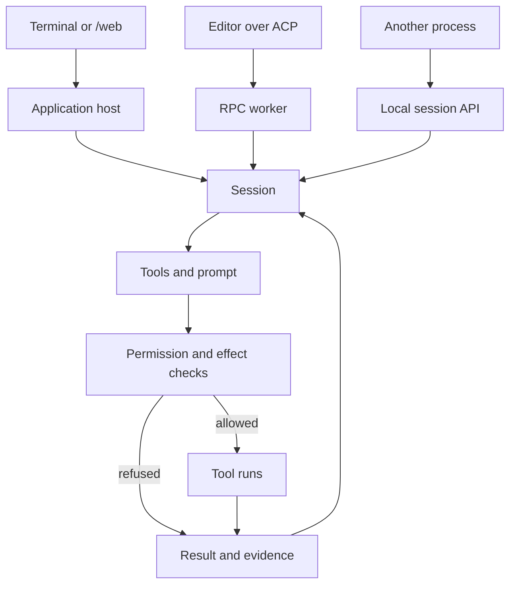
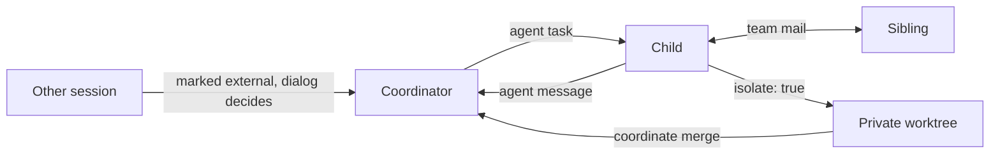
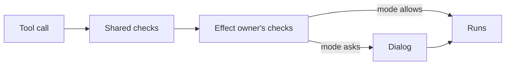

# Octocode features

Find a feature, then follow its link. User reference: [documentation index](../packages/coding-agent/docs/index.md). This folder holds cross-package designs; [configuration](../packages/coding-agent/docs/configuration.md) owns settings and precedence. Toggle any feature in [`/settings`](../packages/coding-agent/docs/configuration.md#changing-configuration).

The host owns execution, permissions and session state; terminal, browser and ACP clients adapt it ([details](INTERFACE_ARCHITECTURE.md)).

## Agents and communication

| Feature                  | What it does                                                                                                               | Read                                                                                             |
| ------------------------ | -------------------------------------------------------------------------------------------------------------------------- | ------------------------------------------------------------------------------------------------ |
| Subagents, orchestration | `agent` `type: "task"` starts a child (profile, model, background, isolation); the coordinator plans, briefs and reviews   | [Workers](AGENT_COMMUNICATION.md#workers)                                                        |
| Messaging                | `agent` `type: "message"` to a child, `parent`, sibling, process name or `coordinator`                                     | [Communication](../packages/coding-agent/docs/subagents.md#communication-and-results)      |
| External messages        | Another session's text arrives marked external; its permission dialog decides                                              | [Session API](../packages/coding-agent/docs/session-api.md#what-the-session-sees)                |
| Check-ins                | A child quiet for `monitor.checkInSeconds` is asked if it needs something                                                  | [Check-in](../packages/coding-agent/docs/subagents.md#subagent-check-in)                   |
| Request budgets          | Soft and hard limits per child; `coordinate` `grant` adds requests                                                         | [Budget](../packages/coding-agent/docs/subagents.md#subagent-request-budget)               |
| Reservations             | `coordinate` lists the team and reserves paths; a task's `paths` reserves for a child                                      | [Reservations](../packages/coding-agent/docs/permissions.md#reservations-and-the-shell)          |
| Local session API        | On by default: owner-only socket per top-level session (`octocode-api`, `/api`)                                            | [Session API](../packages/coding-agent/docs/session-api.md)                                      |
| ACP                      | `octocode --mode acp` serves an editor; `agent` `type: "external"` drives another agent                                    | [ACP](../packages/coding-agent/docs/acp.md)                                                      |
| RPC, headless            | `--mode rpc`, `-p`, JSON output                                                                                            | [RPC](../packages/coding-agent/docs/rpc.md)                                                      |
| Worktrees                | `--worktree`, `/worktree`; one team across worktrees; a finished one messages `coordinator`, who runs `coordinate` `merge` | [Worktrees](../packages/coding-agent/docs/subagents.md#worktrees)                          |
| Isolated children        | `isolate: true`: private worktree, saved to a ref                                                                          | [Isolated workers](AGENT_COMMUNICATION.md#isolated-workers)                                      |
| tmux                     | Panes, windows, notifications; `/fork pane`, `/worktree open`                                                              | [tmux](../packages/coding-agent/docs/tmux.md)                                                    |
| Processes                | `/processes`: names, memory samples, orphan cleanup                                                                        | [Process names](../packages/coding-agent/docs/monitoring.md#process-names-list-and-orphans) |

## Permissions and safety

| Feature            | What it does                                                                                      | Read                                                                                    |
| ------------------ | ------------------------------------------------------------------------------------------------- | --------------------------------------------------------------------------------------- |
| Modes              | `manual`, `workspace`, `full` (default), `bypass`                                                 | [Permissions](../packages/coding-agent/docs/permissions.md)                             |
| `message.external` | Message from another process: `full` accepts, others ask                                          | [External messages](../packages/coding-agent/docs/permissions.md#external-messages)     |
| `worktree.merge`   | Landing on the default branch asks in every mode (`coordinate` `merge`, or `git merge` in `bash`) | [Worktree merges](../packages/coding-agent/docs/permissions.md#worktree-merges)         |
| Plan mode          | `/plan`: read-only tools until a revision is approved                                             | [Planning](../packages/coding-agent/docs/tools.md#planning-mode) |
| Project trust      | `/trust` decides whether a folder's configuration loads                                           | [Project trust](../packages/coding-agent/docs/permissions.md#project-trust)             |
| Security review    | Third-party hooks, MCP servers, skills stay off until approved (`/security`)                      | [Security review](../packages/coding-agent/docs/permissions.md#security-review)     |
| Sandbox            | Optional OS sandbox for shell commands                                                            | [Sandbox](../packages/coding-agent/docs/sandbox.md)                                     |

## Tools

| Feature              | What it does                                                                  | Read                                                                                              |
| -------------------- | ----------------------------------------------------------------------------- | ------------------------------------------------------------------------------------------------- |
| Tool selection       | Native tools, defaults, `--tools`, `--exclude-tools`, `--enable tool:<name>`  | [Tool selection](../packages/coding-agent/docs/tools.md#tool-selection-and-exposure)   |
| Guarded file changes | One `file` writer with read and commit receipts, patches; `/rewind` restores  | [Editing](EXECUTION_AND_PERMISSIONS.md#editing-and-verifying)                                     |
| Shell and jobs       | `bash`, background runs, trimmed output, verification receipts, `/jobs`       | [Shell](../packages/coding-agent/docs/tools.md#bash)                                   |
| Debugging            | A skill drives lldb, pdb and profilers through `bash`; no debugger tool       | [Debugging](EXECUTION_AND_PERMISSIONS.md#editing-and-verifying)                                   |
| Resuming other tools | A skill reads Claude Code, Codex, Cursor sessions; reports dangling worktrees | [Native features](../packages/coding-agent/docs/tools.md#resuming-other-tools-sessions) |
| MCP                  | Octocode default; add servers in configuration; presets, per-agent assignment | [MCP](../packages/coding-agent/docs/mcp.md)                                                       |
| Browser, desktop     | `browser`, `desktop` (needs `cua-driver`, asked each start) presets           | [Browser and web](../packages/coding-agent/docs/browser-and-desktop.md)        |
| Web retrieval        | `web` search and fetch with address and redirect checks                       | [Browser and web](../packages/coding-agent/docs/tools.md#web)        |
| Questions to you     | `askUser`, main session only                                                  | [Questions](../packages/coding-agent/docs/tools.md#questions-to-a-person)               |

## Prompts, context and customization

| Feature                | What it does                                    | Read                                                                                   |
| ---------------------- | ----------------------------------------------- | -------------------------------------------------------------------------------------- |
| Prompt sections        | Sections, cache tier, writer                    | [Prompts](../packages/coding-agent/docs/prompts.md)                                    |
| Context and caching    | Request contents; provider reuse                | [Context](CONTEXT.md)                                                                  |
| Compaction             | Summaries, checkpoint, recovery                 | [Compaction](../packages/coding-agent/docs/how-it-works.md#compaction-limits-and-recovery) |
| Skills                 | Model-visible skills, loaded on demand          | [Skills](../packages/coding-agent/docs/skills.md)                                      |
| Hooks                  | Native, Claude, Codex formats                   | [Hooks](../packages/coding-agent/docs/hooks.md)                                        |
| Plugins                | Claude and Codex plugins, marketplaces          | [Plugins](../packages/coding-agent/docs/plugins.md)                                    |
| Packages and templates | Packages, prompt templates, themes, keybindings | [Packages](../packages/coding-agent/docs/packages.md)                                  |
| Configuration          | One command to read and change settings         | [Configuration](../packages/coding-agent/docs/configuration.md)                        |

## Sessions, memory and work

| Feature            | What it does                                                                                 | Read                                                                                           |
| ------------------ | -------------------------------------------------------------------------------------------- | ---------------------------------------------------------------------------------------------- |
| Sessions, recovery | `/resume`, `/fork`, `/purge`; transcripts survive full disk or crash                         | [Session commands](../packages/coding-agent/docs/commands.md#limits-of-session-commands) |
| Memory, archive    | Saved notes, compacted-history retrieval, agent event log                                    | [Memory](../packages/coding-agent/docs/memory.md)                                              |
| Backlog            | Items, epics, dependencies, steps; optional QA review                                        | [Entities](ENTITIES.md)                                                                        |
| Agent database     | One SQLite schema, retention                                                                 | [Database](ENTITIES.md#database)                                                               |
| Profiler           | `/web` Profiler (Timeline, Requests, Messages, Agents, Insights, Events); `octocode profile` | [Native features](../packages/coding-agent/docs/web-workspace.md)   |
| Machine monitor    | Per-minute load, memory, GPU; threshold alerts                                               | [Machine monitor](../packages/coding-agent/docs/monitoring.md#machine-monitor)            |

## Interfaces and models

| Feature                       | What it does                                                                        | Read                                                                                                            |
| ----------------------------- | ----------------------------------------------------------------------------------- | --------------------------------------------------------------------------------------------------------------- |
| Terminal                      | Editor, status, footer, agents panel                                                | [Terminal UI](../packages/coding-agent/docs/tui.md)                                                             |
| Fullscreen and regular screen | Fullscreen (default) or terminal scrollback                                         | [Layout modes](../packages/coding-agent/docs/tui.md#layout-modes)                                               |
| Selection, mouse              | Drag, double- and triple-click, copy on select; `alt+m` or `/mouse` frees the mouse | [Selection](../packages/coding-agent/docs/tui.md#layout-modes)                                                  |
| Scrolling, search             | Wheel (`fullscreenWheelScrollLines`), prompt jumps, `/find`                         | [Fullscreen keys](../packages/coding-agent/docs/keybindings.md#fullscreen)                                      |
| Web workspace                 | `/web`: activity, board, docs, reports, profiler                                    | [Web workspace](../packages/coding-agent/docs/web-workspace.md)                                                 |
| User-level daemon             | One page across a user's sessions                                                   | [Daemon](INTERFACE_ARCHITECTURE.md#the-user-level-web-daemon)                                                   |
| Remote access                 | `/remote` publishes the daemon to another device                                    | [Remote](../packages/coding-agent/docs/remote.md)                                                               |
| Providers, accounts           | `/providers`, adapters, OAuth                                                       | [Providers](../packages/coding-agent/docs/providers.md)                                                         |
| Model choice                  | `/model`, `/modelsettings`, subagent purposes                                       | [Models](../packages/coding-agent/docs/models.md)                                                               |
| Local models                  | Ollama, llama.cpp as endpoints                                                      | [Local models](../packages/coding-agent/docs/models.md#connect-local-models)                                    |
| Discovery, virtual models     | Vendor model lists; several real models behind one name                             | [Discovery](../packages/coding-agent/docs/models.md#discover-vendor-models)                                     |
| `models.json` scopes          | Global and workspace provider files; Pi fallback                                    | [Models configuration](../packages/coding-agent/docs/models-configuration.md)                                   |
| API keys                      | Credential, keychain, variable or command                                           | [Key command](../packages/coding-agent/docs/providers.md#load-an-api-key-from-a-command)                        |
| Vendor CLIs                   | CLI-only subscription as runner or model                                            | [Subscriptions](../packages/coding-agent/docs/providers.md#subscriptions-and-billing)                           |
| Smart routing                 | Routes by cost, ability, failure                                                    | [Smart routing](../packages/coding-agent/docs/smart-routing.md)                                                 |
| Rate limiting                 | `requestsPerMinute` paces before a `429`                                            | [Rate limits](../packages/coding-agent/docs/troubleshooting.md#rate-limits-and-429)                             |
| Prompt caching                | Layer cache markers; warming when it pays                                           | [Prompt caching](../packages/coding-agent/docs/prompt-caching.md)                                               |
| GitHub sign-in                | `/octocode auth login`; start notice when signed out                                | [GitHub authentication](../packages/coding-agent/docs/commands.md#github-authentication-in-the-terminal) |
| Research CLI                  | `octocode` from a shell or `/octocode`                                              | [Research CLI](../packages/coding-agent/docs/commands.md#the-octocode-research-cli)                      |
| Telemetry                     | Version ping (`enableInstallTelemetry`, on); analytics (`enableAnalytics`, off)     | [Telemetry](../packages/coding-agent/docs/settings.md#telemetry-and-privacy)                                    |

## Tools the model calls

Which tools are on, deferred or removed for a role: [tool selection](../packages/coding-agent/docs/tools.md#tool-selection-and-exposure).

| Tool                     | What it does               | Read                                                                   |
| ------------------------ | -------------------------- | ---------------------------------------------------------------------- |
| `backlog`, `backlogPlan` | Durable work items         | [Backlog items](ENTITIES.md#backlog-items)                             |
| `memory`, `archive`      | Notes; earlier sessions    | [Memory tool](../packages/coding-agent/docs/memory.md#the-memory-tool) |
| `notify`                 | Timers, cron, events       | [Notify](../packages/coding-agent/docs/tools.md#notify)      |
| `models`                 | Model limits, cost, health | [Models](../packages/coding-agent/docs/models.md)                      |
| `render`                 | Table, chart, diagram      | [Render](../packages/coding-agent/docs/tools.md#render)      |

Octocode research tools (code, GitHub, package search) come from the Octocode MCP server ([MCP](../packages/coding-agent/docs/mcp.md)); browser and desktop tools from their presets.

## Slash commands

`/` opens the menu; `/help` searches it. Habit names such as `/config`, `/exit`, `/cost` run their mapped command ([habit names](../packages/coding-agent/docs/commands.md#habit-names-and-moved-forms)). Usage: [Commands](../packages/coding-agent/docs/commands.md).

| Task                | Commands                                                                                              |
| ------------------- | ----------------------------------------------------------------------------------------------------- |
| Get started         | `/help`, `/model`, `/providers`, `/logout`, `/effort`                                                 |
| Sessions            | `/new` (`/clear`, `/reset`), `/resume`, `/fork`, `/clone`, `/tree`, `/rename`, `/purge`               |
| Context             | `/compact`, `/context`, `/status`, `/usage`, `/btw`, `/queue`                                         |
| Changes             | `/diff`, `/rewind`, `/jobs`                                                                           |
| Planning            | `/plan`, `/optimize`                                                                                  |
| Agents and work     | `/agents`, `/messages`, `/backlog`, `/worktree`, `/realm`, `/processes`, `/monitor`, `/cron`, `/loop` |
| Settings and safety | `/settings`, `/models`, `/modelsettings`, `/permissions`, `/trust`, `/security`, `/reload`            |
| Extensions          | `/memory`, `/archive`, `/harness`, `/mcp`                                                             |
| Interfaces          | `/web`, `/remote`, `/api`, `/octocode`, `/mouse`, `/find`, `/links`, `/copy`, `/keys`                 |
| Share and report    | `/export`, `/import`, `/share`, `/bug`, `/changelog`, `/debug`, `/quit`                               |

## What tests do and do not show

Offline suites cover each domain. The scripted end-to-end suite runs real sessions on a scripted model with no network or credentials, driving every declared tool, messaging between processes, landing, check-ins and budgets. A passing run does not establish:

- live provider inference, accounts, entitlements, cache hit rates;
- private vendor contracts (Copilot, Meta, fixed subscription clients);
- every editor's ACP behavior, physical browser and screen-reader use, Windows execution.

By design: tool policy is not an OS sandbox; native file revisions miss shell and external edits; team mail is not email; A2A is not implemented ([why](AGENT_COMMUNICATION.md#channels-and-what-an-acknowledgment-proves)).

## Library boundaries

A library owns protocol mechanics; the host keeps authorization, persistence, accounting and UI.

| Boundary                  | Choice                                                                   | Host keeps                                                                          |
| ------------------------- | ------------------------------------------------------------------------ | ----------------------------------------------------------------------------------- |
| MCP transport             | Official MCP client; legacy SSE rejected                                 | Credential isolation, redirect and body limits, deadlines, process-tree cleanup     |
| JWT                       | `jose`                                                                   | Issuer, audience, algorithm, nonce, authorized-party checks                         |
| Provider HTTP and streams | `@ai-sdk/provider-utils`, official vendor SDKs where they own a protocol | Grammar tools, reasoning replay, cache boundaries, usage accounting                 |
| ACP                       | `@agentclientprotocol/sdk`                                               | Sessions, permissions, MCP registration                                             |
| Skill parsing             | `yaml`, small adapter; no installer at activation                        | Permissive metadata, source precedence, trust, snapshot identity, child inheritance |
| Web rendering             | React, Zustand, sanitized Markdown; no second cache beside the socket    | Permissions, execution                                                              |

RPC, compaction, cache policy and monitoring stay application modules: a transport SDK cannot decide what to compact or how siblings share a cache group.
