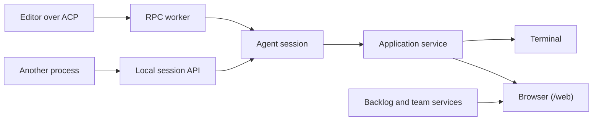
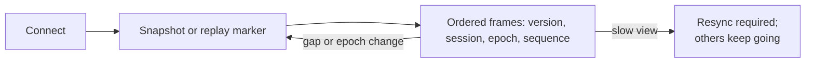

# Terminal, web and the application host

One host process owns execution, permissions and session state. The terminal, the `/web` workspace, editors (ACP) and other processes are views of it: a view can send commands, but receiving or rendering an event never starts another agent run.



| Part                | Does                                                                                           | Never                                 |
| ------------------- | ---------------------------------------------------------------------------------------------- | ------------------------------------- |
| Host                | Runs tools, enforces permissions, keeps the transcript, replay, assets and receipts            | Trusts a view's claims                |
| Terminal            | Input, local extension components, rendering; keeps controls only the terminal user can answer | —                                     |
| Browser             | Renders validated frames; keeps drafts, filters and cursors locally                            | Executes, authenticates or authorizes |
| Agent loop, AI, TUI | Reusable libraries: execution loop, providers, terminal widgets                                | Own backlog or interface policy       |

## The user-level web daemon

One detached page per OS user shows every session of the machine. It is what `/web` opens: every top-level session starts an owner-only attach endpoint, and `/web` starts or reuses the daemon. When the daemon cannot start or the session cannot attach, `/web` warns and serves a per-session page instead (closed with its session). `OCTOCODE_WEB_DAEMON_IDLE_MINUTES` sets the idle time before the daemon exits with no tab and no attached session.

```mermaid
sequenceDiagram
  participant S as Session
  participant D as Daemon
  participant T as Browser tab
  S->>S: listen on 127.0.0.1, write attach file (0600) with a token
  T->>D: open page (token in the URL fragment)
  D->>S: attach.hello with token, then application and workspace requests
  S-->>D: frames (execution, permissions and receipts stay in the session)
  D-->>T: one stream per tab; 512 frames behind: one resync
```

| Topic           | Behavior                                                                                                                                                                                                                                                                                                                                       |
| --------------- | ---------------------------------------------------------------------------------------------------------------------------------------------------------------------------------------------------------------------------------------------------------------------------------------------------------------------------------------------- |
| Single instance | The daemon record is written only after it listens; a run lock stops a second daemon, a launch lock serializes launchers. A record is trusted only when its process may still be the writer and an authenticated health check returns its nonce                                                                                                |
| Upgrade         | A launcher of another build asks the daemon to drain: it hands over, tells open tabs, and exits when they leave or after 30 s                                                                                                                                                                                                                  |
| Page scope      | A page is scoped to one session or one repository (workspace UUID); report files are served only while the checkout still matches its recorded directory                                                                                                                                                                                       |
| Writes          | Board writes need a launch or control token (a view token gets 403) and repaint the board counts of the repository's attached sessions (`backlog.changed`). Setting and provider-key changes are accepted only from the launch token                                                                                                         |
| Session settings | A session's page reaches its settings under `/s/<id>/`; the daemon asks the session what it declares of each tool (`session.tools`), since the daemon has no tools of its own                                                                                                                                                                  |
| Limits          | Attach requests 1 MiB, responses and events 32 MiB; uploads are not carried                                                                                                                                                                                                                                                                    |
| Local security  | Token only in the URL fragment, `Authorization` header or socket hello, never a query string; no cookies or CORS; `Host` must be `127.0.0.1:<port>` and `Origin` the daemon's; only the page and health check are tokenless; strict CSP (`default-src 'none'`, hashed scripts, `frame-ancestors 'none'`); owner-only files in a 0700 directory |

`/remote` can publish the daemon to another device: see [remote access](../packages/coding-agent/docs/remote.md).

## What a view receives



| Item            | Behavior                                                                                                                                                                                                 |
| --------------- | -------------------------------------------------------------------------------------------------------------------------------------------------------------------------------------------------------- |
| Snapshot window | Newest 50 messages within 100 KB, their tools and every later tool, at most 50 tools and 150 KB; older items come from history pages. Queue previews and receipts are bounded separately                 |
| Activities      | At most 50 within 32,768 characters; older ones come through the history cursor `activityBefore`. Structured data stays inline up to 4,000 characters, then moves to a JSON asset                        |
| Waiting for you | While a run waits on a dialog only the terminal can answer, the snapshot carries `awaiting` (`approval` or `question`); the browser shows "Waiting for you". Dialogs opened with no run are not reported |
| Context reset   | Replacing context (including navigating within a session tree) resets the transcript and invalidates old replay cursors                                                                                  |
| Cancel          | Needs an explicit command with the current run id. Closing a view never aborts accepted work; a session change invalidates old connections and commands                                                  |
| Trust           | Output is redacted and bounded; failure receipts redact credential-shaped text. Permission dialogs and terminal-only components stay in the terminal. A view's advertised capabilities grant nothing     |

Shared commands: prompt, steer, follow-up and run-scoped abort; prompt and queue commands may reference uploaded images (image-only input works).

### Command receipts

| Kind                         | States                            | Meaning                                                                                      |
| ---------------------------- | --------------------------------- | -------------------------------------------------------------------------------------------- |
| Application command          | `accepted`, `completed`, `failed` | `completed`: the operation returned (queued steering or follow-up work may still be pending) |
| Workspace team or delegation | `pending`, `accepted`, `failed`   | Accepting a delegation request does not mean a child launched or finished                    |

A durable receipt stops an uncertain request from re-running after reconnect or restart; it is not exactly-once.

## Content, assets and tool display

| Topic            | Behavior                                                                                                                                                                                                                                                                                                                                                                     |
| ---------------- | ---------------------------------------------------------------------------------------------------------------------------------------------------------------------------------------------------------------------------------------------------------------------------------------------------------------------------------------------------------------------------- |
| Blocks           | Text, reasoning summaries, images, media, resources, tool calls and explicit "unsupported" blocks, each with a stable id. Context-only messages and system instructions are hidden from conversation views                                                                                                                                                                   |
| Binary and large | Binary payloads become opaque session-scoped assets; large text and JSON get a full-content reference instead of silent truncation. The terminal shows images with Kitty or iTerm2 when supported; the web uses disposable Blob URLs; remote resource URLs stay links                                                                                                        |
| Uploads          | PNG, JPEG, GIF, WebP up to 20 MiB; assets 32 MiB each and 256 MiB per session, removed on reset; a streaming asset has revisions, a final one is immutable; asset ids never grant file access                                                                                                                                                                                |
| Reports          | `/web` lists saved reports from the checkout's `.octocode` report folders (RFC, research, brainstorming); only reports the index lists can be read                                                                                                                                                                                                                           |
| Failures         | A projection or capacity failure shows a bounded `application.error` notice and later events continue; oversized content restores as an "unavailable" placeholder. The session transcript keeps the original                                                                                                                                                                 |
| Tool display     | Every tool shows title, summary, meta, reason, outcome and ordered blocks (`text`, `output`, `diff`, `list`, `fields`, `markdown`, `path`); a surface that does not know a block shows its text. Rebuilt from saved arguments and results on resume, so MCP tools whose server is down still render. Terminal, web (raw data folded), HTML export and ACP clients all use it |
| Progress         | A tool that reports how far it is shows a meter in the terminal and a progress bar on the web; a result event replaces the previous result, an arguments-only event keeps it                                                                                                                                                                                                 |
| Shell output     | Updates append only their delta; bash messages keep command, exit, cancellation and truncation state; full output is kept up to 32 MiB while the model sees the shortened text. A displayed output path never authorizes a file read                                                                                                                                         |

The database behind sessions, backlog, team and memory: [entities](ENTITIES.md#database).
