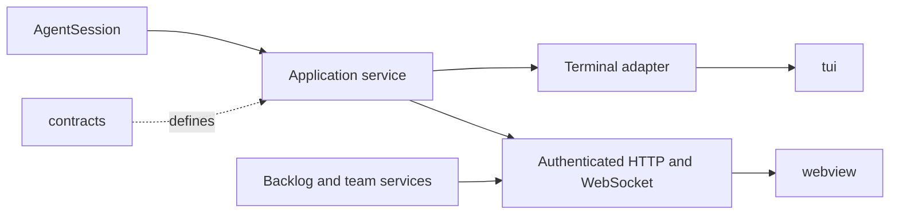

# Terminal and web application boundary

The application host owns execution. Terminal and web consume an application port defined by `packages/contracts` and implemented in `packages/coding-agent/src/core/application`. No additional runtime package is needed: `agent` remains the reusable execution loop, and `tui` remains a generic terminal component library.

## Owners

| Owner                                  | Responsibility                                                                                                                                                                                                                                         |
| -------------------------------------- | ------------------------------------------------------------------------------------------------------------------------------------------------------------------------------------------------------------------------------------------------------ |
| `packages/contracts`                    | Serializable application commands, event/frame schemas, cursors, snapshots, receipts, and connection interfaces; existing backlog and workspace contracts.                                                                                             |
| `coding-agent/src/core/application`    | One session-event subscription, ordered conversation state, asset storage, history, replay, view lifetimes, and dispatch to existing session operations.                                                                                               |
| `coding-agent/src/octocode/workspace`  | Authenticated local transport, team/backlog integration, redaction, and durable command receipts.                                                                                                                                                      |
| `coding-agent/src/octocode/web-daemon` | Opt-in (`OCTOCODE_WEB_DAEMON=1`) user-level daemon: launcher, lock and record, session attach endpoint and client, tab proxy, idle and drain lifecycle, read-only board and reports, configuration routes. Its Settings snapshot is `config-status.ts`; `config-routes.ts` serves it to every token and accepts setting changes (`config-write.ts`) and provider-key changes (`credential-write.ts`) only from the launch token. |
| `coding-agent/src/modes/interactive`   | Terminal input, local extension components, and rendering; consumes shared content events and retains native capabilities for local controls and extension notices.                                                                                    |
| `packages/webview`                     | Browser transport, validated stream reduction, UI state, and safe rendering.                                                                                                                                                                           |
| `packages/agent`, `packages/ai`        | Execution loop and provider integration. They do not own backlog or interface policy.                                                                                                                                                                  |
| `packages/tui`                         | Terminal layout, input, and reusable widgets. It has no application dependency.                                                                                                                                                                        |

Commands flow back through the adapters. Receiving or rendering an event never starts another engine run. Backlog lifecycle validation, ownership, and transactional audit remain in the existing backlog store.

## User-level web daemon

With `OCTOCODE_WEB_DAEMON=1` every non-subagent session starts an owner-only attach endpoint, and `/web` uses one detached daemon per OS user instead of the per-session server (without the flag nothing listens and `/web` is unchanged). Contracts live in `packages/contracts/src/daemon.ts` (`DaemonRecord`, `AttachRecord`, attach requests, responses and events) and `DAEMON_ROUTES` in `protocol.ts`. Phase 1 has no credential or settings writes.

- **Attach.** The session listens on `127.0.0.1:0` and writes `<octocode home>/web/attach/<sessionId>.json` (0600) with a per-run token. The protocol is newline-delimited JSON: `attach.hello` with the token first, then `application.connect/disconnect/execute/readAsset/history` and `workspace.snapshot/revision/execute/subscribe`. Requests are capped at 1 MiB, responses and events at 32 MiB (history pages and assets are larger than requests; uploads are not carried in phase 1). The endpoint calls the same application port and workspace connection as the in-process server, so execution, permissions, receipts and deduplication stay in the session. `session.closed` is sent at shutdown; a dropped socket is a detach.
- **Daemon.** `daemon.json` (0600) is written only after `listen`; `daemon.run.lock` is held for the whole run, so a second daemon cannot start, and launchers serialize on `daemon.launch.lock`. A record is trusted only when its process may still be the writer (`sameProcess`) and an authenticated `GET /api/health` returns its nonce, so a stranger on the port is never used. The daemon exits after the idle timeout with no tab and no attached session; a launcher of another build asks it to drain (it hands over the record and lock at once, tells open tabs, and exits when they leave or after 30 s).
- **Routes.** `GET /` serves the page without data. The page scope is `?s=<sessionId>` or `?r=<repoId>`; the matching routes are the workspace routes under `/s/<sessionId>` and `/r/<repoId>`. The wire field `repoId` carries the workspace UUID. The daemon resolves this ID in the workspace catalog and serves report files only when the checkout still matches its recorded directory binding. The board is read-only.
- **Security rules (RFC R1-R9).** Token only in the URL fragment and the `Authorization` header or socket hello, never a query string (`http-util.ts`, `tabs.ts`); no cookies, no CORS headers, no OPTIONS answer; every route checks `Host` equal to `127.0.0.1:<port>` and any `Origin` equal to the daemon origin, and sockets always need the Origin (`server.ts`, `tabs.ts`); only `GET /` and `GET /api/health` are tokenless, and health returns compatibility only without the token; `Content-Security-Policy` comes from the webview's `pagePolicy`, the same function that writes the page's meta tag: `default-src 'none'`, the script hash computed from the served page (`build.ts`) plus the Mermaid loader's `MERMAID_SCRIPT_HASH`, `blob:` images and media for attachment previews, and `frame-ancestors 'none'`; an attach endpoint accepts only its session's token, on loopback (`attach-server.ts`); files are owner-only in a 0700 directory.
- **Per-tab queue.** Each tab opens its own application stream through the attach connection; a tab that falls 512 frames behind receives one `resync` and reconnects. The daemon watches the database stamp (a stat of the database and WAL) once for all tabs and builds a board snapshot only after it changed.

## Runtime state and database ownership

`core/application/state.ts` creates one Zustand vanilla store per application service. Transcript messages, tools, activities, run status, queue previews, display errors, and command receipts live there. The transcript and activity projectors update that same store; lifecycle translation has no separate mutable state. Workspace activity uses the extension-scoped vanilla store in `core/application/workspace-state.ts`, including standalone extension hosts without an attached application service.

Local interfaces can consume `ApplicationStateSource`: `getSnapshot()` returns a copied, bounded snapshot, and `subscribeState(listener)` returns an unsubscribe function. Notifications follow completed domain updates; subscribing does not emit an initial snapshot. Read the initial value with `getSnapshot()`. Listener failures are isolated, and service disposal removes subscriptions. `subscribe`, `subscribeNative` and `subscribeState` take an optional `onError(error)` second argument: it receives that listener's own failures and service failures such as an `ApplicationServiceError` when a command outcome could not be saved; without one they go to `console.error` (`core/application/service/delivery.ts`). `subscribe` remains the semantic-event path for incremental terminal rendering. Serialized connections retain their redaction, replay, and backpressure rules.

The delivery owner serializes nested application events, native events, command acceptance, and projector changes requested by subscribers. Each event enters replay and existing connection queues before local callbacks run. A connection opened inside a callback starts at that committed cursor; a subscription added there starts with the next notification. Reads during a callback observe the current committed update; queued mutations are processed after its delivery finishes. Disposal stops later notifications and prevents queued work from restoring closed state.

Transcript and activity collaborators require the application store explicitly. History hydration and output reprojection batch map updates, copying each affected map once and committing it after the batch. Completed snapshots and earlier store values remain independent. Individual live updates still copy their affected map; the bounded snapshot window does not bound the retained history index.

The store contains display data, not engine context, permission grants, credentials, process handles, or database rows. Raw normalization sources, asset files, and replay buffers retain their existing private owners and cleanup. Browser drafts, filters, connection cursors, and render state remain view-local. These projections and capabilities have different lifetimes; moving them into a process singleton would mix sessions and security boundaries.

`packages/db/src/schema-sql.ts` owns every native SQL table declaration. Session metadata, backlog entities and history, memories, team presence/messages/deliveries/leases/edits, command receipts, and metadata use its schema through their domain repositories. `packages/db/src/db.ts` owns opening, transactions, actor context, and process connection cleanup. Connections are shared by canonical database path; opening another configured database leaves existing borrowers usable. The external peer-communication database is read-only and keeps its own schema. See [configuration](../packages/coding-agent/docs/configuration.md#runtime-storage) for persistence boundaries.

## Local and serialized capabilities

`contracts` defines `LocalApplicationPort<Event, Operations>` as the in-process extension of the serializable port. The terminal subscribes to semantic message and tool events through `ApplicationService.subscribe`; web receives the same events in frames. Both use the normalized content contract. `subscribeNative` remains for local controls, diagnostics and extension notices, and `invoke` preserves typed local operations. Function callbacks, model instances, and custom renderer functions remain local capabilities.

The serializable application port exposes `connect`, `execute`, connection `close`, and optional asset upload/read and history operations. Its shared command set is prompt, steer, follow-up, and run-scoped abort. Prompt and queue commands can reference uploaded images, including image-only input. The browser consumes semantic message, tool, run, queue, session-status, awaiting, activity, transcript-reset and receipt events. Native control events can still contain host-only capabilities; presentation data is defined by the shared contract.

## Ordered content and assets

`contracts/src/content.ts` owns display blocks for text, reasoning summaries, images, media, resources, tool calls and explicitly unsupported output. Text annotations preserve source references. Message metadata carries provider/model identity, usage, timing, completion status and error details; tool data includes arguments, structured output, parent relationships and execution status. Opaque provider continuation signatures stay in provider/session state. Context-only custom messages and system instructions remain hidden from the ordinary conversation views.

Provider adapters normalize their supported output into the AI content union. The application normalizer assigns stable block IDs and replaces binary payloads with opaque session-scoped asset references. Large text and JSON have explicit full-content references instead of silent truncation. The TUI resolves these references locally, uses Kitty or iTerm2 images when supported, and renders descriptive fallbacks elsewhere. Web fetches authenticated assets and creates disposable Blob URLs; remote resource URLs are links rather than automatic fetches. Unknown vendor formats stay visible as unsupported-content descriptions.

The loopback host exposes `/api/application/assets` for image uploads, `/api/application/assets/:id` for reads, and `/api/application/history` for paginated messages and tools. All require the existing bearer capability and session binding. Uploads accept PNG, JPEG, GIF and WebP up to 20 MiB. Asset storage has a 32 MiB per-asset limit and a 256 MiB session limit, and is removed on session reset/disposal. A mutable streaming asset has a revision; final assets are immutable. Asset IDs never grant arbitrary host path access. Text and JSON reads use the same credential redaction as frames. The host also serves `/api/reports` with the saved workspace report index and `/api/reports/file` with one report Markdown file, read from the checkout's `.octocode` report folders (`octocode-rfc-generator`, `octocode-research`, `octocode-brainstorming`), behind the same bearer capability and redaction; ids and file names are accepted only when they name a report the index lists, so a request never becomes an arbitrary host path read.

Projection and capacity failures produce a bounded `application.error` notice while later events continue. Restoring oversized content produces an explicit unavailable-content placeholder. These limits do not remove the original content from the session transcript.

`session.activity` carries usage-only entries, model and thinking changes, session names, labels, compaction/retry details, turn outcomes, and cumulative shell progress. Each activity has an ID, kind, timestamp, text, and `source` (`session` or `live`). Public structured data is retained inline up to 4,000 characters, then referenced through a JSON asset containing that data; large shell text uses a text asset. The active branch rebuilds persisted activities on attach/reset. Live notifications remain available only for the current process and context. Private extension state, context-edit replacements, compaction system prompts and provider signatures are not exported as activity data. Their public entry metadata remains visible.

Snapshots and resets retain at most 50 activities within 32,768 serialized characters. History accepts an independent `activityBefore` cursor (an activity ID) and returns `activities`, `activityBefore` and `hasMoreActivities`, so windowing does not discard older current-branch entries or current-process notices. Shell updates reuse one execution ID and revisioned asset; once the output has a stored asset, each update appends its delta to it, so an update's cost does not grow with the output so far. A streamed tool call's display is renormalized only when the provider produced a new arguments object and, past 8 KB of argument text, after about an eighth more arrived, so large live arguments update in steps; the call's end and the final message are always exact ([`transcript-toolcalls.ts`](../packages/coding-agent/src/core/application/transcript-toolcalls.ts)). Bash messages preserve their command, exit/cancellation/truncation state and descriptive output path; summary messages retain branch/token provenance. The bash owner captures complete output from verified executor spill files up to 32 MiB into persisted display data, while the model still receives the shortened output. Unavailable or oversized full shell output has an explicit notice. Descriptive paths never authorize file reads, including after importing a session.

The terminal's migrated operations include prompts and queues; cancellation; model/thinking settings; compaction and retry controls; tree navigation; exports; resource reload; bash execution; and bug-report summarization. The same host dispatcher backs serialized execution and local invocation. Local invocation retains the existing completion/return-value semantics; serialized commands use receipts and later completion events.

Read-only session queries remain local. Extension binding and `waitForIdle` retain their existing extension integration. `AgentSessionRuntime` still owns creating, switching, forking, and importing sessions; the port does not duplicate runtime lifecycle management. The terminal detaches its old subscription on rebind and rejects late events from a previous session.

## Delivery and lifetime

Frames carry protocol version, session ID, epoch, sequence, and timestamp. A connection starts with a snapshot or a valid replay marker. The browser rejects malformed frames, ignores duplicate sequences, and requests a fresh snapshot after a gap or epoch change.

Snapshots include recent messages, tool state, activities, session status, queue previews, and recent receipts. While a run is blocked on a dialog only the terminal user can answer, the snapshot also carries `awaiting` (`approval` for a confirmation, `question` for any other dialog, with a one-line title); the `octocode/ui/awaiting.ts` extension publishes it from the `ui_prompt_start` and `ui_prompt_end` events, the browser shows it as "Waiting for you", and a settled run clears it. Dialogs opened while no run is active are not reported. Tool state is reconstructed from persisted calls and results when the service attaches, including calls whose large arguments require full assets. Older conversation data remains accessible through history pages. Context replacement, including navigation within the same session tree, resets the shared transcript and invalidates stale replay cursors. Queue previews and receipts are bounded separately from the authoritative session and durable receipt store. Message/tool snapshot windows reserve space for other sections so a fully populated initial snapshot fits the stream queue. The window holds the newest 50 messages within 100 KB, the tools that belong to them and every later tool, at most 50 tools and 150 KB in total; when the tools do not fit, older messages leave first, so a tool belonging to a carried message is in the window and an older one is returned by a history page. Past the last message, the oldest tools leave ([`transcript-history.ts`](../packages/coding-agent/src/core/application/transcript-history.ts)).

The host bounds replay and each view's pending stream. A slow view receives a resynchronization requirement rather than blocking other views or silently losing output. Closing a view removes its delivery resources; it does not abort accepted work. Cancellation requires an explicit command with the current run ID. Session changes invalidate old connections and commands.

Application command receipts distinguish `accepted`, `completed`, and `failed`. Completion means the requested operation returned; for steering and follow-up, queued agent work may still be pending. Workspace team/delegation receipts retain their existing `pending`, `accepted`, and `failed` meanings. These are different contracts: acceptance of a delegation request does not assert that a child agent launched or completed. Durable receipt lookup prevents uncertain requests from being automatically executed again after reconnect or restart. It is not an exactly-once guarantee.

The browser receives redacted, bounded output. Durable failure receipts redact credential-shaped text before storage and return. Permission decisions and terminal-only extension components remain in the host/terminal. A connection's advertised capabilities do not grant permission. The existing local authentication, origin checks, owner validation, and backlog version checks remain authoritative.

## Verification

### Activity and recovery follow-up — 2026-10-24

The regenerated browser passed 274 tests across 32 files; the full contracts suite passed 28 tests. The final engine/session run passed 88 tests across 10 files. Provider-native output fixtures passed 80 tests with one credential-gated Bedrock skip; terminal fallback/content regressions passed 47 tests. The output-file and direct HTTP-handler suites passed four tests. These runs overlap earlier focused suites and are not an aggregate total.

Independent acceptance verified large tool arguments and structured results after restart, non-text full-content revisions, branch/activity resets, immediate model-change activity, and all 210,042 bytes of a completed shell command after reopening its actual JSONL session. Unregistered output paths were rejected with an explicit notice. Root lint, browser-import smoke, package boundaries, bundle freshness after package builds, and source CLI `--help` passed.

The latest root typecheck and offline build are blocked by concurrent changes outside this implementation: constructor parameter properties in `core/auth-storage/keychain-login.ts` conflict with `erasableSyntaxOnly`, and `test/keychain-login.test.ts` passes a fifth argument to a four-argument login API. The format check also reports concurrent changes in `ai/test/cache-canary-e2e.test.ts`, `coding-agent/src/core/auth-storage.ts`, and `coding-agent/src/core/auth-storage/keychain.ts`. Those files were preserved. The initial successful integration check below predates these changes; it is historical evidence, not a claim that the latest checkout is globally green.

### Initial shared content integration — 2026-10-24

Verified with Node 24.19.0: root `yarn run check`, `yarn run build:offline`, 36 script tests and source CLI `--help` passed. The regenerated browser passed all 267 tests; contracts passed 27 tests; the TUI content integration passed 98 tests. Focused provider/agent fixtures exercised rich output and proxy/history preservation. Independent fixtures verified same-session tree navigation, stale-session rejection, active streaming during projector changes, hidden context, and nested full-asset expansion.

Physical Kitty/iTerm2 terminals and live provider execution were not exercised. Two real HTTP integration tests could not bind a loopback listener in the sandbox (`EPERM`); direct request-handler, asset-store and session-boundary checks passed. The browser generator now resolves shared packages through the root source aliases, and bundle freshness was checked again after package builds.

### Earlier application-port validation

Tests were written before introducing the port and terminal integration. The first terminal-adapter run failed because the application module was absent; the implemented path then passed the same tests.

| Acceptance                                                                                                                               | Test owner                                                |
| ---------------------------------------------------------------------------------------------------------------------------------------- | --------------------------------------------------------- |
| One source subscription, rich event identity, detach without abort, stale-session suppression, prompt callback preservation              | `coding-agent/test/interactive-application-port.test.ts`  |
| Two views, replay, epoch mismatch, duplicate command rejection, slow-view resync, disposal, stale connections, durable uncertain receipt | `coding-agent/test/application-port.test.ts`              |
| Durable restart deduplication, payload conflicts, session/repository isolation, persisted outcomes and credential rejection              | `coding-agent/test/octocode/application-commands.test.ts` |
| Browser validation, ordering, deduplication, resync and receipt reconciliation                                                           | `webview/test/application-stream.test.ts`                 |
| Existing terminal rendering, navigation, startup, sharing and bug reports                                                                | Interactive-mode, TUI, session-share and bug-report tests |

The terminal regression run passed 105 tests across 14 files under Node 24.15.0. Nine durable-receipt tests also passed. Failing cases exposed session rebinding and application receipts leaking into workspace snapshots; adapters now bind to one session and each receipt view selects its own command family. Canonical fingerprints treat reordered JSON fields as the same command. A failure-output regression verifies redaction in both stored and returned receipts. This is deterministic adapter coverage, not a claim that paid provider execution or every interactive terminal/browser combination has been manually exercised. Final integration checks passed 103 native backlog/workspace tests, 40 application/session tests, 21 browser tests, four contracts tests, and four package-boundary tests. Ten live-provider tree-navigation tests were skipped because no test credentials were configured. Root `npm run check`, contracts/webview builds, browser imports, and bundle freshness passed. A real AgentSession with a deterministic fake provider verified one invocation feeding multiple views, including a browser attaching mid-run. An isolated browser preview verified command submission, streaming/final output, and persistent receipt display. The coding-agent package build and source CLI `--help` smoke check also passed after rebuilding stale TUI declarations. No paid provider was called.

The earlier [interface-port RFC](../.octocode/octocode-rfc-generator/2026-10-22-interface-port/RFC.md) records the decision and migration criteria. This page describes the implemented ownership and explicit compatibility capabilities.
