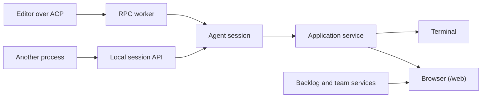
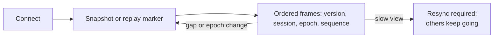

# Terminal, web and the application host

One host process owns execution, permissions and session state. The terminal, `/web`, editors (ACP) and other processes are views: they send commands, but rendering an event never starts a run.



| Part                | Does                                                                         | Never                                 |
| ------------------- | ---------------------------------------------------------------------------- | ------------------------------------- |
| Host                | Runs tools, enforces permissions, keeps transcript, replay, assets, receipts | Trusts a view's claims                |
| Terminal            | Input, rendering, extension components, terminal-only controls               | —                                     |
| Browser             | Renders validated frames; keeps drafts, filters, cursors                     | Executes, authenticates or authorizes |
| Agent loop, AI, TUI | Reusable libraries (loop, providers, widgets)                                | Own backlog or interface policy       |

## The user-level web daemon

One detached page per OS user shows every session on the machine. Each top-level session starts an owner-only attach endpoint; `/web` starts or reuses the daemon. If that fails, `/web` warns and serves a per-session page (closed with its session). `OCTOCODE_WEB_DAEMON_IDLE_MINUTES` sets the idle time before the daemon exits with no tab or session.

```mermaid
sequenceDiagram
  participant S as Session
  participant D as Daemon
  participant T as Browser tab
  S->>S: listen on 127.0.0.1, write attach file (0600) with a token
  T->>D: open page (token in the URL fragment)
  D->>S: attach.hello with token, then application and workspace requests
  S-->>D: frames (execution, permissions and receipts stay in the session)
  D-->>T: one stream per tab; 512 frames behind: one resync
```

| Topic           | Behavior                                                                                                                                                                               |
| --------------- | -------------------------------------------------------------------------------------------------------------------------------------------------------------------------------------- |
| Single instance | Record written only after listening; run lock blocks a second daemon, launch lock serializes launchers; a record is trusted only after an authenticated health check returns its nonce |
| Upgrade         | A launcher of another build makes the daemon drain: hand over, tell tabs, exit when they leave or after 30 s                                                                           |
| Page scope      | One session or one repository (workspace UUID); reports served only while the checkout matches its recorded directory                                                                  |

Writes:

- Board writes need a launch or control token (a view token gets 403) and repaint attached sessions' board counts (`backlog.changed`).
- Setting and provider-key changes need the launch token.

Settings live under `/s/<id>/`; the daemon asks the session for tool declarations (`session.tools`).

Local security:

- Token only in the URL fragment, `Authorization` header or socket hello; never a query string.
- No cookies or CORS; `Host` must be `127.0.0.1:<port>`, `Origin` the daemon's; only the page and health check are tokenless.
- Strict CSP: `default-src 'none'`, hashed scripts, `frame-ancestors 'none'`.
- Owner-only files in a 0700 directory.

### Limits

| Name                     | Value                                                |
| ------------------------ | ---------------------------------------------------- |
| Attach request           | 1 MiB                                                |
| Attach response or event | 32 MiB                                               |
| Image upload             | 20 MiB                                               |
| Asset                    | 32 MiB; 256 MiB per session                          |
| Kept shell output        | 32 MiB                                               |
| Snapshot messages        | 50 within 100 KB                                     |
| Snapshot tools           | 50 within 150 KB                                     |
| Activities               | 50 within 32,768 characters; inline data up to 4,000 |
| Daemon drain             | 30 s                                                 |

`/remote` can publish the daemon to another device: see [remote access](../packages/coding-agent/docs/remote.md).

## What a view receives



| Item            | Behavior                                                                                                                 |
| --------------- | ------------------------------------------------------------------------------------------------------------------------ |
| Snapshot window | Newest 50 messages (100 KB), their tools and later tools (max 50, 150 KB); older from history pages                      |
| Activities      | Max 50 within 32,768 characters; older by cursor `activityBefore`. Data inline up to 4,000 characters, then a JSON asset |
| Waiting for you | `awaiting` (`approval` or `question`) while a run waits on a terminal-only dialog; shown as "Waiting for you"            |
| Context reset   | Replacing context (including tree navigation) resets the transcript and invalidates replay cursors                       |
| Cancel          | Needs the current run id. Closing a view never stops work; a session change invalidates old connections                  |

Session phase (`session.phase`, in the snapshot as `phase`): blocked, working, waiting, resuming, scheduled, stopped, failed, done or idle, with `jobStartedAt` until final.

- Waiting, resuming and scheduled: no run is active but the job goes on.
- Until the phase is final, the terminal keeps tab progress and status `working`; the browser shows what the job waits on.

Shared commands: prompt, steer, follow-up and run-scoped stop; prompt and queue commands can reference uploaded images (image-only input works).

### Command receipts

| Kind                         | States                            | Meaning                                                                                      |
| ---------------------------- | --------------------------------- | -------------------------------------------------------------------------------------------- |
| Application command          | `accepted`, `completed`, `failed` | `completed`: the operation returned (queued steering or follow-up work can still be pending) |
| Workspace team or delegation | `pending`, `accepted`, `failed`   | Accepting a delegation request does not mean a child launched or finished                    |

A durable receipt stops an uncertain request from re-running after reconnect or restart; it is not exactly-once.

## Content, assets and tool display

| Topic            | Behavior                                                                                                                                                                |
| ---------------- | ----------------------------------------------------------------------------------------------------------------------------------------------------------------------- |
| Blocks           | Text, reasoning summaries, images, media, resources, tool calls, explicit "unsupported"; each has a stable id. Context-only messages and system instructions are hidden |
| Binary and large | Opaque session-scoped assets; large text/JSON gets a full-content reference. Images: Kitty/iTerm2 in the terminal, Blob URLs on the web                                 |
| Uploads          | PNG, JPEG, GIF, WebP; assets removed on reset; ids never grant file access                                                                                              |
| Reports          | `/web` reads only indexed reports in the checkout's `.octocode` folders                                                                                                 |
| Failures         | Bounded `application.error` notice; later events continue; oversized content shows "unavailable" (transcript keeps it)                                                  |
| Progress         | Meter in the terminal, progress indicator on the web; a result event replaces the previous result, an arguments-only event keeps it                                     |
| Shell output     | Deltas only; model sees shortened text. An output path never authorizes a read                                                                                          |

Tool display: every tool shows title, summary, meta, reason, outcome and ordered blocks (`text`, `output`, `diff`, `list`, `fields`, `markdown`, `path`). Unknown blocks show their text. Rebuilt from saved arguments and results on resume, so MCP tools with a server down still render. All surfaces share it.

The database behind sessions, backlog, team and memory: [entities](ENTITIES.md#database).
