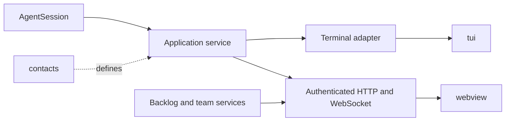

# Terminal and web application boundary

The application host owns execution. Terminal and web consume an application port defined by `packages/contacts` and implemented in `packages/coding-agent/src/core/application`. No additional runtime package is needed: `agent` remains the reusable execution loop, and `tui` remains a generic terminal component library.

## Owners

| Owner | Responsibility |
| --- | --- |
| `packages/contacts` | Serializable application commands, event/frame schemas, cursors, snapshots, receipts, and connection interfaces; existing backlog and workspace contracts. |
| `coding-agent/src/core/application` | One session-event subscription, semantic projection, replay, view lifetimes, and dispatch to existing session operations. |
| `coding-agent/src/octocode/workspace` | Authenticated local transport, team/backlog integration, redaction, and durable command receipts. |
| `coding-agent/src/modes/interactive` | Terminal input, local extension components, and rendering; consumes the application's native event capability. |
| `packages/webview` | Browser transport, validated stream reduction, UI state, and safe rendering. |
| `packages/agent`, `packages/ai` | Execution loop and provider integration. They do not own backlog or interface policy. |
| `packages/tui` | Terminal layout, input, and reusable widgets. It has no application dependency. |

Commands flow back through the adapters. Receiving or rendering an event never starts another engine run. Backlog lifecycle validation, ownership, and transactional audit remain in the existing backlog store.

## Local and serialized capabilities

`contacts` defines `LocalApplicationPort<Event, Operations>` as the in-process extension of the serializable port. The terminal subscribes through `subscribeNative`, preserving complete `AgentSessionEvent` payloads, tool details, attachments, and extension behavior. It invokes session operations through the host's typed `invoke` capability. This capability is local: function callbacks, model instances, and custom renderers are not serialized or exposed to a browser.

The serializable application port exposes `connect`, `execute`, and connection `close`. Its shared command set is prompt, steer, follow-up, and run-scoped abort. The browser consumes semantic message, tool, run, queue, session-status, and receipt events. That projection is deliberately smaller than the native event union. Native parity means shared meaning and one execution authority; it does not mean identical payloads or UI features.

The terminal's migrated operations include prompts and queues; cancellation; model/thinking settings; compaction and retry controls; tree navigation; exports; resource reload; bash execution; and bug-report summarization. The same host dispatcher backs serialized execution and local invocation. Local invocation retains the existing completion/return-value semantics; serialized commands use receipts and later completion events.

Read-only session queries remain local. Extension binding and `waitForIdle` retain their existing extension integration. `AgentSessionRuntime` still owns creating, switching, forking, and importing sessions; the port does not duplicate runtime lifecycle management. The terminal detaches its old subscription on rebind and rejects late events from a previous session.

## Delivery and lifetime

Frames carry protocol version, session ID, epoch, sequence, and timestamp. A connection starts with a snapshot or a valid replay marker. The browser rejects malformed frames, ignores duplicate sequences, and requests a fresh snapshot after a gap or epoch change.

Snapshots include recent messages, tool state, session status, queue previews, and recent receipts. Tool progress can therefore survive a reconnect without replaying the entire session. Queue previews and receipts are bounded separately from the authoritative session and durable receipt store.

The host bounds replay and each view's pending stream. A slow view receives a resynchronization requirement rather than blocking other views or silently losing output. Closing a view removes its delivery resources; it does not abort accepted work. Cancellation requires an explicit command with the current run ID. Session changes invalidate old connections and commands.

Application command receipts distinguish `accepted`, `completed`, and `failed`. Completion means the requested operation returned; for steering and follow-up, queued agent work may still be pending. Workspace team/delegation receipts retain their existing `pending`, `accepted`, and `failed` meanings. These are different contracts: acceptance of a delegation request does not assert that a child agent launched or completed. Durable receipt lookup prevents uncertain requests from being automatically executed again after reconnect or restart. It is not an exactly-once guarantee.

The browser receives redacted, bounded output. Durable failure receipts redact credential-shaped text before storage and return. Permission decisions and terminal-only extension components remain in the host/terminal. A connection's advertised capabilities do not grant permission. The existing local authentication, origin checks, owner validation, and backlog version checks remain authoritative.

## Verification

Tests were written before introducing the port and terminal integration. The first terminal-adapter run failed because the application module was absent; the implemented path then passed the same tests.

| Acceptance | Test owner |
| --- | --- |
| One source subscription, rich event identity, detach without abort, stale-session suppression, prompt callback preservation | `coding-agent/test/interactive-application-port.test.ts` |
| Two views, replay, epoch mismatch, duplicate command rejection, slow-view resync, disposal, stale connections, durable uncertain receipt | `coding-agent/test/application-port.test.ts` |
| Durable restart deduplication, payload conflicts, session/repository isolation, persisted outcomes and credential rejection | `coding-agent/test/octocode/application-commands.test.ts` |
| Browser validation, ordering, deduplication, resync and receipt reconciliation | `webview/test/application-stream.test.ts` |
| Existing terminal rendering, navigation, startup, sharing and bug reports | Interactive-mode, TUI, session-share and bug-report tests |

The terminal regression run passed 105 tests across 14 files under Node 24.15.0. Nine durable-receipt tests also passed. Failing cases exposed session rebinding and application receipts leaking into workspace snapshots; adapters now bind to one session and each receipt view selects its own command family. Canonical fingerprints treat reordered JSON fields as the same command. A failure-output regression verifies redaction in both stored and returned receipts. This is deterministic adapter coverage, not a claim that paid provider execution or every interactive terminal/browser combination has been manually exercised. Final integration checks passed 103 native backlog/workspace tests, 40 application/session tests, 21 browser tests, four contacts tests, and four package-boundary tests. Ten live-provider tree-navigation tests were skipped because no test credentials were configured. Root `npm run check`, contacts/webview builds, browser imports, and bundle freshness passed. A real AgentSession with a deterministic fake provider verified one invocation feeding multiple views, including a browser attaching mid-run. An isolated browser preview verified command submission, streaming/final output, and persistent receipt display. The coding-agent package build and source CLI `--help` smoke check also passed after rebuilding stale TUI declarations. No paid provider was called.

The earlier [interface-port RFC](../.octocode/octocode-rfc-generator/2026-10-22-interface-port/RFC.md) records the decision and migration criteria. This page describes the implemented ownership and explicit compatibility capabilities.
