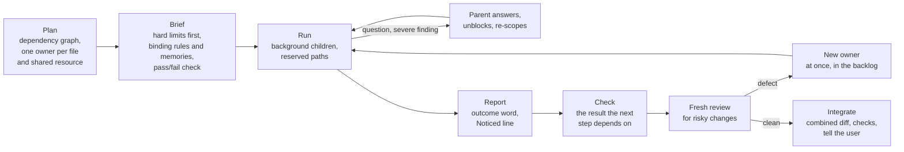
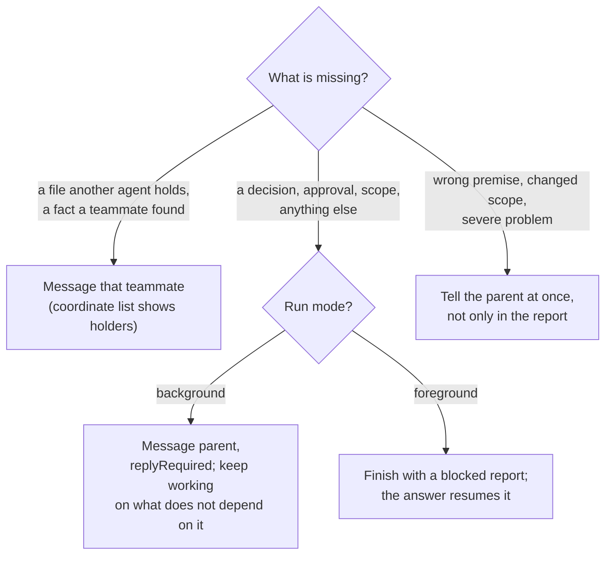

# Orchestration: how a main agent runs subagents

This page explains the flow the prompts teach and where each part lives. The prompts carry a short plain-text version of the same flow (`policy/delegation.md`); the model-facing rules stay in the instruction files linked below, and the mechanics in the [native communication reference](../packages/coding-agent/docs/native-features.md#communication-and-results) and [worker lifecycle](AGENT_COMMUNICATION.md#native-workers-and-team-mail).

## The flow

| Phase  | What the main agent does                                                                                                                                                                                                              | Prompt text                                                                          |
| ------ | ------------------------------------------------------------------------------------------------------------------------------------------------------------------------------------------------------------------------------------- | ------------------------------------------------------------------------------------ |
| Plan   | Delegates only work that needs separate context; runs independent parts in parallel; names one owner per file, interface and shared resource (a build, a generator, a test run); sets a landing order for edits that break each other | `policy/delegation.md`, Decide what to delegate                                      |
| Brief  | Writes a 5W2H task with the hard limits first, copies in every user rule or memory the child must obey, cites a shared brief for several children, and gives a pass/fail command as the Definition of Done                            | `policy/delegation.md`, Write the task                                               |
| Run    | Answers questions at once, gives each confirmed defect an owner as it arrives, keeps ownership in the backlog                                                                                                                         | `policy/delegation.md`, Manage running children                                      |
| Report | Reads the `Noticed` line first, treats the report as a claim and checks what the next step depends on                                                                                                                                 | `policy/delegation.md`, Use its report; the child's contract in `subagent/report.md` |
| Review | Has a fresh reviewer check a risky change: the child that made it does not sign it off                                                                                                                                                | `policy/delegation.md`, `roles/reviewer.md`                                          |
| Tell   | Tells the user unasked about rule breaks, data sent outside and its own wrong claims; while work it started is open, ends each reply with a status table (agent or job, task, state, blocker) and a TL;DR                             | `policy/communication.md`                                                            |

## Who can help: the child's side

A child cannot ask the user. Stuck, missing an input or access, or about to retry an approach that failed twice, it asks whoever can settle it instead of guessing or looping:

The rule is `shared/ask-parent.md`, included in every child policy that has the `agent` tool. Children that edit a shared tree also keep it building with its tests, fix a break they caused first, and back off from a busy lock instead of retrying in a loop (`policy/subagent.md`).

The [check-in](../packages/coding-agent/docs/native-features.md#subagent-check-in) asks the same question of a working child that has exchanged no message with its parent for `subagents.checkInSeconds` (default 300): stuck, missing something, repeating a failing approach, or holding a finding the parent should not wait for. It joins a request the child was about to make, so it never wakes an idle child and costs the parent nothing.

## Memory and subagents

| Source                        | Main session                                                    | Subagent                              |
| ----------------------------- | --------------------------------------------------------------- | ------------------------------------- |
| `AGENTS.md` and project files | In the prompt                                                   | In the prompt                         |
| Pinned memories               | Injected before each prompt, within the pinned budget           | Not injected                          |
| Relevant memories             | Up to five, matched to the prompt                               | Up to three, matched to its goal      |
| Saving                        | Allowed (global and pinned changes keep their permission check) | Read-only: proposals go in its report |

The budgets are in [automatic recall](../packages/coding-agent/docs/memory.md#user-commands-and-automatic-recall). Three consequences, each a rule in the prompts:

- A rule that must bind a child goes in its task: the parent copies it in (`policy/delegation.md`).
- A memory's title is the rule itself, not a pointer, since recall can cut the body; a rule for everyone working in the repository belongs in `AGENTS.md`, which reaches every agent and is versioned (`tools/archive/memory-guidelines.md`).
- A recalled memory is a lead: check the file, function or flag it names before relying on it.
