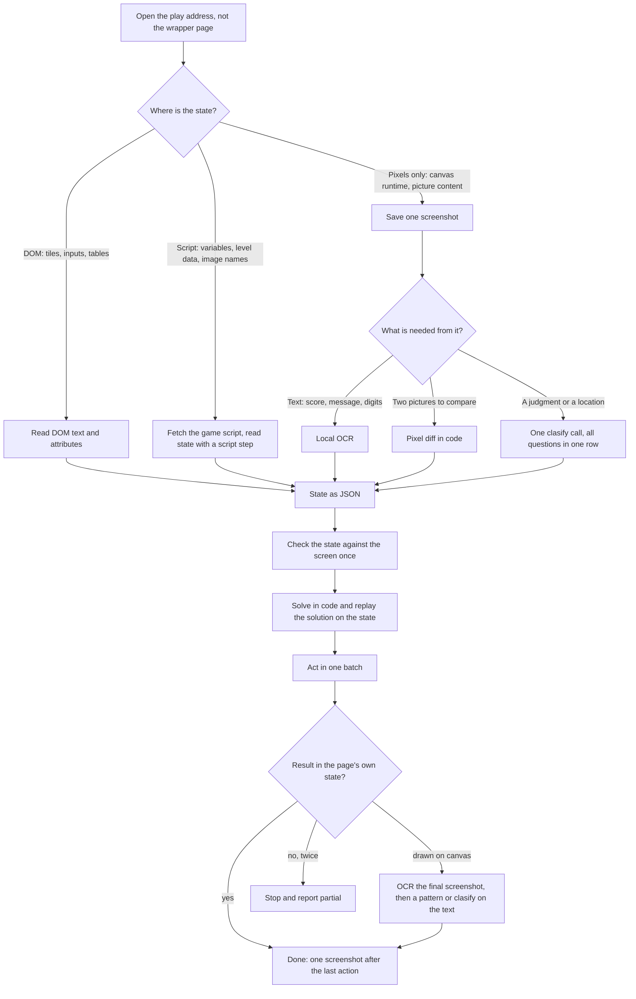

# Puzzles for browser-agent practice

Public, login-free web puzzles used to exercise the browser lane end to end: read a page, extract its state, solve in code, act, and prove the result. Each entry names the address to open and the surface the puzzle is drawn on, because the surface decides where the state can be read.

Do not use a puzzle that sits behind a CAPTCHA, login, paywall or consent wall: report it `blocked`.

## How to solve one

The thinking model is five questions, answered in order. Skip none; each one is cheap, and a wrong answer to an early one wastes every later step.

| Step    | Question                              | Rule                                                                                                                                                    |
| ------- | ------------------------------------- | ------------------------------------------------------------------------------------------------------------------------------------------------------- |
| Surface | Where does the puzzle keep its state? | Open the play address directly. Take the first that holds the answer: DOM, then script state, then pixels.                                              |
| State   | What is the state, as data?           | One JSON value: the grid, the tile order, the target coordinates. Extraction is where solvers fail, so check it once against the screen before solving. |
| Solver  | Which known algorithm fits?           | Pick from the table below and write it as a short script. Do not reason move by move.                                                                   |
| Act     | What is the whole move list?          | Replay the solution on the extracted state first, then send every step in one plan, by ref or by a computed position.                                   |
| Verify  | What does the page say now?           | The page's own state or message. A reply to a click proves nothing; text drawn on a canvas needs OCR.                                                   |

### Reading pixels, cheapest first

| Need                                            | Tool                                             | Notes                                                                                                                                                             |
| ----------------------------------------------- | ------------------------------------------------ | ----------------------------------------------------------------------------------------------------------------------------------------------------------------- |
| Text in a picture (win message, score, digits)  | Local OCR on the saved screenshot                | Runs locally and spends no model tokens. Symbols can be misread: treat the text as a candidate and check it with a pattern.                                       |
| Meaning of that text                            | `clasify` with the saved text file as its source | A fraction of the cost of judging the image.                                                                                                                      |
| Difference between two pictures                 | Pixel diff in a script                           | Exact and free. A vision model is the wrong tool for a comparison code can do.                                                                                    |
| A judgment or a location only the picture holds | `clasify` over the image file                    | Put every question about one image in one row: they share one read of it. Pair a `box` question with a presence question, and zoom and ask again before clicking. |

Word each `clasify` question as one standalone fact that says what counts and names the near miss: "the screen shows a message that the round was completed, not only a Start, Next or Try again button". Act on clear answers, re-ask or crop on middling ones, and confirm any result that matters from text or the page's own state.

Saved captures are files. Search them with `localSearch` and read one span with `localFetch`; when too many captures remain to read, ask `clasify` which ones hold the answer and read only those.

### Solvers by puzzle kind

| Kind                                | State to extract                                | Solver                                                                                |
| ----------------------------------- | ----------------------------------------------- | ------------------------------------------------------------------------------------- |
| Sliding tiles                       | Tile order and the blank                        | IDA* with Manhattan distance; check parity first, an odd permutation is unsolvable    |
| Rotate a 2x2 block (Twirl, Twiddle) | Tile order                                      | Breadth-first search on small boards; place tiles row by row on larger ones           |
| Sudoku, Wordoku, Calcudoku, Keen    | Givens and cages                                | Constraint propagation with backtracking                                              |
| Code breaking (PIN, Mastermind)     | Guess history and feedback                      | Keep every code consistent with the feedback; guess the one that splits the rest best |
| Word search                         | Letter grid and word list                       | Scan eight directions from each cell                                                  |
| Anagrams, word find                 | Letters and a dictionary                        | Sorted-letter lookup; the dictionary is often in the game's script                    |
| Spot the difference                 | The two image files                             | Pixel diff, then cluster changed regions into click points                            |
| Hidden object                       | Target position in level data, else the picture | Read the level data; only when absent, a `clasify` `box` question                     |
| Minesweeper                         | Revealed numbers                                | Constraint solving on the frontier; guess the lowest-risk cell only when forced       |
| Towers of Hanoi                     | Peg contents                                    | The recursive solution, emitted as a move list                                        |
| Lights out, Flip                    | On and off cells                                | Linear algebra over two values (Gaussian elimination)                                 |
| Memory pairs                        | Card identities in the DOM or script            | Read them; no memory needed                                                           |
| Sequence recall (Simon)             | The sequence in script state                    | Read it, then replay with waits on the page's own ready signal                        |

Timed puzzles: extract and solve before the timer starts where the page allows, then act in one batch. Puzzles that score reaction time measure the transport, not the agent; they are listed for completeness only.

## Catalogue

Surface key: **DOM** (tiles and inputs are elements), **Canvas + script** (drawn on a canvas, state held in readable script variables), **Canvas runtime** (a packaged game engine; state is hard to reach, expect pixels).

### IQ Test Labs: puzzles

| Puzzle                    | Play address                                                                                          | Surface         | Notes                                              |
| ------------------------- | ----------------------------------------------------------------------------------------------------- | --------------- | -------------------------------------------------- |
| Find the Pug              | https://www.intelligencetest.com/puzzles/picture-puzzles/find-the-pug/find-the-pug.html               | Canvas + script | Tried. Result text is on the canvas: verify by OCR |
| Spot the Difference       | https://www.intelligencetest.com/puzzles/picture-puzzles/spot-the-difference/spot-the-difference.html | Canvas + script | Tried. Level data is a separate script file        |
| Twirl (pictures)          | https://www.intelligencetest.com/puzzles/picture-puzzles/twirl/twirl-pictures.html                    | DOM             | Tried. Tile order is in the elements               |
| Twirl (numbers)           | https://www.intelligencetest.com/puzzles/math-puzzles/twirl/twirl.html                                | DOM             | Same engine as the picture version                 |
| Sliding puzzle (pictures) | https://www.intelligencetest.com/puzzles/picture-puzzles/sliding-puzzle/game-of-fifteen.html          | DOM             |                                                    |
| Sliding puzzle (numbers)  | https://www.intelligencetest.com/puzzles/math-puzzles/sliding-puzzle/shuffle_puzzle_classic.html      | DOM             |                                                    |
| PIN cracker               | https://www.intelligencetest.com/puzzles/logic-puzzles/pin-cracker/pin-cracker.html                   | Canvas + script | Timed; feedback after each guess                   |
| Sudoku                    | https://www.intelligencetest.com/puzzles/logic-puzzles/sudoku/sudoku.html                             | Canvas runtime  | Givens must be read from pixels                    |
| Calcudoku                 | https://www.intelligencetest.com/puzzles/math-puzzles/calcudoku/calcudoku.html                        | DOM             | Grid is a table                                    |
| Solve Math                | https://www.intelligencetest.com/puzzles/math-puzzles/solvemath/solvemath.html                        | Canvas + script | Timed arithmetic                                   |
| Word find                 | https://www.intelligencetest.com/puzzles/word-puzzles/word-find/wordfind.html                         | DOM             | Letters are draggable elements                     |
| Word scramble             | https://www.intelligencetest.com/puzzles/word-puzzles/word-scramble/wordscramble.html                 | DOM             | Letters are draggable elements                     |
| Word search               | https://www.intelligencetest.com/puzzles/word-puzzles/word-search/index.html                          | Canvas + script | Played on the page itself, no inner frame          |
| Wordoku                   | https://www.intelligencetest.com/puzzles/word-puzzles/wordoku/index.html                              | Canvas + script | Played on the page itself, no inner frame          |

### IQ Test Labs: mind games

| Puzzle                       | Play address                                                     | Surface |
| ---------------------------- | ---------------------------------------------------------------- | ------- |
| Concentration (memory pairs) | https://www.intelligencetest.com/mind-games/concentration.html   | DOM     |
| Word Mastermind              | https://www.intelligencetest.com/mind-games/mastermind.html      | DOM     |
| Minesweeper                  | https://www.intelligencetest.com/mind-games/minesweeper.html     | DOM     |
| Simon says                   | https://www.intelligencetest.com/mind-games/simon-says.html      | DOM     |
| Towers of Hanoi              | https://www.intelligencetest.com/mind-games/towers-of-hanoi.html | DOM     |

Text and picture brainteasers with a revealed answer (no interaction, good for reading and judging): https://www.intelligencetest.com/brainteasers/index.html. Reaction-time tests (completeness only): https://www.intelligencetest.com/reaction-time/index.html.

### Simon Tatham's Portable Puzzle Collection

Every puzzle draws on one canvas and takes keyboard input, and each page can load a game from an ID in its address, which makes runs repeatable. Address pattern: `https://www.chiark.greenend.org.uk/~sgtatham/puzzles/js/<name>.html`.

| Kind                    | Names                                                                                                                      |
| ----------------------- | -------------------------------------------------------------------------------------------------------------------------- |
| Rearrangement           | `fifteen`, `sixteen`, `twiddle`, `netslide`, `cube`, `flip`, `pegs`, `samegame`, `flood`, `inertia`, `untangle`            |
| Number and Latin square | `solo`, `keen`, `towers`, `unequal`, `singles`, `filling`, `range`, `signpost`, `dominosa`                                 |
| Grid deduction          | `mines`, `lightup`, `pattern`, `tents`, `unruly`, `mosaic`, `magnets`, `undead`, `bridges`, `rect`, `palisade`, `galaxies` |
| Loops and paths         | `loopy`, `slant`, `pearl`, `tracks`, `net`, `map`                                                                          |
| Guessing                | `guess`, `blackbox`                                                                                                        |

Index: https://www.chiark.greenend.org.uk/~sgtatham/puzzles/

### More sources (not yet tried)

| Source               | Address                                            | Why                                                                |
| -------------------- | -------------------------------------------------- | ------------------------------------------------------------------ |
| 2048                 | https://play2048.co/                               | Simple grid state, long move sequences                             |
| Puzzle Sudoku        | https://www.puzzle-sudoku.com/                     | Sudoku with selectable sizes                                       |
| Puzzle Light Up      | https://www.puzzle-light-up.com/                   | Same family, a different deduction puzzle per site                 |
| Puzzle Nonograms     | https://www.puzzle-nonograms.com/                  | Clues as text, grid as cells                                       |
| Sudoku solver board  | https://www.sudokuwiki.org/sudoku.htm              | Input cells are form fields                                        |
| Tower of Hanoi       | https://www.mathsisfun.com/games/towerofhanoi.html | Drag interaction                                                   |
| Maths Is Fun puzzles | https://www.mathsisfun.com/puzzles/                | Text puzzles with revealed answers                                 |
| WebGames             | https://webgames.convergence.ai/                   | A published suite of small browser challenges built to test agents |

Before adding an entry: open it once, confirm it needs no login or bot check, and record its play address and surface.

## Why this order

- Turning the picture into an executable state and then running a program on it is the approach with the strongest published results for visual puzzles ([Vis2State](https://arxiv.org/pdf/2611.07397)).
- The usual failure is extracting the constraints, not reasoning over them ([TopoBench](https://arxiv.org/pdf/2603.12133), [VisReason](https://arxiv.org/pdf/2605.25364)); hence the single check of state against the screen.
- Generated solvers are not automatically right ([PuzzlePlex](https://arxiv.org/html/2510.06475v1)); hence replaying the solution on the state before acting.
- Browser agents finish turn-based puzzles well and fail games that need timing ([Atlas in web games](https://arxiv.org/html/2510.26298v1)); hence reaction tests are out of scope.
