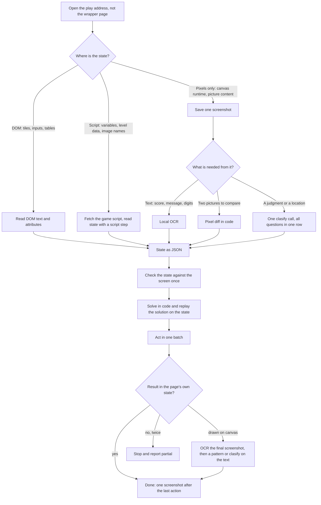

# Puzzles for browser-agent practice

Public, login-free puzzles for exercising the browser lane: read a page, extract state, solve in code, act, prove the result. Each entry gives its address and drawing surface, which decides where state can be read.

A puzzle behind a CAPTCHA, login, paywall or consent wall: report `blocked`.

## How to solve one

Answer five questions in order; a wrong early answer wastes every later step.

| Step    | Question                     | Rule                                                                                                                            |
| ------- | ---------------------------- | ------------------------------------------------------------------------------------------------------------------------------- |
| Surface | Where is the state?          | Open the play address directly; take the first that holds the answer: DOM, script state, pixels                                 |
| State   | What is it as data?          | One JSON value (grid, tile order, target coordinates); check it once against the screen, since extraction is where solvers fail |
| Solver  | Which known algorithm?       | Pick from the table below; write a short script, not move-by-move reasoning                                                     |
| Act     | What is the whole move list? | Replay it on the extracted state, then send every step in one plan, by ref or computed position                                 |
| Verify  | What does the page say now?  | Its own state or message; a click reply proves nothing; canvas text needs OCR                                                   |

### Reading pixels, cheapest first

| Need                                        | Tool                              | Notes                                                                                                          |
| ------------------------------------------- | --------------------------------- | -------------------------------------------------------------------------------------------------------------- |
| Text in a picture                           | Local OCR on the saved screenshot | No model tokens; symbols can be misread, so check the text with a pattern                                      |
| Meaning of that text                        | `clasify` on the saved text file  | Far cheaper than judging the image                                                                             |
| Difference of two pictures                  | Pixel diff in a script            | Exact and free                                                                                                 |
| Judgment or location only the picture holds | `clasify` on the image file       | One row for all questions about an image; pair `box` with a presence question; zoom and re-ask before clicking |

Word each `clasify` question as one standalone fact that names the near miss: "the screen shows a message that the round was completed, not only a Start, Next or Try again button". Act on clear answers, re-ask or crop on middling ones, and confirm important results from text or page state.

Saved captures are files: `localSearch` them, read a span with `localFetch`, or ask `clasify` which hold the answer.

### Solvers by puzzle kind

| Kind                                | State to extract                                | Solver                                                                                |
| ----------------------------------- | ----------------------------------------------- | ------------------------------------------------------------------------------------- |
| Sliding tiles                       | Tile order and the blank                        | IDA* with Manhattan distance; check parity first, an odd permutation is unsolvable    |
| Rotate a 2x2 block (Twirl, Twiddle) | Tile order                                      | Breadth-first search on small boards; place tiles row by row on larger ones           |
| Sudoku, Wordoku, Calcudoku, Keen    | Givens and cages                                | Constraint propagation with backtracking                                              |
| Code breaking (PIN, Mastermind)     | Guess history and feedback                      | Keep every code consistent with the feedback; guess the one that splits the rest best |
| Word search                         | Letter grid and word list                       | Scan eight directions from each cell                                                  |
| Anagrams, word find                 | Letters and a dictionary                        | Sorted-letter lookup; the dictionary is often in the game's script                    |
| Spot the difference                 | The two image files                             | Pixel diff, then cluster changed regions into click points                            |
| Hidden object                       | Target position in level data, else the picture | Read the level data; only when absent, a `clasify` `box` question                     |
| Minesweeper                         | Revealed numbers                                | Constraint solving on the frontier; guess the lowest-risk cell only when forced       |
| Towers of Hanoi                     | Peg contents                                    | The recursive solution, emitted as a move list                                        |
| Lights out, Flip                    | On and off cells                                | Linear algebra over two values (Gaussian elimination)                                 |
| Memory pairs                        | Card identities in the DOM or script            | Read them; no memory needed                                                           |
| Sequence recall (Simon)             | The sequence in script state                    | Read it, then replay with waits on the page's own ready signal                        |

Timed puzzles: extract and solve before the timer starts where the page allows, then act in one batch. Puzzles that score reaction time measure the transport, not the agent; they are listed for completeness only.

## Catalogue

Surface: **DOM** (tiles and inputs are elements), **Canvas + script** (canvas drawing, state in readable script variables), **Canvas runtime** (packaged engine; expect pixels).

### IQ Test Labs: puzzles

Play address: `https://www.intelligencetest.com/puzzles/` + path.

| Puzzle              | Path                                                           | Surface         | Notes                                       |
| ------------------- | -------------------------------------------------------------- | --------------- | ------------------------------------------- |
| Find the Pug        | `picture-puzzles/find-the-pug/find-the-pug.html`               | Canvas + script | Tried; result text on canvas, verify by OCR |
| Spot the Difference | `picture-puzzles/spot-the-difference/spot-the-difference.html` | Canvas + script | Tried; level data in a separate script file |
| Twirl (pictures)    | `picture-puzzles/twirl/twirl-pictures.html`                    | DOM             | Tried; tile order in elements               |
| Twirl (numbers)     | `math-puzzles/twirl/twirl.html`                                | DOM             | Same engine as pictures                     |
| Sliding (pictures)  | `picture-puzzles/sliding-puzzle/game-of-fifteen.html`          | DOM             |                                             |
| Sliding (numbers)   | `math-puzzles/sliding-puzzle/shuffle_puzzle_classic.html`      | DOM             |                                             |
| PIN cracker         | `logic-puzzles/pin-cracker/pin-cracker.html`                   | Canvas + script | Timed; feedback per guess                   |
| Sudoku              | `logic-puzzles/sudoku/sudoku.html`                             | Canvas runtime  | Givens from pixels                          |
| Calcudoku           | `math-puzzles/calcudoku/calcudoku.html`                        | DOM             | Grid is a table                             |
| Solve Math          | `math-puzzles/solvemath/solvemath.html`                        | Canvas + script | Timed arithmetic                            |
| Word find           | `word-puzzles/word-find/wordfind.html`                         | DOM             | Draggable letters                           |
| Word scramble       | `word-puzzles/word-scramble/wordscramble.html`                 | DOM             | Draggable letters                           |
| Word search         | `word-puzzles/word-search/index.html`                          | Canvas + script | No inner frame                              |
| Wordoku             | `word-puzzles/wordoku/index.html`                              | Canvas + script | No inner frame                              |

### IQ Test Labs: mind games

All DOM. Play address: `https://www.intelligencetest.com/mind-games/` + `concentration.html` (memory pairs), `mastermind.html` (Word Mastermind), `minesweeper.html`, `simon-says.html`, `towers-of-hanoi.html`.

Revealed-answer brainteasers (read and judge only): https://www.intelligencetest.com/brainteasers/index.html. Reaction-time tests (completeness only): https://www.intelligencetest.com/reaction-time/index.html.

### Simon Tatham's Portable Puzzle Collection

One canvas and keyboard input per puzzle; a game ID in the address makes runs repeatable. Address pattern: `https://www.chiark.greenend.org.uk/~sgtatham/puzzles/js/<name>.html`.

| Kind                    | Names                                                                                                                      |
| ----------------------- | -------------------------------------------------------------------------------------------------------------------------- |
| Rearrangement           | `fifteen`, `sixteen`, `twiddle`, `netslide`, `cube`, `flip`, `pegs`, `samegame`, `flood`, `inertia`, `untangle`            |
| Number and Latin square | `solo`, `keen`, `towers`, `unequal`, `singles`, `filling`, `range`, `signpost`, `dominosa`                                 |
| Grid deduction          | `mines`, `lightup`, `pattern`, `tents`, `unruly`, `mosaic`, `magnets`, `undead`, `bridges`, `rect`, `palisade`, `galaxies` |
| Loops and paths         | `loopy`, `slant`, `pearl`, `tracks`, `net`, `map`                                                                          |
| Guessing                | `guess`, `blackbox`                                                                                                        |

Index: https://www.chiark.greenend.org.uk/~sgtatham/puzzles/

### More sources (not yet tried)

[2048](https://play2048.co/), [Puzzle Sudoku](https://www.puzzle-sudoku.com/), [Puzzle Light Up](https://www.puzzle-light-up.com/), [Puzzle Nonograms](https://www.puzzle-nonograms.com/), [Sudoku solver board](https://www.sudokuwiki.org/sudoku.htm), [Tower of Hanoi](https://www.mathsisfun.com/games/towerofhanoi.html), [Maths Is Fun puzzles](https://www.mathsisfun.com/puzzles/), and [WebGames](https://webgames.convergence.ai/), a published suite of small browser challenges built to test agents.

Before adding an entry: open it once, confirm it needs no login or bot check, and record its play address and surface.

## Why this order

- State as an executable program is the strongest published approach for visual puzzles ([Vis2State](https://arxiv.org/pdf/2611.07397)).
- Failures come from extracting constraints, not reasoning ([TopoBench](https://arxiv.org/pdf/2603.12133), [VisReason](https://arxiv.org/pdf/2605.25364)): check state against the screen once.
- Generated solvers can be wrong ([PuzzlePlex](https://arxiv.org/html/2510.06475v1)): replay before acting.
- Browser agents solve turn-based puzzles but fail timing games ([Atlas](https://arxiv.org/html/2510.26298v1)): reaction tests are out of scope.
