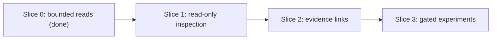
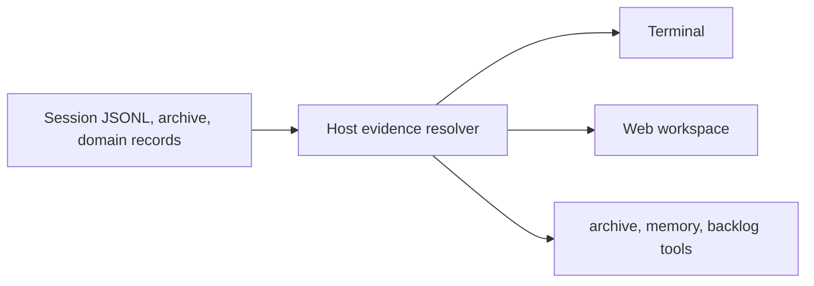
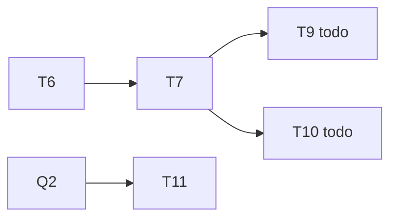

# RFC: Inspectable agent context and evidence

Let people and agents open the evidence behind a checkpoint, recalled note, child report or backlog completion, using the session records, archive index, Profiler and shell receipts Octocode already has. Ship in slices: fix the measured read-path defects (Slice 0), add read-only inspection, then link evidence to decisions. No slice adds automatic model calls, routine prompt bytes or runtime dependencies. Background summaries, semantic retrieval, cache scheduling and lean child handoffs stay gated experiments.

## Summary

- **Decision.** Build on-demand evidence reads over existing owners (session codec, archive, memory, backlog, Profiler) and surfaces (`archive`, `memory` and `backlog` tools, terminal commands, web workspace). Add no store, transport or index service.
- **Effect.** A reader goes from a visible row to its saved original in one bounded read; recall and archive search read only their scope; the inbox keeps its byte bound on every path.
- **Why now.** The audit found five verified defects on hot read paths (F1), each a small, separately revertible change.
- **Provisional.** F3–F6 are direction, not settled interfaces.

## Glossary

| Term            | Meaning                                                                                          | Where                                                                                                         |
| --------------- | ------------------------------------------------------------------------------------------------ | ------------------------------------------------------------------------------------------------------------- |
| Archive segment | Messages one compaction removed, one file per compaction                                         | `sessionOutputDir("archive")`, [history/archive.ts](../packages/coding-agent/src/octocode/history/archive.ts) |
| Archive index   | Disposable FTS5 index over archive passages                                                      | `archive-index.db`, [queries/archive-index.ts](../packages/db/src/queries/archive-index.ts)                   |
| Mirrored note   | Note stored as a `MEMORY.md` line and a `memories` row                                           | [memory/file/sync.ts](../packages/coding-agent/src/octocode/memory/file/sync.ts)                              |
| Member scan     | Recall's skip of notes already a `MEMORY.md` line in the prompt                                  | `fileMemberIds` in `memory/file/sync.ts`                                                                      |
| Shell receipt   | Opt-in result of a `bash` call (`verify: true`): session, mutation epoch, exit status, staleness | [files/bash/verification.ts](../packages/coding-agent/src/octocode/files/bash/verification.ts)                |
| Source anchor   | Typed, owner-scoped locator (record kind plus stable id) a reader can expand                     | F3                                                                                                            |

## Problem and context

No path leads from what a reader sees to the evidence behind it, and several read paths do more work than their scope needs.

| Area            | Gap                                                                                                                                                                                                                                                                                                                                                                                                                      |
| --------------- | ------------------------------------------------------------------------------------------------------------------------------------------------------------------------------------------------------------------------------------------------------------------------------------------------------------------------------------------------------------------------------------------------------------------------ |
| Archive         | Humans cannot search; `/archive <n>` prints only a path ([command.ts:19-25](../packages/coding-agent/src/octocode/archive/command.ts#L19)). Entries are matched by object identity, then a `role\|timestamp\|toolCallId\|customType` key, not entry id ([render.ts:86-103](../packages/coding-agent/src/octocode/compaction/archive/render.ts#L86)), so clones can collide. Scoped search fetched global term rows (F1). |
| Memory          | No line records its supporting correction or report. `MEMORY.md` lines cap at 200 characters ([format.ts:27-51](../packages/coding-agent/src/octocode/memory/file/format.ts#L27)). The member scan read only the newest 500 rows (F1).                                                                                                                                                                                   |
| Backlog         | A completion is text only: `CompletionSchema` has no receipt, session or epoch ([backlogs.ts:102-124](../packages/contracts/src/backlogs.ts#L102)); QA never sees a receipt. Each turn materializes every unfinished item (F1).                                                                                                                                                                                          |
| Team inbox      | Batches cap at 32 rows and 32 KiB, but retries bypassed the byte cap: 32 messages of 2,000 B made one 68,472 B batch (F1).                                                                                                                                                                                                                                                                                               |
| Instructions    | Context files load at 64 KiB each, no total cap ([context-files.ts:40](../packages/coding-agent/src/core/resource-loader/context-files.ts#L40)); a reader cannot see which sources were loaded, withheld or inferred.                                                                                                                                                                                                    |
| Request profile | Layers join messages by index when counts match ([layers.ts:157-162](../packages/coding-agent/src/octocode/profiler/layers.ts#L157)); a reordering hook mislabels silently.                                                                                                                                                                                                                                              |
| Rendering       | Display ids and Profiler row positions are not durable links; the transcript window holds 50 messages and 50 tools ([transcript-history.ts:7-10](../packages/coding-agent/src/core/application/transcript-history.ts#L7)). Custom messages can be model-only, transcript-only or both ([selectors.ts:8-14](../packages/projections/src/selectors.ts#L8)).                                                                |

**Cost of inaction.** Recall re-injects notes already in the prompt past 500 notes; inbox retries can exceed the context budget; archive search grows with every unrelated session; users trust summaries they cannot open.

## Goals and scope

- Slice 0 keeps current results (archive ranking oracle, memory visibility, backlog delivery, completion semantics) and reduces or holds rows read.
- One scripted recording resolves to the same authorized source in tool, CLI, terminal UI and web (Slice 1).
- Inspection never starts a turn, changes permissions or writes to the prompt.
- **Out of scope:** extra stores or vector services, QA or retention changes, paid calls, cache scheduling (B96–B105), the event-loop rewrite (B32).

## Features

| ID  | Consumer        | Before → after                                                                                                        | Example                                                          | Priority | Accepted by |
| --- | --------------- | --------------------------------------------------------------------------------------------------------------------- | ---------------------------------------------------------------- | -------- | ----------- |
| F1  | Agent, operator | Read paths scale with scope; inbox retries stay within 32 KiB                                                         | 600 notes, oldest mirrored → skipped, not re-injected            | High     | V1–V4       |
| F2  | User            | `/archive search <words>` lists ranked scoped hits                                                                    | `/archive search spawn EPERM` → segment, time, excerpt           | High     | V5          |
| F3  | User, agent     | A checkpoint row, archive hit or child report opens its recorded message by source anchor                             | Decision in checkpoint 4 → original user message, branch, author | Medium   | V6          |
| F4  | User, operator  | `/context all` and the web Profiler show **Last request** and **Current context estimate** with link status per layer | Reordered layer → `inferred`                                     | Medium   | V7          |
| F5  | User, agent     | A recalled note shows scope, revision, reason and recorded source                                                     | `/memory last` → `pinned · from a correction in session X`       | Low      | V8          |
| F6  | User, QA        | A completion shows **Recorded check**, **Reported**, **Skipped** or **Stale** and opens its receipt                   | `done` + receipt → `Recorded check`                              | Low      | V9          |

## Proposed design

### Slice 0: bounded read paths (F1, F2), done

Each fix lives in its owner with no contract change.

| Fix                                                                                                                                                | Outcome                                                               |
| -------------------------------------------------------------------------------------------------------------------------------------------------- | --------------------------------------------------------------------- |
| Inbox retry uses the bounded batch selection (B125, `team/inbox.ts`)                                                                               | A lone oversized message still goes alone; test fails on old retry    |
| Scope-wide `id, title` member query; JS `normalizeTitle` kept because SQLite `lower()` is ASCII-only (B126)                                        | 600-note test fails with the 500-row scan, passes after               |
| Scoped term counts in SQL, no query for an empty scope (B127)                                                                                      | Ranking oracle unchanged; no `passages` scan                          |
| Cursor-only peer read, one task line per turn (B128); not gated on `dbStamp` (mtime and size only, [db.ts:264-271](../packages/db/src/db.ts#L264)) | Cursor read 0.015–0.53 ms vs snapshot 0.10–35.7 ms at 10–10,000 items |
| `/archive search <words>` (B127)                                                                                                                   | Calls the `archive` tool's scoped search; bounded page                |
| Projection lookup built once per update (B132)                                                                                                     | At 300 flat tools: 181,200 index reads → under 3,600                  |
| Archive ranking falls back to the scan when full-text tables are missing (B130)                                                                    | Dropped-tables test                                                   |
| Inbox late rows read through a 256-row window; memory candidate scan has a tested 600-note bound (B131)                                            | Bounded                                                               |

### Slice 1: read-only inspection (F3, F4)

- **Source anchors.** A record kind plus the owner's stable locator. Transcript ranges use persisted session and entry ids under a validated branch tip or compaction id. Compaction carries `sourceEntry.id` into the archive capture. Legacy role-and-timestamp matches never become authoritative links.
- **Resolution.** Verify membership, range order and boundary first. Access follows the caller's workspace, session, role and fork lineage. A foreign or unverifiable anchor returns neutral missing, never another session's data or the current leaf. Reads have byte and page limits and cancellation; text carries authorship, availability (`present`, `missing`, `expired`) and redaction status. Cursors bind to the authorized query, branch and result generation.
- **Views.** Historical inspection shows text as recorded; context inspection follows the branch's edits, removals and compaction. Deletion and retention apply to both.
- **Attribution.** Structure is `observed`, `estimated` or `unavailable`; source link is `linked`, `inferred` or `unavailable`. Equal counts, timestamps or similarity never prove a link; identity comes from the conversion seam (B129). Token counts stay estimates. Raw provider bodies and hidden reasoning stay out.
- **Ownership.** `core/session-manager` writes optional anchor fields through the codec on successful compaction. `core/application` assembles the read model through host ports. Domain owners supply scoped readers. `contracts` adds TypeBox schemas additively (reusing `WorkLink`); `projections` stays host-free; terminal UI and webview reuse their detail views.
- **Trust.** Recovered text keeps its authority: an archive quote never grants permissions. A link is a locator, not a capability. Opening a drawer never starts a turn.

### Slice 2: link evidence to decisions (F5, F6)

- **Memory provenance.** Link a note's id and revision to bounded source anchors, author category and confirmation time in the durable database, never the archive index. `MEMORY.md` stays compact and hand-editable. A file-plus-database write records a pending operation keyed by revision and digests, applies the locked atomic file update, then finalizes. Only finalized links whose content still matches are exposed; reconcile idempotently; hand-written lines stay unlinked.
- **Verification links.** A completion or step can cite a shell receipt, QA result or attributed manual check, bound to the goal version or step id and version. An exit code proves the command outcome, not criterion coverage. Mutation epochs see edits in one session only; after restarts, later edits or a worktree mismatch the indicator says `Stale` or unknown.

### Slice 3: gated experiments

Each needs one predeclared primary outcome and allowed regressions, and stays off when inconclusive.

- **Cache scheduling.** Owned by B96–B105. A change to [sibling stagger](../packages/coding-agent/src/octocode/subagents/stagger.ts) needs observed cache reads and writes on the same route.
- **Long-session memory.** Compare archive expansion and exact search first. Only if old corrections are still missed, shadow an age-tiered index with literal identifiers, provenance and supersession, no foreground wait, background inferences counted.
- **Semantic search.** Lexical and embedding candidates share one scoped corpus and the exact resolver; local first, versioned by model and content hash; deletion consistency checked.
- **Subagent handoff.** Keep [full-context forks](../packages/coding-agent/src/octocode/subagents/context-fork.ts). Test an opt-in handoff of goal, constraints and anchors for input size, latency, correctness and privacy.

## Decisions and reasoning

| Decision                                                                      | Evidence and reasoning                                                                                                                                                                                                                                                                                                                                                                                               | Rejected                                                            | Reverses if                                                   |
| ----------------------------------------------------------------------------- | -------------------------------------------------------------------------------------------------------------------------------------------------------------------------------------------------------------------------------------------------------------------------------------------------------------------------------------------------------------------------------------------------------------------- | ------------------------------------------------------------------- | ------------------------------------------------------------- |
| D1: Reuse JSONL, SQLite and FTS5; add no store                                | The codec and both databases own identity, retention and deletion; the probe shows the gap is row transfer, not engine limits; a second store is a second authority                                                                                                                                                                                                                                                  | Document or vector service; `sqlite-vec` (native packaging, pre-v1) | A labelled corpus shows semantic misses after lexical repairs |
| D2: Fix Slice 0 before inspection                                             | Five defects, each local with a test seam; inspection surfaces these paths                                                                                                                                                                                                                                                                                                                                           | Bundling into Slice 1 (larger, harder to revert)                    | Never                                                         |
| D3: Summaries, semantic search, cache scheduling and handoff stay experiments | No measurement shows exact search or full forks failing; UniiChat's 95% cache figure is simulated character share and lets a foreground turn wait ([Memory.ts:140-149](https://github.com/VictorTaelin/uniichat/blob/0500bf6a8ea4bf0ce047488562022b1b6532cc30/Memory.ts#L140-L149), [Server.ts:529-558](https://github.com/VictorTaelin/uniichat/blob/0500bf6a8ea4bf0ce047488562022b1b6532cc30/Server.ts#L529-L558)) | Shipping them now                                                   | Slice 1 checks show agents still miss old corrections         |
| D4: Rewrite the projection lookup once per update                             | Quadratic cost is real; the reuse check never matched window-built snapshots                                                                                                                                                                                                                                                                                                                                         | Defer                                                               | Never                                                         |

## Risks and mitigations

| Risk                                              | Mitigation                                                                     |
| ------------------------------------------------- | ------------------------------------------------------------------------------ |
| Slice 0 query change alters ranking or visibility | Ranking oracle and visibility tests run unchanged                              |
| A wrong link misleads more than none              | `linked` only through recorded identity, else `inferred` or `unavailable` (V7) |
| Cross-workspace disclosure through anchors        | Resolution checks the caller's scope; foreign anchors return neutral missing   |
| File and database drift in provenance             | Pending-then-finalize with digests; crash tests (V8)                           |
| A receipt read as proof of correctness            | Command outcome, criterion review and freshness shown separately               |

## Tasks and rollout

T1–T5 are the Slice 0 fixes above, all done. Critical path: T6 → T7 → T9.

| ID  | What                                                               | Where                                                                    | Serves | Depends on | State                                                                                                                        |
| --- | ------------------------------------------------------------------ | ------------------------------------------------------------------------ | ------ | ---------- | ---------------------------------------------------------------------------------------------------------------------------- |
| T6  | Persist `sourceEntry.id` and branch tip in the archive capture     | `core/compaction`, `octocode/compaction/archive`                         | F3     | none       | done (B133): segments head each message with its entry id; legacy keeps the fallback                                         |
| T7  | Host evidence resolver                                             | `octocode/archive`, `contracts`                                          | F3     | T6         | done (B134): `SourceAnchor`, `EvidenceRead`, scoped resolver; `archive` `get` takes an anchor                                |
| T8  | Identity-based layer links; two-view context report                | `octocode/profiler`, `agent-session/context-report.ts`                   | F4     | none       | done (B129, B138): `entryKey` only where identity is proven                                                                  |
| T9  | Terminal and web detail views                                      | `octocode/archive`, `webview`                                            | F3     | T7         | todo (B135)                                                                                                                  |
| T10 | Memory provenance store, pending-then-finalize                     | `queries/memories.ts` or sibling, `memory/file/passes.ts`                | F5     | T7         | todo (B136)                                                                                                                  |
| T11 | Stable receipt id; completion receipt field; QA gets receipt facts | `files/bash/verification.ts`, `contracts/backlogs.ts`, `backlog/qa-*.ts` | F6     | Q2         | done (B137): cites an id or `latest`; foreign ids refused; command redacted. Goal-version binding not built (V9 second half) |

**Rollout.** Slice 0 ships as separately revertible commits. Slice 1 deploys optional record fields before writers; added routes are read-only. Slice 2 associations start inside the domain write that creates them. **Rollback.** Reverting any slice leaves transcripts, work items and memory files readable; if an optional index fails, the scoped scan or existing list and get remain.

## Validation and success

| ID  | Accepts | Check                                                                                                                                                       |
| --- | ------- | ----------------------------------------------------------------------------------------------------------------------------------------------------------- |
| V1  | F1      | 32 rejected 2,000 B messages retry in batches of at most 32 KiB (a lone oversized one goes alone); all arrive once, in order                                |
| V2  | F1      | With 600 notes, the oldest mirrored, recall skips it; a same-title note in another scope is not skipped; only `id, title` cross the db boundary             |
| V3  | F1      | Scoped archive search returns only scoped passages, ranking equals the oracle; an empty scope runs no term query                                            |
| V4  | F1      | At 0, 10, 1,000 and 10,000 items the bus cursor equals `snapshot().cursor` with no item rows read                                                           |
| V5  | F2      | `/archive search <words>` prints ranked hits; no match and no archive each get a message; `/archive <n>` unchanged                                          |
| V6  | F3      | One recording opens the same authorized source from tool, CLI, terminal UI and web; foreign or stale anchors return neutral missing; zero false exact links |
| V7  | F4      | A hook swapping two messages leaves both layers `inferred` or `unavailable`                                                                                 |
| V8  | F5      | Crashes before and after file replacement and DB finalization leave no duplicate link and never attribute manual edits to an old note                       |
| V9  | F6      | A receipt stays bound to the saved goal version; later goal edits show `Stale`                                                                              |

**Release-gate cases for V6 and V7.** Same-role entries with identical timestamps, copied messages, hidden model-only input, transcript-only `!!` output, `display: "only"` messages, edited instructions, sibling branches, rewind, inherited forks, imported headers, expired archives, missing assets, stale cursors, unsupported providers, older JSONL; read-only browser access over the daemon and the fallback server; secrets split across streamed chunks stay redacted. Failure cases: read cancellation, rejected deliveries, reconnect, index catch-up after a crash, duplicate durable writes, compaction cancellation, retention during a paged read; an expired or changed lookup returns a bounded restart or unavailable result.

**Measurement.** Slice 0: report rows, bytes crossing the db boundary and p50 and p95 latency at fixed and growing corpus sizes; reject a regression beyond the larger of 5% and the noise floor. A local probe (`node:sqlite` in memory, 100 fixed passages, 5 warmups, 31 alternating runs; excludes disk, ranking and model use) returned 1,000 and 50,000 rows at 1.08 ms and 53.47 ms median for the old query, and 100 rows at 0.25 ms and 7.50 ms with one join on selected file ids. Retrieval quality (Slice 1 on) uses a small versioned, labelled corpus of corrections, superseded claims, exact paths, error strings, paraphrases and no-answer queries; a rising score alone never qualifies a change. Paid provider trials run only when authorized.

**Commands.** Named Vitest files per owner, then `yarn workspace @octocodeai/octocode-agent run test:e2e`; for browser changes `yarn run generate:workspace`, the webview and contracts suites and browser smoke; `yarn run check` under the single-suite lock ([DEVELOPMENT.md](../DEVELOPMENT.md)).

## Decided

| Question                                                          | Decision                                                                                                                                                                                                                      |
| ----------------------------------------------------------------- | ----------------------------------------------------------------------------------------------------------------------------------------------------------------------------------------------------------------------------- |
| Q1: B101's ledger and F5 provenance: one record or two?           | Two records, one locator: both use `SourceAnchor` (T7)                                                                                                                                                                        |
| Q2: Receipt identity?                                             | `session:startedAt:hash(command)`, derived from the receipt in the transcript; survives restarts; a completion can cite `latest`                                                                                              |
| Q3: Does the projection reuse check match window-built snapshots? | No: `cloneDisplay` ([transcript-history.ts:55](../packages/coding-agent/src/core/application/transcript-history.ts#L55)) copies every row. The live `ApplicationStream` path was not traced; B132 removed the cost either way |
| Q4: Bound the per-turn backlog snapshot?                          | No. 0.10 ms at 10 items, 3.47 ms and 153 KB at 1,000, 35.7 ms and 1.55 MB at 10,000 (20-run average); revisit beyond a few thousand open items                                                                                |

## Sources

- Archive: [archive/command.ts](../packages/coding-agent/src/octocode/archive/command.ts), [compaction/archive/render.ts](../packages/coding-agent/src/octocode/compaction/archive/render.ts), [history/index/query.ts](../packages/coding-agent/src/octocode/history/index/query.ts), [queries/archive-index.ts](../packages/db/src/queries/archive-index.ts), [archive-index.test.ts](../packages/coding-agent/test/octocode/archive-index.test.ts), [core/compaction/compaction.ts](../packages/coding-agent/src/core/compaction/compaction.ts)
- Memory: [memory/file/sync.ts](../packages/coding-agent/src/octocode/memory/file/sync.ts), [memory/query.ts](../packages/coding-agent/src/octocode/memory/query.ts), [memory/file/format.ts](../packages/coding-agent/src/octocode/memory/file/format.ts), [memory/command.ts](../packages/coding-agent/src/octocode/memory/command.ts), [queries/memories.ts](../packages/db/src/queries/memories.ts), [memory guide](../packages/coding-agent/docs/memory.md)
- Backlog and inbox: [backlog/task-events.ts](../packages/coding-agent/src/octocode/backlog/task-events.ts), [backlog/peers.ts](../packages/coding-agent/src/octocode/backlog/peers.ts), [queries/backlog-changes.ts](../packages/db/src/queries/backlog-changes.ts), [team/inbox.ts](../packages/coding-agent/src/octocode/team/inbox.ts), [contracts/backlogs.ts](../packages/contracts/src/backlogs.ts), [files/bash/verification.ts](../packages/coding-agent/src/octocode/files/bash/verification.ts), [db.ts](../packages/db/src/db.ts)
- Context and rendering: [context-files.ts](../packages/coding-agent/src/core/resource-loader/context-files.ts), [profiler/layers.ts](../packages/coding-agent/src/octocode/profiler/layers.ts), [transcript-history.ts](../packages/coding-agent/src/core/application/transcript-history.ts), [application-projection.ts](../packages/projections/src/application-projection.ts), [selectors.ts](../packages/projections/src/selectors.ts), [render tool](../packages/coding-agent/src/octocode/native/tools/render/tool.ts)
- External: [SQLite FTS5](https://sqlite.org/fts5.html), [sqlite-vec](https://github.com/asg017/sqlite-vec), [UniiChat at 0500bf6](https://github.com/VictorTaelin/uniichat/tree/0500bf6a8ea4bf0ce047488562022b1b6532cc30)
- Measurements: the FTS probe above; the inbox retry and memory window reproductions from this audit; the projection scratch benchmark (one machine, noisy).
