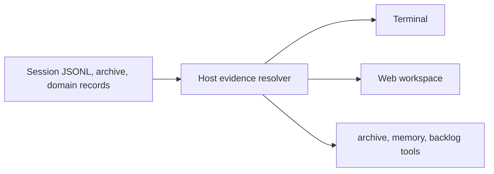

# RFC: Inspectable agent context and evidence

Let people and agents open the evidence behind a checkpoint, recalled note, child report or backlog completion, using the session records, archive index, Profiler and shell receipts Octocode already has. Ship it in slices: first fix the measured read-path defects (Slice 0), then add read-only inspection, then link evidence to decisions. No slice adds automatic model calls, routine prompt bytes or runtime dependencies. Background summaries, semantic retrieval, cache scheduling and lean child handoffs stay experiments behind their own gates.

## Summary

- **Decision.** Build on-demand evidence reads over existing owners (session codec, archive, memory, backlog, Profiler) and existing surfaces (`archive`, `memory` and `backlog` tools, terminal commands, web workspace). Add no new store, transport or index service.
- **Effect.** A reader goes from a visible row to its saved original in one bounded read; memory recall and archive search read only their scope; the inbox keeps its byte bound on every path.
- **Why now.** The audit found five verified defects on hot read paths (F1). Each is a small, separately revertible change.
- **Features.** F1 bounded read paths · F2 human archive search · F3 source anchors and expansion · F4 request and context views with honest attribution · F5 memory provenance · F6 backlog completions linked to shell receipts.
- **Provisional.** The F3–F6 designs are direction, not settled interfaces; Q1 and Q2 decide parts of them.

## Glossary

| Term | Meaning here | Where it lives |
| --- | --- | --- |
| Archive segment | Messages one compaction removed from context, saved as one file per compaction | `sessionOutputDir("archive")`, [history/archive.ts](../packages/coding-agent/src/octocode/history/archive.ts) |
| Archive index | Disposable SQLite FTS5 index over archive passages, rebuilt from segment files | `archive-index.db`, [queries/archive-index.ts](../packages/db/src/queries/archive-index.ts) |
| Mirrored note | A note stored both as a `MEMORY.md` line and as a `memories` row | [memory/file/sync.ts](../packages/coding-agent/src/octocode/memory/file/sync.ts) |
| Member scan | Recall's check that skips notes whose title is already a `MEMORY.md` line in the prompt | `fileMemberIds` in `memory/file/sync.ts` |
| Shell receipt | Opt-in structured result of a `bash` call (`verify: true`): session, mutation epoch, exit status, staleness | [files/bash/verification.ts](../packages/coding-agent/src/octocode/files/bash/verification.ts) |
| Source anchor | A typed, owner-scoped locator (record kind plus stable id) that a reader can expand | proposed, F3 |

## Problem and context

Each store answers its own questions, but no path leads from what a reader sees to the evidence behind it, and several read paths do more work than their scope needs.

| Area | Current behavior | Stored in | Gap |
| --- | --- | --- | --- |
| Archive | Compaction writes a segment; the `archive` tool lists, searches (FTS5 with BM25) and gets, with scoped continuations. `/archive` lists segments; `/archive <n>` prints a file path ([command.ts:19-25](../packages/coding-agent/src/octocode/archive/command.ts#L19)). | Segment files and `archive-index.db` | Humans cannot search. Archived entries are re-identified by object identity, then a `role\|timestamp\|toolCallId\|customType` key, not by persisted entry id ([render.ts:86-103](../packages/coding-agent/src/octocode/compaction/archive/render.ts#L86)), so cloned entries can collide. Scoped search fetches global term rows and discards them in JS (F1). |
| Memory | `memory` tool and `/memory` (`search`, `add`, `auto`, `last`, `review`). Recall selects notes lexically, skips duplicates and can use the active backlog goal. `MEMORY.md` lines carry pin, author and date, capped at 200 characters ([format.ts:27-51](../packages/coding-agent/src/octocode/memory/file/format.ts#L27)). | `memories` table in `workspaces.db`, and `MEMORY.md` files | No line records which correction or report supports it. The member scan reads only the newest 500 full rows (F1). The guide documents a `/memory migrate` that the command does not implement ([command.ts:157-186](../packages/coding-agent/src/octocode/memory/command.ts#L157)). |
| Backlog | The board owns status, claims, goals, steps and completion history; QA may record a skip. A per-turn task line shows the active item. `/backlog` can export `.octocode/agent/backlog.md`, which nothing reads back. | `workspaces.db` | A completion carries text only: `CompletionSchema` has no receipt, session or epoch field ([backlogs.ts:102-124](../packages/contracts/src/backlogs.ts#L102)), and the QA reviewer never sees a receipt. Each turn materializes every unfinished item; the peer bus runs the same snapshot only for its cursor (F1). |
| Team inbox | Delivers mail in batches capped at 32 rows and 32 KiB; rejected handoffs retry next tick. | `deliveries` table | Retries bypass the byte cap: 32 messages of 2,000 B produced one 68,472 B retry batch (F1). |
| Instructions | Startup loads `AGENTS.md`-style files (64 KiB each, no total cap, [context-files.ts:40](../packages/coding-agent/src/core/resource-loader/context-files.ts#L40)); nested trusted reads add more specific rules; `/context all` estimates the committed projection. | Repository files | A reader cannot see which sources were loaded, withheld or inferred for a given request. |
| Request profile | The Profiler records post-hook payload layers on supported adapters. | Session request trace | When layer and message counts are equal it joins them by index ([layers.ts:157-162](../packages/coding-agent/src/octocode/profiler/layers.ts#L157)); a hook that reorders messages mislabels them silently. |
| Rendering | Terminal and web consume typed display events; custom messages can be model-only, transcript-only or both ([selectors.ts:8-14](../packages/projections/src/selectors.ts#L8)). The `render` tool draws a status or table, or asks a confirm or form, in the main session only. The transcript window holds 50 messages and 50 tools ([transcript-history.ts:7-10](../packages/coding-agent/src/core/application/transcript-history.ts#L7)). | Session JSONL via the codec | Display ids and Profiler row positions are not durable links. |

**Cost of inaction.** Recall re-injects notes already in the prompt once more than 500 notes are visible; inbox retries can exceed the context budget the batch cap exists to protect; archive search work grows with every unrelated session. Users keep trusting summaries they cannot open.

## Goals and scope

- Every Slice 0 fix keeps current results (archive ranking oracle, memory visibility, backlog delivery, completion semantics) and reduces or holds the rows read.
- One scripted recording resolves to the same authorized source in tool, CLI, terminal UI and web (Slice 1).
- Inspection never starts a turn, changes permissions or writes to the prompt.
- **Out of scope:** new stores or vector services, changes to QA requirements or retention, paid calls, cache scheduling (owned by the provider-cache items B96–B105), and the event-loop rewrite (B32).

## Features

| ID | Consumer | Before → after | Example | Priority | Accepted by |
| --- | --- | --- | --- | --- | --- |
| F1 | Agent, operator | Read paths do work proportional to their scope; inbox retries stay within 32 KiB | 600 visible notes, the oldest mirrored → skipped by recall, not re-injected | Must | V1–V4 |
| F2 | User | `/archive search <words>` lists ranked scoped hits; `/archive <n>` unchanged | `/archive search spawn EPERM` → segment, time, short excerpt per hit | Must | V5 |
| F3 | User, agent | A checkpoint row, archive hit or child report opens its recorded message or a bounded range by source anchor | Open a decision from checkpoint 4 → the original user message, its branch and author | Should | V6 |
| F4 | User, operator | `/context all` and the web Profiler show **Last request** and **Current context estimate**, with each layer's link status | A reordered layer shows `inferred`, never a wrong source | Should | V7 |
| F5 | User, agent | A recalled note shows its scope, revision, selection reason and, when recorded, its supporting source | `/memory last` → `pinned · from a correction in session X` | Could | V8 |
| F6 | User, QA | A completion shows **Recorded check**, **Reported**, **Skipped** or **Stale**, and opens the receipt it cites | `done` citing a receipt → `Recorded check`, link to its output | Could | V9 |

## Proposed design

### Slice 0: bounded read paths (F1, F2)

Each fix lives in its existing owner and needs no contract change.

| Finding (verified) | Change | Owner files |
| --- | --- | --- |
| Inbox retry sends `db.pending` rows filtered by the retry set with no byte check, while the normal path enforces `INBOX_BATCH_BYTES` ([inbox.ts:60-75](../packages/coding-agent/src/octocode/team/inbox.ts#L60)). | Both paths use one bounded selection; a single oversized message still goes alone, so delivery always progresses; leftovers stay queued. | `team/inbox.ts` |
| `fileMemberIds` reads `store.list("all", 500)` with bodies and matches titles in JS ([sync.ts:280-289](../packages/coding-agent/src/octocode/memory/file/sync.ts#L280)). A mirrored note older than 500 visible notes is missed and re-injected. It creates no duplicate row: the write-side check is FTS-based. | A db query returns `id, title` for every note visible under the same scope clause; matching keeps JS `normalizeTitle` (SQLite `lower()` is ASCII-only). Remove `/memory migrate` from the docs. | `queries/memories.ts`, `memory/store.ts`, `memory/file/sync.ts`, memory and command docs |
| `termCounts` returns term rows for every passage ([archive-index.ts:150-157](../packages/db/src/queries/archive-index.ts#L150)); `query.ts` drops rows outside the scope in JS and calls it even for an empty scope ([query.ts:84-86, 164](../packages/coding-agent/src/octocode/history/index/query.ts#L84)). | Pass the scoped file ids into SQL; skip the query for an empty scope. FTS vocabulary scans still do global work, so check the query plan before choosing the join form. | `queries/archive-index.ts`, `history/index/query.ts` |
| The peer bus calls the full backlog snapshot to read `MAX(id)` ([peers.ts:82](../packages/coding-agent/src/octocode/backlog/peers.ts#L82)); `turn()` builds the task line twice ([task-events.ts:116-121](../packages/coding-agent/src/octocode/backlog/task-events.ts#L116)). | A cursor-only query that `snapshot` also uses; one task line per turn. Measure the per-turn snapshot before bounding it. Do not gate it on `dbStamp`: the stamp is mtime and size only and can miss writes ([db.ts:264-271](../packages/db/src/db.ts#L264)). | `queries/backlog-changes.ts`, `backlog/peers.ts`, `backlog/task-events.ts` |
| No human archive search. | `/archive search <words>` calls the scoped search the `archive` tool uses and prints a bounded page. | `archive/command.ts` |

**Projection follow-up (B132, done).** The browser feed projection scanned the tool window per row before its reuse check: O((M+T)·T), 67 ms per update at 400 chained tools in a scratch benchmark. It now builds the id and parent-to-children indexes once per update and walks descendants with a seen set; at 300 flat tools the old code made 181,200 index reads, the new one stays under 3,600.

### Slice 1: read-only inspection (F3, F4)

- **Source anchors.** A typed reference holds a record kind and the owner's stable locator. Transcript ranges use persisted session and entry ids under a validated branch tip or compaction id. Compaction carries `sourceEntry.id` into the archive capture; today the preparation holds bare messages ([compaction.ts:82-86](../packages/coding-agent/src/core/compaction/compaction.ts#L82)). Legacy role-and-timestamp matches never become authoritative links; old recordings fall back to their existing scoped view.
- **Resolution.** Verify membership, range order and boundary before reading. Resolve access from the caller's workspace, session, role and recorded fork lineage. A foreign or unverifiable anchor returns a neutral missing result, never another session's data or the latest leaf. Each read has byte and page limits and cancellation; text carries authorship, availability (`present`, `missing`, `expired`) and redaction status. Cursors bind to the authorized query, branch and result generation.
- **Views.** Historical inspection shows the text recorded at that time. A context inspection follows the selected branch's edits, replacements, removals and compaction. Physical deletion and retention apply to both.
- **Attribution.** A request layer has two independent facts: its structure is `observed`, `estimated` or `unavailable`; its source link is `linked`, `inferred` or `unavailable`. Equal counts, timestamps or text similarity never prove a link; identity comes from the conversion seam (B129). Per-layer token counts stay estimates. Raw provider bodies and hidden reasoning stay out of the read surface.
- **Ownership.** `core/session-manager` writes optional anchor fields only through the codec and only on successful compaction. `core/application` assembles the read model through host ports, outside snapshots and streaming deltas. Domain owners supply scoped readers. `contracts` adds TypeBox reference, page and status schemas additively, reusing `WorkLink` where it fits; `projections` stays host-free. The terminal UI and webview reuse their detail views and sanitized Markdown.
- **Trust.** Recovered text keeps its original authority: an archive quote never grants permissions or elevates an instruction. A link carries a locator, never a bearer capability. Opening a drawer never starts a turn.

### Slice 2: link evidence to decisions (F5, F6)

- **Memory provenance.** Link a note's id and revision to a bounded set of source anchors, the author category and the confirmation time, in the durable database, never the disposable archive index. `MEMORY.md` stays compact and hand-editable. For a file-plus-database write: record a pending operation keyed by note revision and expected digests, apply the locked atomic file update, then finalize. Expose only finalized links whose content still matches; reconcile idempotently and surface conflicts. Hand-written or ambiguous lines stay unlinked with a neutral status.
- **Verification links.** A completion or step may cite a shell receipt, a QA result or an attributed manual check, bound atomically to the saved goal version or the step id and version. An exit code proves the command outcome, not criterion coverage. Mutation epochs detect host-observed edits in one session only; after restarts, later edits or a worktree mismatch the indicator says `Stale` or unknown. Receipts need a stable id first (Q2).

### Slice 3: gated experiments

Each runs only with one predeclared primary outcome and allowed regressions, and stays off when inconclusive.

- **Cache scheduling.** Owned by the provider-cache items (B96–B105). Any change to sibling stagger ([stagger.ts](../packages/coding-agent/src/octocode/subagents/stagger.ts)) needs observed provider cache reads and writes on the same route before shipping.
- **Long-session memory.** Compare direct archive expansion and exact search against today's retrieval first. Only if old corrections are still missed, shadow an age-tiered index that keeps literal identifiers, provenance and supersession, with no foreground wait and every background or discarded inference counted.
- **Semantic search.** Lexical and embedding candidates share one scoped corpus and the exact source resolver; local first, versioned by embedding model and content hash; deletion and re-index consistency checked with task success.
- **Subagent handoff.** Keep full-context forks ([context-fork.ts](../packages/coding-agent/src/octocode/subagents/context-fork.ts)). Test an opt-in handoff of goal, constraints and authorized source anchors; compare input size, first-request latency, correctness and privacy across sibling bursts.

## Decisions and reasoning

**D1: Reuse JSONL, SQLite and FTS5; add no store.** Evidence: the codec, `workspaces.db` and `archive-index.db` already own identity, retention and deletion; the local probe under Validation shows the scoped-join gap is row transfer, not an engine limit. Reasoning: a second store would be a second authority for identity and deletion. Rejected: a document store or vector service (new deployment and data routing); `sqlite-vec` (native packaging; its upstream calls it pre-v1). Reverses if: a labelled corpus shows persistent semantic misses after lexical repairs.

**D2: Fix Slice 0 before building inspection.** Evidence: five verified defects, each local to one owner with an existing test seam. Reasoning: inspection would surface results from these paths, and fixing them first keeps Slice 1 baselines honest. Rejected: bundling the fixes into Slice 1, which makes larger, harder-to-revert changes. Reverses if: never; each fix ships alone.

**D3: Keep summaries, semantic search, cache scheduling and child handoff as gated experiments.** Evidence: no measurement shows current exact search or full-context forks failing users; UniiChat's 95% cache figure measures simulated serialized-character share and lets a foreground turn wait for summaries ([Memory.ts:140-149](https://github.com/VictorTaelin/uniichat/blob/0500bf6a8ea4bf0ce047488562022b1b6532cc30/Memory.ts#L140-L149), [Server.ts:529-558](https://github.com/VictorTaelin/uniichat/blob/0500bf6a8ea4bf0ce047488562022b1b6532cc30/Server.ts#L529-L558)). Reasoning: each changes cost or behavior and needs its own primary outcome. Reverses if: Slice 1 retrieval checks show agents still miss old corrections.

**D4: Rewrite the projection lookup once per update (reversed from "defer").** Evidence: the quadratic cost is real, and Q3 found the reuse check never matches window-built snapshots, so every update paid it. Reasoning: the fix is local, keeps the output shape, and is guarded by chain and cycle tests. Reverses if: never; the old per-row scan has no advantage.

## Risks and mitigations

| Risk | Mitigation |
| --- | --- |
| A Slice 0 query change alters archive ranking or memory visibility | The ranking oracle and visibility tests run unchanged; the old scan stays the oracle |
| A wrong source link misleads more than no link | Links are `linked` only through recorded identity; everything else is `inferred` or `unavailable` (V7) |
| Cross-workspace disclosure through anchors in global memory | Resolution checks the caller's scope; a foreign anchor returns neutral missing |
| File and database drift in provenance writes | Pending-then-finalize with digests; crash-injection tests (V8) |
| A receipt read as proof of correctness | Indicators separate command outcome, criterion review and freshness; exit zero alone never marks a criterion verified |

## Tasks and rollout

Slice 0 runs in parallel on disjoint files; Slices 1 and 2 follow. The critical path is T6 → T7 → T9.

| ID | What | Where | Serves | Depends on | Done when | State |
| --- | --- | --- | --- | --- | --- | --- |
| T1 | Inbox retries use the bounded batch selection | `team/inbox.ts` | F1 | none | V1 | done (B125): new test fails on the old retry, passes after |
| T2 | Scope-wide `id, title` member query; drop `/memory migrate` from the docs | `queries/memories.ts`, `memory/store.ts`, `memory/file/sync.ts`, docs | F1 | none | V2 | done (B126): 600-note test fails with the 500-row scan, passes after |
| T3 | Scoped term counts in SQL; skip an empty scope | `queries/archive-index.ts`, `history/index/query.ts` | F1 | none | V3 | done (B127): ranking oracle unchanged; plan adds a primary-key lookup, no `passages` scan |
| T4 | Cursor-only peer read; one task line per turn; snapshot measured | `queries/backlog-changes.ts`, `backlog/peers.ts`, `backlog/task-events.ts` | F1 | none | V4 | done (B128): cursor read 0.015–0.53 ms vs snapshot 0.10–35.7 ms (10–10,000 items) |
| T5 | `/archive search <words>` | `archive/command.ts` | F2 | T3 | V5 | done (B127) |
| T6 | Persist `sourceEntry.id` and the branch tip in the archive capture | `core/compaction`, `octocode/compaction/archive` | F3 | none | V6 (anchor half) | done (B133): new segments mark `Message entry ids: session-entries` and head each message with its entry id; a cloned-entries test fails with ids ignored, passes after; legacy segments keep the role-and-time fallback, never authoritative |
| T7 | Host evidence resolver with scoped readers, limits and neutral missing | `octocode/archive`, `contracts` | F3 | T6 | V6 | done (B134): `SourceAnchor` (archive, transcript) with a string form, `EvidenceRead` with present, missing or expired, and a resolver scoped to the sessions archive search already reads; legacy segments, foreign sessions and unknown entries read as missing; text pages on UTF-8 boundaries; the `archive` tool's `get` takes an anchor and search hits carry one |
| T8 | Identity-based layer links; two-view context report | `octocode/profiler`, `agent-session/context-report.ts` | F4 | none | V7 | done (B129): no index join; layers carry `structure` and `link`; a swap test passes; `/context all` shows **Current context estimate** and **Last request**. The request trace now records `entryKey` per message layer where identity is proven (same object, same hash and role after hooks); converted messages (custom, bash, summaries) and merged tool results stay unlinked (B138) |
| T9 | Terminal and web detail views over the resolver | `octocode/archive`, `webview` | F3 | T7 | V6 | todo (B135) |
| T10 | Memory provenance store with pending-then-finalize | `queries/memories.ts` or a sibling, `memory/file/passes.ts` | F5 | T7 | V8 | todo (B136) |
| T11 | Stable receipt id; optional completion receipt field; QA receives receipt facts | `files/bash/verification.ts`, `contracts/backlogs.ts`, `backlog/qa-*.ts` | F6 | Q2 | V9 | done (B137): a completion cites a receipt id or `latest`; foreign ids are refused; the item shows Recorded check, Reported, Skipped or Stale; QA receives the receipt facts; the stored command is redacted. Binding to a goal version (V9's second half) is not built: staleness follows workspace edits, not goal edits |

Follow-ups from the audit, all done: B129 (positional layer join, as T8); B130 (archive ranking falls back to the scan when the full-text tables are missing; a dropped-tables test fails before, passes after); B131 (inbox late rows read through a 256-row window that skips ids already tracked; the memory candidate scan keeps an explicit, tested 600-note bound); B132 (projection, above).

**Rollout.** Slice 0 changes ship as plain, separately revertible commits. Slice 1 deploys optional record fields before new writers; old records open through established paths; new routes are read-only. Slice 2 associations start inside the domain write that creates them. **Rollback.** Reverting any slice leaves transcripts, work items and memory files readable; if an optional index fails, the scoped scan or the existing list and get remain.

## Validation and success

| ID | Accepts | Given | When | Then |
| --- | --- | --- | --- | --- |
| V1 | F1 | 32 rejected messages of 2,000 B | the inbox retries | every batch is at most 32 KiB (a lone oversized message goes alone); all 32 arrive once, in order |
| V2 | F1 | 600 visible notes, the mirrored one oldest and unpinned | recall runs | the note is skipped; a same-title note in another scope is not; only `id, title` cross the db boundary |
| V3 | F1 | a fixed scoped set and a growing unrelated corpus | a scoped archive search runs | rows returned equal the scoped passages; ranking equals the oracle; an empty scope runs no term query |
| V4 | F1 | boards of 0, 10, 1,000 and 10,000 items | the bus reads its cursor | it equals `snapshot().cursor` and reads no item rows; the snapshot cost is recorded |
| V5 | F2 | an archived session | `/archive search <words>` runs | ranked hits come from the tool's reader; no match and no archive each get a clear message; `/archive <n>` is unchanged |
| V6 | F3 | one scripted recording with the release-gate cases below | the anchor is opened from tool, CLI, terminal UI and web | the same authorized source every time; foreign or stale anchors return neutral missing; zero false exact links |
| V7 | F4 | a hook swaps two messages without changing the count | the Profiler builds layers | both layers read `inferred` or `unavailable`, never the swapped source |
| V8 | F5 | a crash injected before and after file replacement and DB finalization | the pass resumes | no duplicate link; manual edits are never attributed to an old note |
| V9 | F6 | a completion citing a receipt, then an edit to its goal | the completion is shown | the receipt stays bound to the saved goal version; later edits show `Stale` |

**Release-gate cases for V6 and V7.** Same-role entries with identical timestamps, copied messages, hidden model-only input, transcript-only `!!` output and `display: "only"` custom messages, edited instructions, sibling branches, rewind, inherited forks, imported headers, expired archives, missing assets, stale cursors, unsupported providers and older JSONL; read-only browser access over both the daemon and the fallback server; secrets split across streamed chunks stay redacted. Failure cases: read cancellation, rejected inbox deliveries, reconnect, index catch-up after a crash, duplicate durable writes, compaction cancellation and retention during a paged read; an expired or changed lookup returns a bounded restart or unavailable result.

**Measurement.** For Slice 0, report rows and bytes crossing the db boundary and p50 and p95 latency at fixed and growing corpus sizes; reject a regression beyond the larger of 5% and the measured noise floor. A local probe on Octocode's contentless FTS schema (`node:sqlite` in memory, 100 fixed passages, 5 warmups, 31 alternating timed runs) returned 1,000 and 50,000 rows at 1.08 ms and 53.47 ms median for the current query, and 100 rows at 0.25 ms and 7.50 ms with one join on the selected file ids; it excludes disk, ranking and model use. Retrieval quality (Slice 1 onward) uses a small versioned, labelled corpus of corrections, superseded claims, exact paths and error strings, paraphrases and no-answer queries; a rising retrieval score alone never qualifies a change. Provider-economics trials follow the provider-cache items and run paid only when authorized.

**Commands.** Named Vitest files for each owner, then `yarn workspace @octocodeai/octocode-agent run test:e2e`; for browser changes, `yarn run generate:workspace`, the webview and contracts suites and browser smoke; `yarn run check` under the single-suite lock ([DEVELOPMENT.md](../DEVELOPMENT.md)).

## Open questions

- **Q1 Resolved:** two records, one locator. B101's ledger tracks payloads loaded into context for cache reuse (`ref → {line, versions, loads[{msg_id, ver, range}]}`); F5 records where a note came from. Both use the `SourceAnchor` contract from T7, so a ledger load and a provenance link name the same source the same way.
- **Q2 Resolved:** a receipt's identity is `session:startedAt:hash(command)`, derived from the receipt the `bash` result already saves in the session transcript, so it outlives a restart without a stored counter. A `verify: true` result prints it; a completion can also cite `latest`.
- **Q3 Resolved:** yes for snapshots built by the transcript window. `cloneDisplay` ([transcript-history.ts:55](../packages/coding-agent/src/core/application/transcript-history.ts#L55)) copies every row, so the projection's `sameSources` identity check never matches them. The live frame path through `ApplicationStream` was not traced. B132 removed the per-row cost either way.
- **Q4 Resolved:** the per-turn backlog snapshot stays. Measured on a temporary database (20-run average): 0.10 ms at 10 open items, 3.47 ms and 153 KB at 1,000, 35.7 ms and 1.55 MB at 10,000. A bounded query pays off only beyond a few thousand open items; revisit if boards grow that large.

## Sources

- Archive: [archive/command.ts](../packages/coding-agent/src/octocode/archive/command.ts), [compaction/archive/render.ts](../packages/coding-agent/src/octocode/compaction/archive/render.ts), [history/index/query.ts](../packages/coding-agent/src/octocode/history/index/query.ts), [queries/archive-index.ts](../packages/db/src/queries/archive-index.ts), [archive-index.test.ts](../packages/coding-agent/test/octocode/archive-index.test.ts), [core/compaction/compaction.ts](../packages/coding-agent/src/core/compaction/compaction.ts)
- Memory: [memory/file/sync.ts](../packages/coding-agent/src/octocode/memory/file/sync.ts), [memory/query.ts](../packages/coding-agent/src/octocode/memory/query.ts), [memory/file/format.ts](../packages/coding-agent/src/octocode/memory/file/format.ts), [memory/command.ts](../packages/coding-agent/src/octocode/memory/command.ts), [queries/memories.ts](../packages/db/src/queries/memories.ts), [memory guide](../packages/coding-agent/docs/memory.md)
- Backlog and inbox: [backlog/task-events.ts](../packages/coding-agent/src/octocode/backlog/task-events.ts), [backlog/peers.ts](../packages/coding-agent/src/octocode/backlog/peers.ts), [queries/backlog-changes.ts](../packages/db/src/queries/backlog-changes.ts), [team/inbox.ts](../packages/coding-agent/src/octocode/team/inbox.ts), [contracts/backlogs.ts](../packages/contracts/src/backlogs.ts), [files/bash/verification.ts](../packages/coding-agent/src/octocode/files/bash/verification.ts), [db.ts](../packages/db/src/db.ts)
- Context and rendering: [context-files.ts](../packages/coding-agent/src/core/resource-loader/context-files.ts), [profiler/layers.ts](../packages/coding-agent/src/octocode/profiler/layers.ts), [transcript-history.ts](../packages/coding-agent/src/core/application/transcript-history.ts), [application-projection.ts](../packages/projections/src/application-projection.ts), [selectors.ts](../packages/projections/src/selectors.ts), [render tool](../packages/coding-agent/src/octocode/native/tools/render/tool.ts)
- External: [SQLite FTS5](https://sqlite.org/fts5.html), [sqlite-vec](https://github.com/asg017/sqlite-vec), [UniiChat at 0500bf6](https://github.com/VictorTaelin/uniichat/tree/0500bf6a8ea4bf0ce047488562022b1b6532cc30)
- Measurements: the FTS probe above; the inbox retry and memory window reproductions from this audit; the projection scratch benchmark (one machine, noisy).
