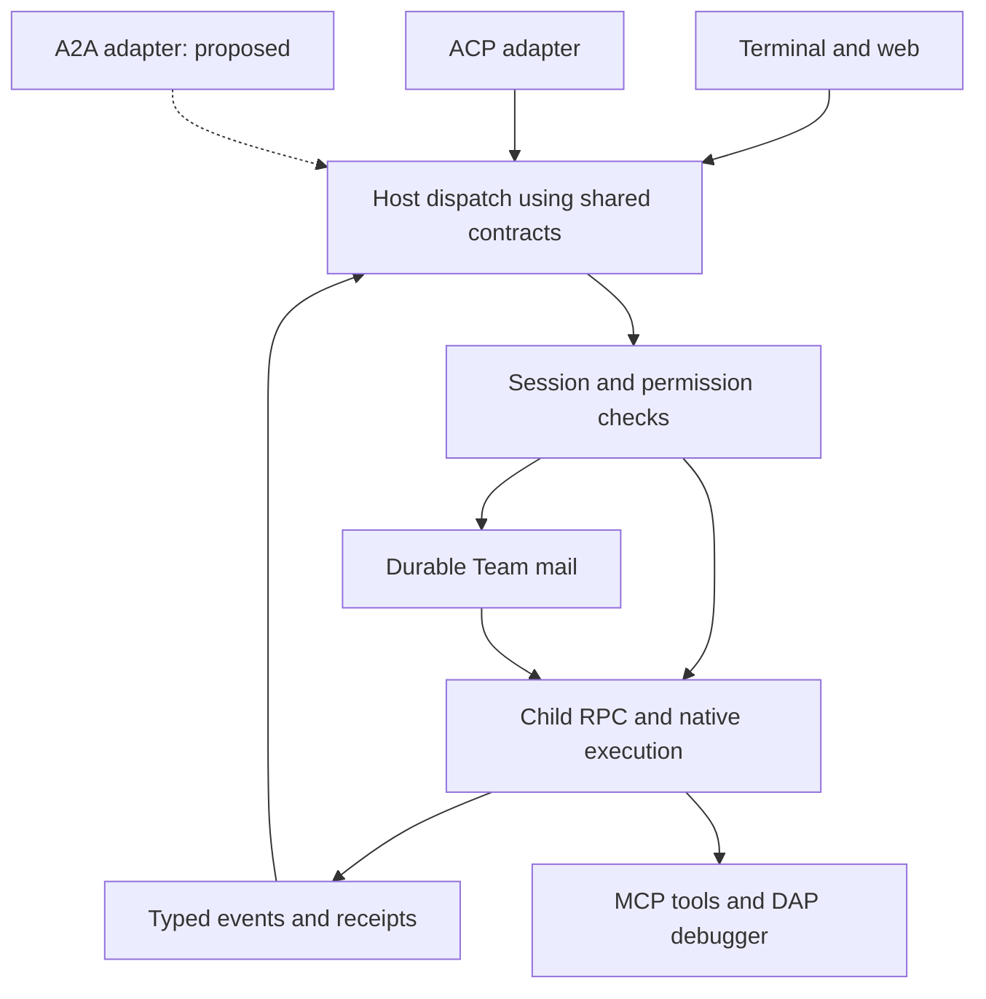

# RFC: shared communication contracts and protocol adapters

## Answer

Use **one versioned family of internal contracts**, sharing vocabulary where semantics overlap and retaining each owner's lifecycle. Extend existing `contacts` contracts and native owners, following the [entity boundaries](ENTITIES.md). Keep ACP for coding clients, MCP for tools, DAP for debugging, and add A2A for remote agent interoperability. This is a proposed migration; no A2A endpoint or unified task protocol is implemented by this RFC.

## Scope

Reviewed 2026-10-23 against the working tree based on `cdc32be2f1b406c96864d01c2bdcafedc4b62869`, including concurrent changes. [Feature scores and executed checks](FEATURE_VALIDATION.md) distinguish current evidence from earlier runs.

Current implementation note (2026-10-29): `packages/acp/package.json` now pins `@agentclientprotocol/sdk` 2.0.2. Inbound and outbound code use its default stable ACP v1 entrypoint; the package version does not select the experimental v2 wire protocol. The version statement in the original review below is retained as dated evidence.

## Evidence

| Boundary today           | Contract and delivery                                                                                                                                                                                                                                                                                                  |
| ------------------------ | ---------------------------------------------------------------------------------------------------------------------------------------------------------------------------------------------------------------------------------------------------------------------------------------------------------------------- |
| Terminal and web         | [Application port](../packages/contacts/src/application.ts): commands, receipts, versioned frames and replay cursors. Local invocation retains richer native capabilities. [Host dispatch](../packages/coding-agent/src/core/application/service.ts) owns execution.                                                   |
| Internal peers           | [Team mail](../packages/coding-agent/src/octocode/team/inbox.ts) persists one message with per-recipient delivery records in SQLite. Delivery means inclusion in model context, not task completion.                                                                                                                   |
| Parent and worker        | [Child RPC](../packages/coding-agent/src/octocode/subagents/process/run-child.ts), nonce-bound [permission relay](../packages/coding-agent/src/octocode/subagents/relay.ts), and persisted [report recovery](../packages/coding-agent/src/octocode/subagents/handoff.ts). This is a distinct process-control contract. |
| Other Octocode processes | [Native API](../packages/coding-agent/src/octocode/api/protocol.ts): JSON-RPC over Unix sockets or HTTP/SSE; separate message keys and event sequence numbers.                                                                                                                                                         |
| External coding agents   | [Inbound ACP](../packages/acp/src/server/broker.ts) and [outbound ACP](../packages/acp/src/client/client.ts). The inbound broker adapts native RPC workers; it does not yet use the application command contract.                                                                                                      |
| Remote A2A agents        | Absent from the current [external transport schema](../packages/coding-agent/src/octocode/external/protocol.ts), which accepts `acp` and `octocode`.                                                                                                                                                                   |

JSON-RPC framing alone does not unify method names, authority, lifecycle or delivery. Current application receipts describe an operation returning; Team delivery describes context inclusion; a worker report describes a task outcome. Preserve these distinctions in any common schema.

### Protocol choice

[Agent Client Protocol v1](https://agentclientprotocol.com/protocol/v1/overview) covers coding sessions, updates and permission requests. Its [transport reference](https://agentclientprotocol.com/protocol/v1/transports) specifies stdio and labels Streamable HTTP a draft. The repository pins SDK `1.8.0`; v2 is a draft, not an automatic upgrade target.

[A2A specification 1.0.1](https://a2a-protocol.org/v1.0.1/specification/) supplies agent discovery and remote task/message/artifact interoperability; its wire version is `1.0`. It leaves authorization to the host. Streaming does not replace durable mail; reconnects can miss messages, and webhooks can duplicate delivery. [A2A and MCP](https://a2a-protocol.org/v1.0.1/topics/a2a-and-mcp/) serve complementary boundaries.

IBM/BeeAI's **Agent Communication Protocol**, which [joined A2A](https://agentcommunicationprotocol.dev/introduction/welcome), is different from this repository's **Agent Client Protocol**.

### Proposed ownership

Target flow below: shared task contracts and the A2A adapter are proposed; execution remains in existing native owners.

Start with a small shared correlation envelope and discriminated, owner-specific outcomes. Add task/run projections only when a concrete adapter needs them; do not convert Team mail into tasks or collapse receipt meanings. Keep stores and authorization in the host. The authenticated principal is host-owned context, never a peer-supplied authority field. Preserve native transcript and Team persistence; an adapter must not introduce a second execution loop.

## Gaps

1. **Identity and outcomes:** separate session/context, logical task and execution attempt. Accepted, delivered, operation-completed and task-completed must remain distinct. A settled run does not automatically mean a successful task.
2. **Recovery:** define key scope, payload-conflict rejection, per-stream cursor/epoch and snapshot recovery. Persist critical outcomes; never blindly replay a prompt after uncertain effects. Disk failure must remain visible.
3. **Approval:** correlate a typed decision with principal, exact action, task/run, expiry and current policy. An A2A `auth-required` state or a message saying “yes” grants nothing by itself.
4. **Lifecycle:** [A2A terminal tasks cannot restart](https://a2a-protocol.org/v1.0.1/topics/life-of-a-task/). Current revival reuses the conversation and starts fresh execution; a future adapter must project a new A2A task with lineage. This projection is not an existing task-ID contract. Map native `blocked` only after distinguishing missing input, missing authorization and failure. Cancellation is a request until execution settles.
5. **Exposure:** an A2A adapter needs authenticated, caller-scoped task access, bounded/redacted artifacts and capability negotiation. Ship polling/streaming first; leave webhook capability off until delivery and callback security are tested.

## Checks

The recommendation was challenged against replacing every transport with A2A. Typed editor approvals, context-acknowledged mail and process control have distinct semantics. Existing application/ACP tests cover their current adapters; proposed shared task projections and A2A require new contract/conformance tests.

Migrate one boundary at a time, starting with correlation and typed outcomes. Contract tests must cover duplicate/conflicting commands, disconnect/replay, late approvals, cross-session access, terminal-task follow-ups and cancel races. Reuse the application port; keep public ACP, native API and worker RPC compatible. Then implement an optional A2A adapter with an independent client conformance run.
