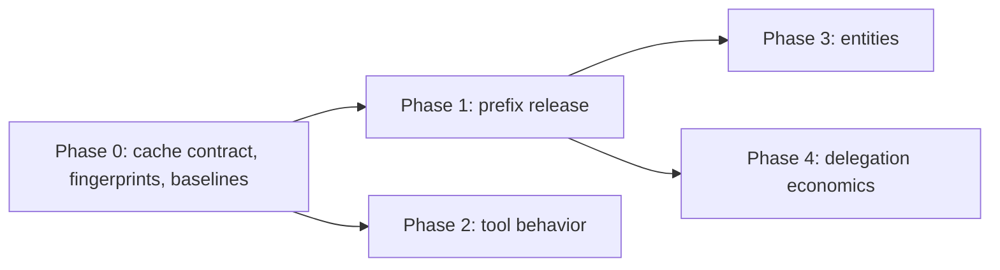

# RFC: context, cache and cost efficiency

Keep the cached prefix byte-stable first, then cut turns, then cut prefix size. Every audit item is checked against the user's rules below. 61 items: 24 accepted, 13 changed, 12 rejected, 12 already done. The accepted work ships in five dependency-ordered phases, starting with a provider cache contract and measurements, and bundles prompt-affecting changes so each release rewrites a cached prefix once.

## Summary

- **Cache first.** Most caching already exists: layered retention, a second instruction block, sibling cache keys, warming and miss notices ([prompt-caching.md](../packages/coding-agent/docs/prompt-caching.md)). This RFC adds a single conformance matrix over every adapter, a per-role prefix fingerprint in the generated contexts, and a rule that a prompt change ships in a batch.
- **MCP: all tools declared, detail tiered.** Every MCP tool stays declared and callable. A new per-server and per-tool `detail: full | brief` setting decides how much of each tool the `mcps` section describes. The Octocode preset defaults five research tools to `full` and the others to `brief`. The provider tool list never changes mid-session.
- **Subagents own their prefix.** The fixed rules a child's task carries today (report contract, run-mode, item and archive rules) move into the child's system prompt. The task keeps only facts. The main agent's profile list shows each profile's route and effort. The default is `medium` effort; `high` is for the coordinator and sensitive tasks.
- **Entities share one vocabulary.** Each entity tool offers `list` (filters plus `query` search), `get`, `add`, `update`, and `delete` where safe. Search is full-text where indexed. Each owner keeps its own store, as [ENTITIES.md](ENTITIES.md) decided.
- **Rejected by rule:** editing without a read (Q3), gating or deferring MCP tools (T3), warm result clearing (C7), and shipping the task as a file (C5).

## Problem and context

Measured by the efficiency audit (`.octocode/tool-skill-audit/efficiency.md` §0-1; 1,258 main and 691 classified child transcripts):

- **Spend splits like this:** main sessions $1,129: 47% cache read, 35% cache write, 17% output, 0.3% fresh input. Children $1,569 (about 58% of combined spend): implementer $2.68, general $2.62, reviewer $1.85 and researcher $1.43 per run.
- **Turns drive cost.** Every turn re-reads the context. Models make 1.14-1.36 tool calls per turn, and only 14% of child tool-turns batch. Implementers average 69 turns and 9.5M cache-read tokens.
- **The prefix is about 25% of each turn's read.** A child starts at 37.7k-38.2k tokens, and the main session's first request wrote 38,485 cache tokens. That is about 2.5 chars/token, not the chars/4 that `sizes.md` assumes.
- **Sizes.** Rendered first requests: main 76,592 chars, general 62,314, researcher 55,741, reviewer 47,724, implementer 46,257, browser 42,300 and lean 11,341 (`src/octocode/instructions/rendered/*/sizes.md`; paths below are relative to `packages/coding-agent/` unless rooted). `mcps` is the largest part: 32,296 chars, 42.2% of main.
- **Wasted calls.** 674 unread-file refusals, 472 inline-interpreter refusals, 203 read-only-role write refusals and 50 localFetch calls over 5 items (`archive errors`, groups 1, 2, 3/7 and 6).

## Goals and scope

The metrics, in priority order. Each phase reports them before and after:

| Id  | Metric                                                                           | Baseline                                                                             | Source                                                                                                                                                   |
| --- | -------------------------------------------------------------------------------- | ------------------------------------------------------------------------------------ | -------------------------------------------------------------------------------------------------------------------------------------------------------- |
| M1  | Cache hit rate (token-weighted) per role and session                             | not yet sampled per role                                                             | `get_session_stats` `cache.conversation.hitRate`; `/agents stats` per profile ([prompt-caching.md:174](../packages/coding-agent/docs/prompt-caching.md)) |
| M2  | Cache-write tokens: first request per role, and a second sibling's first request | main 38,485; child median 37.7k-38.2k; Haiku sibling 170-338 (prompt-caching.md:128) | session usage `cacheWrite`                                                                                                                               |
| M3  | Turns per task and calls per turn                                                | implementer 69 turns; 1.14-1.36 calls/turn                                           | `child.jq`, `sess.jq` in `.octocode/tmp/agents/sneaky-urchin/`                                                                                           |
| M4  | $ per task per role                                                              | above                                                                                | `usage.cost`                                                                                                                                             |
| M5  | Prefix chars per role, rendered and real                                         | above; real main `mcps` 36,908, `project_context` 13,166                             | `sizes.md`, real system message `sections`                                                                                                               |
| M6  | Wasted calls by refusal signature                                                | above                                                                                | `archive errors:true`                                                                                                                                    |

### Decision rules

The user set these on 2026-11-02. The ledger cites them by id.

- **R1 Cache first.** No change may put time-varying or order-unstable content in the cached prefix (tools, base and session tiers). Every adapter must apply caching the same documented way. Prompt changes ship batched.
- **R2 Deterministic data.** Nothing may remove data from context or storage because of timing, sampled usage or model judgment. Truncation must follow a fixed rule and keep a continuation (cursor or saved file). One exception, approved by the user on 2026-11-02: tool-result clearing. It applies only when the cache lifetime has elapsed or the model changed. It clears only the results of re-fetchable tools, keeps the newest 5, and fires only when it frees at least 20k tokens. Each result is saved before its placeholder names the file, and a result that cannot be saved stays. The decision is recorded once and applied identically on every later request, resume and fork.
- **R3 No edit without a pre-read.** Reads may become cheaper or better credited. They may not be skipped.
- **R4 MCP fully available and configurable.** Every MCP tool stays declared and callable. Nothing loads lazily or changes the tool list mid-session. Users choose the detail tier and exposure per server and tool.
- **R5 Subagents own their instructions and caching.** Each role has a stable, cacheable prefix. The parent does not put instructions in the task.
- **R6 Effort.** Children default to `medium`. `high` is only for coordinators and sensitive tasks. The main agent knows which effort each child runs at.
- **R7 Entities.** Every database entity offers filter, search and CRUD in one consistent shape.
- **R8 Assets.** Every skill, tool and role capability is classified as core, role-scoped or on-demand, with a critical reason.
- **R9 Scope.** No item may be mostly long documentation to write.
- **V Value.** Reject an item when the evidence shows no saving.

Out of scope: provider pricing, model choice per provider, the sibling `octocode-mcp` server internals (except where noted as out-of-repo), and permission modes beyond F5.

## Item ledger

E = `efficiency.md`, T = `tools.md` §4, S = `skills.md` §7 (all under `.octocode/tool-skill-audit/`), U = the user's new items. The Design column names the section below.

| #   | Item                                                            | Evidence                                                                                                              | Verdict (rule)                                                       | Design summary                                                                                                                                                               | Measure                                                 |
| --- | --------------------------------------------------------------- | --------------------------------------------------------------------------------------------------------------------- | -------------------------------------------------------------------- | ---------------------------------------------------------------------------------------------------------------------------------------------------------------------------- | ------------------------------------------------------- |
| C1  | Tiered MCP presentation                                         | 7 rare tools hold about 18.5k of 32.3k `mcps` chars; they make about 0.2% of child calls (E C1)                       | change (R4)                                                          | Keep every tool declared; a `detail` tier shortens only the `mcps` text. Configurable (b)                                                                                    | M5 `mcps` chars; M2; usage of brief-tier tools per task |
| C2  | Real vs rendered size                                           | real `mcps` 36,908 vs 32,296; `project_context` 13,166 vs 360 (E C2)                                                  | accept                                                               | Record real section sizes in `/context`; add a size gate for this repo (a)                                                                                                   | M5 real vs rendered                                     |
| C3  | Memory-save guidance on every request                           | about 900 chars in `rules`; 44 saves in 1,258 sessions (E C3); guideline at `src/octocode/memory/tool.ts:39`          | change (R2)                                                          | Cut it to one sentence in the tool guideline. Do not return it in the first `set` result, because the model needs it before it decides to save                               | M5 `rules` chars                                        |
| C4  | Skills catalog size                                             | 5,069 chars in main; 8 of 19 skills loaded 0-3 times (E C4)                                                           | change (R1, R2)                                                      | One-line entries from a committed list, never from live load rates (e)                                                                                                       | M5 `skills` chars                                       |
| C5  | Task as file reference above 3k chars                           | implementer task mean 4.5k chars (E C5)                                                                               | reject (V)                                                           | A file the child reads enters history as a tool result: the same tokens plus one more turn. U3 shrinks the task instead                                                      | none                                                    |
| C6  | `responseChars` default 8-10k for localFetch/localSearch        | localFetch mean 5.8k, p95 17.9k; default 20,000 (E C6)                                                                | accept (R2: a fixed page size with a cursor loses nothing)           | Preset default argument (b)                                                                                                                                                  | mean result size; re-fetch rate                         |
| C7  | Warm tool-result clearing                                       | `src/octocode/compaction/clearing.ts:25-28`: a warm clear rewrites the cache                                          | reject (R1)                                                          | Keep cold and model-switch clearing, under the R2 exception. The warm clear on a trailing system update is a bug (B470)                                                      | M1; clears per session                                  |
| C8  | Drop `reason`                                                   | 1.3% of output; feeds the permission prompt (E C8)                                                                    | reject (V)                                                           | Keep                                                                                                                                                                         | none                                                    |
| Q1  | Scale the work ceremony by change size                          | `policy/work.md` blast-radius bullet vs `policy/research.md` (E Q1)                                                   | accept                                                               | A one-file or mechanical edit needs the file and its direct references; the full impact map is for contract, config or shared-helper changes. One `work.md` edit             | M3 implementer turns on small tasks                     |
| Q2  | Ask vs keep going                                               | askUser 98 calls in 1,258 sessions (E Q2)                                                                             | reject (V)                                                           | No change                                                                                                                                                                    | askUser per task                                        |
| Q3  | Edit without a prior read                                       | 674 refusals, 97% after a bash/localFetch view; `src/octocode/files/tool/guard.ts:320`                                | reject (R3)                                                          | Replaced by U9                                                                                                                                                               | none                                                    |
| Q4  | Malformed `file` calls from small models                        | 31 of 33 invalid-JSON errors from Haiku; `queries` sent as a string (E Q4); no `JSON.parse` fallback in `files/tool*` | accept                                                               | Parse a stringified `queries` once; accept a top-level `{path, edits}` as one query                                                                                          | M6 by model                                             |
| Q5  | Read-only roles writing to scratch                              | 203 refusals (E Q5)                                                                                                   | accept                                                               | Allow literal paths under the child's scratch folder; name the allowed form in the refusal                                                                                   | M6                                                      |
| Q6  | Reservation refusal for inline interpreters                     | 472 refusals (E Q6)                                                                                                   | accept (in flight as B456)                                           | Check the paths a command can reach, not whether any lock exists; confine python3 and perl like node                                                                         | M6                                                      |
| Q7  | Steps on an epic                                                | 44 errors (E Q7)                                                                                                      | done                                                                 | `src/octocode/backlog/tasks/access.ts` now lists the epic's items                                                                                                            | M6                                                      |
| Q8  | Backlog add ceremony                                            | optional fields used rarely (T U2)                                                                                    | accept                                                               | `add` requires only `title`, `why` and `goal`; paths come from the claim (d)                                                                                                 | add error rate                                          |
| F1  | One call per turn                                               | 14-18% multi-call turns; 50 "more than 5 items" errors (E F1)                                                         | change (R1)                                                          | Put the batch limit and an example in the MCP stubs (b); raise the server cap above 5 (out-of-repo). A harness hint only as an appended message, after an eval               | M3 calls/turn                                           |
| F2  | Thinking effort                                                 | 99% of child turns at `high` (E F2); default now `medium` (`src/octocode/subagents/model.ts:180`, commit 6f11996c)    | change (R6)                                                          | Mostly done. Add the reviewer route, the `model` field text and visibility (c)                                                                                               | reasoning tokens; M4                                    |
| F3  | Delegation cost                                                 | top 10% of children carry 32% of child cost; 10 of 691 children were `lean` (E F3)                                    | change (R2)                                                          | Route small edits to `lean` in the delegation list. Turn budget: a warning at 80% and a report request at 100%, never a hard cut. Show turns and $ in the live agent row (c) | M3, M4 per role                                         |
| F4  | Coordination ceremony                                           | 603 coordinate calls against 887 task calls; 72 "nothing was locked" errors (E F4)                                    | accept                                                               | `task` takes `paths`, locked at spawn and unlocked at report (c)                                                                                                             | coordinate calls per spawn                              |
| F5  | MCP reads classed as writes                                     | `src/octocode/permission/gate/classify.ts:82-88`; 19,959 `mcp.write` records (E F5)                                   | accept                                                               | Class tools with `readOnlyHint`, or on the preset's read list, as `read` (b)                                                                                                 | prompts in `manual` mode                                |
| F6  | Permission audit volume                                         | 560 KB of a 3.6 MB transcript (E F6)                                                                                  | accept (disk only)                                                   | Lower the roll-up limit for routine allowed calls (`audit.ts:59`)                                                                                                            | transcript bytes                                        |
| F7  | Cap restored files after compaction                             | 25k chars once per compaction; compaction is 2.8% of spend (E F7)                                                     | reject (V, R3)                                                       | Restored files carry read credit. Dropping read-only ones would cause more unread refusals                                                                                   | none                                                    |
| F8  | Report handoff                                                  | contract consistent (E F8)                                                                                            | reject (nothing to change)                                           | Moves into the child prefix under U3                                                                                                                                         | none                                                    |
| F9  | Rarely used agent task knobs                                    | `workingCopy` 0 uses, `headless` 8 (E F9, T §2 agent)                                                                 | change                                                               | Drop `workingCopy`. Keep `headless`: visible browser logins need it                                                                                                          | declaration chars                                       |
| N1  | More compaction work                                            | 2.8% of spend (E §4)                                                                                                  | reject (V)                                                           | none                                                                                                                                                                         | none                                                    |
| N2  | Permission prompt cost                                          | 98.6% allowed by mode (E §4)                                                                                          | reject (V)                                                           | none                                                                                                                                                                         | none                                                    |
| T1  | `external` agents opt-in                                        | `externalAgents` setting                                                                                              | done (B462)                                                          | none                                                                                                                                                                         | none                                                    |
| T2  | `mcp` tool down to 4 intents                                    | `packages/mcp/src/manage-tool.ts`                                                                                     | done (B462)                                                          | none                                                                                                                                                                         | none                                                    |
| T3  | Gate GitHub/registry/history MCP tools away from main           | about 13 KB of namespace (T §4 #3)                                                                                    | reject (R4)                                                          | Replaced by C1 tiers                                                                                                                                                         | none                                                    |
| T4  | Backlog: derived `operationKey`, drop rare filters and `remove` | `backlog/completion-key.ts`                                                                                           | change (R7)                                                          | Key derivation done. Keep every filter (R7) with shared field docs. `remove` stays a user command (d)                                                                        | declaration chars                                       |
| T5  | Archive: `reason` only                                          | `src/octocode/archive/tool.ts`                                                                                        | done (B462)                                                          | none                                                                                                                                                                         | none                                                    |
| T6  | Agent field pruning (`workingCopy`, `forward`, `wake`)          | `forward` 1 and `wake` 3 uses (T §2 agent)                                                                            | change                                                               | With F9: drop `workingCopy`; fold `wake` into `replyRequired`; keep `forward`, which the coordinator uses to pass reports                                                    | declaration chars                                       |
| T7  | Steps: list/add/update only                                     | `backlog/task-tool.ts`                                                                                                | done (B462)                                                          | none                                                                                                                                                                         | none                                                    |
| T8  | `models` tool opt-in                                            | 16 calls; 892 chars (T §2 models)                                                                                     | change (R6)                                                          | Keep it in main for now. Re-evaluate after the profile list shows routes (c)                                                                                                 | `models` calls after Phase 1                            |
| T9  | Top error wordings; chained plain reads credited                | `src/octocode/files/bash-reads.ts:6-14`                                                                               | done (B462)                                                          | none                                                                                                                                                                         | M6                                                      |
| T10 | bash `type` only on Windows                                     | `src/octocode/files/bash.ts:191`                                                                                      | accept (R1: fixed per install, which is already the base tier's key) | Declare `type` only where PowerShell exists                                                                                                                                  | declaration chars                                       |
| T11 | Consolidate browser MCP to about 12 tools                       | 25 tools, 21,211 chars, browser child only (T §2)                                                                     | accept (out-of-repo)                                                 | Change in the sibling `octocode-chrome-devtools`; role-scoped (e)                                                                                                            | browser `mcps` chars                                    |
| T12 | Trim the `web` description                                      | about 60 tokens (T §4)                                                                                                | accept                                                               | Trim the text; keep `maxResults` (a filter, R7)                                                                                                                              | declaration chars                                       |
| S1  | Drop get-started from the app catalog                           | `excluded-hosts` honored in `core/skills/load-dir.ts`                                                                 | done (B462)                                                          | none                                                                                                                                                                         | none                                                    |
| S2  | Gate graphBuild steps                                           | sibling skills                                                                                                        | done (B462)                                                          | none                                                                                                                                                                         | none                                                    |
| S3  | Implementer gets debugging; role skills resolve test            | `roles/implementer.md`                                                                                                | done (B462)                                                          | none                                                                                                                                                                         | none                                                    |
| S4  | Promote research and agentic-prompts to core                    | the core skill depends on agentic-prompts (S §5)                                                                      | change (R8)                                                          | research becomes core; agentic-prompts becomes on-demand; context-optimization stays core (user, 2026-11-02) (e)                                                             | skill loads per role                                    |
| S5  | Reviewer script blind spots                                     | `skill-review.mjs:187` skips links outside a skill (S §6)                                                             | accept (out-of-repo)                                                 | Check outside links, reference depth, tool names and the 8,000-char catalog total                                                                                            | reviewer self-test                                      |
| S6  | Over- and under-triggering descriptions                         | 7 descriptions named (S §3)                                                                                           | accept                                                               | Short one-pass rewrites in trigger-first style with a "not for" clause; each under 250 chars                                                                                 | catalog chars; loads                                    |
| S7  | Trim the core skills                                            | Mermaid charts, repeated rules (S §7)                                                                                 | change (R9)                                                          | Cuts only, no new text                                                                                                                                                       | SKILL.md lines                                          |
| S8  | Merge prompt-audit; narrow workflows                            | merge done (B462)                                                                                                     | reject (R9)                                                          | Narrowing workflows is a documentation rewrite                                                                                                                               | none                                                    |
| S9  | Share the report pipeline across skills                         | 13 identical copies; bundle size only (S §2)                                                                          | reject (V)                                                           | No context or cost effect                                                                                                                                                    | none                                                    |
| S10 | Flatten references, unify verdict words, move repo-local skills | `skill-missing` on 3 loose `.md` files (S §2)                                                                         | change (R9)                                                          | Move the three `.octocode/skills/*.md` files to `<name>/SKILL.md`, which is mechanical. Reject the flattening and vocabulary rewrites                                        | `skill-review` errors                                   |
| D1  | `debug` tool removed                                            | parent's brief                                                                                                        | done                                                                 | none                                                                                                                                                                         | none                                                    |
| D2  | `ollama` tool removed                                           | parent's brief                                                                                                        | done                                                                 | none                                                                                                                                                                         | none                                                    |
| D3  | Skills grouped core/octocode/external                           | `src/core/skills/category.ts`                                                                                         | done                                                                 | none                                                                                                                                                                         | none                                                    |
| U1  | Provider caching as the first layer                             | `packages/ai/test/*cache*` (about 30 files, per adapter)                                                              | accept (R1)                                                          | Conformance matrix, prefix fingerprints, batched releases (a)                                                                                                                | M1, M2                                                  |
| U2  | Configurable MCP tiers and exposure                             | `packages/mcp/src/servers.ts:34-62` (`exposure`, `toolExposure`); setting `mcpPresentation`                           | accept (R4)                                                          | `detail`/`toolDetail` beside `exposure`/`toolExposure` (b)                                                                                                                   | M5                                                      |
| U3  | Each child owns its instructions and cache                      | report contract rides in the task (`instructions/subagent/report.md:1-6`)                                             | accept (R5)                                                          | Fixed rules move to the child's prefix; the task carries facts (c)                                                                                                           | M2 sibling write; task chars                            |
| U4  | Concise when-to-delegate list                                   | `policy/delegation.md:13,29`; profile descriptions                                                                    | accept (R6)                                                          | Profile lines show route and effort, plus a `lean` rule (c)                                                                                                                  | lean share; M4                                          |
| U5  | Effort policy and visibility                                    | `roles/reviewer.md:7` `medium:high`; `agent-tool.ts:49-53`                                                            | accept (R6)                                                          | `medium` by default; `:high` for sensitive tasks and coordinators (c)                                                                                                        | reasoning tokens; review findings                       |
| U6  | Smarter entities: filter, search, CRUD                          | `agentdb/queries/*`; tool schemas                                                                                     | accept (R7)                                                          | One verb and filter shape; FTS where indexed (d)                                                                                                                             | entity errors; calls per lookup                         |
| U7  | Core assets with critical reasons                               | per-role tools and skills                                                                                             | accept (R8)                                                          | Classification table (e)                                                                                                                                                     | M5; loads                                               |
| U8  | No edit without pre-read                                        | user rule                                                                                                             | accept (R3)                                                          | Constraint on every design                                                                                                                                                   | none                                                    |
| U9  | Cheaper, better-credited reads                                  | 644 of the refusals followed an `rg`/`grep`/piped view (E Q3)                                                         | accept (R3)                                                          | Credit printed line-numbered search hits as partial views. An unread refusal returns the anchored region and credits it (f)                                                  | M6 unread refusals                                      |

## Proposed design

### (a) Provider caching as the first layer

**Today.** The provider request order is tools, instructions, history. The instructions go out as two blocks: a base block that depends only on tools and install (`preamble`, `tools`, `rules`, `docs`, `mcps`), and a session block (`src/core/system-prompt-spec.ts:33-54`; [prompt-caching.md:138-146](../packages/coding-agent/docs/prompt-caching.md)). The volatile `environment`, `planning` and `mcp_status` sections come last. A changed date, skill or `AGENTS.md` arrives as an appended section update (`test/octocode/e2e-cache-prefix.test.ts:74,122,138`). The MCP tool order is sorted and independent of connection timing (prompt-caching.md:124). Retention defaults to long/long. Anthropic, Bedrock and OpenRouter-Claude place breakpoints. OpenAI explicit mode marks both blocks. Responses, Codex, Azure, Mistral and Chat Completions get `prompt_cache_key`, and siblings share `OCTOCODE_PROMPT_CACHE_KEY` (prompt-caching.md:20-34,130). Google and Cloudflare send no cache field, which is implicit caching by design (`packages/ai/src/api/google*` has no cache option).

**Gap.** Consistency is proven by about 30 separate per-adapter tests (`packages/ai/test/*cache*`), not by one contract. Nothing shows a reviewer when a change rewrites a role's prefix. The prompt-size ceiling measures a fixture, not the real repository (C2).

**Design.**

1. **Cache contract test.** One table-driven test in `packages/ai/test/` runs every adapter that sends cache controls through the same fixture. It checks: (i) two requests with different histories serialize byte-identical tools and instruction blocks; (ii) breakpoints sit where the retention table says, for each `cacheRetention`/`instructionCacheRetention` pair; (iii) the routing key is present, or absent under `none`. Adapters without controls (Google, Vertex, Cloudflare) are rows marked `implicit`. The same table feeds `/status`, so the doc, the status line and the test cannot drift. Existing per-adapter tests stay.
2. **Prefix fingerprints.** `generate:prompts` writes into each role's `sizes.md` a SHA-256 of that role's tool array and of each instruction block, plus the chars of both blocks. `test/octocode/e2e-agent-context.test.ts` already fails when the files are stale. The diff then shows which roles a pull request re-prices.
3. **Prefix invariants in tests.** Extend `e2e-cache-prefix.test.ts`:
   - Render a session twice with a different clock, process id and connection order, and assert identical base and session blocks.
   - A `detail` change from (b) applies only at a reload or a new session, as one appended `mcps` patch.
   - Two children of one profile with different tasks send identical system prompts and tool arrays (U3).
4. **Real-size gate (C2).** `/context` reports the real section sizes. A CI check on this repository fails when the real main prefix exceeds a ceiling set from the Phase 0 measurement.
5. **Batched releases.** Prompt-affecting items of one phase merge together and regenerate once. Each release costs one cold write per role and project; the rule keeps that to one per phase.

No retention or warming default changes. The design adds no request fields, so live-provider acceptance stays as documented (prompt-caching.md:154).

### (b) MCP presentation tiers with configuration

**Today.**

- Every tool of a selected server is declared, with a thin provider declaration: a one-line trigger and top-level field types. Each server gets one `mcps` block holding the full description and schema of every enabled tool ([docs/mcp.md:76](../packages/coding-agent/docs/mcp.md)).
- `mcpPresentation: compact | json` picks the format (`src/core/settings-schema.ts:113-119`).
- `exposure`/`toolExposure: direct | hidden` picks availability (`packages/mcp/src/servers.ts:34-62`), with project overrides through `OVERRIDE_KEYS` (`packages/mcp/src/config.ts:67`).
- Rendering is in `packages/mcp/src/compact/render.ts` (`renderServer`, line 273).

**Settings shape.** Add `detail` and `toolDetail` to a server entry in `mcp.json`, next to `exposure` and `toolExposure`, with the same pattern rules: an exact name wins over patterns, and the first matching pattern wins.

```jsonc
// a server entry in mcp.json (global or trusted project)
"octocode": {
  "detail": "brief",            // server default: "full" | "brief"; omitted = "full"
  "toolDetail": { "localFetch": "full", "local*": "full" }
}
```

- **`full`** is today's block for the tool.
- **`brief`** is a lossless rendering ([study](../.octocode/rfc-efficiency/mcp-brief-lossless.md)):
  - the whole signature, generated from the live `inputSchema`, one line per field: every name, type, enum and const value, required marker, nesting, bound and default. Bounds such as `(maxItems 5)` live in comments today, so the renderer emits them as signature text, not as removable comments;
  - one curated usage note per tool (at most 300 chars), with the knowledge errors show is needed: the 5-query cap, which fields each `operation` allows, anchoring `lspSearch` on an observed path, symbol and line, artifact name and version formats, and that an issue number is not a pull request number;
  - no prose that restates the schema.

  The `mcp tools` intent already returns a tool's full description and schemas without running it. A failed validation already shows the signature (docs/mcp.md:76).

- **Lossless usage (user condition, 2026-11-02).** A `brief` entry must not lose anything a model needs to call the tool correctly. It keeps every field name, type, enum value, required marker, nesting and bound. Only prose that repeats the schema or explains rare options may go. The Octocode preset owns its usage notes, stored as `{text, schemaHash}` next to `compact-overrides.json`, because Octocode MCP is configured here. The signature is generated, so it needs no sync. When a tool's schema hash changes, that tool falls back to `full` until `generate:compact` re-accepts the note. A new `mcp-brief-fidelity.test.ts` compares each brief with the live schema: every property path, enum and const value, required marker, min, max, maxItems and default. It extends `compact/fidelity.ts` `checkToolBlock`, which checks names, enums and required keys but not bounds or defaults. `mcp tools` and the validation-error signature remain fallbacks only: a turn each, and they do not cover a wrong operation choice or an unresolved anchor. Prerequisite: B464 (five stale overrides) lands first.
- **Exposure is unchanged.** Every non-`hidden` tool stays declared and callable (R4). `brief` changes only the `mcps` text, never the provider tool list.
- **Role override.** A role's frontmatter may set `mcpDetail: full` to render every tool in full. The researcher role uses this, because research is its job.
- **Precedence:** role, then project `mcp.json`, then global `mcp.json`, then preset default, then `full`.
- **CLI.** `octocode mcp detail <server> [tool] <full|brief>` mirrors `mcp exposure` (`packages/mcp/src/cli.ts:32`).

**Octocode preset defaults.** The five most-used research tools are `full`: localFetch, localSearch, structureSearch, ghSearchCode and ghGetFileContent. The rest are `brief`: lspSearch, astSearch, ghSearchHistory, ghGetHistoryItem, ghStructure, ghSearchRepo, artifactSearch, and `clasify`, which the live server offers but the rendered catalog lacks (T §2). Other presets and configured servers default to `full`, so their behavior is unchanged. The preset also:

- states the 5-query batch limit with an example in the localFetch and localSearch stubs (F1);
- sets a default `responseChars` of 10,000 for localFetch and localSearch (C6). The cursor still continues a cut result, so no data is lost (R2);
- marks its read-only tools as `read` for the permission gate (F5).

**Cache impact.** The tier is configuration, so it lives in the base-tier `mcps` block and is identical across sessions, projects and days that share the configuration. A change applies at the next loadout rebuild (new session, reload or model change) as the existing single appended `mcps` patch. It never applies inside a run.

**Expected effect (measured split, 2026-11-02).** Main, general and researcher carry the `mcps` block (31,382 chars at HEAD). The seven brief tools cost 19,894 chars, of which 11,073 (56%) are their schema signatures. A lossless brief comes to about 12.1k-13.1k chars, saving about 5k-7.8k chars per request (2k-3.1k tokens at chars/2.5). That is less than the 16k first estimated, which would have needed deleting fields. Saving more means a smaller signature form (`schema-to-ts.ts`), not deleting fields. The researcher keeps `full`. Implementer (21,478) and reviewer (24,074) drop their `excludeTools` lists (`roles/implementer.md`, `roles/reviewer.md`; R4), so the five tools the implementer excludes and the four the reviewer excludes return as `brief` entries, about 350 chars each (estimate). The other rare tools they already carry go to `brief`, so their net change is small.

### (c) Subagents: own prefixes, the delegation list, effort

**c1. Each role owns its instructions and cache.**

Today the profile and model fix a child's tool list and system prompt. Name, parent, scratch folder and skills ride in the task, so siblings of one profile share a prefix: a Haiku sibling wrote 170-338 tokens instead of 5,037 or 39,000 (prompt-caching.md:128). The launch stagger and the shared `OCTOCODE_PROMPT_CACHE_KEY` already exist (prompt-caching.md:128-130).

The task still carries fixed rules that are the same for every child:

- the report contract (`instructions/subagent/report.md:7-11`);
- the background and foreground rules, the "only this backlog item" rule and the archive rule (`instructions/subagent/identity.md`).

Change:

- Move those sentences into the child's system prompt: `policy/subagent.md`, and `lean/lean.md` for lean children. Both include one shared template file, so the text has one source, which was the reason it went to the task in the first place (report.md:1-6). Each rule is written conditionally ("When you run in the background, ...").
- The task's `## You` block keeps only facts: name, role, goal, parent, scratch, item id, run mode and archive path.
- `policy/delegation.md` gains one clause: the task holds settled facts, what to verify and the Definition of Done. It does not restate role rules, tool mechanics or the report contract, which the child already has.

Measure: task chars per role (baseline implementer mean 4.5k, p90 7.3k; researcher 3.1k) and a second sibling's first-request `cacheWrite`.

**c2. The main agent's when-to-delegate list.**

Today's list is the profile descriptions (`policy/delegation.md:29`, rendered `main/system.md:734-739`) plus a scale rule (delegation.md:13). Keep it to one line per profile, each followed by the effective route:

```text
- Do it yourself: a lookup, a change you can verify in one file, anything needing the user.
- Profiles (route, effort):
  - lean (small, low): a bounded edit with named files and a known check.
  - researcher (small, medium): Use when a fact, root cause or dependency behavior is uncertain; ...
  - implementer (medium, medium): Use when a scoped change is ready to build; ...
  - reviewer (medium, medium; pass :high for sensitive changes): Use when a specified change needs review; ...
  - browser (small, low): Use when a task needs a rendered page; ...
  - no profile: mixed or not yet scoped work (your model, medium).
```

The route text comes from the same resolution the run uses (`supportedThinking`, `routeSummary`, `src/octocode/subagents/model.ts:197-217`). It is rendered at session start and changes only with settings or the model catalog, so it lives in the session tier (R1). The `lean` line puts F3(a) into effect: today only 10 of 691 children are lean.

**c3. Effort policy.**

| Who                        | Default effort                                                        | When `high`                                                   | Owner                                                               |
| -------------------------- | --------------------------------------------------------------------- | ------------------------------------------------------------- | ------------------------------------------------------------------- |
| Main session (coordinator) | the user's `defaultThinkingLevel`                                     | the coordinator plans, integrates and judges                  | settings                                                            |
| Any child without a route  | `medium` (`SUBAGENT_DEFAULT_THINKING`, model.ts:180)                  | the parent passes `:high`                                     | `OCTOCODE_SUBAGENT_THINKING`, plus a new `subagentThinking` setting |
| implementer                | `medium:medium` (roles/implementer.md:6)                              | security, permission, auth, data-migration or release changes | role file                                                           |
| reviewer                   | `medium:high` today (roles/reviewer.md:7), changed to `medium:medium` | the same sensitive list, and a final review before release    | role file                                                           |
| researcher                 | `small:low` today (roles/researcher.md:6), changed to `small:medium`  | root causes the parent marks as design-deciding               | role file                                                           |
| browser, lean              | `small:low`                                                           | never by default                                              | role file                                                           |

- Change the `model` field text (`src/octocode/subagents/agent-tool.ts:49-53`) from "medium:high review, your model :high root causes and design" to: "Default: the profile's route (shown in the profile list), else medium. Pass :high only for a child that coordinates others or a sensitive task: security, permissions, credentials, data loss or migration, releases."
- **Visibility.** The main agent sees effort in the profile list (c2), in each start and result line (`routeSummary`), and in `agent coordinate list` (`provider/id:level`, T §2). The models report already states the level a child gets when nothing names one, and where it came from (`src/octocode/subagents/models-command.ts:114-116`).
- **Cache.** Effort is not part of the prefix: a thinking switch leaves the transcript prefix alone (`e2e-cache-prefix.test.ts:49`).

**c4. Delegation economics (F3, F4).**

- `task` takes optional `paths`. The harness locks them at spawn and unlocks them at the report; `lock` returns the holder and its goal instead of failing silently.
- `task` takes optional `maxTurns`. At 80% the harness appends a fixed one-line notice. At 100% it asks for a `partial` report. It never stops the child (R2).
- The live agent row shows turns and $.

### (d) Entities: one verb and filter shape

Each entity keeps its owner, store and validation. [ENTITIES.md](ENTITIES.md) rejects a universal entity or CRUD service. Only the vocabulary, a few shared schema fragments and the row format are shared.

| Entity (tool)                                 | Today                                                                                                                                | Missing                                           | Proposed                                                                                                                                                                                                                            |
| --------------------------------------------- | ------------------------------------------------------------------------------------------------------------------------------------ | ------------------------------------------------- | ----------------------------------------------------------------------------------------------------------------------------------------------------------------------------------------------------------------------------------- |
| Backlog items (`backlog`)                     | `list`/`get`/`add`/`update`; 16 list filters; `query` text match (`backlog/reads.ts:57-58`); no model delete                         | full-text ranking; `until`; add needs many fields | Add an FTS index over title, goal, why and notes (a named query in `agentdb/queries/backlog.ts`, like `memories_fts`, `queries/memories.ts:88`). `add` requires title, why and goal (Q8). Delete stays a user command (destructive) |
| Steps (`steps`)                               | `list`/`add`/`update`; filters `item`, `id`, `state`                                                                                 | text search; `get`; filter by item state          | `list` takes `query` and `since`; `get` by id. Delete is `state: dropped`, which keeps the record                                                                                                                                   |
| Memories (`archive`, source memories)         | `list`/`search` (FTS bm25)/`get`/`set` (add, or update by id)/`delete`; main only for writes                                         | separate add and update; version check            | Split `set` into `add` and `update` (with `version`). Children stay read-only                                                                                                                                                       |
| History: sessions and compactions (`archive`) | `list`/`search`/`get`; `query`, `keywords`, `file`, `since`                                                                          | `until` on all sources                            | Read-only by design (transcripts are immutable). Add `until`                                                                                                                                                                        |
| Agent events (`archive`, source events)       | `agentId`, `sessionId`, `eventType`, `since`/`until`                                                                                 | none                                              | Keep                                                                                                                                                                                                                                |
| Messages (`agent message`)                    | send, reply and forward; no read for the model; `asks`, `unansweredAsks` and `openQuestions` exist (`agentdb/queries/deliveries.ts`) | find an earlier message after compaction          | `archive` source `messages`, read-only: `list` with `from`, `unanswered`, `since`, `query`                                                                                                                                          |
| Runs and reports (`agent`)                    | `coordinate list` (live only)                                                                                                        | search finished runs and their reports            | `archive` source `runs`: `list` with `profile`, `outcome`, `since`, `query`; `get` returns the report path. _Assumption:_ report text is read from the report files, so no new store                                                |
| Leases (`agent coordinate`)                   | `list`/`lock`/`unlock`/`changes`                                                                                                     | holder in errors                                  | covered by c4                                                                                                                                                                                                                       |

**The shared shape.**

- **Verbs:** `list`, `get`, `add`, `update`, `delete`, each only where the entity allows it.
- **Search is `list` with `query`.** `archive`'s `search` op becomes `list` with `query`. That removes one verb, and today's legacy dispatch already infers it (`archive/tool.ts:91`). Archive specifics ([decision](../.octocode/rfc-efficiency/clearing-archive-decision.md), [review](../.octocode/rfc-efficiency/clearing-archive-review.md)):
  - **Fix D1:** a source searches only that source. Today `source:compactions` with a query also returns thousands of transcript passages (reproduced).
  - **Ranking:** a record `query` is ranked, with `regex: true` for a pattern. The legacy no-`op` form keeps regex `query`: 82 of 89 measured calls use it, 43 of them with a regex.
  - **Sources:** `sessions | compactions | memories | agents | events | errors | all`. `errors` replaces `errors: true` and keeps `since`, the regex filter, `file` narrowing and its grouped output. `events` keeps `agentId`, `sessionId` and `eventType`.
  - **Continuation:** `cursor` only, replacing `page`. `since` and `until` apply to every source.
  - **Hints:** a no-match search names the next step, and the size-limit error names `since` or `file`.
  - **No new recovery op.** A cleared result is read back with localFetch from the file its placeholder names. `archive file` stays limited to session archives (`archive/history.ts:31-37`).
- **Common filters:** `query`, `since`, `until`, `states`, `tags`, `assignee` or `agentId`, `limit`, and `offset` or `cursor`.
- **Rows:** `id · state · title`, then `Next:` with the exact continuation call.
- **Errors** name the accepted forms (`Unknown archive operation.` does not today, T §2 archive).

The shared field docs live in one TypeBox fragment module under `src/octocode/shared/`. Each tool imports it, so a field is described once. The budget: no entity declaration grows past today's size (backlog 4,474, steps 1,205, archive 2,994 chars, `main/sizes.md`).

### (e) Core assets

- **Core:** declared for every role that has native tools.
- **Role:** only in the named roles.
- **On-demand:** a catalog line or a brief MCP tier; the full text loads on use.

Each reason states what fails without the asset.

| Asset                                                           | Decision                                           | Critical reason                                                                                                                                                                                                                                                                                                                                                                                                                                                                    |
| --------------------------------------------------------------- | -------------------------------------------------- | ---------------------------------------------------------------------------------------------------------------------------------------------------------------------------------------------------------------------------------------------------------------------------------------------------------------------------------------------------------------------------------------------------------------------------------------------------------------------------------- |
| `bash`                                                          | core                                               | The only process runner: tests, builds, git.                                                                                                                                                                                                                                                                                                                                                                                                                                       |
| `file`                                                          | core                                               | The only mutation path. It carries the read-before-edit guard (R3).                                                                                                                                                                                                                                                                                                                                                                                                                |
| Octocode local tools (localFetch, localSearch, structureSearch) | core, `full`                                       | 90%+ of research calls (T §2). Reads earn edit credit here.                                                                                                                                                                                                                                                                                                                                                                                                                        |
| ghSearchCode, ghGetFileContent                                  | core, `full`                                       | The common external lookups; dropping them sends routine questions to a researcher child, which costs more.                                                                                                                                                                                                                                                                                                                                                                        |
| Other Octocode MCP tools                                        | core, `brief`                                      | Declared under R4. Under 0.5% of calls, so their full text is not worth 18.5k chars per request.                                                                                                                                                                                                                                                                                                                                                                                   |
| `steps`                                                         | core                                               | 1,205 chars; keeps multi-step work resumable across compaction.                                                                                                                                                                                                                                                                                                                                                                                                                    |
| `archive` (read)                                                | core                                               | The only way back to history after compaction. Children read only.                                                                                                                                                                                                                                                                                                                                                                                                                 |
| `skill`                                                         | core where a catalog exists                        | Loads skill text on demand (already hidden when empty).                                                                                                                                                                                                                                                                                                                                                                                                                            |
| `mcp` manager                                                   | core                                               | Recovers failed servers. It would otherwise fail silently.                                                                                                                                                                                                                                                                                                                                                                                                                         |
| `agent` coordinate/message                                      | core                                               | Locks and messages between agents.                                                                                                                                                                                                                                                                                                                                                                                                                                                 |
| `web`                                                           | core except lean                                   | Public docs and advisories that the repository cannot answer.                                                                                                                                                                                                                                                                                                                                                                                                                      |
| `agent` task, `askUser`, `compact`, `models`                    | role: main                                         | Only the coordinator delegates, asks the user and controls compaction. `models` gives effort visibility until c2 lands, then is re-checked (T8).                                                                                                                                                                                                                                                                                                                                   |
| `backlog`                                                       | role: main, and children whose task names an item  | Shared durable state. Children without an item cannot misuse it.                                                                                                                                                                                                                                                                                                                                                                                                                   |
| memory writes (`archive` add/update/delete)                     | role: main                                         | Memories need user-level authority and scope checks.                                                                                                                                                                                                                                                                                                                                                                                                                               |
| Browser MCP                                                     | role: browser                                      | 21k chars; only rendered-page work needs it.                                                                                                                                                                                                                                                                                                                                                                                                                                       |
| `octocode-debugging`                                            | core skill; role skill for implementer             | The one skill tied to the edit-test loop; implementers hit failures daily.                                                                                                                                                                                                                                                                                                                                                                                                         |
| `octocode-research`                                             | core skill; role skill for researcher and reviewer | Two bundled roles require it, and it sits outside core today (S §5), so a missing collection silently breaks them.                                                                                                                                                                                                                                                                                                                                                                 |
| `octocode-chrome-devtools`                                      | role: browser                                      | Useless without the browser tools.                                                                                                                                                                                                                                                                                                                                                                                                                                                 |
| `octocode-context-optimization`                                 | core (unchanged)                                   | The user kept it core on 2026-11-02. It is the workflow that keeps skill and MCP text short, which is this RFC's subject.                                                                                                                                                                                                                                                                                                                                                          |
| All other skills                                                | on-demand                                          | Loaded by name. Skills loaded 0-3 times in every transcript get a one-line entry (C4) from a committed list.                                                                                                                                                                                                                                                                                                                                                                       |
| Role tool sets                                                  | role                                               | Implementer and reviewer get every Octocode tool: their `excludeTools` lists go (R4); the tiers make the rare tools cost a brief entry each. Researcher gets `mcpDetail: full`. Two allowlists stay, each for a stated reason. Lean (`bash, agent, steps, file`, `roles/lean.md`) is the no-research route by definition; a lean task names its files. Browser (`mcp__browser__*`, local reads, `clasify`, `web`) gets a rendered page; it hands code research back to its parent. |

### (f) Cheaper, better-credited reads (U9)

The guard still refuses an edit to an unseen file (`files/tool/guard.ts:320`). Two changes make the read the model already did count, or make the refusal itself the read:

1. **Credit search hits.** `files/bash-reads.ts` credits `cat`, `head`, `tail -n +N` and `sed -n 'A,Bp'`. Add `rg -n` and `grep -n` with literal paths, with or without `-A/-B/-C`: each printed `path:line:` row counts as a partial view of those lines, and the edit passes only when every `oldText` lies inside credited lines. localSearch hits with context lines get the same partial credit through the existing receipt path (`shared/local-reads.ts:37`).
2. **A refusal that reads.** When an edit is refused as unread and its `oldText` matches once, the refusal returns that region (the match plus 5 lines each side, capped at 4,000 chars) and credits it. The model reissues the edit after one turn instead of two. A write over an existing file and a delete keep the full-read rule.

Measure: unread refusals (674 baseline) and turns between refusal and successful edit.

## Alternatives and rationale

| Option                                                                                            | Why not                                                                                                                                            |
| ------------------------------------------------------------------------------------------------- | -------------------------------------------------------------------------------------------------------------------------------------------------- |
| Deferred tool loading or tool search (`defer_loading`), as Anthropic and Claude Code offer (E §3) | Changes the tool list mid-session (R4). Tiers keep the list fixed and still cut the text.                                                          |
| Gate GitHub and history tools to the researcher (T3)                                              | Breaks R4. A tier saves the same chars and keeps the tools callable.                                                                               |
| Edit without a read when every `oldText` matches once (E rank 1)                                  | Rejected by R3. U9 recovers most of the wasted turns while keeping the read.                                                                       |
| Warm result clearing                                                                              | Rewrites the cache on every clear (R1). Today's cold-only clearing costs no extra write.                                                           |
| One universal entity CRUD service                                                                 | [ENTITIES.md](ENTITIES.md) decided against it: owners keep their validation and lifecycle. A shared vocabulary gives consistency without coupling. |
| A global `low` effort for children                                                                | Saves reasoning tokens but risks quality on root causes and reviews. R6 sets `medium`, with `high` only where it matters.                          |
| Shrink policy prose first                                                                         | The prefix is about 25% of a turn's read, so a 25% cut is about 3% of spend (E §1). Turns (F1, F3, U9) and per-role sharing (U3) are worth more.   |
| Status quo                                                                                        | 18k chars of rarely used MCP text on every main request, hundreds of avoidable refusals, and child effort that the coordinator cannot see.         |

The choice reverses if Phase 0 measurement shows a cache hit rate below the per-adapter expectation. Then fix the cache layer before any size work. It also reverses if brief-tier tools lose more than half their use on the eval set; then default them back to `full`.

## Implementation and rollout

Order by dependency. Each prompt-changing phase regenerates `rendered/` once (`yarn workspace @octocodeai/octocodecode run generate:prompts`).



| Phase                          | Items                                                                | Change                                                                                                                   | Check                                                                                                           | Rollback                                                                                              |
| ------------------------------ | -------------------------------------------------------------------- | ------------------------------------------------------------------------------------------------------------------------ | --------------------------------------------------------------------------------------------------------------- | ----------------------------------------------------------------------------------------------------- |
| 0 Measure                      | U1, C2                                                               | Contract test, fingerprints, real-size gate; record M1-M6 baselines with the audit's jq scripts                          | `packages/ai` tests; `e2e-agent-context`; baseline saved under `.octocode/efficiency/`                          | Tests only; nothing user-facing                                                                       |
| 1 Prefix release (one rewrite) | C1/U2, C3, C4, F1 stubs, F9/T6, T10, T12, Q1, U3, U4, U5, S4, S6, S7 | Tiers and settings; child prompt owns the rules; profile routes; effort text and role routes; catalog and core decisions | `prompt-size.test.ts` ceilings lowered to the new sizes; `e2e-cache-prefix` new cases; fingerprints change once | `detail: full` in `mcp.json` restores full text without a code revert; revert the commit for the rest |
| 2 Tool behavior                | U9, Q4, Q5, C6, F5, F6                                               | Read credit, tolerant `file` input, scratch writes, page size, read class                                                | guard unit tests (search-hit credit, refusal region); `archive errors` counts                                   | Per-change revert; no prefix change except stub text, which ships with Phase 1                        |
| 3 Entities                     | U6, Q8, T4                                                           | Shared fragments, FTS migration, verb changes                                                                            | agentdb query tests; `check:db-boundary`; declaration sizes no larger                                           | The FTS table is additive: drop it and fall back to the text match                                    |
| 4 Delegation economics         | F3, F4, Q6 (B456), T8 re-check                                       | `paths` auto-lock, `maxTurns` notices, live row                                                                          | subagent tests; coordinate calls per spawn                                                                      | Fields are optional; omitting them restores today's behavior                                          |

U3 edits the same files B463 is rewriting now: `policy/subagent.md`, `lean/`, and the subagent protocol and report Markdown, which `misty-clam` holds. Land U3 after B463 and rebase its sentences onto that version.

Out-of-repo, in any order: T11 (browser MCP consolidation), S5 (reviewer script), the localFetch cap above 5 (F1, sibling `octocode-mcp`), then `generate:compact`.

## Risks and mitigations

- **Brief tools get used less where they mattered.** Run a tool-choice eval of lsp, ast and history tasks before and after. The researcher keeps `full`. Revert the tier per tool with `toolDetail`.
- **Each prompt release costs one cold write per role and project.** Batch per phase, and watch M2 for a single spike rather than a new level.
- **Medium reviewers miss defects.** Sensitive work names `:high`. Compare review findings on the B452 eval set before and after.
- **Facts-only tasks drop context that parents had put in the task.** Delegation policy keeps the Definition of Done and settled facts. The prompt-size test asserts the child prefix holds the rules.
- **Search-hit credit accepts lines the model did not read closely.** Credit only printed lines. Edits outside them still need a read.
- **The FTS migration fails on an existing database.** The migration is additive and guarded by the agentdb schema version; the fallback is the current text match.
- **Token estimates are uncertain:** chars/token measured at 2.5, one prompt (E §5). Report chars and provider tokens, and claim savings from M1-M4 only.

## Validation and success

- **Phase 0.**
  - Given two requests with different histories, when each cache-capable adapter serializes them, then the tool and instruction bytes are equal and the breakpoints match the retention table.
  - Given a new prompt source change, when `generate:prompts` runs, then the affected roles' fingerprints change and no others do.
- **Phase 1.**
  - Given `detail: brief` for a tool, when a session starts, then the provider tool list equals the `full` session's list, and the `mcps` block holds the brief entry. Checked by `e2e-agent-context` and `prompt-size.test.ts`.
  - Given two children of one profile with different tasks, when both start, then their system prompts and tool arrays are byte-identical (`e2e-cache-prefix.test.ts`), and the second child's first `cacheWrite` is under 1,000 tokens on a provider with prefix caching.
  - Given the main session, when the delegation section renders, then each profile line shows its route and effort, and the `model` field text names `medium` as the default.
  - Targets: main rendered prefix at most 69k chars (from 76,592): the lossless tiers about 5k-7.8k, plus the memory guidance and catalog cuts. First-request M2 down about 8% for main and general. Every brief passes `mcp-brief-fidelity.test.ts`.
  - Rollback threshold: M1 hit rate falls for two days running.
- **Phase 2.**
  - Given an `rg -n` view of lines 10-20, when the model edits an `oldText` inside them, then the edit passes; outside them, the refusal returns the anchored region.
  - Target: unread refusals under 100 per 1,000 `file` calls (from 90).
- **Phase 3.** Given `steps list query:"x"`, `backlog list query:"x"` and `archive list source:memories query:"x"`, when each runs, then each returns ranked rows in the shared format with a `Next:` continuation. Entity tool error rates do not rise.
- **Phase 4.** Coordinate calls per spawn fall from 0.68 to under 0.3. Children over `maxTurns` end with a `partial` report, not a cut.
- **Overall.** M3 calls per turn rises from about 1.2 toward 1.5. M4 $ per child task falls on the same eval set. All figures above are targets, not measurements.

## Decisions (user, 2026-11-02)

- Effort: the c3 routes as proposed. Researcher `small:medium`, reviewer `medium:medium` (`:high` for sensitive work), implementer `medium:medium`, browser and lean `small:low`.
- `clasify` joins the `full` tier, making six full tools.
- Verb changes approved: `archive` `search` becomes `list` with `query`, and memory `set` splits into `add`/`update`. Each removed verb returns an error naming the new form.
- Agent fields: drop `workingCopy`; fold `wake` into `replyRequired`.
- `octocode-context-optimization` stays core.
- Condition: no change may lose data or tool-usage knowledge. See the lossless rule in (b).

## Audit and revised plan (2026-11-04)

An audit of whether agents understand and use their tools, skills and sub-agents. Where this section conflicts with the phases above, this section wins. No code has changed for it.

### What was measured

Read-only, over transcripts modified in the 7 days to 2026-11-04: 70 main sessions (10,546 requests) and 20 child sessions (919 requests). The scripts are in `.octocode/efficiency/2026-11-04/`. Prompt sizes are from the working tree's `rendered/`, which includes uncommitted work.

| Area                              | Result                                                                                                                                                                                                               |
| --------------------------------- | -------------------------------------------------------------------------------------------------------------------------------------------------------------------------------------------------------------------- |
| Code reads, main                  | 3,082 bash reads against 1,320 Octocode calls: 70% bash                                                                                                                                                              |
| Code reads, children              | 580 bash reads against 20 Octocode calls: 97% bash. Five researcher runs: 0 Octocode calls, 199 bash reads                                                                                                           |
| Octocode share by day (main)      | Oct 29 58%, Oct 30 40%, Oct 31 44%, Nov 1 29%, Nov 2 11%, Nov 3 6%                                                                                                                                                   |
| Call size, median                 | `localFetch` arguments 173 chars, bash read 381. Results 3,494 and 1,391 (not like for like). Call size does not explain the preference                                                                              |
| `localFetch`/`localSearch` errors | 1.5% and 2.0% on main. Sampled errors were mostly bad paths and limits, so the thin declarations plus the TypeScript contract are kept                                                                               |
| `mcps` size                       | 43,735 chars: 66% of main's system prompt, 76% of the researcher's. Rendered size was 31,375 at `6f11996c` and 14,691 at `8970600b`                                                                                  |
| Rare tools                        | Nine tools hold 27,556 chars (63% of `mcps`) and made 51 of about 10,900 main calls (0.5%). None of the nine was fully described in the `rendered/` of `8970600b`, so sessions on that build may have used them less |
| Override staleness                | `generate:compact --check`: 94 stale Octocode overrides. The catalog is 43,676 chars with overrides and 44,142 without                                                                                               |
| Skills                            | No skill loaded in 49 of 70 main sessions and 19 of 20 children; 13 main sessions loaded two or more                                                                                                                 |
| Delegation                        | 795 tasks: 60% no profile, 62% no model, 23% pinned to Opus 5.5, 3 `lean`. 663 `coordinate` and `message` calls (0.83 per task)                                                                                      |
| Batching                          | 16.4% of main and 8.8% of child tool turns make more than one call                                                                                                                                                   |
| Prompt size against history       | Main's median first prompt is 44,941 tokens; its mean prompt is 163,301. `mcps` is about 17.5k tokens at 2.5 chars/token: about 11% of each prompt and, by estimate, about 5% of main spend                          |

**Limits.** All 20 child transcripts are from one day, because older ones were cleared. Task mix varies by day and the build each session ran is unknown, so the daily fall has no proven single cause. `6f11996c` removed the "use Octocode" rule on 2026-11-02, but the share was already falling. The restored rule and the role-skill "Load each" line are uncommitted and appear in none of these numbers. Cost figures are estimates. Cache figures are from `.octocode/flow-audit-2026-11-03/caching.md`, not re-run.

### Conclusions

- **Keep:** caching (98.1% main, 97.1% children) and the thin declarations with the TypeScript contract.
- **Advice steers less than defaults.** The largest gaps are prompt rules agents did not follow: read with Octocode, load skills, set a model. Prefer harness behavior and defaults where a rule keeps being ignored, without blocking.
- **Prefix size is an attention question more than a cost one.** History and turn count drive spend.
- **Nothing measures correctness.** M1-M6 measure cost and cache, so there is no evidence yet that Octocode reads beat bash reads.

### Drift from this RFC

Checked against the working tree:

- `detail`/`toolDetail` (U2) are not built, and `rendered/*/sizes.md` (a) does not exist.
- `roles/researcher.md` is `small:low` and `roles/reviewer.md` is `medium:high`, against the decided `small:medium` and `medium:medium`.
- The report contract still rides in the child's task (U3).
- `task` has no `paths` field (c4).
- `packages/mcp/src/contract-tiers.ts` added an `indexed` tier behind `mcpContractTiers` (default off). It looked up contracts on demand, which R4 rejects. The owner removed it on 2026-11-04.
- `instructions/README.md:59` says policy never says when to use an MCP server, while the uncommitted `policy/research.md` does.
- `files/tool/guard.ts:101-105`: the unread refusal offers `sed -n`.

Correction: c2's "no profile: your model" is out of date. Since `8970600b` (2026-11-03) a task with no profile and no model runs on the middle tier at medium effort (`subagents/model.ts:53`, `subagents/claim.ts:225`). Most of the 7-day window predates that commit, so the delegation row shows what tasks asked for, not what they would run on today.

### Decisions (user, 2026-11-04)

| Topic          | Decision                                                                                                                    |
| -------------- | --------------------------------------------------------------------------------------------------------------------------- |
| Ship criterion | Correct at lower cost: correctness first, then cost. Octocode adoption is reported, not a goal                              |
| Bash reads     | Keep the prompt rule and add a hint on plain reads. Never block                                                             |
| Contract size  | Keep every contract full until the eval decides. Refresh the stale overrides now. `detail` tiers (C1, U2) wait for the eval |
| Role skills    | Inline a role's skills in its cached system prompt                                                                          |
| Child default  | Middle tier, medium: already in place, so only verify it                                                                    |
| Role routes    | Apply the 2026-11-02 routes                                                                                                 |
| Eval models    | Opus 5.5 must pass as the main model, with delegating tasks so children run and are scored on their real routes             |
| Release gate   | The eval passes, then a soak on the user's own sessions                                                                     |
| Batching       | State the limit and an example in the tool text (F1). No appended hint yet                                                  |
| Coordination   | Build `task` `paths` now (F4, c4)                                                                                           |

### Plan

Each step reports correctness, cost per task and Octocode share before and after. Steps 3 and 4 regenerate `rendered/` once, as one batch (R1).

| Step                 | Change                                                                                                                                                                                         | Owner                                                                                                                                         | Check                                                                                                         |
| -------------------- | ---------------------------------------------------------------------------------------------------------------------------------------------------------------------------------------------- | --------------------------------------------------------------------------------------------------------------------------------------------- | ------------------------------------------------------------------------------------------------------------- |
| 1 Settle the tree    | Commit or drop the uncommitted prompt and MCP work, which may belong to other sessions. Resolve the README contradiction                                                                       | their owners; `instructions/README.md`                                                                                                        | `yarn run check`; `generate:prompts` is clean                                                                 |
| 2 Eval and baseline  | Real tasks with graded correctness and cost, some delegating. Run on the settled tree, using `octocode-eval-benchmark`. Live runs cost money, so size the suite with the user first            | new eval; baseline under `.octocode/efficiency/`                                                                                              | Repeat runs of the baseline agree enough to detect a change                                                   |
| 3 Prompt release     | Refresh overrides. Batch limit and example in `localFetch`/`localSearch`. Role routes. Role skills in the `role` section instead of the task line. Refusal text leads with the declared reader | `generate:compact`; `roles/*.md`; `subagents/task-skills.ts`, `subagents/tool.ts:321`, `core/system-prompt-spec.ts:51`; `files/tool/guard.ts` | `prompt-size.test.ts` raised by no more than the skill text; `e2e-cache-prefix`: siblings stay byte-identical |
| 4 Harness behavior   | The bash hint. `task` `paths`, locked at spawn and unlocked at report                                                                                                                          | `files/bash.ts`, `files/bash-reads.ts`; `subagents/agent-tool.ts`, `subagents/claim.ts`                                                       | Unit tests below; coordinate calls per spawn fall                                                             |
| 5 Decide and release | Re-run the eval. Decide on `detail` tiers. Soak, then release                                                                                               | `packages/mcp`                                                                                                                                | The gate below                                                                                                |

**Bash hint rules.** It follows a fixed rule so it stays deterministic (R2):

- It fires only when the agent has `mcp__octocode__localFetch` declared and all the command does is read the workspace: at least one `rg`, `grep`, `find`, `ls`, `cat`, `head`, `tail`, `nl` or `sed -n`, possibly piped through filters that narrow the output, joined with `cd` steps that stay inside and commands that change nothing (`echo`, `wc`, `git diff` and the like). A build, script, loop, substitution, `sed -i` or a redirect that writes never fires it, because bash is the right tool for them.
- The first version fired only on plain literal commands without pipes. In the smoke eval it matched 0 of 12 real bash calls, so on 2026-11-04 the rule was widened; the widened rule matches 7 of those 12.
- It is one line appended to that tool result, with a fixed cap per session (set in step 4). It lands in history, so no cached prefix changes (R1).
- Tests: a read chain fires it, a chain holding a build or script does not, an agent without Octocode does not, and the cap holds.

**Role skills rules.**

- `lean` keeps inlining into its task.
- Skills named by a task's `skills` field stay in the task.
- A role skill that is not installed is left out, as now.
- The full catalog stays available to non-lean roles. Each role's prefix grows by about 3k chars.

**Release gate.** Eval correctness is no worse and cost per task is lower. Then a few days of the user's own sessions hold M1 and M6 steady. Numeric thresholds and the soak length are set from the baseline in step 2. Scripted tests alone do not pass the gate.

### Progress (2026-11-04)

The user approved the plan. All of this is uncommitted in the working tree. Two evals have run, neither able to prove a cost saving.

- **Step 1, changed.** Nothing was committed or dropped, because the work belongs to other sessions. The tree as it stood is saved as `refs/octocode/eval-baseline-2026-11-04`, the eval's baseline.
- **Step 2, kit built and run.** `scripts/agent-eval/` holds 12 tasks, the runner and the comparer. The user asked for a basic, short and cheap eval, so a 4-task smoke run ($2.52) came first, then all 12 tasks once per arm ($5.73), both on Opus 5.5 at medium thinking. Repeat runs have not happened.
- **Order changed.** Steps 3 and 4 went ahead of the live baseline, because the baseline can still run later from that ref.
- **Step 3, built.**
  - 94 stale overrides were reviewed: 31 accepted, 30 rewritten, 33 dropped. `mcps` fell from 43,735 to 35,689 chars.
  - Batch limits and examples are in the `localFetch` and `localSearch` triggers.
  - Role routes follow the 2026-11-02 decision.
  - Role skills are in the role section. Each role's prompt grew by more than estimated: researcher and reviewer 3,042 chars, browser 3,797, implementer 6,869.
  - The refusal names the exact `localFetch` call. Its range hint was wrong (`ranges=["1-5"]`) and now matches the schema.
- **Step 4, built.** The bash hint is capped at 3 per session. `task` `paths` reserves from start to report; isolated and read-only children reserve nothing, and a lingering child holds nothing.

Smoke eval (2026-11-04, `.octocode/efficiency/eval-20261104T051040/`, one run of 4 development tasks, verdict `Inconclusive`):

| Measure                   | Baseline | Candidate          |
| ------------------------- | -------- | ------------------ |
| Correct                   | 4/4      | 4/4                |
| Cost per task             | $0.321   | $0.311             |
| 95% interval on change    |          | -$0.048 to +$0.021 |
| Skill loads               | 2        | 0                  |
| Multi-call turn share     | 21.4%    | 7.7%               |
| Octocode share (reported) | 70.8%    | 62.5%              |

- **`paths` works with a real parent and child.** The parent passed both files on `q-008` unprompted, and the child edited them. The conflict path was not exercised live.
- **Role skills.** Children no longer load them, as intended: 2 loads became 0. The candidate researcher used 4 bash calls and 2 Octocode calls where the baseline researcher used 9 Octocode calls, on one run each with different thinking.
- **The bash hint never fired.** The first rule matched 0 of the candidate's 12 bash calls, because each mixes reads with pipes, `git`, `wc -l` or `node`. The rule was then widened (see "Bash hint rules").
- **Batching did not improve.** The multi-call share fell, on too few turns to read as a trend.
- **Parents override role routes.** All 3 candidate delegations passed `model`, 2 of them with a lower thinking level than the role's default, so the role defaults were not used as written.

Full eval (2026-11-04, `.octocode/efficiency/eval-20261104T061753/`, all 12 tasks, one run per arm, Opus 5.5 at medium thinking, $5.73, verdict `Inconclusive`). The candidate is ref `refs/octocode/eval-candidate-2026-11-04`: the baseline plus only this session's files, because the working tree also holds another session's retry, print-mode and storage changes. Its checks pass; one native test (`bash-wrapper-ast`) failed under the full suite and passed 3 of 3 alone, and that file is unchanged.

| Measure                   | Baseline | Candidate          |
| ------------------------- | -------- | ------------------ |
| Correct                   | 12/12    | 12/12              |
| Held-out correct          | 3/3      | 3/3                |
| Cost per task             | $0.245   | $0.232             |
| 95% interval on change    |          | -$0.054 to +$0.019 |
| Main first prompt, tokens | ~40,000  | ~37,700            |
| Spent on children         | $0.732   | $0.517             |
| Skill loads               | 2        | 0                  |
| Multi-call turn share     | 10.6%    | 7.8%               |
| Octocode share (reported) | 54.3%    | 71.4%              |

- **The saving is not proven.** One task, `q-011`, saved $0.21 of the $0.15 total, because the parent happened to route its researcher to `small:low` where the baseline's chose `medium`. Without it the candidate costs slightly more. Direct tasks went from $0.188 to $0.196 despite the smaller prompt.
- **Correctness cannot separate the arms yet.** Both scored 100%, so these graders set a floor and show no difference.
- **The hint fires and has not changed behavior.** It fired 8 times, in 5 sessions. None of those 5 sessions made an Octocode call.
- **`paths` held up.** The parent passed it on the one implementer task, as in the smoke run.
- **Parents still choose routes.** 5 of 5 candidate delegations passed `model`, so the role defaults were not used as written.
- **Batching did not improve.** The multi-call share stayed low.

Follow-ups:

- **Bash hint.** Remove it if the soak also shows no switch to Octocode tools after it fires.
- **Routes.** Decide whether parents should stop passing `model` when a profile already has a route: `q-011` suggests routing moves cost more than prompt size.
- **Graders.** Add tasks hard enough that one arm can fail, or correctness never decides.
- **`paths` naming.** `paths` is shared with `coordinate` through a one-entry allowance in `octocode/agent-tool.ts`, against that file's rename rule. The alternative is naming the task field `reserve`.
- **`lspSearch` signature.** Upstream moved its "required except with operation" notes to item level, so `line` and `symbolName` now read as optional in the signature, with the rule in a comment. Check for failed `lspSearch` calls in the eval, and fix it in the renderer or the sibling server.
- **Eval limits.** Grader wording tolerance and real delegation in print mode need a live run, as `scripts/agent-eval/README.md` lists.

## Open questions

- Remaining from 2026-11-04: how large and costly the eval suite may be.

- Decided (user, 2026-11-02): the R2 clearing exception is approved (see R2). The studies ([practice](../.octocode/rfc-efficiency/clearing-practice-web.md), [measurement](../.octocode/rfc-efficiency/clearing-archive-local.md), [review](../.octocode/rfc-efficiency/clearing-archive-review.md)) support it on several grounds:
  - Over 2,853 transcripts, 38 clears freed about 1.27M tokens, worth about $34 (estimate; $17-68 under a 2x error), at no extra cache write.
  - None of the 891 cleared results was detected re-read or repeated.
  - It matches Anthropic's `clear_tool_uses` and Manus's restorable compression.

  The alternatives lose:
  - (b) clearing only at compaction forfeits the saving;
  - (c) a warm threshold breaks the cache (R1), as SWE-agent's source warns.

  The review found one warm-clear path, which is a bug fixed under B470.

## References

- Audits: `.octocode/tool-skill-audit/efficiency.md`, `tools.md`, `skills.md`; completed work: B462.
- Caching: [prompt-caching.md](../packages/coding-agent/docs/prompt-caching.md); `packages/ai/src/utils/cache-policy.ts`; `packages/coding-agent/src/core/system-prompt-spec.ts`.
- MCP: [mcp.md](../packages/coding-agent/docs/mcp.md); `packages/mcp/src/servers.ts`, `compact/render.ts`, `presets/octocode/`.
- Subagents: `src/octocode/subagents/model.ts`, `agent-tool.ts`; `src/octocode/instructions/policy/delegation.md`, `roles/`, `subagent/`.
- Entities: [ENTITIES.md](ENTITIES.md); `src/octocode/agentdb/queries/`.
