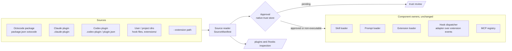

# RFC: align hooks, plugins and extensions

Treat every integration source (a native package, a Claude or Codex plugin, a user or project directory, a `--extension` path) as one kind of thing: a manifest with an identity, a protocol and component declarations. Every source then goes through one reader, one approval record and one inspection command. The component owners stay as they are: skill loader, prompt loader, extension loader, hook dispatcher and MCP registry. Today each system has its own discovery, its own approval field and its own documentation, and a feature reaches users only when all of them agree. This RFC keeps the runtime owners and removes the parallel paths around them.

## Summary

- **Decision.** Introduce one source manifest model that Octocode packages, Claude plugins and Codex plugins all produce. Executable declarations get one approval per source, stored in the existing native trust store and reviewed in `/trust`. The hook-to-extension event mapping becomes data, and the documentation table is generated from it. Nothing is enabled or disabled by environment variables.
- **Effect.** A package can ship hooks and MCP servers the way a plugin can, and a plugin is approved the same way as project hooks. `/hooks` and a single source inspector show the same facts that the runtime uses.
- **Already done in this change (S0).** `OCTOCODE_HOOKS` and `OCTOCODE_HOOKS_COMPAT` are removed. Hooks are on in every main session, each source file runs under its own profile (Claude, Codex or native), and Claude permission rules always apply. Subagents opt in through `hooks: true` (internal handoff `OCTOCODE_SUBAGENT_HOOKS`). `disableAllHooks: true` remains the off switch.
- **Provisional.** Whether installing a package approves its executable declarations is still open (see Open questions).

## Problem and context

Current behavior, from source:

| Concern     | Hooks                                                                                                                                               | Plugins                                                                        | Extensions                                                                       | Octocode packages                                                                                                                          |
| ----------- | --------------------------------------------------------------------------------------------------------------------------------------------------- | ------------------------------------------------------------------------------ | -------------------------------------------------------------------------------- | ------------------------------------------------------------------------------------------------------------------------------------------ |
| Code owner  | [`src/octocode/hooks/`](../packages/coding-agent/src/octocode/hooks/register.ts)                                                                    | [`src/core/plugin-*.ts`](../packages/coding-agent/src/core/plugin-manifest.ts) | [`src/core/extensions/`](../packages/coding-agent/src/core/extensions/loader.ts) | [`src/core/package-manager/`](../packages/coding-agent/src/core/package-manager.ts)                                                        |
| Discovery   | Fixed list of Claude, Codex and Octocode files ([`hooks/config.ts`](../packages/coding-agent/src/octocode/hooks/config.ts)) plus configured plugins | Explicit `plugins: [{ path, protocol }]` settings entries                      | Extension directories, settings paths, `--extension`, packages                   | `octocode install`, settings `packages`                                                                                                    |
| Manifest    | `{ "hooks": {...} }` JSON or Codex TOML                                                                                                             | `.claude-plugin/plugin.json`, `.codex-plugin/plugin.json`, root `plugin.json`  | None (module default export)                                                     | `package.json` key `octocode`, or the legacy key `pi` ([`extension-manifest.ts`](../packages/coding-agent/src/core/extension-manifest.ts)) |
| Can declare | Hook handlers                                                                                                                                       | Skills, prompt commands, hooks, MCP servers                                    | Tools, commands, events, providers, MCP servers, UI                              | Extensions, skills, prompts, themes; **not** hooks or MCP                                                                                  |
| Approval    | Native configuration trust (fingerprinted project files)                                                                                            | `hooksFingerprint` and `mcpFingerprint` copied by hand into settings           | Project trust for project directories; none for user files                       | Install action; project trust for project declarations                                                                                     |
| Off switch  | `disableAllHooks`                                                                                                                                   | `enabled: false`                                                               | Remove the file or path                                                          | `octocode remove`                                                                                                                          |
| Inspection  | `/hooks`                                                                                                                                            | Diagnostics in `/hooks` and the MCP views                                      | None dedicated                                                                   | `octocode list`                                                                                                                            |
| Event names | PascalCase (`PreToolUse`, `Stop`, …), 18 events                                                                                                     | Uses the hook names                                                            | snake_case (`tool_call`, `agent_before_settle`, …), about 50 events              | —                                                                                                                                          |

Deciding evidence:

- Hooks are already an adapter over extension events. `registerHooks` takes an `ExtensionAPI` and maps PreToolUse to `tool_call`, PostToolUse to `tool_result`, Stop to `agent_before_settle`, PreCompact to `session_before_compact`, and so on. The mapping exists only in a comment in [`hooks/register.ts`](../packages/coding-agent/src/octocode/hooks/register.ts) and in prose tables in [hooks.md](../packages/coding-agent/docs/hooks.md#supported-contract).
- A plugin's executable parts need two separate approvals (`hooksFingerprint`, `mcpFingerprint`). The user reads each fingerprint from a diagnostic and pastes it into settings ([plugins.md](../packages/coding-agent/docs/plugins.md#configure-a-local-plugin)). Project hooks use a third mechanism: the native trust fingerprint reviewed in `/trust`.
- A native package's `hooks/hooks.json` is ignored ([packages.md](../packages/coding-agent/docs/packages.md)). So the same hook file works in a Claude plugin and silently does nothing in an Octocode package.
- Plugin and skill markers block implicit extension discovery ([`hasPluginOrSkillMarker`](../packages/coding-agent/src/core/extension-manifest.ts)). This guard exists only because the two discovery paths can see the same directory.
- Until S0, hooks also needed two environment flags. The default runtime applied a shared behavior to Claude and Codex files that matched neither host. That second dialect doubled the test matrix and the documentation.
- The same facts are described in [hooks.md](../packages/coding-agent/docs/hooks.md) (319 lines), [plugins.md](../packages/coding-agent/docs/plugins.md), [packages.md](../packages/coding-agent/docs/packages.md), [extensions.md](../packages/coding-agent/docs/extensions.md) and the 597-line [PLUGINS_MODS_HOOKS.md](PLUGINS_MODS_HOOKS.md) matrix.

If nothing changes, each new component type (agents, LSP, Claude Mods) needs its own discovery path, approval field and document in every system. Authors will also keep finding that a declaration works in one container and is ignored in the other.

## Goals and scope

Goals:

1. One reader turns every source into the same manifest shape. Owners receive declarations, not directories.
2. One approval per source covers all of its executable declarations (hooks, MCP servers, extension entry points), reviewed in `/trust` and stored in the native trust store.
3. The hook event catalog is data. It drives dispatch registration, profile validation and the generated documentation table.
4. Octocode packages can declare hooks and MCP servers.
5. No environment variable enables or disables a component. Off switches live in configuration (`disableAllHooks`, `enabled: false`, package removal).
6. Each fact has one owning document.

Out of scope: Claude Mods execution, plugin marketplaces, dependency resolution, remote bundles, agent and LSP plugin components, and new hook events. These remain listed in [PLUGINS_MODS_HOOKS.md](PLUGINS_MODS_HOOKS.md#compatibility-matrix--current-implementation-and-remaining-work).

Constraints: keep global/workspace precedence and project trust ([CONFIGURATIONS.md](../CONFIGURATIONS.md)), keep safety checks, keep cancellation and cleanup, keep the machine-read hook payloads, and keep the 400-line source limit. Do not reintroduce Pi names or aliases.

## Proposed design



### Source manifest

One type, `SourceManifest`, in `src/core/` next to the current plugin readers:

```ts
interface SourceManifest {
	identity: string; // canonical root path or package identity; the approval key
	protocol: "octocode" | "claude" | "codex";
	scope: "user" | "project" | "package" | "plugin" | "cli";
	root: string;
	skills: string[];
	prompts: PromptDeclaration[]; // native templates and Claude commands
	themes: string[];
	extensions: string[]; // executable
	hooks: HookDefinition[]; // executable
	mcpServers: McpDeclaration[]; // executable
	diagnostics: string[];
}
```

Readers:

- `package.json` key `octocode`. This adds `hooks` and `mcpServers` alongside the existing `extensions`, `skills`, `prompts` and `themes`, and removes the `pi` key.
- The three plugin manifests, which keep their current containment and default-directory rules ([`plugin-components.ts`](../packages/coding-agent/src/core/plugin-components.ts)).
- Plain user and project directories, which become synthetic sources: hook files, `extensions/` and `skills/`.

Because a directory is read once into one manifest, the plugin/skill marker guard in extension discovery is no longer needed.

### Approval

- An approval covers the hash of a source's executable declarations: hook definitions, MCP declarations and the list of extension entry points. As today, it does not cover the contents of scripts or binaries.
- Approvals live in the native trust store that `/trust` already uses for project configuration.
- The `hooksFingerprint` and `mcpFingerprint` settings fields are removed. A source whose declarations change returns to pending, and `/trust` shows the new declarations. Pending sources load their non-executable components (skills, prompts, themes) and report the rest in diagnostics. This is the behavior unapproved plugins already have.
- User hook files and user extension files remain approved by their location, as now. Project sources still require project trust first.

### Event catalog

[`hooks/contracts.ts`](../packages/coding-agent/src/octocode/hooks/contracts.ts) gains one table, one row per hook event. Each row records:

- the extension event it adapts
- which profiles accept it
- whether it can block, ask, rewrite or add context
- its default timeout for each profile

Registration in `hooks/register/*`, profile validation in `hooks/config/parse.ts` and the hooks.md event table all read this table. The table is produced by the existing `generate:references` script, so the documentation cannot drift from dispatch.

### Enablement

There are no enablement environment variables. Components are on when they are discovered, trusted where trust applies, and approved where they are executable. Off switches:

- `disableAllHooks` for hooks
- `enabled: false` for a plugin or package entry
- removing the package or path for extensions

Internal parent-to-child handoffs such as `OCTOCODE_SUBAGENT_HOOKS` are not user switches. They stay documented in code only.

### Inspection

Add one canonical command, `/plugins`. It lists every source with:

- protocol and scope
- components by kind
- approval state
- diagnostics

`/hooks` keeps the per-command detail: matcher, profile and timing. `octocode list` keeps the package-install view.

### Compatibility

- Hook payloads, profiles and plugin MCP server names (`plugin:<name>:<key>`) do not change.
- Existing `hooksFingerprint` and `mcpFingerprint` values stop applying. The affected plugin shows as pending in `/trust` until it is approved there once.
- Packages that still use the `pi` key stop loading their resources and get a diagnostic that names the key to rename.

## Alternatives and rationale

| Option                                                 | Cost                                                                     | Benefit                                                                                       | Verdict                                                                                                                                                       |
| ------------------------------------------------------ | ------------------------------------------------------------------------ | --------------------------------------------------------------------------------------------- | ------------------------------------------------------------------------------------------------------------------------------------------------------------- |
| A. Status quo plus S0                                  | None further                                                             | Flags are already gone                                                                        | Leaves three approval mechanisms, two manifest formats and hand-copied fingerprints                                                                           |
| **B. One source manifest and one approval (proposed)** | Reader refactor, settings migration, generator step                      | One path for every new component kind. Packages and plugins reach parity. Docs come from data | Chosen: the owners already exist and only the paths into them differ                                                                                          |
| C. Compile hook files into extensions                  | Rewrite of the dispatcher's per-profile semantics into generated modules | One runtime concept                                                                           | Rejected: profiles need per-dialect parsing, failure policy and output validation that the adapter already owns. Generated code would hide that from `/hooks` |
| D. Keep separate approvals, share only the review UI   | Small                                                                    | Less code moves                                                                               | Rejected: fingerprints would still be copied by hand, and package hooks would still need a fourth approval                                                    |

This choice would be reversed if approving per component kind turns out to be required for security review. For example, approving a plugin's skills and MCP server while refusing its hooks. In that case the approval record keeps one hash per component kind behind the same `/trust` flow.

## Risks and mitigations

- **Hooks are now on by default (S0).** Users with hooks in `~/.claude/settings.json` or `~/.codex/hooks.json` will have them run in Octocode on upgrade. Mitigation: the release note names `disableAllHooks`, and `/hooks` lists every loaded command with its source. Project and plugin hooks still require review.
- **Claude permission rules now always apply (S0).** Rules a user wrote for Claude Code now restrict Octocode too. Mitigation: restrictions only ever narrow behavior, and a typed `!` command keeps typed consent when no rule or shell target concerns it.
- **The approval migration invalidates existing plugin approvals.** Mitigation: a one-time diagnostic in `/trust` names each affected plugin.
- **A package can now run hooks.** Mitigation: package hooks use the same approval as plugin hooks, and installing a package does not auto-approve them unless the open question is resolved that way.
- **Coupling.** Five owners receive declarations from one reader. Mitigation: the reader produces plain data, owners keep their validation, and `check:boundaries` keeps `core/` free of `octocode/` imports.

## Implementation and rollout

Each step is a separate change with its own check. Steps after S1 depend on S2.

| Step      | Change                                                                                                                                                                                                                    | Check                                                                                                   | Rollback                                              |
| --------- | ------------------------------------------------------------------------------------------------------------------------------------------------------------------------------------------------------------------------- | ------------------------------------------------------------------------------------------------------- | ----------------------------------------------------- |
| S0 (done) | Remove `OCTOCODE_HOOKS` and `OCTOCODE_HOOKS_COMPAT`. Source profiles and Claude permission rules are always on. Subagents opt in with `hooks: true`                                                                       | Native hook, permission and subagent suites. Docs updated                                               | Revert the commit                                     |
| S1 (done) | Event catalog as data in `hooks/catalog.ts`. The parser, payload projection, `/hooks events` and the generated `docs/hook-events.md` read it                                                                              | Existing hook suites unchanged. Generated table matches                                                 | Revert; the prose table returns                       |
| S2        | `SourceManifest` and readers. Plugin readers and `readExtensionManifest` move behind it. Drop the `pi` key                                                                                                                | Plugin manifest, component, extension discovery and package tests. New tests for a `pi`-key diagnostic  | Revert the reader; owners are unchanged               |
| S3        | Owners consume `SourceManifest`. Remove `hasPluginOrSkillMarker`                                                                                                                                                          | Extension discovery rules and plugin runtime tests                                                      | Revert S3 only                                        |
| S4        | One approval per source in the native trust store. Remove `hooksFingerprint` and `mcpFingerprint` from the settings schema and regenerate schemas                                                                         | Plugin fingerprint, trust and plugin MCP tests rewritten for the trust store. Migration diagnostic test | Restore the fields; the trust-store record is ignored |
| S5        | `octocode.hooks` and `octocode.mcpServers` declarations in packages                                                                                                                                                       | Package distribution tests with a hook-bearing package (pending until approved)                         | Drop the two fields                                   |
| S6 (done) | `/plugins` command: lists plugins, extensions and hooks per host and switches each through the `toggles` setting ([plugins.md](../packages/coding-agent/docs/plugins.md#inspect-and-switch-plugins-extensions-and-hooks)) | Command registration and SDK command inventory tests                                                    | Remove the command                                    |
| S7        | Docs: hooks.md keeps hook mechanics, plugins.md and packages.md merge into one page per container, and PLUGINS_MODS_HOOKS.md keeps only the status matrix                                                                 | Link and anchor check. `yarn run check`                                                                 | Revert the docs                                       |

## Validation and success

- Given a Claude plugin with hooks and an MCP server, when the user approves it once in `/trust`, then both components load after reload and `/plugins` shows one approved source.
- Given an approved plugin, when its `hooks/hooks.json` changes, then its hooks and MCP servers stop loading, its skills still load, and `/trust` shows the changed declarations.
- Given an Octocode package declaring `octocode.hooks`, when it is installed and approved, then its hooks dispatch exactly as the same file inside a Claude plugin with the same protocol.
- Given a package that uses the `pi` key, when Octocode starts, then none of its resources load and a diagnostic names the key to rename.
- Given the event catalog, when `generate:references` runs, then the hooks.md event table equals the catalog, and adding a catalog row without a dispatcher fails a test.
- Given any loaded hook file with `disableAllHooks: true`, when a session starts, then no hook runs and `/hooks` says why. No environment variable changes this.
- `yarn run check`, `./test.sh` and `yarn vitest run --config vitest.octocode.config.ts` pass after each step.

## Open questions

- Blocking: Does `octocode install` approve a package's executable declarations, or do package hooks and MCP servers wait for `/trust` like plugins? Approving at install keeps the current extension behavior (installed code runs). Waiting is stricter, but a package's extensions would then also wait, which changes how packages behave today. This must be settled before S4 and S5. The owner is the user.
- Non-blocking: Should one approval cover all component kinds, or should each kind keep its own hash within one record? A single hash is simpler. Per-kind hashes allow a partial refusal. The default in this RFC is a single hash.
- Non-blocking: The name of the inspection command. `/plugins` matches the user-facing term for containers. `/sources` would match the model. Canonical commands are one word either way.
- Non-blocking: Several environment flags outside hooks still gate features. Some are opt-in (`OCTOCODE_EXPERIMENTAL`, `OCTOCODE_API`, `OCTOCODE_CACHE_DIAGNOSTICS`) and some are opt-out (`OCTOCODE_MCP`, `OCTOCODE_MCP_BROWSER`, `OCTOCODE_MEMORY_AUTO`, `OCTOCODE_EXTRA_SKILLS`, `OCTOCODE_VERIFY_NUDGE`, `OCTOCODE_EDIT_DIAGNOSTICS`, `OCTOCODE_MODELS_DEV`, `OCTOCODE_INSTRUCTION_CACHE_SPLIT`). Applying the enablement principle to them is a separate decision for each flag.
