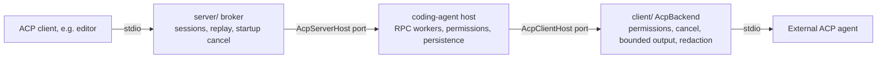

# @octocodeai/octocode-acp

Private workspace: Octocode's inbound and outbound Agent Client Protocol v1 integration, on the official `@agentclientprotocol/sdk` (stable v1 API; no second wire protocol or agent loop). Users: [ACP guide](../coding-agent/docs/acp.md) (launch with `octocode --mode acp`, capabilities, Codex, permissions, limits). The [local session API](../coding-agent/docs/session-api.md) is a separate protocol.



| Owner                   | Responsibility                                                                                                    |
| ----------------------- | ----------------------------------------------------------------------------------------------------------------- |
| `src/server/`           | Stdio broker, session lifecycle, input/event conversion, history replay, startup cancellation, client MCP handoff |
| `src/client/`           | Outbound process connection, permission callbacks, cancellation, bounded output, credential redaction             |
| `src/host.ts`           | `AcpServerHost`, `AcpClientHost` and `AcpBrokerHost` ports and the worker, event and transcript types acp reads   |
| `packages/coding-agent` | CLI selection, RPC workers, model execution, native permissions, persistence, external-agent manager, session API |
| `packages/mcp`          | MCP configuration, connections and tool registration used by the handoff                                          |

## Packaging

Not independently publishable: `octocodeSource` declares the `acp` mount and the coding-agent build bundles these sources (relative-path imports), shipping the runtime dependencies including the SDK. acp imports nothing from `packages/coding-agent`; shared helpers come from `packages/common` and external-agent types from `packages/contracts` (`external`). There is no new public export or executable.

## Host ports

Hosts pass an implementation explicitly; there is no global registry.

| Port            | Provides                                                                                                                                                                                       | Implemented in                                                                                                                         |
| --------------- | ---------------------------------------------------------------------------------------------------------------------------------------------------------------------------------------------- | -------------------------------------------------------------------------------------------------------------------------------------- |
| `AcpServerHost` | Agent directory, Node runtime, session directory config, session listing and transcripts for replay, `createWorker` (wraps the RPC client), stdout take-over, compaction summary text, version | `coding-agent/src/main/acp-host.ts` (`acpServerHost`); `--mode acp` runs `runAcpMode(acpServerHost, acpWorkerArguments(args, parsed))` |
| `AcpClientHost` | `saveOutput` for bounded output archives; `processTree` (`graceMs`, `prepare`, `adopt`, `stop`) for peer process ownership                                                                     | `coding-agent/src/octocode/external/acp-host.ts` (`acpClientHost`, `connectAcp`; the external manager's default connection factory)    |
| `AcpBrokerHost` | The subset of `AcpServerHost` the broker and replay read                                                                                                                                       |                                                                                                                                        |

Internal exports: `@octocodeai/octocode-acp/server` (`runAcpMode`, `acpWorkerArguments`) and `/client` (`AcpBackend`, `AcpError`, `AcpPermission`). Tests build real adapters: `AcpBroker({ host: acpServerHost, ... })`, `AcpBackend.connect(acpClientHost, ...)`, `new AcpOutput(acpClientHost.saveOutput)`.

## Verify

```sh
yarn workspace @octocodeai/octocode-acp test
yarn node --test scripts/acp-workspace.test.mjs   # ownership: one source owner, no private runtime dependency, staging of entries
yarn run check
yarn run build:offline
```

`test/server/` and `test/client/` cover broker, history, input, approvals, startup ownership, process lifecycle, output bounds and redaction. CLI/RPC/API integration tests and the Python SDK, TCK and reliability runners stay in `packages/coding-agent/test/`; commands in the [ACP guide](../../DEVELOPMENT.md#interface-checks).
