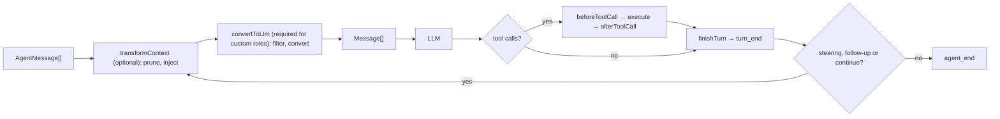

# @octocodeai/octocode-agent-core

The agent loop: a stateful `Agent` that streams a model response, runs tool calls, queues steering input and emits events. It builds on `@octocodeai/octocode-ai` and receives models, tools and policy from its host. The package is private and bundled into `@octocodeai/octocodecode`; contributors import it as a workspace. Application files and settings: [CONFIGURATIONS.md](../coding-agent/docs/configuration.md).

## Quick start

```typescript
import { Agent } from "@octocodeai/octocode-agent-core";
import { createModels } from "@octocodeai/octocode-ai";
import { anthropicProvider } from "@octocodeai/octocode-ai/providers/anthropic";

const models = createModels();
models.setProvider(anthropicProvider());
const model = models.getModel("anthropic", "claude-sonnet-4-6");
if (!model) throw new Error("Model not found");

const agent = new Agent({
	initialState: { systemPrompt: "You are a helpful assistant.", model },
	streamFn: models.streamSimple.bind(models),
});

agent.subscribe((event) => {
	if (event.type === "message_update" && event.assistantMessageEvent.type === "text_delta") {
		process.stdout.write(event.assistantMessageEvent.delta);
	}
});

await agent.prompt("Hello!");
```

## How a run works

`AgentMessage` is the agent's own message type: the LLM roles (`user`, `assistant`, `toolResult`) plus app-specific roles added by declaration merging. Before every provider request the loop converts it to what the model understands.



## Exports

| Export                                                                   | Purpose                                                                                       |
| ------------------------------------------------------------------------ | --------------------------------------------------------------------------------------------- |
| `Agent`                                                                  | Stateful wrapper: state, `prompt()`, `continue()`, queues, `subscribe()`, `abort()`           |
| `agentLoop`, `agentLoopContinue`, `runAgentLoop`, `runAgentLoopContinue` | Low-level loop without the `Agent` class                                                      |
| `runToolCall`                                                            | Run one tool call through the hooks (hosts use it to adapt MCP tools)                         |
| `streamProxy`                                                            | `streamFn` that goes through a backend proxy                                                  |
| `setDefaultStreamFn`                                                     | Default `streamFn` for agents created without one                                             |
| `createEventBus`                                                         | Channel-keyed event bus with no Node dependency                                               |
| `AgentToolExecutionError`                                                | Error that keeps structured `details` on a failed tool                                        |
| Types                                                                    | `AgentMessage`, `AgentTool`, `AgentState`, `AgentEvent`, `AgentContext`, `AgentLoopConfig`, … |

## Pages

| Page                     | Covers                                                                                         |
| ------------------------ | ---------------------------------------------------------------------------------------------- |
| [API](docs/api.md)       | Options, state, methods, steering and follow-up, custom messages, tools, proxy, low-level loop |
| [Events](docs/events.md) | Event sequences, tool hooks, request preparation, turn finalization, `continue()`, event types |

## License

MIT
