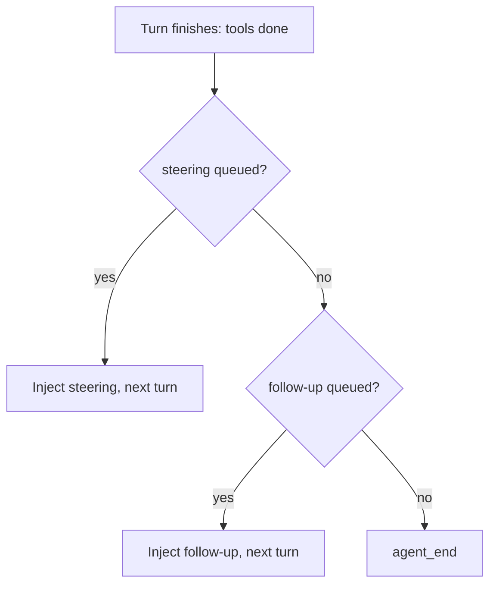

# Agent API

Part of the [`@octocodeai/octocode-agent-core`](../README.md) guide. Event order and hooks: [Events](events.md).

## Options

All optional except `streamFn`.

| Option                            | Meaning                                                                                                                                                                                                                 |
| --------------------------------- | ----------------------------------------------------------------------------------------------------------------------------------------------------------------------------------------------------------------------- |
| `initialState`                    | `systemPrompt`, `model`, `thinkingLevel` (`off`, `minimal`, `low`, `medium`, `high`, `xhigh`, `max`), `tools`, `messages`. Prompt and tools become the leading system message unless `messages` already starts with one |
| `streamFn`                        | Required. Receives a `TranscriptContext`; the prompt and tool declarations live in its system messages                                                                                                                  |
| `convertToLlm`                    | `AgentMessage[]` → `Message[]`; required for custom roles                                                                                                                                                               |
| `transformContext`                | `(messages, signal)` before `convertToLlm`: pruning, compaction                                                                                                                                                         |
| `steeringMode`, `followUpMode`    | `"one-at-a-time"` (default) or `"all"`                                                                                                                                                                                  |
| `sessionId`                       | Provider cache key                                                                                                                                                                                                      |
| `getApiKey`                       | `(provider)` resolves a key per request, for expiring OAuth tokens                                                                                                                                                      |
| `toolExecution`                   | `"parallel"` (default) or `"sequential"`                                                                                                                                                                                |
| `beforeToolCall`, `afterToolCall` | Preflight and postprocess each tool call                                                                                                                                                                                |
| `prepareRequest`                  | Rebuild the finalized context before every provider request                                                                                                                                                             |
| `finishTurn`                      | Decide `continue` or `end` before `turn_end`                                                                                                                                                                            |
| `unknownToolMessage(name)`        | Error text for a call to an undeclared tool                                                                                                                                                                             |
| `pendingToolNames()`              | Names of tools declared but not executable yet                                                                                                                                                                          |
| `thinkingBudgets`                 | Token budgets for `minimal`, `low`, `medium`, `high` on token-based providers                                                                                                                                           |

Hook semantics: [Events](events.md#tool-execution-hooks).

## State

```typescript
interface AgentState {
	model: Model<any>;
	thinkingLevel: ThinkingLevel;
	tools: AgentTool<any>[];
	messages: AgentMessage[];
	readonly systemPrompt: string;
	readonly isStreaming: boolean;
	readonly streamingMessage?: AgentMessage;
	readonly pendingToolCalls: ReadonlySet<string>;
	readonly errorMessage?: string;
}
```

- Assigning `state.tools` or `state.messages` copies the top-level array; mutating the returned array mutates the state.
- The transcript owns the system prompt: the leading system message is the prompt, later system messages patch it. `state.systemPrompt` replays it read-only. `getCurrentSystemMessage(messages)` from `@octocodeai/octocode-ai` returns the replayed head, including declared tools.
- `state.tools` is the executable loadout. Before each request the loop diffs it against the tools the transcript declares and, on a difference, announces the change in a system message.
- `isStreaming` stays `true` until the run settles, including awaited `agent_end` subscribers. `streamingMessage` is the current partial assistant message.

To change the prompt mid-conversation, append a system message with `content` (added instructions) or `sections` (named replacements):

```typescript
await agent.prompt([
	{ role: "system", content: "", sections: { skills: "<skills>...</skills>" }, timestamp: Date.now() },
	{ role: "user", content: "Continue", timestamp: Date.now() },
]);
```

## Methods

| Method                                         | Does                                                                                                                   |
| ---------------------------------------------- | ---------------------------------------------------------------------------------------------------------------------- |
| `prompt(text \| message \| messages, images?)` | Start a run                                                                                                            |
| `continue()`                                   | Continue from a non-assistant tail; with an assistant tail it uses one queued steering batch, then one follow-up batch |
| `abort()` / `await waitForIdle()`              | Cancel / wait until settled                                                                                            |
| `subscribe((event, signal) => …)`              | Returns an unsubscribe function; listeners are awaited in registration order                                           |
| `reset()`                                      | Clear messages and queues, keeping the system prompt and tool baseline; throws while a run is active                   |
| `peekQueuedMessages()`                         | Next queued messages, respecting queue modes; does not consume                                                         |

```typescript
await agent.prompt("What's in this image?", [{ type: "image", data: base64Data, mimeType: "image/jpeg" }]);
agent.state.model = getBuiltinModel("openai", "gpt-4o"); // from "@octocodeai/octocode-ai/providers/all"
agent.state.thinkingLevel = "medium";
agent.toolExecution = "sequential"; // also sessionId, thinkingBudgets and every hook are assignable
```

An abort during a tool batch still lets the loop issue one more request, which returns at once with `stopReason: "aborted"` and marks the interruption in the transcript; steering queued before the abort is committed first. An abort after a batch finished ends the run at the next turn boundary without that message.

## Steering and follow-up



```typescript
agent.steer({ role: "user", content: "Stop! Do this instead.", timestamp: Date.now() }); // while running
agent.followUp({ role: "user", content: "Also summarize.", timestamp: Date.now() }); // after it would stop
agent.clearSteeringQueue(); // also clearFollowUpQueue(), clearAllQueues()
```

Edit one queued message by object identity: `hasQueuedMessage`, `removeQueuedMessage`, `swapQueuedMessages(first, second)` (same queue only), `placeQueuedMessage(message, "steer" | "followUp", before?)` (moves it from either queue; last when `before` is not queued there).

## Custom message types

```typescript
declare module "@octocodeai/octocode-agent-core" {
	interface CustomAgentMessages {
		notification: { role: "notification"; text: string; timestamp: number };
	}
}

const agent = new Agent({
	streamFn: models.streamSimple.bind(models),
	convertToLlm: (messages) => messages.filter((m) => m.role !== "notification"),
});
```

## Tools

```typescript
import { Type } from "typebox";

const readFileTool: AgentTool = {
	name: "read_file",
	label: "Read File", // UI display
	description: "Read a file's contents",
	parameters: Type.Object({ path: Type.String({ description: "File path" }) }),
	executionMode: "sequential", // optional; one sequential tool makes the whole batch sequential
	execute: async (toolCallId, params, signal, onUpdate) => {
		if (!fs.existsSync(params.path)) throw new Error(`File not found: ${params.path}`);
		const content = await fs.readFile(params.path, "utf-8");
		onUpdate?.({ content: [{ type: "text", text: "Reading..." }], details: {} });
		return { content: [{ type: "text", text: content }], details: { path: params.path } };
	},
};
agent.state.tools = [readFileTool];
```

- **Failure:** throw. Do not return error text as content. The agent reports it to the model as a tool error (`isError: true`). Throw `AgentToolExecutionError(message, result)` to keep structured `details`.
- **`terminate: true`** (from `execute`, a blocked `beforeToolCall` or `afterToolCall`) hints that the run should stop after the batch; it applies only when every finalized result in the batch sets it. It is runtime-only; transcript tool results stay standard.
- **`structuredContent`** on a result is kept in the persisted `ToolResultMessage` for replay and interfaces; it is not sent to the model.
- **MCP tools:** hosts adapt each MCP server tool to an `AgentTool` and run it through `runToolCall()`, which keeps both hooks.

## Proxy

`streamProxy` replaces `streamFn` for browser apps that go through a backend. The server strips `partial` from delta events and the client rebuilds it. Servers send `content_update` with `{ contentIndex, content }` (the complete normalized block, keeping attachments and annotations); a `text_end` frame may carry authoritative `text`, `annotations` and `contentSignature`.

```typescript
const agent = new Agent({
	streamFn: (model, context, options) =>
		streamProxy(model, context, { ...options, authToken: "...", proxyUrl: "https://your-server.com" }),
});
```

## Low-level loop

`agentLoop(messages, context, config, signal, streamFn)` and `agentLoopContinue(context, config, signal, streamFn)` return event streams without the `Agent` class.

```typescript
const context: AgentContext = {
	messages: [{ role: "system", content: "You are helpful.", timestamp: Date.now() }],
	tools: [],
};
const config: AgentLoopConfig = {
	model: getBuiltinModel("openai", "gpt-4o"),
	convertToLlm: (msgs) => msgs.filter((m) => ["user", "assistant", "toolResult"].includes(m.role)),
	toolExecution: "parallel",
};
for await (const event of agentLoop([userMessage], context, config, undefined, models.streamSimple.bind(models))) {
	console.log(event.type);
}
```

These streams are observational: they keep event order but do not wait for your async handling. For message processing as a barrier before tool preflight, use `Agent`.
