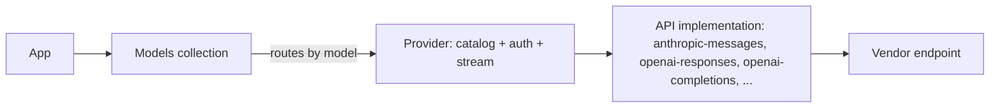

# @octocodeai/octocode-ai

Unified LLM API: provider collections, automatic auth resolution, streaming events, token and cost tracking, and context hand-off between models mid-session. The package is private and bundled into `@octocodeai/octocodecode`; contributors import it as a workspace. The coding agent owns `models.json`, stored credentials and model selection: see [CONFIGURATIONS.md](../coding-agent/docs/configuration.md) and the [models guide](../coding-agent/docs/models.md).

The chat catalog lists only models that support tool calling. Image and classifier catalogs use their own capabilities.



## Pages

| Page                                                           | Covers                                                                                                   |
| -------------------------------------------------------------- | -------------------------------------------------------------------------------------------------------- |
| [Providers and models](docs/providers-and-models.md)           | Factories, model queries, static catalog, dynamic providers, migrating from the global API               |
| [Auth](docs/auth.md)                                           | Auth resolution, header transforms, credential store, environment variables, OAuth, Vertex AI, CLI login |
| [Tools](docs/tools.md)                                         | Defining tools, constrained sampling, partial JSON, validation, event reference                          |
| [Images](docs/images.md)                                       | Image input and generation                                                                               |
| [Classification](docs/classification.md)                       | Classifier models, OpenAI Decisions, llama.cpp                                                           |
| [Thinking and stop reasons](docs/thinking-and-stop-reasons.md) | Reasoning options, thinking events, stop reasons                                                         |
| [Errors and observability](docs/errors-and-observability.md)   | Telemetry, errors, aborts, payload and stream-event debugging                                            |
| [Custom providers](docs/custom-providers.md)                   | `createProvider()`, direct API calls, OpenAI compatibility settings                                      |
| [Conversations](docs/conversations.md)                         | Cross-provider handoff, system messages, serialization                                                   |
| [Browser and bundling](docs/browser-and-bundling.md)           | Browser use, tree shaking, env overrides, model discovery                                                |
| [Development](docs/development.md)                             | Adding a provider, faux provider for tests                                                               |

## Supported providers

| Group                       | Providers                                                                                                                                                                                                              |
| --------------------------- | ---------------------------------------------------------------------------------------------------------------------------------------------------------------------------------------------------------------------- |
| Frontier                    | OpenAI (including Decisions), Anthropic, Google, Vertex AI, Azure OpenAI (Responses), Amazon Bedrock, Mistral, xAI, Meta (Responses-compatible), DeepSeek                                                              |
| Subscriptions (OAuth)       | OpenAI Codex (legacy, ChatGPT Plus/Pro), GitHub Copilot: see [OAuth](docs/auth.md#oauth)                                                                                                                               |
| Gateways and hosts          | OpenRouter, Vercel AI Gateway, Cloudflare AI Gateway and Workers AI, Groq, Cerebras, Together AI, Baseten, Hugging Face, NVIDIA NIM, Fireworks (OpenAI- and Anthropic-compatible), OpenCode Zen and Go                 |
| Regional and plan providers | Ant Ling, ZAI Coding Plan, MiniMax, Moonshot AI and Kimi For Coding, Qwen Token Plan, Xiaomi MiMo (each with its China or region variants where listed in [environment variables](docs/auth.md#environment-variables)) |
| Classifiers                 | TypeSafe (System One)                                                                                                                                                                                                  |
| Anything else               | Any OpenAI-compatible API (Ollama, vLLM, LM Studio) via [custom providers](docs/custom-providers.md)                                                                                                                   |

`Type`, `Static` and `TSchema` from TypeBox are re-exported from the root.

## Quick start

Build a `Models` collection and stream through it. `builtinModels()` registers every built-in provider; size-sensitive apps register single providers ([factories](docs/providers-and-models.md#provider-factories), [bundling](docs/browser-and-bundling.md#bundling-and-tree-shaking)).

```typescript
import { Type, type Context, type Tool } from "@octocodeai/octocode-ai";
import { builtinModels } from "@octocodeai/octocode-ai/providers/all";

const models = builtinModels();
const model = models.getModel("openai", "gpt-4o-mini")!;

const tools: Tool[] = [
	{
		name: "get_time",
		description: "Get the current time",
		parameters: Type.Object({ timezone: Type.Optional(Type.String({ description: "e.g. America/New_York" })) }),
	},
];

// A Context is plain JSON: serialize it and hand it to another model at any time
const context: Context = {
	systemPrompt: "You are a helpful assistant.",
	messages: [{ role: "user", content: "What time is it?", timestamp: Date.now() }],
	tools,
};

// Streaming; auth resolves through the provider (OPENAI_API_KEY here)
const s = models.stream(model, context);
for await (const event of s) {
	if (event.type === "text_delta") process.stdout.write(event.delta);
	if (event.type === "toolcall_end") console.log(event.toolCall.name, event.toolCall.arguments);
	if (event.type === "error") console.error(event.error.errorMessage);
}
const message = await s.result();
context.messages.push(message);

// Run each tool call, push a toolResult, then ask again
for (const call of message.content.filter((b) => b.type === "toolCall")) {
	context.messages.push({
		role: "toolResult",
		toolCallId: call.id,
		toolName: call.name,
		content: [{ type: "text", text: new Date().toISOString() }],
		isError: false,
		timestamp: Date.now(),
	});
}
const answer = await models.complete(model, context); // no streaming
console.log(message.usage.cost.total); // estimated USD
```

Events: [Tools](docs/tools.md#complete-event-reference). Failures arrive as an `error` event and a final message with `stopReason: "error"`: [Errors](docs/errors-and-observability.md).

## Cost

`usage.cost` estimates inference charges from the provider's catalog rates and reported tokens, including long-context tiers, cache-write lifetimes, served OpenAI service tiers and billable reasoning tokens. A time-limited price carries `cost.until` (last UTC day, inclusive) and `cost.after` (the rates from the next day); `calculateCost(model, usage, now?)` picks the period by the clock, which tests can inject. Subscription allowances, account credits, regional premiums and time-based cache-storage fees are not represented.

## License

MIT
