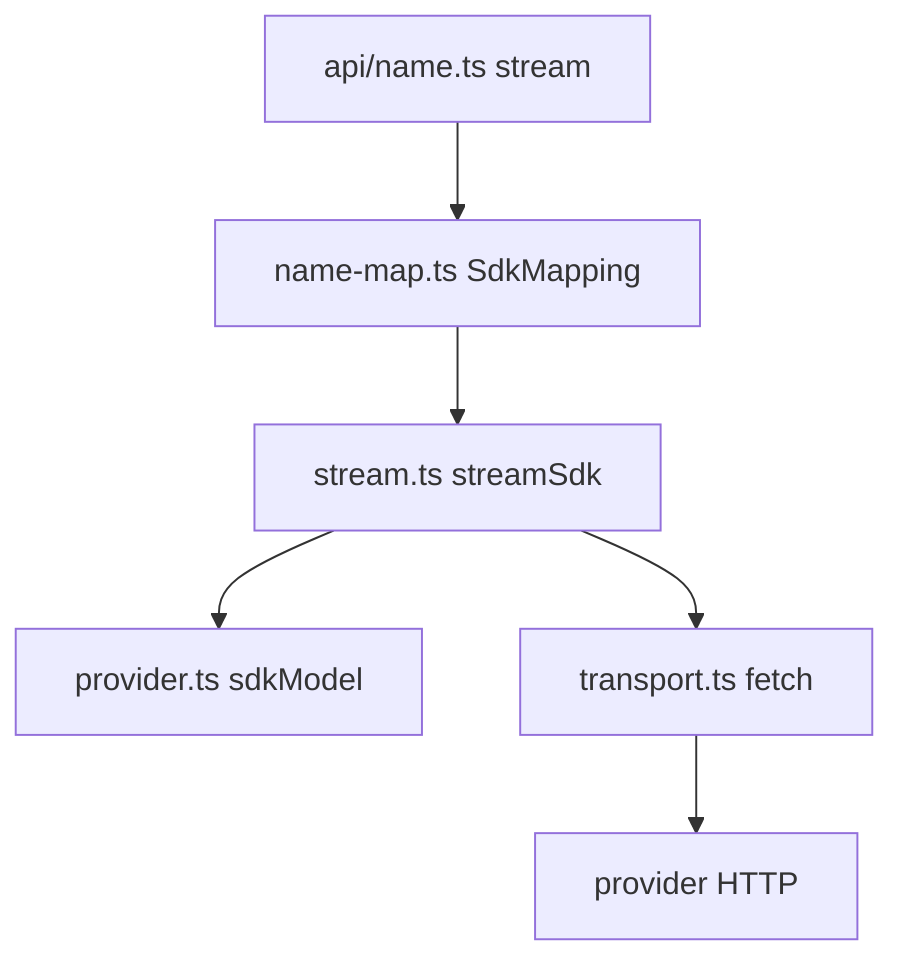

# Provider adapters on the AI SDK

Every streaming provider API runs through the Vercel AI SDK (`ai` and `@ai-sdk/*`). Vendor clients and our own HTTP or SSE
parsing are gone. What remains here is mapping: transcript to SDK messages, SDK parts to Octocode events, and a few
narrow request fixes the SDK does not expose. Mappings preserve request policy, transcript replay, streaming events and
usage accounting.

## Shape

| Piece | Owns |
| --- | --- |
| `stream.ts` | the `streamText` call, part-to-event mapping, usage, stop reasons, abort, errors |
| `transport.ts` | the fetch the SDK uses: retries, deadlines, cancellation, `onResponse`, `onProviderStreamEvent` (fired once, here only) |
| `provider.ts` | builds the SDK model per `model.api`, importing each `@ai-sdk/*` package lazily |
| `*-map.ts` | one provider's `SdkMapping` |

`SdkMapping` hooks, narrowest first:

| Hook | Use |
| --- | --- |
| `providerOptions` | fields the SDK supports |
| `augmentRequest` | the few request fields the SDK drops; runs before `onPayload` |
| finalization | runs after a replacement payload, so Anthropic can require streaming |
| `onPart` | raw chunks the SDK does not map |
| `networkFetch` | request signing after every hook (Bedrock) |
| `model` | the mapping builds its own SDK model (Node-only providers) |

Gate provider-specific behavior on the exact `model.api`. SDK errors are consumed from the stream rather than printed to
stderr, where credentials could leak.

## Per provider

| API | Package | Notes |
| --- | --- | --- |
| `anthropic-messages` | `@ai-sdk/anthropic` | Workload identity federation reads its token file through a variable `import()` specifier |
| `openai-responses` | `@ai-sdk/openai` | |
| `openai-completions` | `@ai-sdk/openai-compatible` | Supplies its own stream state |
| `azure-openai-responses` | `@ai-sdk/azure` | |
| `google-generative-ai` | `@ai-sdk/google` | See Google replay below |
| `google-vertex` | `@ai-sdk/google-vertex` | API key: the `/edge` entry (browser-safe). Credentials: `vertex-node.ts` with `google-auth-library`, loaded through `vertex-node.lazy.ts` |
| `bedrock-converse-stream` | `@ai-sdk/amazon-bedrock` | See Bedrock below |
| `mistral-conversations` | `@ai-sdk/mistral` | Generated images arrive in raw chunks and are added in `onPart`; unknown output is a typed error |
| `openai-codex-responses` | `@ai-sdk/openai` | HTTP (SSE) only; the WebSocket transport and its settings are removed |

Not on `streamText`, by design:

- Classifiers (System One and similar) post with `postToApi` from `@ai-sdk/provider-utils`.
- The Cloudflare Workers AI binding calls `env.AI.run` as a custom transport.
- OpenRouter image generation reads the raw JSON response: the compatible SDK schema drops `message.images`.

OpenAI wire types are neutral contracts in `openai-wire-types.ts`; the `openai` package is gone.

## Google replay

Replay preserves Gemini 2.x separate image turns, Gemini 3 nested image results, fitted tool IDs, signed empty blocks
and distinct thought-signature boundaries. Raw SDK chunks keep media order and signatures without duplicating SDK
content events. Usage keeps provider totals and clamps invalid billing counts. Unsigned Gemini 3 function calls use the
SDK's documented signature-validation sentinel; real same-model signatures are kept.

## Bedrock

- Credentials come from `@aws-sdk/credential-providers` (profiles, SSO, assume-role, instance roles). The region falls
  back to the profile's `region` in the AWS config file.
- Requests are signed in `networkFetch` with `aws4fetch`, after our hooks change the body, so the signature matches what
  is sent.
- The SDK drops tool definitions when no tool is offered this turn, but Bedrock rejects history with tool calls and no
  `toolConfig`. The mapping hands the SDK the historical tools during conversion and removes `toolConfig` in
  `augmentRequest` when this turn offers none.
- Error messages keep their old prefixes, because retry classification matches on them (for example `server.?error`).
- The mapping builds its own model (`SdkMapping.model`), keeping AWS packages out of `provider.ts` and the browser graph.

## Node-only code and bundles

- Node-only modules load through a variable specifier, which bundlers do not follow. A literal `import("node:…")` fails
  the browser build; `process.getBuiltinModule` would bypass test mocks.
- Single-file builds (the Bun binary) cannot load those at runtime, so they register them statically:
  `setBedrockProviderModule` and `setVertexNodeModule` (see `coding-agent/src/bun/runtime-setup.ts`).
- `check:browser-smoke` fails when a Node built-in reaches the browser bundle.

## Verification

Tests never reach the network: they pass a `fetch` that returns recorded SSE and assert on the captured request body
(`onPayload`) and the emitted events; the no-network setup refuses unmocked requests. Live tests are credential-gated
and skipped by default. After a change here run the full AI suite, `yarn run check` (typecheck, lint, browser smoke)
and e2e.
