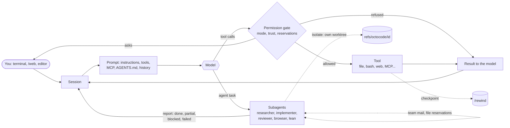

# Octocode Agent

A terminal coding agent that researches code before it changes it, and splits big work across a team of subagents and git worktrees. Fork of [Pi](https://github.com/earendil-works/pi) with the Octocode features built in.

## Install and first run

Needs Node 24.15 or later (Node 24 line).

```sh
npm install -g @octocodeai/octocode-agent
cd your-project
octocode
```

> [!NOTE]
> Octocode first asks whether you trust the folder. Until you do, it reads nothing from it: no `AGENTS.md`, settings, MCP servers, hooks or skills.

1. `/providers` connects an AI provider (browser sign-in or API key).
2. `/model` picks the model, then type your task.
3. Optional: `/octocode auth login` connects GitHub for code search.
4. `/help` lists every command.

Run it without the terminal UI, for other agents, scripts and CI:

```sh
octocode -p --no-stdin --permission-mode workspace "Summarize what changed on this branch"
git diff main | octocode -p "Review this diff for bugs"   # piped stdin is read first
octocode --trust -p "..."                                 # headless runs need a trusted folder
```

For machine-readable progress use `--mode json`; for a persistent worker use `--mode rpc`. The [external-agent guide](docs/external-agents.md) explains safe spawning, model and permission selection, configuration and completion checks.

Something not working? See [troubleshooting](docs/troubleshooting.md).

The package installs `octocode` and `octocode-api`. If the separate `octocode` research package is installed globally, npm reports `EEXIST` for the shared command name: remove that package first, or install with `--force`. `octocode --version` shows which one runs.

## How a turn works

Every tool call passes one permission gate; a refusal comes back to the model as a result, not a crash. The model can hand bounded work to subagents, each its own process with its own saved session.



## Features

| Feature               | What you get                                                                                     | Start with                                   | Page                                                                                           |
| --------------------- | ------------------------------------------------------------------------------------------------ | -------------------------------------------- | ---------------------------------------------------------------------------------------------- |
| Octocode research     | Local, AST, LSP, GitHub and package search, on by default                                        | just ask; `/octocode auth login`             | [research CLI](docs/commands.md#the-octocode-research-cli)                              |
| Tools                 | `bash`, guarded `file` writer, `web`, `agent`, `backlog`, `archive`, `memory`, `notify`, `askUser` | `--tools`, `--exclude-tools`                 | [tool selection](docs/tools.md#tool-selection-and-exposure)                         |
| Subagents             | Children with roles, model routes, request budgets, check-ins                                    | ask for parallel work; `/agents`             | [subagents](docs/subagents.md)                                                 |
| Worktrees             | Parallel sessions on separate branches, one team                                                 | `--worktree <name>`; `/worktree`             | [worktrees](docs/subagents.md#worktrees)                                                 |
| Team and locks        | File reservations, team mail, backlog-driven coordination                                        | `/agents`                                    | [communication](docs/subagents.md#communication-and-results)                             |
| Backlog and web board | Durable work items and a live board                                                              | `/web`                                       | [web workspace](docs/web-workspace.md)                                                         |
| Memory and archive    | Notes, searchable history, compaction summaries                                                  | `/memory`                                    | [memory](docs/memory.md)                                                                       |
| MCP                   | Any stdio or Streamable HTTP server                                                              | `/mcp`; `octocode mcp add`                   | [MCP](docs/mcp.md)                                                                             |
| Desktop control       | Native apps through Cua Driver, if installed; every action asks                                  | `desktop` task; `/permissions`               | [permissions](docs/permissions.md#desktop-control)                                             |
| Skills                | On-demand instructions for a kind of work                                                        | `/harness list skills`                       | [skills](docs/skills.md)                                                                       |
| Hooks                 | Your commands on lifecycle events                                                                | `/harness hooks`                             | [hooks](docs/hooks.md)                                                                         |
| Plugins               | Claude and Codex plugins and marketplaces                                                        | `octocode marketplace add`                   | [plugins](docs/plugins.md)                                                                     |
| Harnesses             | Reuse Pi, Claude Code, Codex, Cursor and `.agents` setup                                         | `/harness`                                   | [configuration](docs/configuration.md#pi-configuration-fallback)                               |
| Providers and models  | Hosted providers, OAuth, local llama.cpp and Ollama, routing                                     | `/providers`, `/model`, `/modelsettings`     | [providers](docs/providers.md), [models](docs/models.md)                                       |
| Prompt caching        | Stable prefixes shared across agents, cache warming                                              | `/status`                                    | [prompt caching](docs/prompt-caching.md)                                                       |
| Permissions           | Modes `full`, `workspace`, `manual`; folder trust; plan mode; checkpoints                        | `/permissions`, `/trust`, `/plan`, `/rewind` | [permissions](docs/permissions.md)                                                             |
| Sessions              | Resume, fork, tree, compaction, side questions                                                   | `/resume`, `/fork`, `/compact`, `/btw`       | [commands](docs/commands.md#session)                                                           |
| Configuration         | One place to enable, disable and set anything                                                    | `/settings`                             | [configuration](docs/configuration.md#changing-configuration)                                  |
| Terminal and tmux     | Full-screen UI, panes for forks and worktrees                                                    | `/fork pane`, `/worktree open <name> pane`   | [TUI](docs/tui.md), [tmux](docs/tmux.md)                                                       |
| Web and remote        | Browser workspace, control or view-only links                                                    | `/web`, `/remote`                            | [web](docs/web-workspace.md), [remote](docs/remote.md)                                         |
| Editors and scripts   | ACP, RPC, JSON Lines, session API                                                                | `--mode acp`, `--mode rpc`, `octocode-api`   | [CLI](docs/cli.md), [ACP](docs/acp.md), [RPC](docs/rpc.md), [session API](docs/session-api.md) |

## Control a desktop app (optional)

Octocode drives web pages with its built-in browser tools and operates native apps on your computer (a desktop app, a simulator, system settings) through [Cua Driver](https://github.com/trycua/cua) ([docs](https://cua.ai/docs/cua-driver/quickstart)). It is off until you install Cua Driver yourself; Octocode never installs or bundles it.

1. Install Cua Driver with Cua's own installer, from [github.com/trycua/cua](https://github.com/trycua/cua):

   ```sh
   # macOS or Linux
   /bin/bash -c "$(curl -fsSL https://cua.ai/driver/install.sh)"
   ```

   ```powershell
   # Windows (PowerShell)
   irm https://cua.ai/driver/install.ps1 | iex
   ```

   These run a script from the internet, so read it first if you prefer. Then check `cua-driver --version`, and on macOS grant Accessibility and Screen Recording with `cua-driver permissions grant`. The Cua Spaces app also carries Cua Driver (see the repository).

2. Start Octocode and run `/mcp`: the `desktop` server is listed, and enabled when Octocode finds `cua-driver` on your `PATH`. If you keep it elsewhere, set `OCTOCODE_CUA_DRIVER_PATH` to its absolute path (`~` works).
3. Ask in plain words: "open Calculator, compute 6 × 7 and show me the screenshot". The agent hands the work to its `desktop` specialist, and **you approve every start**, in every permission mode.

What to expect: the specialist has no shell, controls only the app the task names, never your own browser profile, and asks again before risky actions such as reading the clipboard. A print or JSON run (`-p`, `--mode json`) has nobody to approve, so it has no desktop control at all. Without Cua Driver, none of this exists: no server, no specialist, no extra prompt text. Octocode warns you at startup if Cua Driver is too old or lacks the macOS permissions. Turn it off with `OCTOCODE_MCP_DESKTOP=0` or `/settings disable mcp:desktop`. Cua Driver sends its own telemetry by default (`cua-driver telemetry disable`). Details: [desktop control](docs/browser-and-desktop.md#desktop-control), [permissions](docs/permissions.md#desktop-control).

## Everyday commands

| Command                             | Does                                                        |
| ----------------------------------- | ----------------------------------------------------------- |
| `/providers`, `/model`, `/effort`   | Connect a provider, pick the model, set reasoning effort    |
| `/plan <task>`                      | Keep the agent read-only until you approve a plan           |
| `/rewind [turns]`, `/diff`          | Restore or inspect checkpointed file changes                |
| `/permissions <mode>`               | Switch `full`, `workspace` or `manual`                      |
| `/resume`, `/fork`, `/tree`, `/new` | Find, branch and start sessions                             |
| `/compact`, `/context`              | Compact context now; see what fills the window              |
| `/btw <question>`                   | Side question outside the conversation                      |
| `/agents`, `/worktree`              | Watch the team; manage parallel worktrees                   |
| `/mcp`, `/harness`                  | MCP servers; skills, hooks, plugins and other agents' setup |
| `/settings`                    | Enable, disable, set and add any configuration              |
| `/web`, `/remote`                   | Open the web workspace; share a link                        |
| `/help [search]`                    | Every command the host offers                               |

Shell: `octocode mcp add <name> -- <command>`, `octocode marketplace add`, `octocode trust add <path>`, `octocode completion bash|zsh|fish`. Full lists: [commands](docs/commands.md) and [CLI flags and modes](docs/cli.md).

## Documentation

Start with the [documentation index](docs/index.md).

| Need                         | Page                                                                                                                         |
| ---------------------------- | ---------------------------------------------------------------------------------------------------------------------------- |
| A task in a few steps        | [how to](docs/how-to.md)                                                                                                     |
| Every command and flag       | [commands](docs/commands.md), [CLI](docs/cli.md)                                                                             |
| Settings, files, environment | [configuration](docs/configuration.md), [settings](docs/settings.md), [environment variables](docs/environment-variables.md) |
| Terms                        | [glossary](docs/GLOSSARY.md)                                                                                                 |

MIT; original Pi copyright notices are retained in [LICENSE](LICENSE). Licenses of the third-party code compiled into the bundle are in `dist/licenses/THIRD_PARTY_NOTICES.md`.
