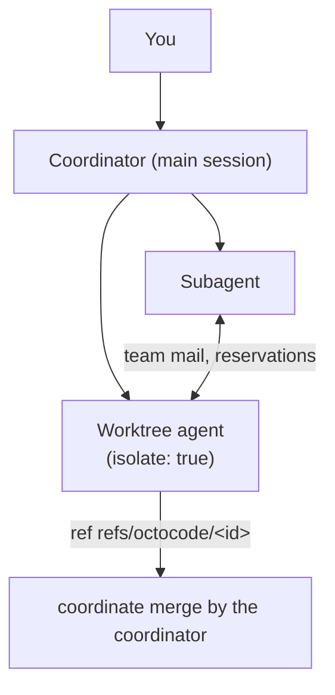

# Glossary

One definition per term, with the page that owns it. Instructions and docs use these words in these senses.

## Agents and teams

| Term                                | Meaning                                                                                                                                                                                                                                                                                                                                                   | Owner page                                                                                                                         |
| ----------------------------------- | --------------------------------------------------------------------------------------------------------------------------------------------------------------------------------------------------------------------------------------------------------------------------------------------------------------------------------------------------------- | ---------------------------------------------------------------------------------------------------------------------------------- |
| **Coordinator**                     | The agent that starts and directs subagents: writes their tasks, answers questions, decides, and owns the conversation with you and integration. A subagent addresses it as `to: "parent"` (the machine value stays `parent`). From a linked worktree, `to: "coordinator"` instead reaches the orchestrator that created the worktree, which lands merges | [Finishing a worktree](native-features.md#finishing-a-worktree), [Team mail](native-features.md#team-mail)                         |
| **Realm**                           | One Octocode process with its children: the main session, its subagents and the sessions they share a team with. Not a place: a checkout or worktree is a _place_ (`/realm places` lists places; `/realm` shows the realm)                                                                                                                                                                 | [Roles and realms](native-features.md#roles-and-realms)                                                                            |
| **Main orchestrator**               | A session in a repository's main checkout, the coordinator of its realm; several can exist per repository. It alone creates worktrees and lands merges                                                                                                                                                                                                    | [Roles and realms](native-features.md#roles-and-realms)                                                                            |
| **Worktree session (proxy)**        | A top-level session in a linked worktree, a proxy of the orchestrator that created it: it keeps its own backlog view and permissions, may start non-isolated subagents, may not create worktrees, and reports done and merge handoffs to its orchestrator                                                                                                 | [Roles and realms](native-features.md#roles-and-realms)                                                                            |
| **Subagent (child)**                | An agent a coordinator starts with the `agent` tool for one bounded goal, in its own process and saved session; it ends with a report outcome                                                                                                                                                                                                             | [Communication and results](native-features.md#communication-and-results), [subagent model](native-features.md#the-subagent-model) |
| **Team, teammate**                  | Every subagent joins its coordinator's team, in any git worktree of the repository. Teammates appear in `coordinate list`, message each other by id or unique role name and reserve files. A subagent reaches only its own tree; its coordinator relays beyond                                                                                            | [Team mail](native-features.md#team-mail), [Worktrees](native-features.md#worktrees)                                               |
| **Worktree agent (isolated child)** | A subagent started with `isolate: true`: own git worktree, changes saved to `refs/octocode/<id>`, landed by the coordinator with `coordinate` `merge`. Its worktree is removed when it finishes, so it cannot be resumed; it is on the same team as any child                                                                                             | [Worktrees](native-features.md#worktrees)                                                                                          |
| **Profile (role)**                  | A named subagent definition (instructions, tools, permissions, model preference) chosen with the task's `profile`; omitted, the child is general-purpose                                                                                                                                                                                                  | [Profile front matter](native-features.md#profile-front-matter), [roles](prompts.md#what-you-can-change)                           |
| **Report outcome**                  | First word of a final report: `done`, `partial`, `blocked` (waits for an answer) or `failed`; any other opening leaves the outcome unknown                                                                                                                                                                                                                | [Communication and results](native-features.md#communication-and-results)                                                          |

## Coordination and work

| Term                     | Meaning                                                                                                                                                                                                                                                                                                                                     | Owner page                                                                                               |
| ------------------------ | ------------------------------------------------------------------------------------------------------------------------------------------------------------------------------------------------------------------------------------------------------------------------------------------------------------------------------------------- | -------------------------------------------------------------------------------------------------------- |
| **Reservation (lock)**   | A claim on files or a tree (`coordinate` `lock`, or a task's `paths`) that blocks other agents' edits and `bash` writes there until released or the run ends; scripts and other editors ignore it                                                                                                                                           | [Team mail](native-features.md#team-mail), [Reservations](permissions.md#reservations-and-the-shell)     |
| **Lease (peer)**         | An advisory path lease kept by an agent of another vendor (Claude, Codex) in the shared agents-communication database; Octocode refuses a write the lease covers; no database or an unknown version means no lease                                                                                                                          | [Team mail](native-features.md#team-mail)                                                                |
| **Backlog item**         | Durable work record with a goal, plan and evidence; states `backlog`, `todo`, `ongoing`, `done` (a closed item is `done` with a closure kind). A subagent updates only the item its task names                                                                                                                                              | [Backlog view](web-workspace.md#backlog-board), [Backlog items](../../../docs/ENTITIES.md#backlog-items) |
| **Step**                 | A tracked unit inside one piece of work (`todo`, `ongoing`, `done`, `dropped`), under the held backlog item or the session                                                                                                                                                                                                                  | [Tool selection](native-features.md#tool-selection-and-migration)                                        |
| **Scratch**              | An agent's own folder `.octocode/agent/temp/agents/<id>/` for its saved session and files it hands back; cleared after a retention period without writes unless you keep it                                                                                                                                                                 | [Communication and results](native-features.md#communication-and-results)                                |
| **Wait, `waitUntil`**    | The `notify` tool wakes its session after a delay, every N seconds, or when an event happens (`item.state`, `path.unlocked`, `agent.ended`, `check.result`, with an optional `check` question); `off` releases it                                                                                                                           | [Tool selection](native-features.md#tool-selection-and-migration)                                        |
| **Timer, wake, monitor** | Three parts of "something wakes a session": `timer` is the `notify` tool with its `/loop` and `/cron` commands and `timer.*` settings (the model or you schedule a wake); a wake is the delivery of one event (a report, a job's exit, mail, a timer) to an idle session; the monitor raises `monitor.alert` when a machine threshold trips | [Native features](native-features.md#tool-selection-and-migration), [Settings](settings.md)              |

## Session and context

| Term           | Meaning                                                                                                 | Owner page                                                                                                                                   |
| -------------- | ------------------------------------------------------------------------------------------------------- | -------------------------------------------------------------------------------------------------------------------------------------------- |
| **Session**    | One saved conversation with its own id and transcript; `/new`, `/resume`, `/fork` start or continue one | [Session commands](native-features.md#session-workflow-commands)                                                                             |
| **Compaction** | Summarizing older turns near the context limit so the session continues from the summary and archive    | [When compaction runs](../../../docs/CONTEXT.md#when-compaction-runs), [Compaction and recovery](native-features.md#compaction-and-recovery) |

## Extensions and permissions

| Term                 | Meaning                                                                                                                                                                                                                                                           | Owner page                                                                        |
| -------------------- | ----------------------------------------------------------------------------------------------------------------------------------------------------------------------------------------------------------------------------------------------------------------- | --------------------------------------------------------------------------------- |
| **Harness**          | Another agent product's configuration (Pi, Claude Code, Codex, Cursor) Octocode can read for skills, hooks, MCP servers and instructions; switched with `/settings` (`harness:<name>`)                                                                            | [Configuration](configuration.md#changing-configuration), [Commands](commands.md) |
| **Skill**            | A folder with `SKILL.md` (name, description, instructions) the model loads when its description matches the task                                                                                                                                                  | [Skills](skills.md)                                                               |
| **MCP server, role** | An MCP server is an external tool provider the agent connects to; MCP itself is always on and servers are switched in MCP configuration or `/settings`. A preset may group tools into named roles (reader, search, read-only) so instructions route by capability | [MCP servers](mcp.md)                                                             |
| **Permission mode**  | How much the agent may do without asking: `manual`, `workspace`, `full` (default) or `bypass`                                                                                                                                                                     | [Modes](permissions.md#modes)                                                     |
