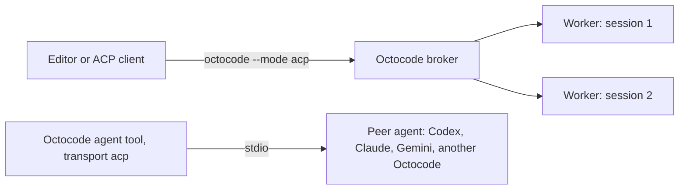

# Agent Client Protocol

Octocode speaks [ACP v1](https://agentclientprotocol.com/protocol/v1/overview) over stdio in both directions. The [local session API](session-api.md) is a different protocol.



| Direction | What                                            | Entry                                                |
| --------- | ----------------------------------------------- | ---------------------------------------------------- |
| Inbound   | An editor or other ACP client controls Octocode | `octocode --mode acp`                                |
| Outbound  | Octocode prompts another agent                  | `agent` tool, `type: "external"`, `transport: "acp"` |

Stdio is the only transport (ACP's HTTP transport is still a draft). Diagnostics go to stderr.

## Connect an editor

Register a custom agent with command `octocode` and arguments `["--mode", "acp"]` (an absolute path if the editor does not inherit your `PATH`). In Zed, add to `settings.json` ([custom agents](https://zed.dev/docs/ai/external-agents)):

```json
{ "agent_servers": { "Octocode": { "type": "custom", "command": "octocode", "args": ["--mode", "acp"], "env": {} } } }
```

Prompt text, `@file`, print mode, `--no-session`, session-selection flags, export and model listing cannot be combined with `--mode acp`; `--provider`, `--model` and similar runtime flags are forwarded to each session. From a source checkout use `yarn start --mode acp`.

Each session runs in its own Octocode subprocess in the `cwd` the client gives (absolute, existing), with your usual settings, models, credentials, resources and project trust. ACP never trusts a folder by itself: an untrusted one fails with `-31000` and the fix in `data.command`.

| Topic       | Behaviour                                                                                                                                                                                                                                                                                                                                                                                                                                                              |
| ----------- | ---------------------------------------------------------------------------------------------------------------------------------------------------------------------------------------------------------------------------------------------------------------------------------------------------------------------------------------------------------------------------------------------------------------------------------------------------------------------- |
| Auth        | `authMethods` is empty and `authenticate` answers `-32601`. Sign in and pick a model with the normal CLI first. A prompt without usable credentials fails with `-32000` naming the fix; the session stays usable.                                                                                                                                                                                                                                                      |
| Permissions | Your [permission policy](permissions.md) decides. `OCTOCODE_PERMISSION` is `manual`, `workspace` or `full` (default `full`, announced on stderr); set it in the client's launch environment, for example `OCTOCODE_PERMISSION=manual octocode --mode acp`. When policy asks, the client gets `session/request_permission` with **allow once** and **reject once**. Cancel, invalid replies, unsupported dialogs and disconnect never grant. Project trust is separate. |

## What is served

| Method                               | Behavior                                                                                                                                                                                  |
| ------------------------------------ | ----------------------------------------------------------------------------------------------------------------------------------------------------------------------------------------- |
| `initialize`                         | v1; capabilities: `loadSession`, session `list`/`resume`/`close`, prompt `image` and `embeddedContext`, MCP `http` (not `sse`)                                                            |
| `session/new`                        | New conversation in an isolated worker; at most eight per connection                                                                                                                      |
| `session/list`                       | Stored conversations, filter by `cwd`, pages of 50                                                                                                                                        |
| `session/load`, `session/resume`     | Restore in the original cwd with the current client MCP servers; `load` replays history first. An idle active session is replaced, a busy one refused.                                    |
| `session/prompt`                     | One active prompt per session; the reply waits for the turn to settle                                                                                                                     |
| `session/update`                     | Message chunks, tool calls (name, kind, title with the call's `reason`), bounded text results, compaction as a tool call, provider retries as thought chunks, `available_commands_update` |
| `session/cancel`, `$/cancel_request` | Cancel the turn and pending permission waits; the prompt answers `cancelled`; an unresponsive worker is stopped after a bounded wait                                                      |
| `session/close`                      | Cancel, stop that worker, free the slot                                                                                                                                                   |
| Disconnect, stdin EOF                | Stops every worker (ten seconds before forced termination)                                                                                                                                |

**Prompt content:** text, resource links (never fetched), embedded text resources, and images (PNG, JPEG, GIF, WebP; 5 MiB each, 20 per prompt, 20 MiB total). Audio and binary resources are rejected.

**Client MCP servers** (`mcpServers` on new/load/resume): stdio with absolute executable paths, or HTTP(S) with literal headers (`${NAME}` and `!command` have no meaning). They exist only for that session, are never saved to `mcp.json`, run without a shell and are refused with `--no-mcp`. See [MCP](mcp.md).

**Other work:** work not started by a prompt (local API, team delivery, startup hooks) also streams to the client. An overlapping ACP prompt is refused without stopping that work: cancel it, then prompt again. `--session-dir` resolves once against the broker's launch folder; for a relative setting call `session/list` with that workspace's `cwd`.

| Error    | Meaning                                                                                        |
| -------- | ---------------------------------------------------------------------------------------------- |
| `-32700` | Malformed JSON                                                                                 |
| `-32600` | Before `initialize`, or a busy or closed session                                               |
| `-32601` | Unknown or unadvertised method                                                                 |
| `-32602` | Bad params (relative `cwd`, bad cursor, `additionalDirectories`)                               |
| `-32002` | Unknown session (`data.sessionId`)                                                             |
| `-31000` | Untrusted folder                                                                               |
| `-32603` | A worker that cannot start, or a prompt the worker rejected (such as terminal-only `/context`) |

A prompt is never replayed: after a failure or worker exit, streamed output may be partial and tools may have run.

**Not implemented:** `authenticate`, session fork and delete, `additionalDirectories`, client filesystem, terminal and elicitation delegation, protocol modes, models and config options, plans, usage updates, rich diffs and tool locations, `allow always`, steering. Tool arguments other than `reason` are not shown; reasoning blocks, binary output and tool images are not sent. Terminal-only dialogs are cancelled. Policy is not an operating-system sandbox.

## Reach a running session

ACP cannot reach a running process: the client launches the agent and owns its stdio. Use the [local session API](session-api.md) (`octocode-api list`, `status`, `send`, `watch`, `abort`); `--to` accepts an instance id, process name, session id or pid, and an ACP session id works. A broker names itself `octocode-acp-<pid>`; its workers are the sessions. The ACP client sees such a message as an `agent_message_chunk` whose `_meta["octocode/external"]` holds the caller's claim and transport.

## Connect from Octocode to another agent

Needs the `externalAgents` setting. Call `agent` with flat fields and real absolute paths:

```json
{
	"type": "external",
	"externalAction": "connect",
	"transport": "acp",
	"connection": "peer",
	"vendor": "octocode",
	"command": "/absolute/path/to/octocode",
	"args": ["--mode", "acp"],
	"cwd": "/absolute/path/to/workspace",
	"reason": "Exchange messages with the requested peer"
}
```

Then `{"type":"external","externalAction":"prompt","connection":"peer","promptText":"Reply with ACK.","timeoutMs":120000,"reason":"Check the peer reply"}`. Reuse `peer` to keep its context; finish with `disconnect`. Up to eight connections at once.

| Topic            | Behaviour                                                                                                                                                                                                                                                                                                                                                                             |
| ---------------- | ------------------------------------------------------------------------------------------------------------------------------------------------------------------------------------------------------------------------------------------------------------------------------------------------------------------------------------------------------------------------------------- |
| `list`           | Shows connections, local instances and `acpAgents`: adapters found on `PATH` (`claude-agent-acp`, `codex-acp`, `gemini --acp`, `opencode acp`) with the `vendor`, `command` and `args` to connect. Starts nothing; a listed agent may be signed out.                                                                                                                                  |
| Running Octocode | `transport: "octocode"` with `instanceId` (instance id or process name) instead of `command` reuses the local API and launches nothing; `cwd` defaults to its folder.                                                                                                                                                                                                                 |
| Models           | Connect reports the peer's `model` and up to 100 `models` (`modelsMore` counts the rest). Pass one as `model` to apply it; an unlisted value fails and names the choices. Peers that only send the unstable `models` field are shown but cannot be switched.                                                                                                                          |
| `refs`           | Entries such as `["msg#41", "report:<agent-id>"]` are resolved locally and appended as a fenced `## Referenced content` block with producer, time and sha256, secrets redacted, before hooks and the permission dialog, so you approve the exact text sent. An unresolved ref fails with `execution: "not-sent"`. See [handoff limits](native-features.md#communication-and-results). |
| Reply            | The model sees `text`, `stopReason`, `messageId` (and `remoteMessageId` for an Octocode peer). Protocol updates are saved to a hashed JSONL file named in `updatesSaved`. Replies are another model's text: untrusted.                                                                                                                                                                |
| Timeout          | Ends only the local wait; the peer may still be running. The connection stays busy and refuses another prompt until the request settles; late output is discarded and late permission requests cancelled. Inspect `partial`, then wait, `cancel` or `disconnect`. Nothing is replayed.                                                                                                |
| Cancel           | Stops active work and, for an ACP peer, the owned process tree; connect again before another prompt.                                                                                                                                                                                                                                                                                  |
| Capture bounds   | Each turn keeps up to 1 MiB of updates and a 64 KiB text tail; stderr keeps 64 KiB. Overflow is archived privately (32 MiB cap) with pattern-based credential redaction; this cannot recognize arbitrary secrets.                                                                                                                                                                     |
| Direction        | The peer cannot send unprompted mail; to reach this session it needs the enabled local API. Octocode advertises no filesystem, terminal or elicitation capability to peers.                                                                                                                                                                                                           |

Tool policy and process ownership: [external-agent lifecycle](native-features.md#external-agent-lifecycle).

### Connect to Codex

Install the separate [Codex ACP adapter](https://github.com/agentclientprotocol/codex-acp); the native `codex app-server` does not speak ACP. Configure Codex authentication and model first, then connect as above with `"vendor": "codex"`, `"command": "/absolute/path/to/codex-acp"`, `"args": []` and a `connection` name such as `codex-peer`. A launcher can set `CODEX_PATH` and `CODEX_HOME` before starting the adapter.

Codex's read-only sandbox refuses the local API socket, so a configured endpoint does not grant a sandboxed peer access: use the peer's scoped authorization or an explicit callback. A parent waiting on its child cannot settle a callback turn, so make the parent idle first.
